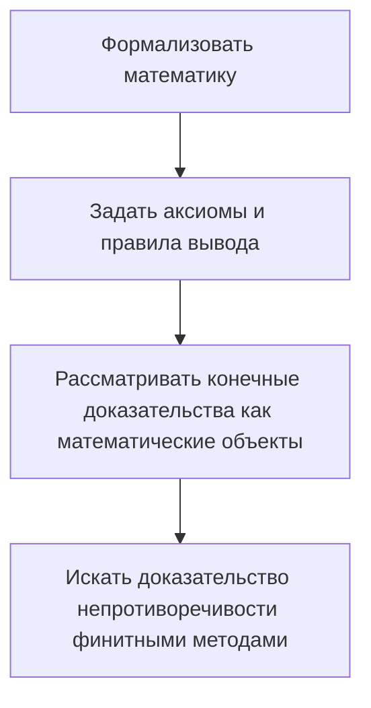
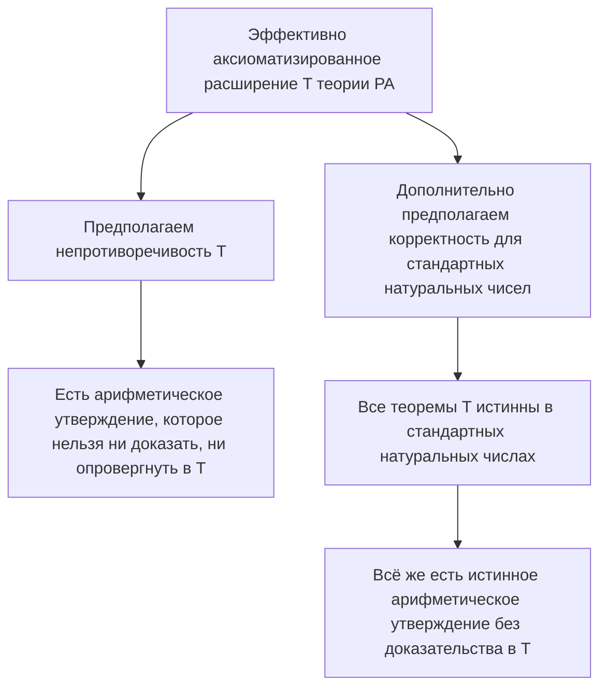
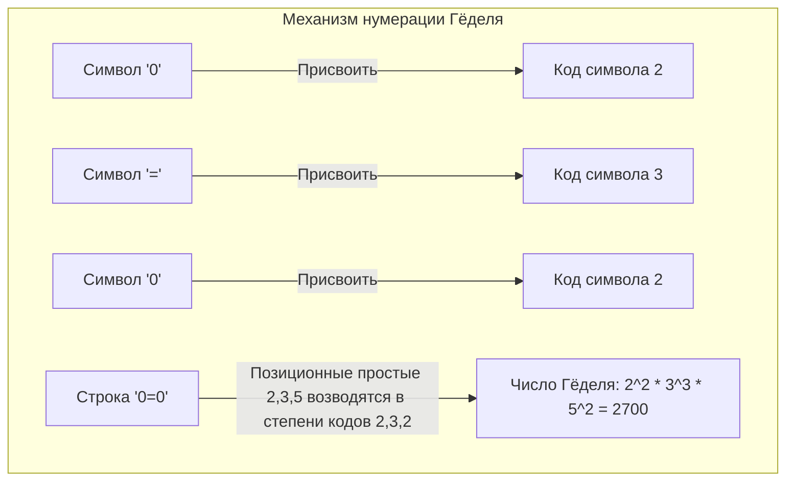
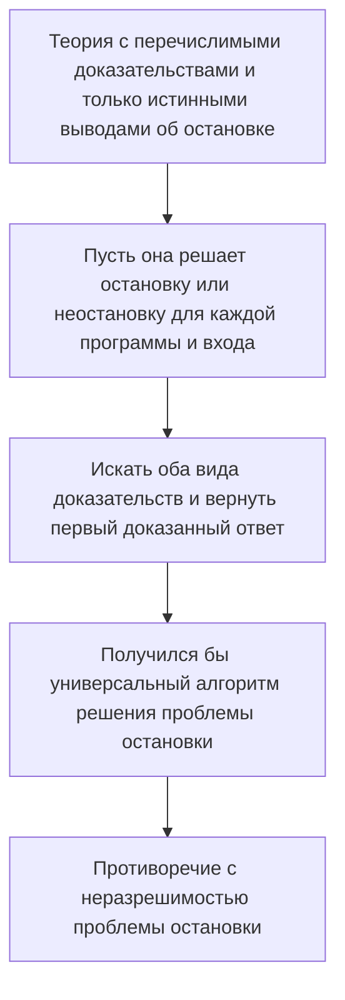

Если выбрать одну систему аксиом и строить доказательства по механическим правилам, можно ли ответить на все вопросы о натуральных числах? Теоремы Гёделя о неполноте показывают, что теории, удовлетворяющие определённым условиям, не могут дать такое полное решение.

Важно уточнять, <strong>в какой именно теории утверждение недоказуемо</strong>. Результат не означает существования истин, которые невозможно доказать при любом выборе аксиом. Мы разграничим непротиворечивость, семантическую корректность и эффективную аксиоматизацию, рассматривая кодирование, самореференцию и область применимости теорем.

---

## 1. Программа Гильберта и три разных вопроса

Чтобы укрепить основания математики, [Давид Гильберт](/ru/p/hilbert/) и другие математики предложили описать её с помощью формальных аксиоматических систем и доказать их непротиворечивость финитными методами. Формализация математики и изучение её доказательств извне — разные задачи. Описание программы как «системы, которая изнутри гарантирует всё о самой себе» неточно.

Следует также различать три свойства.

- <strong>Непротиворечивость</strong>: теория не доказывает одновременно утверждение $A$ и его отрицание $\neg A$.
- <strong>Полнота теории</strong>: для каждого утверждения $A$ её языка теория доказывает $A$ или $\neg A$. Здесь имеется в виду синтаксическая полнота.
- <strong>Разрешимость</strong>: всегда завершающийся алгоритм может определить, является ли данное утверждение теоремой этой теории.

Полнота отличается от семантической корректности, то есть истинности всех теорем в предполагаемой интерпретации. Теорема о полноте логики первого порядка также означает не то же самое, что полнота конкретной арифметической теории.

## 2. Формальные системы и арифметика Пеано

Формальная система задаёт символы, правила построения формул, аксиомы и правила вывода. Синтаксическую проверку того, что конечное доказательство следует правилам, можно отделить от семантического вопроса об истинности формулы в некоторой интерпретации. Отсутствие необходимости учитывать смысл при проверке доказательства не означает, что смысл неважен для математики.

Обычный пример — арифметика Пеано первого порядка (PA). Она рассматривает ноль, операцию следования, сложение и умножение натуральных чисел и включает схему аксиом индукции. В этой статье натуральные числа включают ноль. Даже $1+1=2$ — утверждение, выводимое из этих аксиом и правил.

Для ясности мы будем главным образом рассматривать эффективно аксиоматизированные теории, содержащие PA, как достаточный набор условий. Это не самые слабые возможные предпосылки: существуют формы первой теоремы, применимые к более слабой арифметике.

## 3. Первая теорема о неполноте: утверждения, которые теория не решает

Мы сформулируем результат [Курта Гёделя](/ru/p/godel/) в следующей форме, учитывающей усиление Россера.

> Любая непротиворечивая, эффективно аксиоматизированная теория, содержащая PA, имеет арифметическое утверждение, которое она не может ни доказать, ни опровергнуть.

«Эффективно аксиоматизированная» означает, что аксиомы и доказательства можно перечислять механической процедурой. Недоказуемость относительна к выбранной теории. Она не означает, что утверждение должно оставаться недоказуемым в другой теории с дополнительными аксиомами. Необходимо различать истину в стандартных натуральных числах и доказуемость в фиксированной теории.

Чтобы изобразить множество доказуемых утверждений как подмножество истинных в стандартных натуральных числах, требуется более сильная предпосылка — <strong>семантическая корректность</strong>. Непротиворечивость лишь исключает доказательство утверждения вместе с его отрицанием; сама по себе она не делает все теоремы истинными в стандартных натуральных числах.

### Построить арифметическую самореференцию, а не противоречие

Сходство с фразой лжеца «Это предложение ложно» может помочь интуиции. Но конструкция Гёделя не вносит противоречия в математику. Она кодирует утверждения и доказательства числами и выражает арифметически <strong>доказуемость в определённой теории</strong>.

Пусть теория обозначена через $T$, а $\operatorname{Prov}_T(y)$ — обычный предикат доказуемости, выражающий наличие в $T$ доказательства утверждения с кодом $y$. Обозначение $\ulcorner G_T\urcorner$ означает нумерал для кода утверждения $G_T$. Лемма о неподвижной точке позволяет построить утверждение, для которого теория доказывает эквивалентность:

$$
T\vdash G_T\leftrightarrow\neg\operatorname{Prov}_T(\ulcorner G_T\urcorner)
$$

Здесь $T\vdash A$ означает, что $T$ доказывает $A$. Конструкция использует кодирование и подстановку, а не просто принимает фразу естественного языка в качестве аксиомы.

Если бы в $T$ существовало доказательство $G_T$, существование этого конечного доказательства можно было бы выразить и в арифметике, поэтому $T$ доказывала бы $\operatorname{Prov}_T(\ulcorner G_T\urcorner)$. Однако приведённая эквивалентность вместе с $G_T$ дала бы и отрицание этого утверждения. Следовательно, если $T$ непротиворечива, она не может доказать $G_T$.

В стандартных натуральных числах обычный предикат доказуемости правильно описывает реально существующие конечные доказательства. Используя этот факт, из отсутствия доказательства заключаем, что $G_T$ истинно в стандартных натуральных числах. В этом внешнем рассуждении предполагается непротиворечивость $T$. Оно не означает, что люди могут автоматически распознать непротиворечивость любой теории.

Из одного этого рассуждения нельзя вывести, что простая непротиворечивость исключает также доказательство отрицания того же $G_T$. Например, семантическая корректность исключает доказательство отрицания истинного утверждения $G_T$. Исходное доказательство независимости у Гёделя использовало $\omega$-непротиворечивость; Россер построил другое утверждение, получив недоказуемость и неопровержимость из одной лишь обычной непротиворечивости.

## 4. Нумерация Гёделя: кодирование строк и доказательств числами

Нумерация Гёделя сопоставляет символам, формулам и конечным последовательностям формул, составляющим доказательства, натуральные числа-коды. В учебном примере каждому вхождению одного символа мы присвоим одно и то же положительное целое число, а разным позициям строки — разные простые числа. Это не буквальное воспроизведение нумерации из исходной статьи.

Присвоим символу «0» код 2, а символу «=» — код 3. Тогда строка «0=0» получает последовательность кодов 2, 3, 2. Возведение позиционных простых чисел 2, 3, 5 в эти степени и перемножение результатов даёт 2700. Единственность разложения целых чисел, не меньших двух, на простые множители позволяет восстановить исходную последовательность в этом примере.

Важно не получение огромных чисел само по себе, а возможность рассматривать синтаксис, подстановку и проверку конечных доказательств как отношения между числами. Например, нужно отличать отношение «число $p$ кодирует доказательство утверждения с кодом $q$» от доказуемости — утверждения, что такое $p$ существует.

Проверка одного конечного кандидата в доказательства отличается от решения вопроса, что доказательств вообще нет. Само кодирование не делает все вопросы доказуемости разрешимыми.

## 5. Вторая теорема о неполноте: доказательство непротиворечивости внутри теории

Вторую теорему о неполноте мы также объясняем при следующих достаточных предпосылках.

> Непротиворечивое, эффективно аксиоматизированное расширение PA не может доказать внутри себя собственную непротиворечивость, выраженную обычным предикатом доказуемости.

Например, выберем $0=1$ в качестве противоречия и выразим непротиворечивость так:

$$
\operatorname{Con}(T)
\equiv\neg\operatorname{Prov}_T(\ulcorner 0=1\urcorner)
$$

Это арифметическое утверждение об отсутствии в $T$ доказательства противоречия. Если назвать произвольную формулу «непротиворечивостью», тот же результат автоматически не получится: существенны формализация предиката доказуемости и его условия выводимости.

Аналогия с человеком, заявляющим «Я никогда не лгу», может побудить задуматься об основаниях доказательства. Она не является доказательством второй теоремы. Тот факт, что противоречивая теория доказывает всё, сам по себе тоже не устанавливает недоказуемость в непротиворечивой теории.

Непротиворечивость здесь отличается от семантической корректности, то есть истинности каждой теоремы в предполагаемой интерпретации. Результат не исключает доказательства непротиворечивости исходной теории в более сильной. Он также не применяется без условий к людям, организациям или всем программным системам.

## 6. Заблуждения и область применимости

### Математика не рухнула

Неполнота не является отрицанием непротиворечивости. Она означает, что фиксированная теория оставляет некоторые утверждения нерешёнными. Добавляя аксиомы, нужно рассматривать причины их выбора и такие вопросы, как непротиворечивость расширения. Добавление аксиом не устраняет все трудности автоматически.

### Теорема не доказывает превосходство людей над машинами

Даже внешнее рассуждение об истинности гёделева утверждения предполагает условия вроде непротиворечивости теории. Теорема не говорит, что люди могут проверить эти предпосылки для любой теории. Философские аргументы о человеческом разуме или ИИ следует отличать от представленных здесь математических выводов.

### Не всякая теория неполна

Важны язык, аксиомы, эффективность и сила, необходимая для выражения арифметики. Например, теория первого порядка вещественно замкнутых полей, описывающая вещественные числа с помощью нуля, единицы, сложения, умножения и порядка, полна и разрешима. Элиминация кванторов даёт способ решать её утверждения.

Это не означает, что вся математика о вещественных числах, произвольных функциях или множествах решается автоматически. Это также не даёт того же результата для арифметики натуральных чисел. Утверждая, что «евклидова геометрия полна», тоже необходимо уточнять формализацию и язык.

## 7. Связь с проблемой остановки

[Проблема остановки](/ru/p/halting-problem/) утверждает, что нет универсального алгоритма, который всегда завершается и правильно отвечает, остановится ли произвольная программа на заданном входе. Модель Тьюринга математическая; это не простая замена формальной системы физической машиной.

Один способ увидеть связь — рассмотреть теорию с механически перечислимыми доказательствами, которая доказывает только истинные утверждения об остановке и неостановке. Если бы она доказывала остановку или неостановку для каждой программы и входа, мы могли бы перечислять доказательства и возвращать ответ, для которого найдено доказательство. Тем самым проблема остановки стала бы разрешимой.

Это объяснение использует сильную предпосылку семантической корректности в вопросах остановки. Оно не формулирует самые слабые условия и не является полным доказательством отдельных теорем Гёделя. Вычислимость также следует отличать от сложности, изучающей затраты времени и памяти на вычисление.

## 8. Заключение: указывайте теорию и предпосылки

Теоремы о неполноте описывают границы доказательств в фиксированной теории при определённых условиях. Непротиворечивая, эффективно аксиоматизированная арифметическая теория достаточной силы имеет утверждения, которые она не может ни доказать, ни опровергнуть. При достаточных предпосылках она также не может доказать собственную непротиворечивость в обычной формализации.

Утверждение, не решённое одной теорией, может стать доказуемым после добавления новых аксиом. Но если расширение по-прежнему удовлетворяет тем же условиям, оно тоже неполно. Рассматривать множество всех арифметических истин — не то же самое, что задать его механически перечислимую аксиоматизацию.

Крах математики, превосходство людей над машинами и общие ограничения для любого ИИ не следуют из одних этих теорем. Нужно спрашивать, какая теория выбрана, какие предпосылки приняты и различаются ли истина и доказуемость.

### Источники

- [Open Logic Project: Incompleteness and Computability](https://ic.openlogicproject.org/ic-screen.pdf) — учебник по кодированию, неподвижным точкам, результатам Гёделя и Россера и условиям для предикатов доказуемости.
- [UCLA: Incompleteness and Undecidability](https://www.math.ucla.edu/~dam/220b.1.11w/220notes4.pdf) — арифметизация символов и доказательств, различие между первой теоремой с предпосылкой семантической корректности и формой Россера.
- [Richard Zach: The Practice of Finitism](https://arxiv.org/abs/math/0102189) — исследование аксиоматизации и финитных доказательств непротиворечивости в программе Гильберта.
- [Jindřich Zapletal: Elements of Set Theory](https://people.clas.ufl.edu/zapletal/files/notesset.pdf) — язык первого порядка вещественно замкнутых полей и элиминация кванторов; см. теорему 6.3.12 в разделе 6.3.
