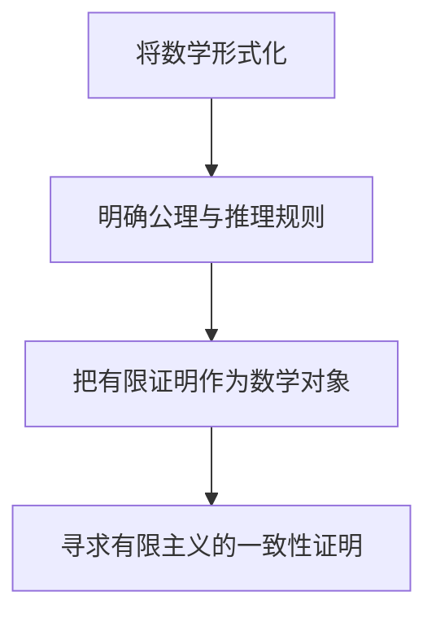
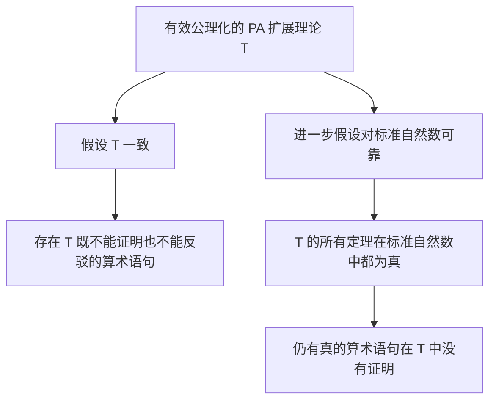
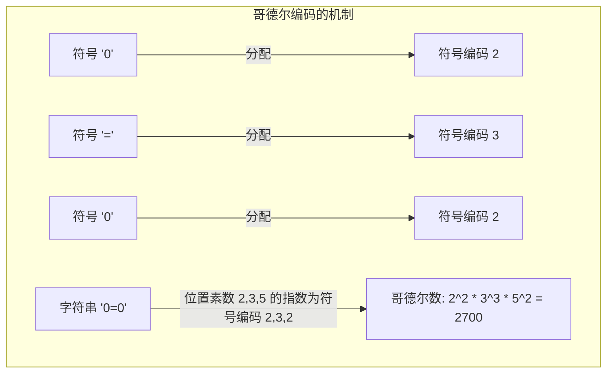
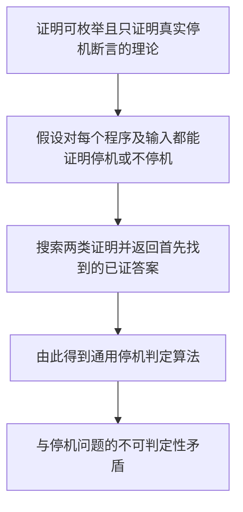

选定一套公理，再按照机械的规则逐步证明，能否回答关于自然数的所有问题？哥德尔不完备定理表明，满足一定条件的理论无法提供这样的完整解答。

关键在于明确<strong>一个语句在哪个理论中无法被证明</strong>。这不意味着存在无论采用什么公理都绝对无法证明的真理。下面将区分一致性、可靠性与有效公理化，介绍编码、自我指涉和定理的适用范围。

---

## 1. 希尔伯特计划与三个不同的问题

为了确立数学的基础，[大卫·希尔伯特](/zh-cn/p/hilbert/)等人提出将数学描述为形式公理系统，并用有限主义方法证明其一致性的计划。将数学形式化，与从外部研究其中的证明，是两项不同的工作。仅仅把这一计划说成“让系统在内部为自身的一切提供保证”并不准确。

以下三个性质也需要区分。

- <strong>一致性</strong>：理论不会同时证明同一个语句 $A$ 及其否定 $\neg A$。
- <strong>理论的完备性</strong>：对于其语言中的每个语句 $A$，理论能够证明 $A$ 或 $\neg A$。这里指语法上的完备性。
- <strong>可判定性</strong>：存在一个总会终止的算法，能够判断给定语句是否为该理论的定理。

完备性不同于可靠性，后者要求所有定理在预期解释中都为真。一阶逻辑的“完备性定理”与某个算术理论的完备性，也不是同一个概念。

## 2. 形式系统与皮亚诺算术

形式系统规定使用的符号、公式的构造规则、公理和推理规则。检查有限证明是否遵循规则，是语法层面的工作；判断公式在某种解释中是否为真，是语义层面的工作。二者可以区分。“检查证明不需要考虑意义”，并不等于数学不需要考虑意义。

一个典型例子是一阶皮亚诺算术（PA）。它涉及自然数的零、后继、加法和乘法，并包含归纳公理模式。例如，$1+1=2$ 也是由这些公理和规则推导出的语句。

为便于说明，下面主要考虑包含 PA 且有效公理化的理论，作为一组充分条件。这不是不完备性的最弱条件：第一定理也有以比 PA 更弱的算术为基础的形式。

## 3. 第一不完备定理：理论内无法解决的语句

这里采用包含罗瑟改进的形式来表述[库尔特·哥德尔](/zh-cn/p/godel/)的不完备性结果。

> 任何包含 PA、有效公理化且一致的理论，都存在一个算术语句，使该理论既不能证明它，也不能反驳它。

“有效公理化”是指公理和证明能够通过机械过程枚举出来。不可证明性是相对于选定理论而言的，并不意味着加入其他公理后的理论仍然绝对无法证明该语句。必须区分标准自然数中的真理与固定理论内的可证明性。

如果要把可证明语句的集合画成标准自然数中为真语句集合的子集，就需要比一致性更强的<strong>可靠性</strong>假设。一致性只排除同时证明一个语句及其否定；单靠一致性，并不能保证每个定理在标准自然数中都为真。

### 用算术构造自我指涉，而不是制造矛盾

“这句话是假的”这一说谎者语句可以帮助形成直觉，但哥德尔的构造并不是在数学中引入矛盾。他把语句和证明编码为数，用算术表达<strong>特定理论中的可证明性</strong>。

设理论为 $T$，用通常的可证明性谓词 $\operatorname{Prov}_T(y)$ 表示编码为 $y$ 的语句在 $T$ 中有证明。$\ulcorner G_T\urcorner$ 表示语句 $G_T$ 的编码所对应的数码。不动点引理使我们能够构造一个语句，并在理论中证明以下等价关系：

$$
T\vdash G_T\leftrightarrow\neg\operatorname{Prov}_T(\ulcorner G_T\urcorner)
$$

这里 $T\vdash A$ 表示 $T$ 证明 $A$。这一构造使用编码与代入，并非直接把一句自然语言当成公理。

如果 $T$ 能证明 $G_T$，那么这份有限证明的存在也能够用算术表达，因此 $T$ 会证明 $\operatorname{Prov}_T(\ulcorner G_T\urcorner)$。但上述等价关系与 $G_T$ 又会推出其否定。因此，如果 $T$ 一致，它就不能证明 $G_T$。

在标准自然数中，通常的可证明性谓词正确地描述实际存在的有限证明。利用这一事实，由不存在证明可知 $G_T$ 在标准自然数中为真。这一外部论证包含了 $T$ 一致的假设，并不意味着人类能够自动确认任意理论的一致性。

仅凭上述论证，不能从普通的一致性推出同一个理论也无法证明 $G_T$ 的否定。例如，可靠性可以排除对真语句 $G_T$ 的否定的证明。哥德尔最初的独立性证明使用了 $\omega$-一致性；罗瑟构造了另一个语句，仅凭普通一致性便得到了既不可证明、也不可反驳的结论。

## 4. 哥德尔编码：把字符串与证明编码为数

哥德尔编码为符号、公式和有限证明序列分配自然数编码。作为教学示例，我们为同一个符号的每次出现分配相同的正整数，并为字符串中不同的位置分配不同的素数。这并不是对原论文编码方案的逐字复现。

给符号“0”分配编码 2，给“=”分配编码 3，字符串“0=0”的编码序列就是 2、3、2。将位置对应的素数 2、3、5 分别取这些指数次幂再相乘，得到 2700。大于等于 2 的整数具有唯一素因数分解，因此在这个例子中能够恢复原来的编码序列。

重要的不是制造巨大的数，而是把语法、代入和有限证明的检查作为数之间的关系来处理。例如，“数 $p$ 编码了一份对编码为 $q$ 的语句的证明”是一个关系；可证明性则断言存在这样的 $p$，两者需要区分。

检查一个有限的候选证明，与判定根本不存在证明，是不同的任务。仅靠编码，并不能使所有可证明性问题都变得可判定。

## 5. 第二不完备定理：在理论内部证明一致性

这里同样在以下充分条件下介绍第二不完备定理。

> 一个一致且有效公理化的 PA 扩展理论，不能在自身内部证明用通常的可证明性谓词表达的自身一致性。

例如，选取 $0=1$ 作为矛盾，将一致性表达为：

$$
\operatorname{Con}(T)
\equiv\neg\operatorname{Prov}_T(\ulcorner 0=1\urcorner)
$$

这是一个断言 $T$ 中不存在矛盾的证明的算术语句。把任意公式命名为“一致性”，并不会自动得到同样的结论；可证明性谓词的形式化方式与其可导性条件都很重要。

有人宣称“我绝不说谎”的比喻，可以启发我们追问证明的依据，但它并不是第二定理的证明。不一致的理论能够证明一切，这一事实本身也不足以证明某个语句在一致的理论中不可证明。

这里的一致性不同于可靠性，后者要求每个定理在预期解释中为真。该结果不排除在更强的理论中证明原理论的一致性，也不能无条件地套用到人、组织或所有软件系统上。

## 6. 常见误解与适用范围

### 数学并没有崩溃

不完备性并不是对一致性的否定。它说明某个固定理论无法解决某些语句。加入公理时，需要考虑选择这些公理的理由，以及扩展理论的一致性等问题。增加公理不会使一切困难自动消失。

### 定理没有证明人类超越机器

即使从理论外部论证哥德尔语句为真，也依赖该理论一致等条件。定理并未说明人类能对任意理论确认这些前提。关于人类理性或 AI 的哲学讨论，应当与这里的数学结论区分开来。

### 并非所有理论都不完备

语言、公理、有效性以及表达算术的能力都很重要。例如，使用零、一、加法、乘法和序关系描述实数的实闭域一阶理论是完备且可判定的，量词消去提供了判定其语句的一种途径。

这并不意味着所有涉及实数、任意函数或集合的数学问题都能自动解决，也不意味着自然数算术有同样的结论。“欧几里得几何是完备的”这样的说法，同样需要明确所用的形式化方式和语言。

## 7. 与停机问题的联系

[停机问题](/zh-cn/p/halting-problem/)说明，不存在一个总会终止的通用算法，能对任意程序及给定输入，正确判断该程序是否停机。图灵模型是数学模型；这并不是简单地将形式系统替换成物理机器的论证。

可以通过如下方式理解二者的联系：考虑一个证明能够机械枚举、且只证明关于停机与不停机的真实断言的理论。如果它能对每个程序和输入证明停机或不停机，我们便可枚举证明，一旦找到其中一种结论的证明就返回对应答案，从而判定停机问题。

这段解释使用了关于停机问题的可靠性这一较强假设，并不是在陈述最弱条件，也不是哥德尔各个定理的完整证明。可计算性还应与研究计算所需时间和内存的复杂性区分开来。

## 8. 结论：明确理论与假设

不完备定理描述满足一定条件的固定理论中的证明局限。一个具有所需表达能力、一致且有效公理化的算术理论，必然有既不能证明、也不能反驳的语句。在充分条件下，它也无法证明通常形式化方式下的自身一致性。

某个理论中无法解决的语句，加入新公理后可能变得可证明。然而，如果扩展后的理论仍然满足同样的条件，它也仍然不完备。考虑所有算术真理的集合，与为该集合提供可机械枚举的公理化，也是两件不同的事。

仅凭这些定理，不能推出数学的崩溃、人类优于机器或一切 AI 都受到某种笼统限制。应当追问的是：选择了哪个理论、采用了哪些假设，以及是否区分了真理与可证明性。

### 参考资料

- [Open Logic Project: Incompleteness and Computability](https://ic.openlogicproject.org/ic-screen.pdf) — 介绍编码、不动点、哥德尔与罗瑟的结果，以及可证明性谓词的条件。
- [UCLA: Incompleteness and Undecidability](https://www.math.ucla.edu/~dam/220b.1.11w/220notes4.pdf) — 符号与证明的算术化，区分以可靠性为前提的第一定理与罗瑟形式。
- [Richard Zach: The Practice of Finitism](https://arxiv.org/abs/math/0102189) — 研究希尔伯特计划中的公理化与有限主义一致性证明。
- [Jindřich Zapletal: Elements of Set Theory](https://people.clas.ufl.edu/zapletal/files/notesset.pdf) — 实闭域的一阶语言与量词消去，参见第 6.3 节定理 6.3.12。
