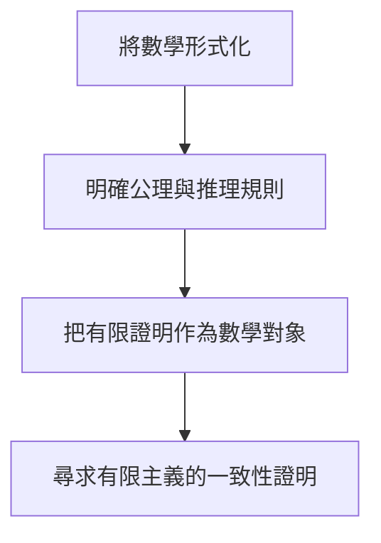
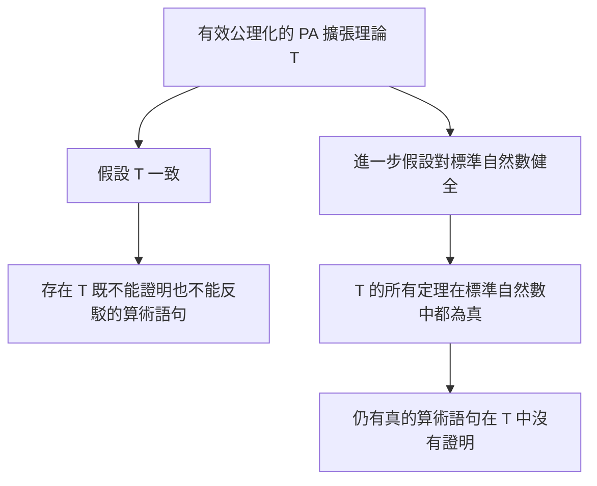
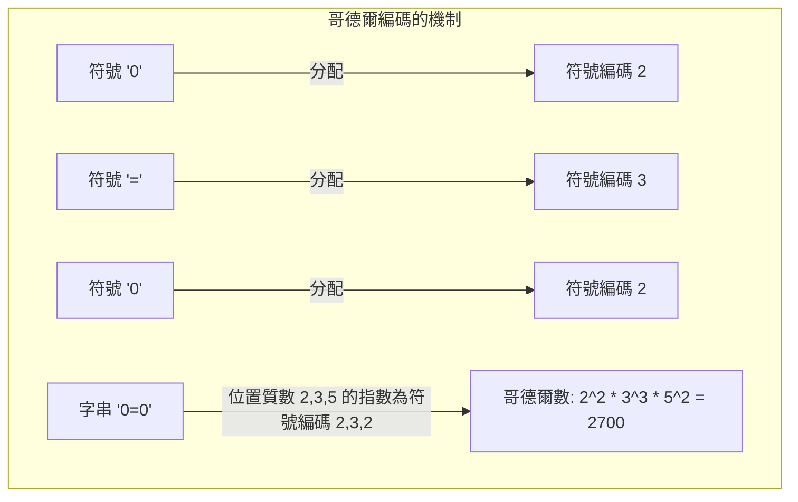
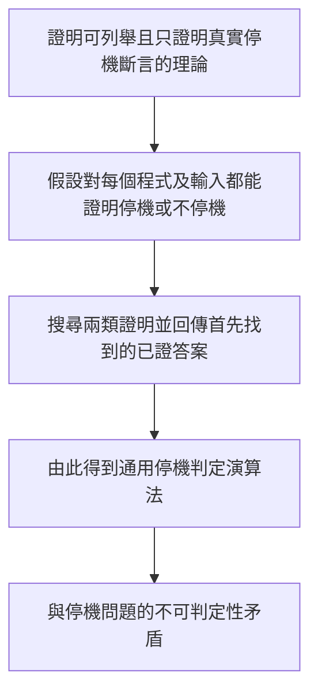

選定一套公理，再按照機械的規則逐步證明，能否回答關於自然數的所有問題？哥德爾不完備定理表明，滿足一定條件的理論無法提供這樣的完整解答。

關鍵在於明確<strong>一個語句在哪個理論中無法被證明</strong>。這不意味著存在無論採用什麼公理都絕對無法證明的真理。下面將區分一致性、健全性與有效公理化，介紹編碼、自我指涉和定理的適用範圍。

---

## 1. 希爾伯特計畫與三個不同的問題

為了確立數學的基礎，[大衛·希爾伯特](/zh-tw/p/hilbert/)等人提出將數學描述為形式公理系統，並用有限主義方法證明其一致性的計畫。將數學形式化，與從外部研究其中的證明，是兩項不同的工作。僅僅把這一計畫說成「讓系統在內部為自身的一切提供保證」並不準確。

以下三個性質也需要區分。

- <strong>一致性</strong>：理論不會同時證明同一個語句 $A$ 及其否定 $\neg A$。
- <strong>理論的完備性</strong>：對於其語言中的每個語句 $A$，理論能夠證明 $A$ 或 $\neg A$。這裡指語法上的完備性。
- <strong>可判定性</strong>：存在一個總會終止的演算法，能夠判斷給定語句是否為該理論的定理。

完備性不同於健全性，後者要求所有定理在預期解釋中都為真。一階邏輯的「完備性定理」與某個算術理論的完備性，也不是同一個概念。

## 2. 形式系統與皮亞諾算術

形式系統規定使用的符號、公式的構造規則、公理和推理規則。檢查有限證明是否遵循規則，是語法層面的工作；判斷公式在某種解釋中是否為真，是語義層面的工作。二者可以區分。「檢查證明不需要考慮意義」，並不等於數學不需要考慮意義。

一個典型例子是一階皮亞諾算術（PA）。它涉及自然數的零、後繼、加法和乘法，並包含歸納公理模式。例如，$1+1=2$ 也是由這些公理和規則推導出的語句。

為便於說明，下面主要考慮包含 PA 且有效公理化的理論，作為一組充分條件。這不是不完備性的最弱條件：第一定理也有以比 PA 更弱的算術為基礎的形式。

## 3. 第一不完備定理：理論內無法解決的語句

這裡採用包含羅瑟改進的形式來表述[庫爾特·哥德爾](/zh-tw/p/godel/)的不完備性結果。

> 任何包含 PA、有效公理化且一致的理論，都存在一個算術語句，使該理論既不能證明它，也不能反駁它。

「有效公理化」是指公理和證明能夠透過機械過程列舉出來。不可證明性是相對於選定理論而言的，並不意味著加入其他公理後的理論仍然絕對無法證明該語句。必須區分標準自然數中的真理與固定理論內的可證明性。

如果要把可證明語句的集合畫成標準自然數中為真語句集合的子集，就需要比一致性更強的<strong>健全性</strong>假設。一致性只排除同時證明一個語句及其否定；單靠一致性，並不能保證每個定理在標準自然數中都為真。

### 用算術構造自我指涉，而不是製造矛盾

「這句話是假的」這一說謊者語句可以幫助形成直覺，但哥德爾的構造並不是在數學中引入矛盾。他把語句和證明編碼為數，用算術表達<strong>特定理論中的可證明性</strong>。

設理論為 $T$，用通常的可證明性謂詞 $\operatorname{Prov}_T(y)$ 表示編碼為 $y$ 的語句在 $T$ 中有證明。$\ulcorner G_T\urcorner$ 表示語句 $G_T$ 的編碼所對應的數詞。固定點引理使我們能夠構造一個語句，並在理論中證明以下等價關係：

$$
T\vdash G_T\leftrightarrow\neg\operatorname{Prov}_T(\ulcorner G_T\urcorner)
$$

這裡 $T\vdash A$ 表示 $T$ 證明 $A$。這一構造使用編碼與代入，並非直接把一句自然語言當成公理。

如果 $T$ 能證明 $G_T$，那麼這份有限證明的存在也能夠用算術表達，因此 $T$ 會證明 $\operatorname{Prov}_T(\ulcorner G_T\urcorner)$。但上述等價關係與 $G_T$ 又會推出其否定。因此，如果 $T$ 一致，它就不能證明 $G_T$。

在標準自然數中，通常的可證明性謂詞正確地描述實際存在的有限證明。利用這一事實，由不存在證明可知 $G_T$ 在標準自然數中為真。這一外部論證包含了 $T$ 一致的假設，並不意味著人類能夠自動確認任意理論的一致性。

僅憑上述論證，不能從普通的一致性推出同一個理論也無法證明 $G_T$ 的否定。例如，健全性可以排除對真語句 $G_T$ 的否定的證明。哥德爾最初的獨立性證明使用了 $\omega$-一致性；羅瑟構造了另一個語句，僅憑普通一致性便得到了既不可證明、也不可反駁的結論。

## 4. 哥德爾編碼：把字串與證明編碼為數

哥德爾編碼為符號、公式和有限證明序列分配自然數編碼。作為教學示例，我們為同一個符號的每次出現分配相同的正整數，並為字串中不同的位置分配不同的質數。這並不是對原論文編碼方案的原樣重現。

給符號「0」分配編碼 2，給「=」分配編碼 3，字串「0=0」的編碼序列就是 2、3、2。將位置對應的質數 2、3、5 分別取這些指數次冪再相乘，得到 2700。大於等於 2 的整數具有唯一質因數分解，因此在這個例子中能夠恢復原來的編碼序列。

重要的不是製造巨大的數，而是把語法、代入和有限證明的檢查作為數之間的關係來處理。例如，「數 $p$ 編碼了一份對編碼為 $q$ 的語句的證明」是一個關係；可證明性則斷言存在這樣的 $p$，兩者需要區分。

檢查一個有限的候選證明，與判定根本不存在證明，是不同的任務。僅靠編碼，並不能使所有可證明性問題都變得可判定。

## 5. 第二不完備定理：在理論內部證明一致性

這裡同樣在以下充分條件下介紹第二不完備定理。

> 一個一致且有效公理化的 PA 擴張理論，不能在自身內部證明用通常的可證明性謂詞表達的自身一致性。

例如，選取 $0=1$ 作為矛盾，將一致性表達為：

$$
\operatorname{Con}(T)
\equiv\neg\operatorname{Prov}_T(\ulcorner 0=1\urcorner)
$$

這是一個斷言 $T$ 中不存在矛盾的證明的算術語句。把任意公式命名為「一致性」，並不會自動得到同樣的結論；可證明性謂詞的形式化方式與其可導性條件都很重要。

有人宣稱「我絕不說謊」的比喻，可以啟發我們追問證明的依據，但它並不是第二定理的證明。不一致的理論能夠證明一切，這一事實本身也不足以證明某個語句在一致的理論中不可證明。

這裡的一致性不同於健全性，後者要求每個定理在預期解釋中為真。該結果不排除在更強的理論中證明原理論的一致性，也不能無條件地套用到人、組織或所有軟體系統上。

## 6. 常見誤解與適用範圍

### 數學並沒有崩潰

不完備性並不是對一致性的否定。它說明某個固定理論無法解決某些語句。加入公理時，需要考慮選擇這些公理的理由，以及擴張理論的一致性等問題。增加公理不會使一切困難自動消失。

### 定理沒有證明人類超越機器

即使從理論外部論證哥德爾語句為真，也依賴該理論一致等條件。定理並未說明人類能對任意理論確認這些前提。關於人類理性或 AI 的哲學討論，應當與這裡的數學結論區分開來。

### 並非所有理論都不完備

語言、公理、有效性以及表達算術的能力都很重要。例如，使用零、一、加法、乘法和序關係描述實數的實閉體一階理論是完備且可判定的，量詞消去提供了判定其語句的一種途徑。

這並不意味著所有涉及實數、任意函數或集合的數學問題都能自動解決，也不意味著自然數算術有同樣的結論。「歐幾里得幾何是完備的」這樣的說法，同樣需要明確所用的形式化方式和語言。

## 7. 與停機問題的關聯

[停機問題](/zh-tw/p/halting-problem/)說明，不存在一個總會終止的通用演算法，能對任意程式及給定輸入，正確判斷該程式是否停機。圖靈模型是數學模型；這並不是簡單地將形式系統替換成物理機器的論證。

可以透過如下方式理解二者的關聯：考慮一個證明能夠機械列舉、且只證明關於停機與不停機的真實斷言的理論。如果它能對每個程式和輸入證明停機或不停機，我們便可列舉證明，一旦找到其中一種結論的證明就回傳對應答案，從而判定停機問題。

這段解釋使用了關於停機問題的健全性這一較強假設，並不是在陳述最弱條件，也不是哥德爾各個定理的完整證明。可計算性還應與研究計算所需時間和記憶體的複雜性區分開來。

## 8. 結論：明確理論與假設

不完備定理描述滿足一定條件的固定理論中的證明侷限。一個具有所需表達能力、一致且有效公理化的算術理論，必然有既不能證明、也不能反駁的語句。在充分條件下，它也無法證明通常形式化方式下的自身一致性。

某個理論中無法解決的語句，加入新公理後可能變得可證明。然而，如果擴張後的理論仍然滿足同樣的條件，它也仍然不完備。考慮所有算術真理的集合，與為該集合提供可機械列舉的公理化，也是兩件不同的事。

僅憑這些定理，不能推出數學的崩潰、人類優於機器或一切 AI 都受到某種籠統限制。應當追問的是：選擇了哪個理論、採用了哪些假設，以及是否區分了真理與可證明性。

### 參考資料

- [Open Logic Project: Incompleteness and Computability](https://ic.openlogicproject.org/ic-screen.pdf) — 介紹編碼、固定點、哥德爾與羅瑟的結果，以及可證明性謂詞的條件。
- [UCLA: Incompleteness and Undecidability](https://www.math.ucla.edu/~dam/220b.1.11w/220notes4.pdf) — 符號與證明的算術化，區分以健全性為前提的第一定理與羅瑟形式。
- [Richard Zach: The Practice of Finitism](https://arxiv.org/abs/math/0102189) — 研究希爾伯特計畫中的公理化與有限主義一致性證明。
- [Jindřich Zapletal: Elements of Set Theory](https://people.clas.ufl.edu/zapletal/files/notesset.pdf) — 實閉體的一階語言與量詞消去，參見第 6.3 節定理 6.3.12。
