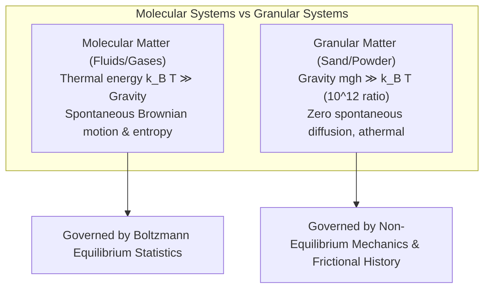
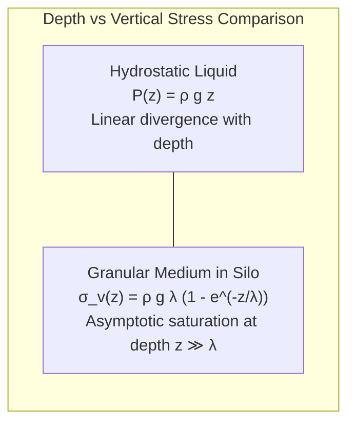
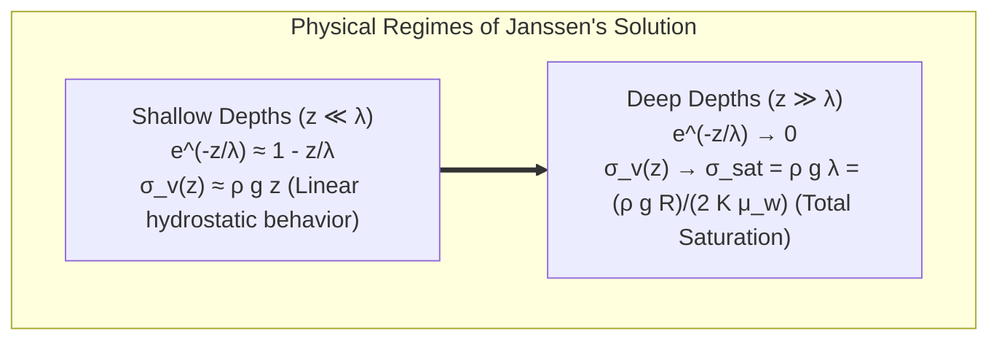
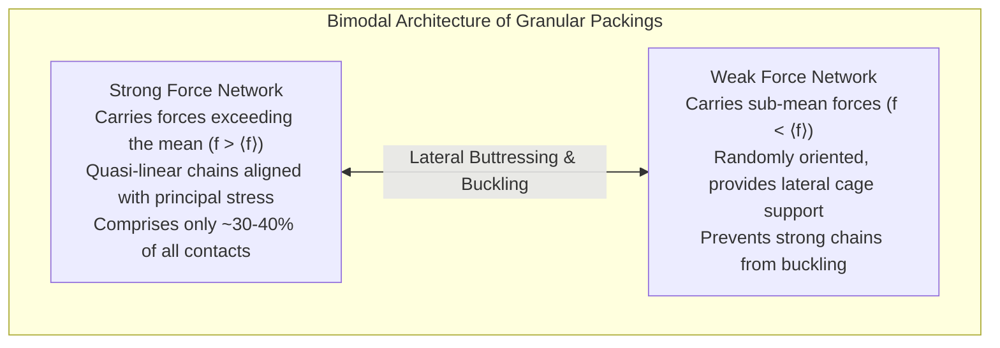
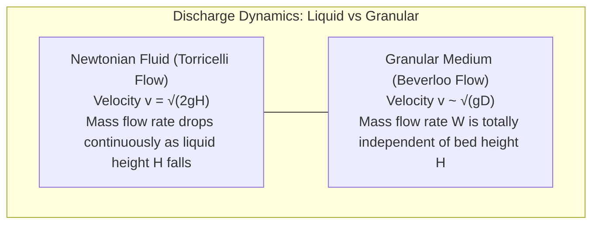
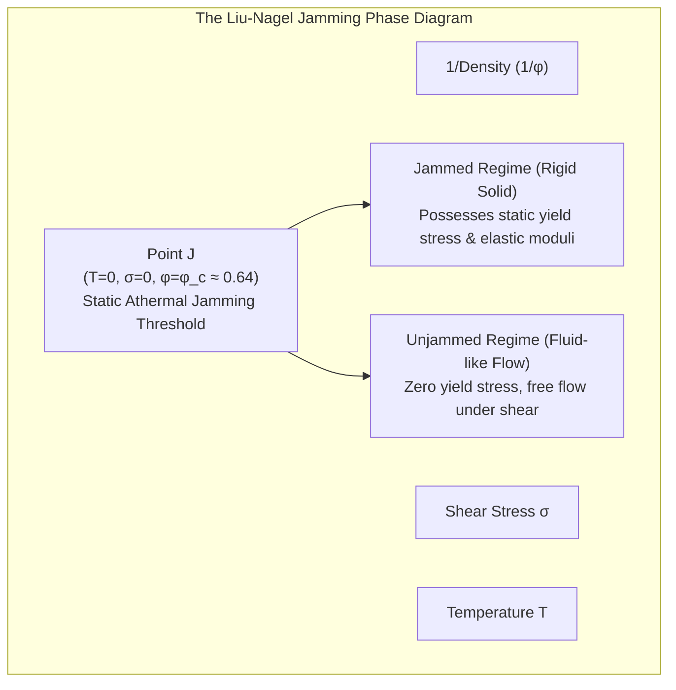
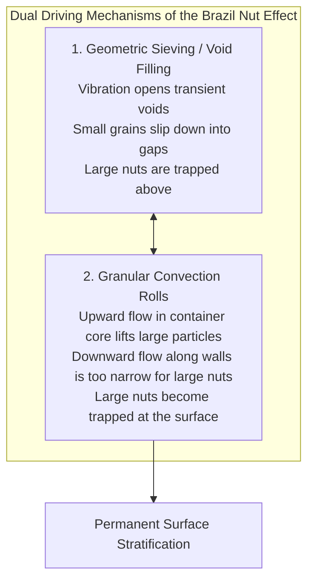
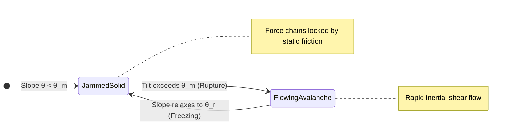
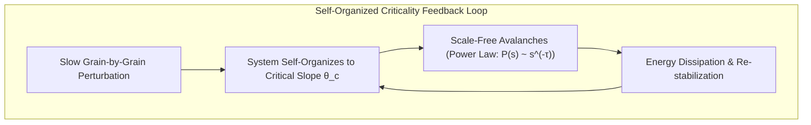

Scoop up a handful of dry beach sand, and the tiny grains slip smoothly through your fingers like water. Yet, heap that very same sand into a mound and stand upon it, and it supports your full body weight as rigidly as a slab of reinforced concrete. Pour sand into a funnel or an hourglass, and it flows like a viscous fluid—yet, unlike water escaping a reservoir, its drainage rate remains perfectly constant from the moment the top bulb is full until the very last grain drops, completely oblivious to the height of the column above it. Vibrate a container of mixed grains, and instead of sinking according to density, the largest and heaviest Brazil nuts spontaneously rise to the surface.

Sand, grain, sugar, pharmaceutical powders, coal heaps, and cosmic regolith blanketing distant asteroids—all of these macroscopic collections of discrete particles are known in physics as <strong>granular matter</strong>.

Granular materials defy simple classification into the classical states of matter (solid, liquid, or gas). Because individual macroscopic grains have thermal energies ($k_B T$) that are completely negligible compared to their gravitational potential energy, and because mechanical energy is irreversibly dissipated through friction and inelastic collisions, granular matter constitutes an inherently non-thermal, far-from-equilibrium system. The Nobel laureate Pierre-Gilles de Gennes famously championed granular physics as the "fourth state of matter," heralding it as one of the most intellectually fertile frontiers of modern condensed matter physics.

In this comprehensive treatise, we delve deep into the counterintuitive mechanics of granular media. We will trace the rigorous mathematical derivation of the Janssen effect and stress saturation in silos, visualize the invisible skeleton of force chains via photoelasticity, dissect Reynolds dilatancy and the Beverloo law of hourglass discharge, explore the revolutionary Liu-Nagel Jamming Transition, unravel the mechanisms of the Brazil nut effect, and survey how self-organized criticality shapes everything from sand avalanches to planetary exploration.

---

## 1. The Fourth State of Matter: Athermal Nature and Dissipation

### 1.1 The Total Absence of Thermal Fluctuations

In conventional molecular fluids and gases governed by classical equilibrium thermodynamics, absolute temperature $T$ dictates a characteristic thermal kinetic energy scale $k_B T$, where $k_B$ is the Boltzmann constant (at room temperature $300\,\text{K}$, $k_B T \approx 4.14 \times 10^{-21}\,\text{J}$). This energy drives perpetual Brownian motion, molecular diffusion, and entropic elasticity.

Now consider a single, modest grain of quartz sand with diameter $d = 1\,\text{mm}$ and density $\rho = 2.5 \times 10^3\,\text{kg/m}^3$. Its individual mass $m$ is given by:
$$m = \frac{\pi}{6} \rho d^3 \approx \frac{3.1416}{6} \times 2500 \times (10^{-3})^3 \approx 1.31 \times 10^{-6}\,\text{kg} = 1.31\,\text{mg}$$

To elevate this grain vertically by a distance equal to its own diameter ($h = 1\,\text{mm}$), the gravitational potential energy required is:
$$\Delta E_g = m g h = (1.31 \times 10^{-6}\,\text{kg}) \times (9.81\,\text{m/s}^2) \times (10^{-3}\,\text{m}) \approx 1.28 \times 10^{-8}\,\text{J}$$

Comparing this gravitational scale to the ambient thermal energy:
$$\frac{\Delta E_g}{k_B T} \approx \frac{1.28 \times 10^{-8}\,\text{J}}{4.14 \times 10^{-21}\,\text{J}} \approx 3.1 \times 10^{12}$$

Gravitational energy dominates room-temperature thermal fluctuations by <strong>more than twelve orders of magnitude (over three trillion times)</strong>! 

Consequently, grains cannot undergo spontaneous thermal diffusion. Left undisturbed on a table, a pile of sand will never rearrange itself through Brownian motion over the age of the universe. In statistical physics terms, granular matter possesses an effective thermal temperature of zero ($T_{\text{eff}} \to 0$). The system is permanently arrested in deep, metastable energy minima determined entirely by boundary conditions, friction, and loading history.



### 1.2 Inelastic Collisions and Irreversible Dissipation

A second defining attribute of granular systems is that inter-particle collisions are fundamentally <strong>inelastic</strong>. The coefficient of restitution $e$ satisfies $0 \le e < 1$. Whenever two grains collide, a significant fraction of their kinetic energy is irreversibly transferred into microscopic lattice vibrations (internal heat) or acoustic waves within the grains:
$$\Delta E_{\text{kin}} = -\frac{1}{4} m (1 - e^2) (\mathbf{v}_1 - \mathbf{v}_2)^2$$

Without a continuous external input of energy (such as mechanical shaking or gravity-driven shearing), a moving granular collection quickly loses all kinetic energy. In freely cooling granular gases, this rapid loss of energy induces a catastrophic instability known as <strong>inelastic collapse</strong>, where clusters of particles undergo an infinite number of collisions in finite time, losing all velocity and congealing into dense, jammed agglomerates.

---

## 2. Statics of Granular Media: The Janssen Effect and Stress Saturation

### 2.1 Hydrostatic vs. Granular Pressure: The Silo Enigma

In a container filled with an ordinary liquid of density $\rho$, the pressure at depth $z$ obeys Stevin's law of hydrostatic equilibrium:
$$P(z) = \rho g z$$
Pressure increases strictly linearly with depth without bound. If you double the height of the liquid column, the force exerted on the container's base doubles.

However, during the late 19th century, civil engineers designing colossal grain silos in Europe and North America encountered a baffling reality: as grain was poured higher and higher into a silo, the downward vertical pressure measured at the bottom floor <strong>ceased to increase</strong> beyond a certain depth. Instead of blowing out the base, overloaded silos routinely suffered structural failures and ruptures near their middle or upper side walls.

In 1895, the German engineer <strong>H. A. Janssen</strong> published a brilliant mathematical model that solved this mystery by incorporating boundary friction and horizontal stress redirection.



### 2.2 Derivation of Janssen's Equation

Consider a vertical cylindrical silo of radius $R$ filled with granular particles of bulk density $\rho$. Let us analyze the vertical force balance on a thin horizontal slice of granular material located between depth $z$ and $z + dz$. The slice has cross-sectional area $A = \pi R^2$ and perimeter $U = 2\pi R$.

The downward forces acting on the slice are:
1. Downward force from the material above: $A \sigma_v(z)$
2. Weight of the granular slice itself: $A \rho g dz$

The upward resisting forces are:
1. Upward supporting force from the material below: $A \sigma_v(z + dz) = A \left( \sigma_v + \frac{d\sigma_v}{dz} dz \right)$
2. Upward frictional shear force exerted by the silo wall: $\tau_w U dz$

Setting the sum of vertical forces to zero for static equilibrium:
$$A \sigma_v + A \rho g dz = A \left( \sigma_v + \frac{d\sigma_v}{dz} dz \right) + \tau_w U dz$$

Subtracting $A \sigma_v$ from both sides and dividing by $A dz$:
$$\frac{d\sigma_v}{dz} = \rho g - \frac{U}{A} \tau_w = \rho g - \frac{2}{R} \tau_w$$

To close this differential equation, Janssen introduced two foundational constitutive assumptions:
1. <strong>Coulomb's Friction Law at the Wall</strong>: The shear stress $\tau_w$ at the container wall is proportional to the normal horizontal stress $\sigma_h$ pressing against the wall:
   $$\tau_w = \mu_w \sigma_h$$
   where $\mu_w = \tan \phi_w$ is the wall-grain friction coefficient.
2. <strong>Janssen's Stress Redirection Ratio $K$</strong>: Due to the interlocking and contact geometry of rigid particles, a fixed fraction of the vertical stress is redirected laterally into horizontal thrust:
   $$K = \frac{\sigma_h}{\sigma_v} \quad \left(0 < K < 1, \text{ typically } K \approx \frac{1 - \sin \phi}{1 + \sin \phi} \approx 0.4\right)$$

Substituting $\tau_w = \mu_w K \sigma_v$ into the force balance yields:
$$\frac{d\sigma_v}{dz} = \rho g - \frac{2 K \mu_w}{R} \sigma_v$$

We define the characteristic <strong>screening length (Janssen length)</strong> $\lambda$ as:
$$\lambda = \frac{R}{2 K \mu_w}$$

The differential equation simplifies to:
$$\frac{d\sigma_v}{dz} = \rho g - \frac{\sigma_v}{\lambda}$$

Applying the boundary condition at the free top surface, $\sigma_v(0) = 0$, we integrate directly to obtain <strong>Janssen's classical stress formula</strong>:

$$\sigma_v(z) = \rho g \lambda \left( 1 - e^{-z / \lambda} \right) = \frac{\rho g R}{2 K \mu_w} \left( 1 - e^{-\frac{2 K \mu_w}{R} z} \right)$$



### 2.3 Physical Implications: Wall Support and Hourglass Regularity

The implications of Janssen's formula are profound:
- Near the surface ($z \ll \lambda$), the exponential term can be expanded as $1 - e^{-z/\lambda} \approx z/\lambda$, yielding $\sigma_v(z) \approx \rho g z$. Here, the granular bed mimics an ordinary hydrostatic liquid.
- At depths substantially greater than the screening length ($z \gg \lambda$, typically a few silo diameters), the exponential vanishes, and the vertical stress asymptotically approaches the finite constant:
  $$\sigma_{\text{sat}} = \rho g \lambda = \frac{\rho g R}{2 K \mu_w}$$

Beyond $z \sim \lambda$, the weight of any additional grain added to the top of the silo is transferred entirely to the side walls via static friction! The vertical stress at the base is shielded. This remarkable screening phenomenon is the primary physical reason why an hourglass flows at an unvarying rate: the pressure immediately above the constriction is completely decoupled from the height of the sand column.

---

## 3. The Microscopic Skeleton: Force Chains and Stress Anisotropy

### 3.1 Visualizing the Inhomogeneous Stress Fabric

If you load an elastic block of rubber or steel, the internal stress field is smooth, continuous, and accurately predicted by continuum elasticity (Hooke's law and the Navier-Cauchy equations). But what happens inside a granular pack under load?

Beginning in the 1970s, pioneering experiments using photoelastic polymer discs—materials that exhibit birefringence under mechanical stress when viewed between crossed polarizers—unveiled a shocking microscopic reality. 

External loads are <strong>not</strong> transmitted uniformly throughout the packing. Instead, mechanical forces propagate along quasi-linear, branched filamentary networks known as <strong>force chains (stress chains)</strong>.



### 3.2 The Bimodal Contact Force Distribution

Experimental measurements and discrete element method (DEM) simulations reveal that the probability distribution function $P(f)$ of normalized inter-particle contact forces $f = F / \langle F \rangle$ exhibits a universal bimodal structure:
1. <strong>Sub-mean forces ($f < 1$)</strong>: $P(f)$ is approximately constant or follows a modest power-law behavior, $P(f) \sim f^{-\alpha}$ (with $\alpha \approx 0.2 \sim 0.4$).
2. <strong>Super-mean forces ($f > 1$)</strong>: For forces exceeding the mean, $P(f)$ decays <strong>exponentially</strong>:
   $$P(f) \sim A \exp(-\beta f) \quad (\beta \approx 1.4 \sim 1.8)$$

This exponential tail means that a tiny minority of grain contacts (the strong network) bears an overwhelmingly disproportionate share of the entire external load. These chains act as rigid internal stone arches, while the surrounding particles (the weak network) contribute virtually nothing to bearing the primary load, serving merely as lateral buttresses that prevent the slender force chains from buckling.

### 3.3 Structural Vulnerability and Chain Buckling

Because force chains are essentially slender, column-like arches held together solely by frictional contacts without tensile cohesion, they are extraordinarily sensitive to transverse perturbations. 

If external vibrations or slight shear strains displace even a fraction of a percent of the grains in the weak network, the lateral support vanishes. The primary force chains undergo catastrophic <strong>elastic buckling</strong>, triggering an avalanche-like collapse of the load-bearing skeleton. This structural fragility explains why solid ground can instantaneously liquefy during earthquakes, and why granular slopes can fail without macroscopic warning.

---

## 4. Reynolds Dilatancy: Why Sand Expands When Sheared

### 4.1 The Wet Beach Paradox

Anyone who has strolled along the water's edge on a wet, sandy beach has experienced a striking paradox. Step firmly onto the saturated, glossy sand, and the area immediately surrounding your foot instantly turns dry and pale. Lift your foot, and moisture slowly seeps back to the surface.

Intuition drawn from everyday sponges suggests that squeezing a saturated porous medium should force water out. Why does stepping on wet sand cause the water to disappear into the ground?

In 1885, the British physicist <strong>Osborne Reynolds</strong> formulated the geometric and mechanical foundation of this behavior, christening it <strong>dilatancy</strong> (the volume expansion of dense granular assemblies under shear).

```mermaid
sequenceDiagram
    autonumber
    actor Foot as Pedestrian Foot
    participant Surface as Surface Water Film
    participant DenseGrains as Densely Packed Sand Grains
    participant PoreSpace as Interstitial Pore Volume
    Foot->>DenseGrains: Imparts downward and shear stress
    DenseGrains->>DenseGrains: Grains must roll up and over neighbors (Dilatancy)
    DenseGrains->>PoreSpace: Void ratio increases; total pore volume expands
    PoreSpace->>Surface: Capillary action draws surface water into newly created voids
    Note over Surface: Surface water disappears, appearing instantly dry!
```

### 4.2 Geometrical Constraint of Dense Packings

Consider a dense collection of rigid spheres resting in their most compact configuration. In this state, each grain rests nestled securely in the interstitial hollow formed by the grains beneath it.

If a macroscopic shear deformation is imposed:
- The grains cannot pass through one another (steric exclusion).
- To slide horizontally, a grain has no choice but to ride up and climb over the tops of its neighbors.
- This climbing motion pushes neighboring layers apart, forcing the macroscopic volume of the packing to <strong>expand</strong>.

As the densely packed sand beneath your foot is sheared, its interstitial void volume (porosity) increases abruptly. The surface water film is immediately sucked downward into the newly created underground pores by capillary pressure, leaving the surrounding surface temporarily desiccated.

### 4.3 Critical State Soil Mechanics and the Dilatancy Angle

In geotechnical engineering, the shear strength of granular soil is formalized through critical state soil mechanics. The total shear resistance $\tau$ along a failure plane under normal stress $\sigma_n$ depends not only on the intrinsic inter-grain friction angle $\phi_{\mu}$, but also on the <strong>dilatancy angle $\psi$</strong>, representing the mechanical work required to expand the sample against the confining pressure:

$$\tau = \sigma_n \tan(\phi_{\mu} + \psi)$$

For an initially dense sand, $\psi > 0$, resulting in a pronounced peak shear strength. As shear strain accumulates, the packing continuously dilates until it reaches a universal, constant-volume state known as the <strong>critical state</strong> (where the void ratio stabilizes at the critical void ratio $e_c$, and $\psi \to 0$). Dilatancy is nature's primary mechanism for conferring structural rigidity upon loose granular media.

---

## 5. Hourglass Rheology: The Beverloo Law of Granular Discharge

### 5.1 The Breakdown of Torricelli's Law

When an ordinary liquid (such as water) drains under gravity from an orifice of diameter $D$ at the bottom of a container, Torricelli's law (derived from Bernoulli's principle) states that the efflux velocity $v$ scales with the square root of the liquid depth $H$:
$$v = \sqrt{2 g H}$$
As the reservoir empties and $H$ diminishes, the discharge rate continuously slows down to a trickle.

If sand flowed like a liquid, an hourglass would run progressively slower as the sand level fell, rendering it useless as a timepiece. In reality, the mass flow rate of sand discharging from a hopper or hourglass is <strong>strictly invariant over time</strong>, remaining rock-steady until the final grains clear the constriction.



### 5.2 Derivation of the Beverloo Law

The independence of flow rate from bed height $H$ arises from two coupled granular phenomena:
1. <strong>Janssen screening</strong>: The vertical stress in the lower section of the hopper is clamped to $\sigma_{\text{sat}} \approx \rho g \lambda$, completely decoupled from the total height $H$.
2. <strong>The Free-Fall Arch</strong>: Just above the exit aperture, particle arches continuously form, break, and reform. This dynamic boundary creates a hemispherical domed region—the "free-fall arch"—spanning the orifice. Inside this dome, inter-particle contacts are lost, and grains detach to accelerate downward under pure gravity from rest.

In 1961, <strong>W. A. Beverloo</strong> and collaborators synthesized extensive experimental data to establish the universal empirical formula for granular mass discharge rate $W$ (in $\text{kg/s}$):

$$W = C \rho_b g^{1/2} \left( D - k d \right)^{5/2}$$

where:
- $C$: Dimensionless discharge coefficient (typically $C \approx 0.55 \sim 0.65$);
- $\rho_b$: Bulk packing density;
- $g$: Acceleration due to gravity;
- $D$: Orifice diameter;
- $d$: Mean particle diameter;
- $k$: Dimensionless boundary correction coefficient (typically $k \approx 1.0 \sim 3.0$).

#### Dimensional Derivation of the $5/2$ Power Scaling
The $D^{5/2}$ scaling can be deduced from elementary physical principles:
1. The effective cross-sectional area through which particles exit scales as $A_{\text{eff}} \sim D^2$.
2. Particles start falling freely from an arch height of order $D$. The characteristic free-fall exit velocity acquired across this zone is:
   $$v_{\text{exit}} \sim \sqrt{g D}$$
3. The resulting mass flow rate $W = \rho_b A_{\text{eff}} v_{\text{exit}}$ scales as:
   $$W \sim \rho_b \times D^2 \times \sqrt{g D} = \rho_b g^{1/2} D^{5/2}$$

#### The Empty Annulus Concept
The subtraction term $(D - k d)$ captures the geometric reality that the center of mass of a finite grain of diameter $d$ cannot approach the orifice edge closer than $d/2$. Consequently, an inert boundary zone of width $\sim k d/2$—the <strong>empty annulus</strong>—forms along the perimeter, rendering the effective opening narrower than the physical hole ($D_{\text{eff}} = D - k d$).

When the orifice diameter shrinks to $D \lesssim 4 \sim 6 d$, stable force arches can permanently span the opening, causing the flow to jam completely (clogging).

---

## 6. The Jamming Transition: A Unified Thermodynamic Paradigm

### 6.1 What is Jamming?

Consider a vacuum-sealed bag of ground coffee. When evacuated, atmospheric pressure clamps the grounds together, transforming the flexible package into a rigid, rock-hard brick. Puncture the plastic to let air in, and the solid instantly relaxes into a compliant, pourable powder.

Similarly, when commuters rush through a subway turnstile, they flow smoothly at moderate densities; but if passenger density exceeds a critical threshold, motion arrests abruptly, locking the crowd into an unyielding human gridlock.

This transition—where an amorphous collection of particles spontaneously develops mechanical rigidity and a yield stress without crystallizing into a periodic lattice—is termed the <strong>jamming transition</strong>.



### 6.2 The Liu-Nagel Phase Diagram

In 1998, physicists <strong>Andrea Liu</strong> and <strong>Sidney Nagel</strong> proposed a revolutionary unifying framework. They posited that granular jamming, colloidal glass transitions, the rheology of emulsions (like mayonnaise) and foams, and the molecular glass transition of supercooled liquids are all distinct projections of a single overarching <strong>jamming phase diagram</strong>.

The phase space is parameterized by three orthogonal axes:
1. <strong>Inverse density $1/\phi$ (or packing fraction $\phi$)</strong>: The volume fraction occupied by particles.
2. <strong>Applied shear stress $\sigma$</strong>: The external driving force attempting to deform the system.
3. <strong>Temperature $T$</strong>: The intensity of thermal fluctuations.

Athermal granular media live strictly on the <strong>$T = 0$ ground plane</strong> of this diagram.

### 6.3 Point J and Isostaticity

In the limit of zero applied stress ($\sigma = 0$) and zero temperature ($T = 0$), increasing the packing fraction $\phi$ of frictionless hard spheres causes the system to undergo a singular transition at a critical threshold known as <strong>Point J</strong>.

For frictionless spheres, Point J coincides precisely with the <strong>random close packing (RCP)</strong> density:
$$\phi_c \approx 0.64$$

#### Rigidity Percolation and the Maxwell Criterion
The emergence of rigidity at Point J is governed by constraint counting, originally formulated by James Clerk Maxwell in 1864 for structural truss frames.

Consider $N$ frictionless particles in $D$ spatial dimensions. The total number of translational degrees of freedom is $D N$. Each physical contact between two spheres exerts a central normal force, eliminating one relative degree of freedom. Since each contact is shared between two particles, the total number of constraints in a system with mean coordination number $Z$ (average contacts per particle) is $N Z / 2$.

For the packing to be mechanically stable (rigid against all deformations), the number of constraints must equal or exceed the degrees of freedom:
$$\frac{N Z}{2} \ge D N \implies Z \ge 2 D$$

- In two dimensions ($D = 2$): $Z_c = 4$
- In three dimensions ($D = 3$): $Z_c = 6$

A packing satisfying $Z = 2 D$ is called <strong>isostatic</strong>. At Point J, the packing is precisely isostatic: it possesses just enough contacts to be mechanically stable, but not a single redundant contact.

Above Point J ($\phi > \phi_c$), the excess coordination number $\Delta Z = Z - Z_c$ grows according to a universal square-root scaling:
$$Z - Z_c \propto (\phi - \phi_c)^{1/2}$$

The elastic bulk modulus $K$ and shear modulus $G$ exhibit strikingly disparate scalings:
- <strong>Bulk modulus</strong>: $K \sim (\phi - \phi_c)^0 = \text{const}$ (discontinuous step at $\phi_c$)
- <strong>Shear modulus</strong>: $G \sim (\phi - \phi_c)^{1/2}$ (continuous emergence from zero)

The ratio $G/K \to 0$ as $\phi \to \phi_c$ reveals that marginal jammed solids near Point J are exceptionally resistant to compression, yet infinitely susceptible to shear distortions. This exotic behavior places jammed granular matter into a distinct universality class separate from standard crystalline solids.

---

## 7. Vibrational Wonders: The Brazil Nut Effect and Segregation

### 7.1 Defying Archimedes: Why Large Particles Float

Open a newly purchased can of mixed nuts, and you will invariably find the largest, densest Brazil nuts resting prominently at the top, while small peanuts settle at the bottom. 

According to Archimedes' principle, heavier and denser objects should sink in a fluid. In granular media, however, <strong>geometry often overrides density</strong>: when a heterogeneous mixture of grains is subjected to vertical vibration, large particles spontaneously ascend against gravity, regardless of their mass. This phenomenon is known as the <strong>Brazil nut effect</strong> or <strong>size segregation</strong>.



### 7.2 The Dual Mechanisms of Segregation

Decades of experimental observation, high-speed photography, and X-ray micro-tomography have demonstrated that the Brazil nut effect is driven by two cooperative physical processes:

#### Mechanism 1: Geometric Sieving and Void Percolation
During the upward phase of vertical vibration, the bed is accelerated upward. As the container accelerates downward during the second half of the cycle, the granular bed enters a state of momentary free-fall, dilating and generating transient voids between particles.
- Fine grains easily filter downward through these micro-voids under gravity.
- A large Brazil nut cannot fit into small interstitial voids; it can only drop if a cavity matching its own dimensions opens directly beneath it—a statistically improbable event.
As small particles continually occupy the space beneath the large nut, they form a new supporting bed, ratcheting the large particle upward cycle by cycle.

#### Mechanism 2: Granular Convection Rolls
Friction between the container's side walls and adjacent grains establishes a steady convective circulation within the vibrating bed:
- In the interior core of the container, an upward convective current carries all particles toward the surface.
- Near the perimeter walls, downward shear generates a narrow downward boundary stream.

While fine grains circulating to the surface are dragged down the narrow boundary stream, large Brazil nuts are wider than the thickness of this downward boundary boundary layer. Consequently, large particles reaching the top surface are excluded from the downward stream, remaining permanently trapped at the surface.

### 7.3 The Reverse Brazil Nut Effect

Under specific vibration frequencies, accelerations, and density ratios, the segregation pattern can invert: dense large particles sink to the bottom, while lighter small particles collect at the top. This <strong>reverse Brazil nut effect</strong> occurs when the inertia of a massive particle allows it to punch through the upward convective current, or when inelastic collisions between disparate species create localized granular temperature gradients. Mastering granular segregation is critical in pharmaceutical manufacturing, where active ingredients must remain uniformly dispersed within excipient powders prior to tableting.

---

## 8. Avalanches, the Angle of Repose, and Self-Organized Criticality

### 8.1 Static vs. Dynamic Angle of Repose

When dry sand is slowly poured onto a flat surface, it accumulates into a conical heap whose slope cannot exceed a characteristic threshold: the <strong>angle of repose</strong>.

Closer inspection reveals a distinct mechanical hysteresis:
1. If you tilt a static sandbox, the slope remains motionless as a solid until it reaches the <strong>maximum angle of stability $\theta_m$</strong> (typically $\approx 35^\circ$ for dry sand).
2. The instant the tilt exceeds $\theta_m$ by even $0.05^\circ$, the surface layer shears catastrophically, unleashing an avalanche of flowing grains.
3. The avalanche continues until the slope relaxes to the lower <strong>dynamic angle of repose $\theta_r$</strong> (typically $\approx 30^\circ \sim 32^\circ$), where motion abruptly freezes.

This angular gap $\Delta \theta = \theta_m - \theta_r \approx 2^\circ \sim 5^\circ$ reflects the disparity between static friction (which maintains the force chains) and dynamic kinetic friction (which governs moving grains), exhibiting the hallmark hysteresis of a first-order phase transition.



### 8.2 The Bak-Tang-Wiesenfeld Sandpile Model and SOC

In 1987, physicists <strong>Per Bak, Chao Tang, and Kurt Wiesenfeld (BTW)</strong> introduced a cellular automaton inspired by sandpiles, creating a paradigm-shifting concept in complex systems: <strong>Self-Organized Criticality (SOC)</strong>.

In the BTW model, virtual grains of sand are dropped randomly one by one onto a lattice. When the local slope (height difference between neighboring sites) exceeds a critical threshold $Z_c$, the site topples, distributing grains to its neighbors. If neighboring sites thereby exceed $Z_c$, secondary toppling events occur, propagating a cascading avalanche across the lattice.



The system autonomously drives itself to a critical attractor—the boundary between stability and collapse—<strong>without any external fine-tuning</strong> of parameters like temperature or pressure.

The probability distribution of avalanche sizes $s$ obeys a scale-free <strong>power law</strong>:
$$P(s) \sim s^{-\tau} \quad (\tau \approx 1.1 \sim 1.3)$$

This power law indicates that the addition of a single grain can trigger either a tiny, localized shift or a cataclysmic, system-wide avalanche. The mathematical framework of the BTW sandpile model provides the foundational blueprint for understanding power-law distributions across diverse complex systems, including Gutenberg-Richter earthquake statistics, forest fires, solar flare dynamics, neural avalanches in the brain, and financial market crashes.

---

## 9. Industrial Applications and Engineering Frontiers

Granular physics is not merely a theoretical curiosity; it directly underpins global industry. It is estimated that between $1\%$ and $3\%$ of the world's total energy consumption is expended in comminuting, conveying, blending, and storing granular powders and ores.

| Domain | Engineering Challenge | Granular Physics Solution |
|---|---|---|
| <strong>Pharmaceuticals</strong> | Preventing segregation of active pharmaceutical ingredients (API) | Jamming-based compression simulations, segregation control |
| <strong>Geotechnical Hazard Mitigation</strong> | Predicting landslide, debris flow, and snow avalanche runout | $\mu(I)$ rheology continuum simulations (SPH, MPM methods) |
| <strong>Civil Engineering</strong> | Maximizing concrete compressive strength and flowability | Polydisperse packing optimization to minimize void ratio |
| <strong>Mining & Agriculture</strong> | Preventing silo clogs, arching, and wall ruptures | Beverloo discharge tuning, acoustic excitation of force chains |
| <strong>Space Exploration</strong> | Spacecraft landings on low-gravity asteroids (Hayabusa2, OSIRIS-REx) | Microgravity regolith impact dynamics, cohesive force modeling |

### 9.1 Asteroid Exploration and Microgravity Regolith Mechanics

When the Japanese spacecraft <strong>Hayabusa2</strong> fired a kinetic impactor into the asteroid Ryugu in 2019, planetary scientists were astounded by the resulting crater. Ryugu was not a solid monolithic rock, but a "rubble pile" asteroid—a gravitationally bound heap of boulders and sand-like regolith.

In an environment where gravity is tens of thousands of times weaker than on Earth, the mechanical hierarchy of granular forces is completely upended:
- Gravitational forces become subordinate to microscopic van der Waals cohesion and electrostatic forces.
- The effective Janssen screening length expands dramatically.
- Low-velocity impacts produce disproportionately massive cratering and fluid-like splashing.

Analyzing how regolith flows and jams under microgravity has established an indispensable bridge connecting terrestrial powder rheology with planetary accretion and solar system evolution.

---

## 10. Conclusion: The Profound Harmony Within a Grain of Sand

Is sand a solid or a liquid?

Modern physics answers decisively: <strong>it is both, and it is neither.</strong>

At rest, sand behaves as a resilient solid, weaving an intricate, invisible network of force chains capable of bearing immense loads. Subjected to shear or tilt, it yields and flows as a complex non-Newtonian fluid. Vigorously agitated, it behaves as a dissipative gas. The boundaries governing these transformations are dictated not by the thermal collisions of atoms, but by the pure, athermal mechanics of geometry, friction, and steric exclusion.

Within a humble handful of sand resides the collapse of classical continuum theories, the birth of modern complexity science, and the universal geometry of the jamming transition. Whenever you step upon the earth, you are standing upon one of the most intellectually breathtaking frontiers of the physical sciences.
