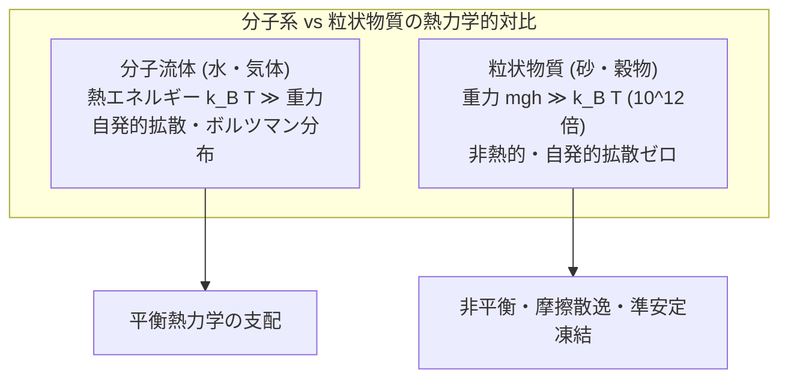
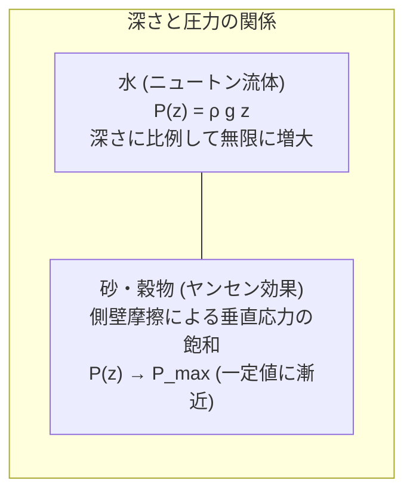
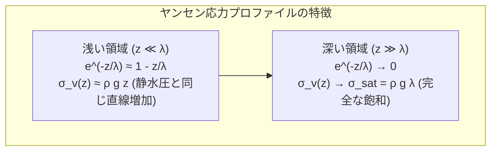
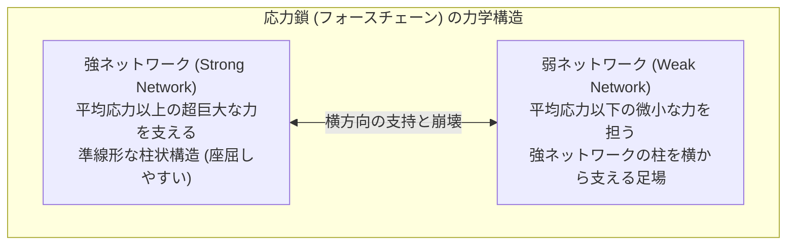
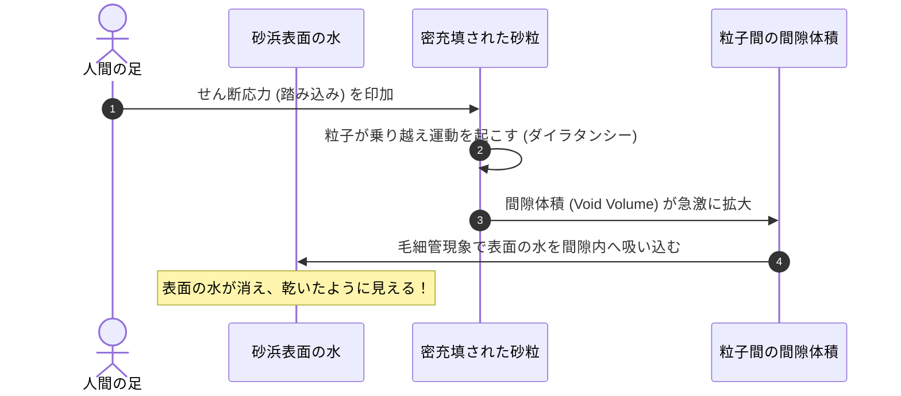
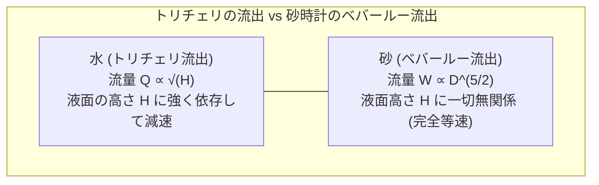
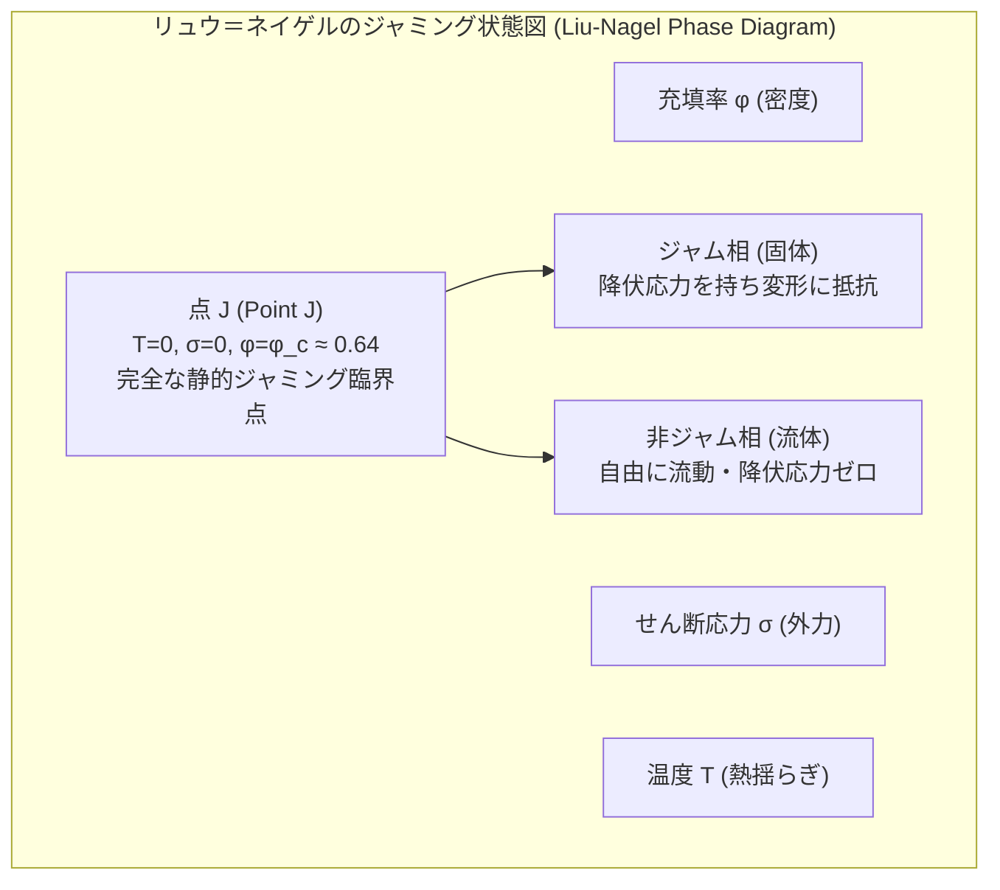
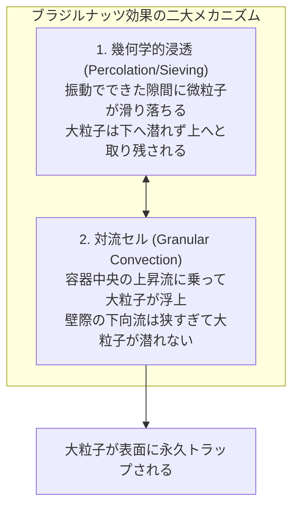
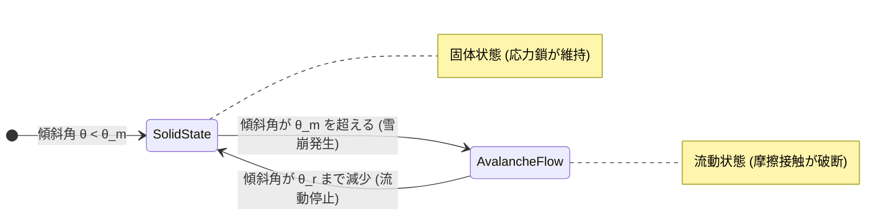
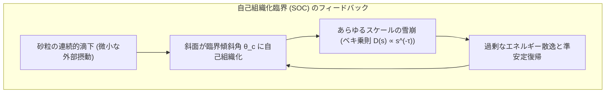

砂浜を手ですくい上げると、無数の粒子は指の間から水のようにさらさらとこぼれ落ちていきます。しかし、その砂を地面に山のように積み上げて体重をかければ、まるで一枚の巨大なコンクリートスラブであるかのように、大人の体重をびくともせずに支え抜きます。さらに、漏斗の中に砂を流し込めば流体のように運動しますが、水とは異なり、砂時計の底から流出する速度は上部の砂の残量に一切依存せず、常に一定の時を刻み続けます。そして、容器を激しく揺さぶると、より重く巨大なブラジルナッツが沈むどころか自発的に表面へと浮上してくるのです。

砂、米、小麦粉、鉱石、薬品の粉末、そして小惑星の表面を覆うレゴリス——これらマクロな粒子が無数に集まった系は、物理学において<strong>「粒状物質（Granular Matter）」</strong>と呼ばれます。

粒状物質は、古典的な物質の三態（固体・液体・気体）のいずれにも単純には分類できません。熱力学的な熱揺らぎ（$k_B T$）が粒子の重力ポテンシャルに比べて無視できるほど小さく、摩擦と非弾性衝突によってエネルギーが不可逆的に散逸する「非熱的・非平衡系」だからです。ノーベル物理学賞受賞者ピエール＝ジル・ド・ジェンヌ（Pierre-Gilles de Gennes）は、粒状物質を「第四の物質状態」と呼び、凝縮系物理学の最前線としてその探求を熱烈に呼びかけました。

本稿では、日常的でありながら物理学の常識をことごとく覆す粒状物質の力学を徹底的に解き明かします。ヤンセン効果による応力飽和の数理から、光弾性で視覚化される「応力鎖（フォースチェーン）」の不均一ネットワーク、レイノルズのダイラタンシー、砂時計のベバールー則、そして物理学のパラダイムを刷新した「ジャミング転移（Jamming Transition）」と自己組織化臨界まで、現代物理学の到達点を余すところなく探求します。

---

## 1. 物質の「第四の状態」：粒状物質の基本定義と非熱的性質

### 1.1 熱揺らぎの完全な欠如

水や空気などの通常の分子流体・連続体を支配する熱力学では、絶対温度 $T$ に比例する熱エネルギー $k_B T$（$k_B$ はボルツマン定数、室温 $300\,\text{K}$ において約 $4.14 \times 10^{-21}\,\text{J}$）が分子のブラウン運動を引き起こし、エントロピー弾性や拡散現象を生み出します。

しかし、直径 $d = 1\,\text{mm}$、密度 $\rho = 2.5 \times 10^3\,\text{kg/m}^3$ のごくありふれた石英砂の単一粒子を考えてみましょう。この粒子の質量 $m$ は：
$$m = \frac{\pi}{6} \rho d^3 \approx \frac{3.1416}{6} \times (2500) \times (10^{-3})^3 \approx 1.31 \times 10^{-6}\,\text{kg} = 1.31\,\text{mg}$$

この粒子を自分自身の直径の高さ（$h = 1\,\text{mm}$）だけ持ち上げるのに必要な重力ポテンシャルエネルギー $\Delta E_g$ は：
$$\Delta E_g = m g h = (1.31 \times 10^{-6}\,\text{kg}) \times (9.8\,\text{m/s}^2) \times (10^{-3}\,\text{m}) \approx 1.28 \times 10^{-8}\,\text{J}$$

熱エネルギーとの比を計算すると：
$$\frac{\Delta E_g}{k_B T} \approx \frac{1.28 \times 10^{-8}}{4.14 \times 10^{-21}} \approx 3.1 \times 10^{12}$$

重力エネルギーは室温の熱揺らぎよりも<strong>3兆倍以上</strong>も巨大です。これは、外から機械的な振動やせん断などの仕事を加えない限り、砂粒が熱運動によって自発的に位置を変えたり拡散したりすることは絶対にあり得ないことを意味します。粒状物質における有効温度は事実上「絶対零度（$T_{\text{eff}} \to 0$）」であり、系は常に重力や摩擦力によって拘束された準安定な極小エネルギー状態（Metastable Traps）に凍結されています。

### 1.2 非弾性衝突と摩擦：エネルギー散逸の不可逆性

分子気体では分子同士の衝突は完全弾性衝突（運動エネルギー保存）として扱われますが、粒状物質における粒子間の衝突は常に<strong>非弾性衝突</strong>です。反発係数 $e < 1$ であり、衝突のたびに巨視的な運動エネルギーが粒子の内部格子振動（熱）や塑性変形へと不可逆的に散逸します。

エネルギー注入のない孤立した粒状気体（Granular Gas）は、粒子同士の衝突を繰り返すことで運動エネルギーを急激に失い、局所的な密度上昇がさらなる衝突頻度の増大を招く「非弾性崩壊（Inelastic Collapse）」を起こして、あっという間に流動性を失い凝固します。

---

## 2. 静止した砂の驚異：ヤンセン効果と圧力の飽和

### 2.1 水圧と砂圧の決定的相違：なぜ穀物サイロは底から破裂しないのか？

深さ $H$ の水槽の底にかかる静水圧 $P(z)$ は、流体力学の基本原理であるステヴィンの法則（静水圧平衡）に従います：
$$P(z) = \rho g z$$
深さ $z$ に厳密に比例して水圧は直線的に増大し、水深が10倍になれば底面にかかる圧力も10倍になります。

ところが19世紀末、巨大な穀物サイロの底部を建設していた技術者たちは、不可解な現実に直面しました。サイロにトウモロコシや小麦をどれほど高く積み上げても、底板にかかる垂直圧力はある一定の深さから先、<strong>まったく増加しなくなる</strong>のです。破壊が起きるとすれば、底部ではなくサイロの側壁でした。

1895年、ドイツの技術者<strong>H. A. ヤンセン（H. A. Janssen）</strong>は、粒状物質と側壁との間の摩擦力に着目し、この謎を数学的に解明しました。

### 2.2 ヤンセン方程式の厳密な導出

半径 $R$ の円筒形サイロに密度 $\rho$ の粒子が充填されているとします。深さ $z$ から $z + dz$ の微小な水平スライス要素（厚さ $dz$、断面積 $A = \pi R^2$、周長 $U = 2\pi R$）の力の釣り合いを考えます。

スライスにかかる垂直下向きの力：
- 上部からの垂直力：$A \sigma_v(z)$
- スライス自身の重力：$A \rho g dz$

スライスにかかる上向きの力：
- 下部からの支持力：$A \sigma_v(z + dz) = A \left( \sigma_v + \frac{d\sigma_v}{dz} dz \right)$
- 側壁との摩擦力：$\tau_w U dz$

垂直方向の力の釣り合い式は：
$$A \sigma_v + A \rho g dz = A \left( \sigma_v + \frac{d\sigma_v}{dz} dz \right) + \tau_w U dz$$

整理すると：
$$A \frac{d\sigma_v}{dz} = A \rho g - U \tau_w$$
両辺を $A = \pi R^2$ で割り、$U/A = 2/R$ を代入すると：
$$\frac{d\sigma_v}{dz} = \rho g - \frac{2}{R} \tau_w$$

ここでヤンセンは2つの本質的な仮定を置きました：
1. <strong>クーロンの摩擦法則</strong>：側壁におけるせん断応力 $\tau_w$ は、側壁を押す水平応力 $\sigma_h$ と壁面摩擦係数 $\mu_w = \tan \phi_w$ の積に等しい：
   $$\tau_w = \mu_w \sigma_h$$
2. <strong>ヤンセンの応力偏向係数 $K$</strong>：粒子同士の接触と滑りにより、垂直応力 $\sigma_v$ の一定割合が水平応力 $\sigma_h$ へと変換される：
   $$\sigma_h = K \sigma_v \quad \left(K \approx \frac{1 - \sin \phi}{1 + \sin \phi} \approx 0.3 \sim 0.6\right)$$

これらを代入すると、垂直応力に関する一階線形常微分方程式が得られます：
$$\frac{d\sigma_v}{dz} = \rho g - \frac{2 K \mu_w}{R} \sigma_v$$

特徴的な遮蔽長（Screening Length） $\lambda$ を以下のように定義します：
$$\lambda = \frac{R}{2 K \mu_w}$$

微分方程式は極めてシンプルな形になります：
$$\frac{d\sigma_v}{dz} = \rho g - \frac{\sigma_v}{\lambda}$$

上面（$z = 0$）で外圧がない境界条件 $\sigma_v(0) = 0$ のもとでこれを解くと、世界的に名高い<strong>ヤンセンの応力式</strong>が導かれます：

$$\sigma_v(z) = \rho g \lambda \left( 1 - e^{-z / \lambda} \right) = \frac{\rho g R}{2 K \mu_w} \left( 1 - e^{-\frac{2 K \mu_w}{R} z} \right)$$

この式が示す物理的意味は極めて深遠です：
- 深さ $z$ が特徴長 $\lambda$ よりはるかに浅い領域（$z \ll \lambda$）では、指数関数を展開することで $\sigma_v(z) \approx \rho g z$ となり、流体と同じように深さに比例して圧力が増加します。
- しかし深さ $z$ が $\lambda$ を超えると（$z \gg \lambda$）、指数項はゼロに漸近し、垂直応力は最大飽和値 $\sigma_{\text{sat}} = \rho g \lambda = \frac{\rho g R}{2 K \mu_w}$ で完全に頭打ちになります。

追加されたすべての砂粒の重量は、もはや底面には一切届かず、側壁との静止摩擦力によってサイロの円筒壁面へと横向きに逃がされ、壁が荷重を支えているのです！これが、砂時計が上部の砂の量に関係なく一定の力学環境を底部に維持できる最大の物理的要因です。

---

## 3. 見えない骨格：応力鎖（フォースチェーン）の物理

### 3.1 光弾性実験が暴いた不均一な力の網目

均質なゴムや金属ブロックを上から押し込むと、材料内部の応力は連続体弾性論（フックの法則やナビエの方程式）に従って滑らかに分散します。しかし、粒状物質に荷重を加えたとき、力は均一に伝わるのでしょうか？

1970年代以降、ガラスや光弾性樹脂（応力を受けると複屈折を起こし、偏光板を通すと干渉縞が見える材料）で作られた円盤粒子を用いた実験により、物理学者たちは息を呑む光景を目撃しました。

外部からの荷重は、全体に均等に分散するのではなく、粒子が数珠つなぎになったごく一部の細い線状の経路だけに集中して伝達されていたのです。この力の通り道を<strong>「応力鎖（フォースチェーン / Force Chains）」</strong>またはストレスチェーンと呼びます。

### 3.2 接触力分布の指数関数的減衰

粒子間の接触力 $f$ の確率密度関数 $P(f)$ を測定すると、平均接触力 $\langle f \rangle$ を境にして劇的な二峰性・非対称性を示します：
- 平均以下の力（$f < \langle f \rangle$）：$P(f)$ はほぼ一定または緩やかなベキ乗則に従います。
- 平均以上の大きな力（$f > \langle f \rangle$）：分布は驚くべきことに<strong>指数関数的に減衰（Exponential Decay）</strong>します：
  $$P(f) \sim e^{-\beta f / \langle f \rangle} \quad (\beta \approx 1.4 \sim 1.8)$$

この指数関数的減衰は、平均値の数倍から十数倍もの桁違いに巨大な局所荷重を担う「超強力な応力鎖」が系内に確実に存在する一方で、それ以外の大多数の粒子はほとんど力を受け持たずにただ空間を埋めているだけであることを物語っています。

### 3.3 アーチ構造と力学的脆弱性（座屈）

応力鎖は、ミクロなスケールで見ると「石造りのアーチ橋」と同じ原理で形成されています。粒子同士が互いに押し合い、摩擦力によって噛み合うことで、下方の空間に荷重を逃がさない「アーチ（拱）」を自発的に架橋します。

しかし、この構造には致命的な弱点があります。応力鎖は一本の細長い柱であるため、<strong>わずかな横方向の力に対して極めて座屈（Buckling）しやすい</strong>のです。全体のわずか $1\%$ の粒子がミリ単位で動いただけで、主応力鎖が連鎖的に座屈崩壊し、それまで巨岩のような強度を誇っていた砂の山が一瞬にして流動化して崩落します。この極端な非線形性と不均一性が、地すべりや雪崩の予測を極めて困難にしている元凶です。

---

## 4. レイノルズのダイラタンシー：変形すると体積が増える？

### 4.1 濡れた砂浜のパラドックス

波打ち際の湿った砂浜を力強く踏みしめると、誰もが不思議な現象を経験します。
足の裏で砂を強く踏み込んだ瞬間、足の周囲の砂から水分がすっと消え、<strong>まるで砂が乾いたかのように白く変色する</strong>のです。足を離すと、再びじわりと水が戻ってきます。

常識的に考えれば、スポンジや濡れたタオルを上から強く圧迫すれば、内部の水は外へと絞り出されるはずです。なぜ砂を踏むと、逆に水が内部へと吸い込まれて表面が乾くのでしょうか？

1885年、流体力学で名高いイギリスの物理学者<strong>オズボーン・レイノルズ（Osborne Reynolds）</strong>は、この現象の幾何学的・力学的本質を見抜き、これを<strong>「ダイラタンシー（Dilatancy：剪断膨張性）」</strong>と命名しました。

### 4.2 最密充填の幾何学的幾何拘束

規則正しく密にパッキングされた球体集合を考えてみましょう。粒子が最密充填されている状態では、どの粒子も周囲の粒子の「くぼみ（谷間）」にすっぽりと収まっています。

この砂の層を水平方向にせん断変形（ずらし変形）させようとすると、粒子は隣の粒子を押し退けて「山」を乗り越えなければ動くことができません。この<strong>「乗り越え（Overriding）」</strong>運動が起きると、粒子同士の平均中心間距離が広がり、結果として<strong>粉体全体の巨視的な体積（間隙率 $\phi_v$）が強制的に膨張</strong>します。

密充填された砂浜の砂は、足で踏まれてせん断変形を受けることで、内部の間隙体積（空隙）が急激に拡大します。すると、元々砂の表面を覆っていた水が、拡大した地下の間隙へと毛細管現象で一気に吸い込まれるため、表面から水気が消えて「乾いた」ように見えるのです。

### 4.3 土質力学における臨界状態とダイラタンシー角

土質力学の祖カール・テルツァーギ（Karl von Terzaghi）らは、このダイラタンシーを砂地盤のせん断強度を決定づける中核原理として定式化しました。
せん断応力 $\tau$ と垂直応力 $\sigma_n$ の関係は、粒子間の真の摩擦角 $\phi_{\mu}$ に加えて、ダイラタンシーによる膨張に抗して仕事をするための<strong>ダイラタンシー角（Dilatancy Angle） $\psi$</strong> の寄与を受けます：

$$\tau = \sigma_n \tan(\phi_{\mu} + \psi)$$

初期状態が密な砂は、せん断変形に伴って膨張（ダイラタンシー $\psi > 0$）しながら高いピーク強度を示し、その後粒子がバラバラに崩れて一定の体積を保ったまま変形し続ける「臨界状態（Critical State）」へと漸近します。ダイラタンシーこそが、砂が外力に対して踏ん張り、崩壊に抵抗する最大の防御機構なのです。

---

## 5. 砂時計の流動学：ベバールーの法則とオリフィス流動

### 5.1 トリチェリの定理の破綻

水や油などのニュートン流体が容器の底の小孔（オリフィス、直径 $D$）から流出するとき、その流出速度 $v$ はトリチェリの定理（エネルギー保存則・ベルヌーイの定理）に従います：
$$v = \sqrt{2 g H}$$
液面高さ $H$ が高ければ高いほど、開口部にかかる静水圧が大きくなり、噴出する液体の流速と流量は大きくなります。液面が下がるにつれて流出は徐々に勢いを失い、最後にはぽたぽたと落ちるようになります。

もし砂が流体であるならば、砂時計のくびれを通過する砂の落下速度も、上部の砂の残量 $H$ に比例して時間とともに減速しなければならないはずです。しかし、現実の砂時計の流出速度は、<strong>砂が満杯のときから最後の一粒が落ちる直前まで、完全に一定</strong>です。古代から砂時計が正確な計時装置として利用できたのは、まさにこの特異な流動特性のおかげです。

### 5.2 ベバールーの法則（Beverloo Law）の次元解析的導出

なぜ砂の流出速度は深さ $H$ に依存しないのでしょうか？
第2章で導出した<strong>ヤンセン効果</strong>を思い出してください。深さがある程度以上になると、側壁との摩擦によって底部の垂直応力 $\sigma_v$ は完全に飽和し、深さ $H$ から完全に切り離されます。

さらに、排出口の直上近傍では粒子同士がアーチを形成して落下を互いに妨げ合っており、オリフィスの直上わずか数粒子分の領域に「自由落下アーチ（Free-Fall Arch）」と呼ばれるドーム状の境界が形成されます。粒子はこのアーチから下へ、重力によって初速ほぼゼロで自由落下を開始します。

1961年、W. A. ベバールー（W. A. Beverloo）らは膨大な実験データを統合し、オリフィス直径 $D$ からの粒状物質の質量流出速度 $W$（$\text{kg/s}$）を記述する普遍則<strong>「ベバールーの法則（Beverloo Law）」</strong>を確立しました：

$$W = C \rho_b g^{1/2} \left( D - k d \right)^{5/2}$$

ここで：
- $C$：オリフィスの形状や粒子の摩擦特性に依存する無次元定数（通常 $C \approx 0.55 \sim 0.65$）；
- $\rho_b$：充填嵩密度（Bulk Density）；
- $g$：重力加速度；
- $D$：オリフィスの直径；
- $d$：砂粒の平均直径；
- $k$：無次元の補正係数（通常 $k \approx 1.0 \sim 3.0$）。

#### $D^{5/2}$ スケーリングの幾何学的・物理的証明
この魅力的なベキ指数 $5/2$ は、簡単な次元解析から極めて明快に導くことができます：
1. 粒子の流出断面積はオリフィスの面積に比例する：$A \propto D^2$
2. 粒子が自由落下アーチの高さ（$\sim D$）から重力加速度 $g$ で落下するとき、獲得する通過速度 $v$ は：$v \sim \sqrt{g D}$
3. したがって質量流量 $W = \rho_b A v$ は：
   $$W \sim \rho_b \times D^2 \times \sqrt{g D} = \rho_b g^{1/2} D^{5/2}$$

#### 空虚環（Empty Annulus）効果
ベバールー則のもう一つの天才的な洞察は、$(D - k d)$ という項です。オリフィスの端の壁面近傍では、有限の大きさ $d$ を持つ粒子の重心はオリフィスの壁から少なくとも $d/2$ だけ内側にしか存在できません。そのため、幾何学的に粒子が通過できない「空虚な環状領域（Empty Annulus）」が縁に生じ、有効な開口径が $D_{\text{eff}} = D - k d$ へと狭まるのです。

もしオリフィス径 $D$ が小さくなりすぎて $D \approx k d$（通常 $D \lesssim 4 \sim 6 d$）に達すると、粒子のアーチが開口部を完全に跨いで自発的に固定され、流動が完全に停止する<strong>「閉塞（Clogging / Jamming）」</strong>が発生します。

---

## 6. ジャミング転移：物理学の新たな統一パラダイム

### 6.1 固体と流体の境界：ジャミングとは何か？

コーヒー豆の真空パックを思い出してください。袋の空気が抜かれているときは、カチカチのレンガのように硬く、叩いても形が変わりません。しかし、ハサミを入れて空気を吸い込ませた瞬間、粉体はさらさらと流れる粉へと豹変します。

あるいは、満員電車から乗客が一斉に狭い改札口へと殺到したとき、人がまばらであれば流れるように通過できるのに、密度がある限界を超えた瞬間、誰一人として前に進めなくなる「人間ボトルネック」が発生します。

このように、流動していた粒子集合が、密度の増加や外力の減少によって、結晶のような規則正しい格子構造を形成することなく、<strong>乱雑な配置（Disordered State）のまま突如として剛性（弾性率）を獲得して固体化する現象</strong>を<strong>「ジャミング転移（Jamming Transition）」</strong>と呼びます。

### 6.2 リュウ＝ネイゲルのジャミング状態図

1998年、物理学者アンドレア・リュウ（Andrea Liu）とシドニー・ネイゲル（Sidney Nagel）は、物理学界に衝撃を与える記念碑的論文を発表しました。彼らは、粒状物質の流動停止、コロイド溶液のガラス転移、エマルション（マヨネーズ等）や泡のレオロジー、さらには過冷却液体の分子ガラス化を、単一の統一概念枠組みで統合する<strong>「ジャミング状態図」</strong>を提唱したのです。

この状態図は以下の3つの直交軸で構成されます：
1. <strong>充填率の逆数 $1/\phi$（または密度 $\phi$）</strong>：粒子が空間を占める割合。
2. <strong>せん断応力 $\sigma$（外力）</strong>：系を無理やり流動させようとする力。
3. <strong>温度 $T$</strong>：熱揺らぎ。

砂のような熱揺らぎの存在しない巨視的粒状物質は、この3次元空間の底面である <strong>$T = 0$ 平面</strong>上に存在します。

### 6.3 点 J（Point J）の幾何学的臨界性

せん断応力ゼロ（$\sigma = 0$）、温度ゼロ（$T = 0$）の極限において充填率 $\phi$ を徐々に上げていくと、ある鋭敏な臨界充填率 $\phi_c$ で系は流体から弾性固体へと不連続に転移します。この特別な相転移点は<strong>「点 J（Point J）」</strong>と呼ばれます。

無摩擦の球体において、点 J はランダム最密充填率（Random Close Packing, RCP）：
$$\phi_c \approx 0.64$$
に正確に一致します。

#### アイソスタティック性（Isostaticity）と臨界配位数
点 J における剛性の獲得メカニズムは、マクスウェル（James Clerk Maxwell）が1864年にトラス橋の安定条件として導いた「剛性理論（Rigidity Percolation）」によって数学的に記述されます。

$D$ 次元空間において、摩擦のない $N$ 個の粒子を考えます。各粒子は $D$ 個の並進自由度を持つため、系全体の未知の自由度は $D N$ 個です。
系が力学的に安定（剛性を持つ）であるためには、粒子間の接触点における拘束力の数が、自由度の数以上でなければなりません。

1つの接触点は2つの粒子で共有されるため、平均配位数（1粒子あたりの接触点数）を $Z$ とすると、総接触数は $\frac{N Z}{2}$ です。
力学的平衡条件（マクスウェル基準）：
$$\frac{N Z}{2} \ge D N \implies Z \ge 2 D$$

- 2次元空間（$D = 2$）：$Z_c = 4$
- 3次元空間（$D = 3$）：$Z_c = 6$

この $Z_c = 2 D$ を満たす限界状態を<strong>「アイソスタティック（Isostatic：静定）状態」</strong>と呼びます。
充填率が $\phi_c$ を超えると、超過接触数 $\Delta Z = Z - Z_c$ は次のような美しい普遍的ベキ乗則に従って増加します：
$$Z - Z_c \propto (\phi - \phi_c)^{1/2}$$

さらに、系のせん断弾性率 $G$ と体積弾性率 $K$ は以下のように振る舞います：
- 体積弾性率：$K \sim (\phi - \phi_c)^0 = \text{const}$（点 J でジャンプ）
- せん断弾性率：$G \sim (\phi - \phi_c)^{1/2}$（ゼロから連続的に立ち上がる）

比 $G/K \to 0$（$\phi \to \phi_c$）となるこの性質は、点 J 近傍の固体が「圧縮には極めて強いが、ねじりやせん断には極限まで柔らかい」という、通常の結晶固体には見られない極めて特異な臨界物質であることを証明しています。

---

## 7. 振動が引き起こす怪奇現象：ブラジルナッツ効果

### 7.1 常識の逆転：重いナッツがなぜ浮くのか？

ミックスナッツの缶を開けると、最も大きくて重い「ブラジルナッツ」が必ず一番上に鎮座していることに気づきます。輸送中のトラックの揺れによって容器全体が激しく振動した結果、大きなナッツが浮き上がってきたのです。

アルキメデスの原理に従えば、密度が大きく重い物体ほど底に沈み、軽くて小さい物体が浮上するはずです。ところが粒状物質では、密度の大小に関わらず、<strong>単に「粒子のサイズが大きい」という幾何学的な理由だけで、重力に逆らって最上部へと押し上げられる</strong>のです。これを物理学で<strong>「ブラジルナッツ効果（Brazil Nut Effect）」</strong>または<strong>粒状サイズ偏析（Granular Segregation）</strong>と呼びます。

### 7.2 二大メカニズムの解明

物理学者たちの長年の論争と高速度カメラ・X線CTスキャンによる可視化の結果、この逆説的現象は主に2つの競合するメカニズムによって引き起こされていることが判明しました：

#### メカニズム 1：幾何学的空隙浸透（Percolation / Void Filling）
容器が上向きに加速された後、自由落下するとき、粒子同士の接触が一瞬緩み、粒子間に微小な空間（間隙）が生まれます。
- 小さな粒子は、その微小な隙間を縫って重力に引かれ、容易に下層へと滑り落ちることができます。
- しかし、巨大なブラジルナッツは自分自身のサイズより大きな隙間が直下に開かない限り、下へ落ちることができません。
結果として、振動が繰り返されるたびに「大粒子の下」に小粒子が次々と潜り込んで新しい床を形成するため、大粒子は一段ずつ階段を登るように上方へとラチェット式に押し上げられていくのです。

#### メカニズム 2：粒状対流ロール（Granular Convection）
容器の壁面と砂粒の間には摩擦が存在します。上下振動が加わると、摩擦の違いによって系全体に大規模な対流渦（Convection Cells）が発生します：
- 容器の中央部では砂粒子が一斉に上向きへと押し上げられる上昇流が生じます。
- 容器の側壁近傍では砂粒子が下向きへと滑り落ちる下降流が生じます。

大粒子はこの中央の上昇流に乗って表面へと一気に運ばれます。表面に到達した大粒子は側壁へと流されますが、壁際の下降流の幅は非常に狭いため、巨大な大粒子は下降流に吸い込まれることができません。結果として、大粒子は表面に永久にトラップされ続けることになります。

### 7.3 反ブラジルナッツ効果（Reverse Brazil Nut Effect）

さらに驚くべきことに、2000年代初頭の実験により、振動の加速度や周波数、粒子の密度比を特定のパラメータ領域に調整すると、<strong>「大きな粒子が底に沈み、小さな粒子が浮上する」という真逆の現象（反ブラジルナッツ効果）</strong>が起きることが発見されました。

大粒子の密度が周囲の微小粒子に比べて極端に大きい場合、慣性力によって大粒子が上昇流を突き破って沈降したり、非弾性衝突による局所的な冷却効果によって大粒子周囲の流動性が変化するためです。この複雑な偏析現象の制御は、製薬業界において錠剤の有効成分を均一に混合するための死活問題となっています。

---

## 8. 雪崩・安息角と自己組織化臨界（SOC）

### 8.1 静的安息角 $\theta_r$ と動的安息角 $\theta_m$ のヒステリシス

乾いた砂をゆっくりと平面上に落としていくと、綺麗な円錐形の砂山が形成されます。この斜面の傾斜角はある限界角度を決して超えることができません。この自発的に定まる最大傾斜角を<strong>「安息角（Angle of Repose）」</strong>と呼びます。

しかし、砂山の傾斜を徐々に傾けていく実験を行うと、粒状物質特有の力学的ヒステリシス（履歴現象）が現れます：
1. 斜面を傾けていくと、角度が<strong>最大静止角 $\theta_m$（Angle of Maximum Stability, 砂では通常 $35^\circ$ 前後）</strong>に達するまで砂山は微動だにしません（固体の振る舞い）。
2. $\theta_m$ をわずか $0.1^\circ$ でも超えた瞬間、表面の数層の粒子が突如として雪崩を起こして一気に滑り落ちます（流体の振る舞い）。
3. 雪崩は傾斜角が $\theta_m$ より小さな<strong>動的安息角 $\theta_r$（Angle of Repose, 通常 $30^\circ \sim 32^\circ$）</strong>まで低下したところでピタリと停止します。

この角度差 $\Delta \theta = \theta_m - \theta_r$（約 $2^\circ \sim 5^\circ$）の存在は、静止摩擦係数が動摩擦係数より大きいことに起因する一次相転移的なヒステリシスループを示しています。

### 8.2 バク・タン・ヴィーゼンフェルド（BTW）の砂山モデルと $1/f$ ノイズ

1987年、物理学者パー・バク（Per Bak）、チャオ・タン（Chao Tang）、クルト・ヴィーゼンフェルド（Kurt Wiesenfeld）は、砂山の雪崩をモデル化した極めてシンプルなセル・オートマトンを考案し、現代複雑系科学の金字塔となる概念<strong>「自己組織化臨界（Self-Organized Criticality, SOC）」</strong>を提唱しました。

正方格子上の各サイトに砂粒を1粒ずつランダムに落としていきます。あるサイトの傾き（隣接サイトとの標高差）が閾値 $K_c$ を超えると、そのサイトの砂が崩れて隣接する4つのサイトに分配されます。これにより隣のサイトも閾値を超えれば、連鎖的な雪崩が発生します。

この系は、外部から温度などのパラメータを精密に微調整（ファインチューニング）することなく、<strong>自律的に臨界状態（相転移の境界線上）へと進化してその状態を維持</strong>します。

雪崩の規模（崩れた粒子の総数） $s$ の発生頻度 $P(s)$ を計測すると、特徴的なスケールを持たない<strong>ベキ乗則（Power Law）</strong>に従います：
$$P(s) \sim s^{-\tau} \quad (\tau \approx 1.0 \sim 1.5)$$

これは、砂粒をたった一粒落としたとき、それが1粒だけの微小な滑りで終わるのか、それとも砂山全体を巻き込む壊滅的な大雪崩に発展するのかは、事前に誰にも予測できないことを意味します。この砂山モデルの数学的構造は、地震の規模に関するグーテンベルグ・リヒター則、株式市場の暴落、生体進化における大絶滅、太陽フレアの発生機構など、あらゆる複雑系における破局的現象の基礎理論として今なお物理学の中心課題であり続けています。

---

## 9. 産業応用と最先端の工学フロンティア

粒状物質の物理学は、純粋な基礎科学にとどまらず、人類の産業文明を支える超重要技術です。世界のエネルギー消費の数パーセントが、鉱石の破砕や穀物・粉体の輸送・ハンドリングという「粉粒体プロセス」に費やされていると言われています。

| 産業・学術分野 | 直面する課題 | 粒状物理学の適用技術 |
|---|---|---|
| <strong>製薬工学</strong> | 錠剤の有効成分の偏析防止と高精度打錠 | ジャミング転移に基づく粉体圧縮成形シミュレーション、対流制御 |
| <strong>土木・防災工学</strong> | 地すべり、土石流、雪崩の到達範囲予測 | $\mu(I)$ レオロジーモデルを用いた連続体粒子法（SPH, MPM）解析 |
| <strong>建設・材料</strong> | 高強度コンクリートの流動性と充填率最大化 | 多分散球体パッキング理論による空隙率の極小化設計 |
| <strong>エネルギー・鉱山</strong> | 穀物・石炭サイロの閉塞（アーチ架橋）破壊 | ベバールーの法則と音響加振による応力鎖破壊技術 |
| <strong>惑星探査</strong> | 月・火星・小惑星（はやぶさ2・オシリスレックス）の着陸 | 微小重力環境下におけるレゴリスの低抵抗侵入・衝撃弾性解析 |

### 9.1 小惑星探査とレゴリス力学：「はやぶさ2」が暴いた宇宙の砂

2019年、日本の小惑星探査機「はやぶさ2」が小惑星リュウグウに着陸してインパクター（衝突装置）を撃ち込んだ際、地球の物理学者たちを驚愕させる現象が起きました。リュウグウの表面は強固な一枚岩ではなく、無数の岩塊と砂状のレゴリスが緩く自己重力で集まった「ラブルパイル（瓦礫の山）」天体だったのです。

重力が地球の数万分の一という極限環境では、粒状物質の挙動は地球上とは劇的に異なります。粒子の接触力における重力の寄与が極限まで低下し、粒子間のごくわずかなファンデルワールス力や静電気力が支配的になります。リュウグウや小惑星ベンヌで観察された流動クレーターの形成ダイナミクスは、地球上の粉体レオロジー理論を宇宙物理学へと拡張する新たな扉を開きました。

---

## 10. 結論：砂粒が語る宇宙の真理

砂とは固体なのでしょうか、それとも液体なのでしょうか？

現代物理学が出した答えは、<strong>「そのどちらでもあり、そのどちらでもない」</strong>というものです。

砂は、静止しているときは応力鎖という見えない網目を張り巡らせて外力に耐える強靭な「固体」であり、せん断や傾斜を受ければ滑らかに流れ出す「液体」であり、激しく加振されれば粒子同士が飛び交う「気体」となります。そして、その相の境界を支配しているのは、分子のような熱運動ではなく、<strong>幾何学的な充填構造、摩擦、そして非弾性散逸という純粋に力学的な相互作用</strong>です。

手に取った一握りの砂粒の中には、アインシュタインやニュートンが築いた連続体物理学の枠組みを根底から揺るがし、自己組織化臨界やジャミングといった現代統計物理学の最も深遠な謎が凝縮されています。足元の砂を踏みしめるとき、私たちは物理学が今まさに切り拓きつつある、壮大なフロンティアの真上に立っているのです。
