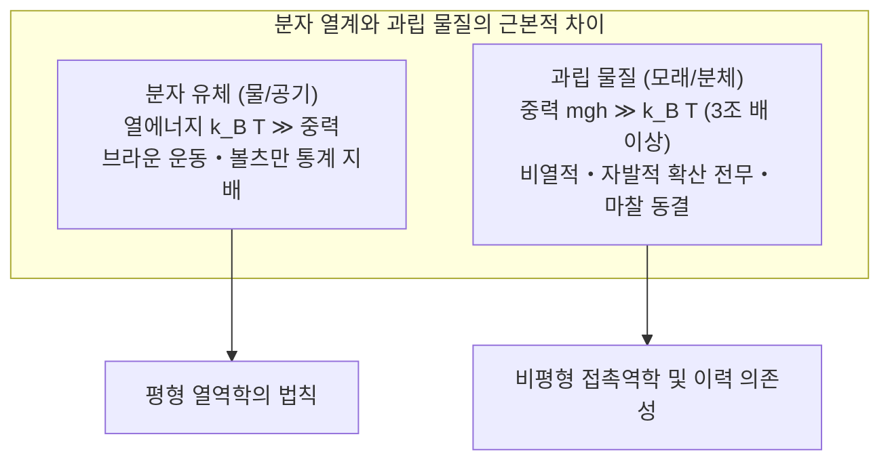
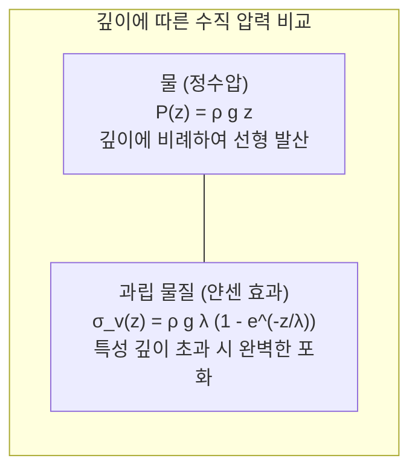
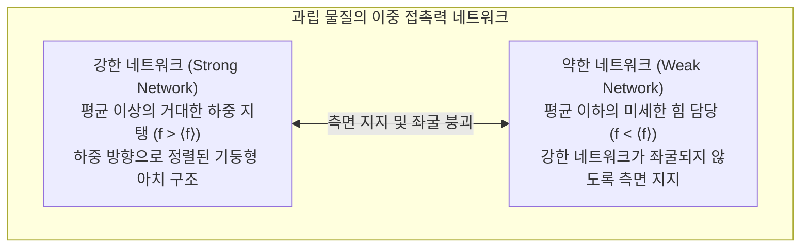

모래사장에서 마른 모래를 한 움큼 쥐면, 손가락 틈새로 물처럼 부드럽게 흘러내립니다. 그러나 그 모래를 바닥에 쌓아 올리고 그 위에 발을 딛고 서면, 마치 단단한 콘크리트 슬래브처럼 성인의 체중을 거뜬히 지탱합니다. 깔때기나 모래시계에 모래를 부으면 액체처럼 흐르지만, 물과 달리 모래시계 밑바닥에서 모래가 떨어지는 속도는 상부에 남은 모래의 양에 전혀 영향을 받지 않고 처음부터 끝까지 일정한 속도로 떨어집니다. 그리고 여러 종류의 견과류가 섞인 통을 위아래로 격렬하게 흔들면, 가장 무겁고 거대한 브라질너트가 바닥에 가라앉기는커녕 마법처럼 표면으로 떠오릅니다.

모래, 쌀, 밀가루, 광석 파쇄물, 알약 원료 분말, 그리고 소행성 표면을 덮고 있는 레골리스에 이르기까지——물리학에서는 이러한 거시적 불연속 입자들의 거대한 집합체를 <strong>과립 물질(Granular Matter)</strong>이라고 부릅니다.

과립 물질은 고전적인 물질의 세 가지 상태(고체, 액체, 기체) 중 그 어떤 것으로도 단순하게 분류할 수 없습니다. 개별 입자의 중력 위치 에너지가 열역학적 열 요동($k_B T$)보다 수조 배 이상 압도적으로 크며, 입자 사이의 마찰과 비탄성 충돌로 인해 기계적 에너지가 비가역적으로 흩어지는 비열적·비평형계이기 때문입니다. 노벨 물리학상 수상자인 피에르질 드 젠(Pierre-Gilles de Gennes)은 과립 물질을 '물질의 제4의 상태'라 부르며 응집물질물리학의 위대한 미개척 영역으로 선언했습니다.

본 글에서는 일상적이면서도 기존 물리학의 상식을 뒤엎는 과립 물질의 역학을 체계적으로 파헤칩니다. 얀센 효과(Janssen Effect)에 의한 수직 응력 포화부터 광탄성 실험이 밝혀낸 '응력 사슬(Force Chains)'의 불균일한 그물망, 레이놀즈의 다이래턴시 현상, 모래시계 유출을 지배하는 베벌루 법칙(Beverloo Law), 그리고 현대 물리학의 지평을 넓힌 '재밍 전이(Jamming Transition)'와 자기조직화 임계성까지 심도 있게 탐구합니다.

---

## 1. 물질의 '제4의 상태': 비열적 본질과 에너지 소산

### 1.1 열 요동의 완전한 부재

물이나 기체와 같은 통상적인 분자 유체계에서는 절대온도 $T$에 비례하는 열에너지 척도 $k_B T$(상온 $300\,\text{K}$에서 약 $4.14 \times 10^{-21}\,\text{J}$)가 분자들의 브라운 운동과 자발적 확산 현상을 지배합니다.

하지만 지름 $d = 1\,\text{mm}$, 밀도 $\rho = 2500\,\text{kg/m}^3$인 전형적인 석영 모래 알갱이 하나를 생각해 보겠습니다. 이 입자의 질량은 약 $1.31\,\text{mg}$입니다. 이 모래알 하나를 자기 지름 높이($h = 1\,\text{mm}$)만큼 들어 올리는 데 필요한 중력 위치 에너지는:
$$\Delta E_g = m g h \approx 1.28 \times 10^{-8}\,\text{J}$$

이 중력 에너지를 상온의 열에너지와 비교하면:
$$\frac{\Delta E_g}{k_B T} \approx 3.1 \times 10^{12}$$

입자 하나를 움직이는 데 필요한 중력 에너지가 상온 열 요동보다 무려 <strong>3조 배 이상</strong> 거대합니다. 이는 외부에서 기계적인 진동이나 전단력을 가하지 않는 한, 모래 알갱이가 열 운동으로 자발적으로 확산하거나 재배열되는 일은 우주의 나이 동안에도 결코 일어날 수 없음을 의미합니다. 따라서 과립계의 유효 열역학적 온도는 절대영도($T_{\text{eff}} \to 0$)와 같으며, 계는 마찰력과 중력에 의해 준안정한 극소 에너지 상태에 영구히 갇히게 됩니다.

### 1.2 비탄성 충돌과 비가역적 감쇠

분자 기체의 충돌은 완전 탄성 충돌로 간주되지만, 과립 물질의 입자 간 충돌은 언제나 <strong>비탄성 충돌</strong>입니다(반발 계수 $e < 1$). 충돌이 일어날 때마다 거시적 운동 에너지가 미시적 격자 진동(열)이나 소성 변형으로 전환되어 비가역적으로 소산됩니다. 에너지가 지속적으로 공급되지 않는 고립된 과립 기체는 '비탄성 붕괴(Inelastic Collapse)'를 일으켜 순식간에 운동성을 잃고 덩어리로 굳어집니다.

---

## 2. 얀센 효과: 곡물 사일로 바닥이 터지지 않는 이유

### 2.1 정수압과 과립 압력의 결정적 차이

유체역학의 스테빈 법칙에 따르면, 깊이 $H$인 수조 바닥의 정수압은 $P = \rho g H$로 깊이에 비례하여 무한히 선형 증가합니다.

하지만 19세기 말 거대한 곡물 사일로를 건설하던 기술자들은 놀라운 사실을 발견했습니다. 사일로에 곡물을 아무리 높이 쌓아 올려도, 바닥면이 받는 수직 압력은 일정 깊이를 넘어서면 <strong>더 이상 증가하지 않고 완전히 포화</strong>되는 것이었습니다. 사일로의 붕괴 사고는 바닥이 아니라 측면 벽체에서 발생했습니다.

1895년 독일의 공학자 <strong>H. A. 얀센(H. A. Janssen)</strong>은 과립 입자와 벽면 사이의 마찰력, 그리고 수평 응력 편향을 고려하여 이 현상을 수학적으로 명쾌하게 유도했습니다.

### 2.2 얀센 공식의 유도

반지름 $R$인 원통형 사일로의 깊이 $z$에서 두께 $dz$인 수평 미소 층의 수직 힘의 평형을 고려하면:
$$A \frac{d\sigma_v}{dz} = A \rho g - U \tau_w \implies \frac{d\sigma_v}{dz} = \rho g - \frac{2}{R} \tau_w$$

여기서 얀센은 두 가지 핵심 가정을 도입했습니다:
1. 벽면 전단 응력은 수평 수직 응력에 마찰 계수를 곱한 것과 같다: $\tau_w = \mu_w \sigma_h$.
2. 입자의 접촉 구조로 인해 수직 응력 $\sigma_v$의 일정 비율 $K$가 수평 응력 $\sigma_h$로 전환된다: $\sigma_h = K \sigma_v$.

특성 감쇠 길이(얀센 길이) $\lambda = \frac{R}{2 K \mu_w}$를 정의하고 경계조건 $\sigma_v(0) = 0$을 적용하여 적분하면 그 유명한 <strong>얀센의 응력식</strong>이 도출됩니다:

$$\sigma_v(z) = \rho g \lambda \left( 1 - e^{-z / \lambda} \right) = \frac{\rho g R}{2 K \mu_w} \left( 1 - e^{-\frac{2 K \mu_w}{R} z} \right)$$

- 얕은 깊이($z \ll \lambda$)에서는 $\sigma_v(z) \approx \rho g z$로 액체처럼 선형 증가합니다.
- 그러나 깊이가 깊어지면($z \gg \lambda$), 지수 항이 0으로 수렴하여 수직 압력은 최대 포화값 $\sigma_{\text{sat}} = \rho g \lambda$에 도달합니다.

그 위에 추가되는 모든 모래와 곡물의 무게는 더 이상 바닥으로 전달되지 않고, 측벽과의 정지 마찰력을 통해 벽체로 분산 지탱됩니다. 이것이 바로 모래시계가 모래의 잔량에 상관없이 밑바닥에서 일정한 압력 환경을 유지하며 정밀한 시계 역할을 할 수 있는 근본 이유입니다.

---

## 3. 보이지 않는 골격: 응력 사슬(Force Chains)의 미시 역학

### 3.1 광탄성 실험이 보여준 충격적 구조

금속이나 고무 같은 균질 탄성체는 외력을 받으면 응력이 연속적으로 매끄럽게 분산됩니다. 하지만 과립 물질에 하중을 가했을 때 힘은 어떻게 전달될까요?

광탄성 수지 원반을 이용한 실험을 통해 물리학자들은 하중이 전체 입자에 고르게 분산되는 것이 아니라, 일렬로 늘어선 소수의 입자 사슬을 따라서만 집중적으로 전달된다는 사실을 밝혀냈습니다. 이를 <strong>응력 사슬(Force Chains)</strong>이라고 부릅니다.

### 3.2 접촉력의 지수함수적 감쇠 분포

입자 간 접촉력 $f = F / \langle F \rangle$의 확률 분포 $P(f)$는 평균값보다 큰 영역에서 놀랍게도 <strong>지수함수적으로 감쇠</strong>합니다:
$$P(f) \sim e^{-\beta f} \quad (\beta \approx 1.4 \sim 1.8)$$

이는 계 내에서 소수의 '강한 응력 사슬'이 하중의 대부분을 감당하고 있으며, 대다수의 입자는 힘을 거의 받지 않은 채 강한 사슬이 옆으로 휘어지는 <strong>좌굴(Buckling)</strong>을 막아주는 버팀목 역할만 하고 있음을 의미합니다. 미세한 진동으로 버팀목 입자가 흔들리면, 거대한 하중을 지탱하던 응력 사슬이 순식간에 좌굴되어 모래더미 전체가 액체처럼 무너져 내립니다.

---

## 4. 레이놀즈 다이래턴시: 밟으면 팽창하는 젖은 모래

파도가 지나간 젖은 모래사장을 힘껏 밟으면, 발자국 주위의 모래에서 물기가 싹 사라지며 하얗게 마른 것처럼 변하는 현상을 볼 수 있습니다. 발을 떼면 다시 물기가 촉촉하게 배어 나옵니다.

압력을 가하면 물이 짜여 나와야 할 텐데, 왜 밟았을 때 물이 모래 속으로 빨려 들어갈까요?

1885년 영국의 물리학자 <strong>오즈본 레이놀즈(Osborne Reynolds)</strong>는 빽빽하게 채워진 과립계가 전단 변형을 받을 때 부피가 팽창하는 <strong>다이래턴시(Dilatancy, 전단 팽창성)</strong> 현상을 발견하고 그 메커니즘을 규명했습니다.

조밀하게 맞물려 있는 모래알들은 서로의 오목한 틈새에 완벽히 끼워져 있습니다. 이 층에 전단 변형이 가해지면, 입자들은 이웃 입자의 언덕을 <strong>'타고 넘어가는(Overriding)'</strong> 운동을 해야만 이동할 수 있습니다. 이 과정에서 입자 사이의 간격이 벌어지며 모래층 전체의 공극 부피(Void Volume)가 급격히 팽창합니다. 공극이 커지면서 표면에 있던 얇은 수막이 모세관 압력에 의해 지하의 새로운 틈새로 순식간에 빨려 들어가 겉표면이 마른 것처럼 보이는 것입니다.

---

## 5. 모래시계의 유변학: 베벌루 법칙

토리첼리의 정리에 따르면 액체가 밑바닥 구멍으로 빠져나갈 때의 속도는 수두 $H$의 제곱근에 비례하여 감속합니다($v = \sqrt{2gH}$). 그러나 모래시계의 모래 유출 속도는 상부 모래 높이와 완전히 무관하게 일정합니다.

1961년 <strong>W. A. 베벌루(W. A. Beverloo)</strong>는 모래시계나 호퍼의 오리피스(지름 $D$)를 통해 빠져나가는 질량 유량 $W$에 대한 보편적인 법칙을 정립했습니다:

$$W = C \rho_b g^{1/2} \left( D - k d \right)^{5/2}$$

- $D^{5/2}$ 스케일링: 유효 면적($\sim D^2$)과 자유 낙하 아치 영역에서 가속되어 획득하는 속도($v \sim \sqrt{gD}$)의 곱으로 완벽히 설명됩니다.
- $(D - kd)$ 항: 입자 크기 $d$로 인해 구멍 벽면 근처에 형성되는 <strong>빈 고리(Empty Annulus)</strong> 효과를 반영합니다. 구멍 크기가 $D \lesssim 4 \sim 6d$ 수준으로 좁아지면 입자들이 아치 구조를 형성하여 흐름이 영구히 멈추는 <strong>막힘(Clogging/Jamming)</strong>이 발생합니다.

---

## 6. 재밍 전이(Jamming Transition): 물리학의 새로운 통합 틀

1998년 <strong>안드레아 류(Andrea Liu)</strong>와 <strong>시드니 네이겔(Sidney Nagel)</strong>은 과립의 유동 정지, 콜로이드 유리 전이, 에멀션과 거품의 탄성을 단일한 상태도로 통합하는 <strong>재밍 상태도</strong>를 제안했습니다.

무질서하게 흩어져 흐르던 입자 집합체가 결정화 없이 밀도의 증가나 응력 감소만으로 갑자기 유한한 탄성률과 항복 응력을 가진 고체로 굳어지는 현상을 <strong>재밍 전이(Jamming Transition)</strong>라고 합니다.

마찰이 없는 구체계에서 온도 $T=0$, 전단 응력 $\sigma=0$일 때의 임계점인 <strong>포인트 J(Point J)</strong>는 랜덤 최밀 충전율 $\phi_c \approx 0.64$에 정확히 대응합니다. 포인트 J에서 계는 입자당 평균 접촉 수가 자유도의 두 배($Z_c = 2D = 6$)가 되는 맥스웰의 정정(Isostatic) 조건을 만족하며, 압축에는 극도로 강하지만 전단 변형에는 극도로 취약한 기묘한 한계 고체 상태를 나타냅니다.

---

## 7. 진동이 빚어내는 역설: 브라질너트 효과

견과류 통을 흔들었을 때 가장 무거운 브라질너트가 표면으로 떠오르는 현상은 두 가지 물리적 메커니즘에 기인합니다:
1. <strong>공극 침투(Percolation/Void Filling)</strong>: 진동 중 순간적으로 벌어진 미세 틈새로 작은 입자들이 중력에 의해 먼저 아래로 미끄러져 들어가 바닥을 형성함으로써 큰 입자를 단계적으로 밀어 올립니다.
2. <strong>과립 대류(Granular Convection)</strong>: 벽면 마찰로 인해 중앙부는 상승하고 벽면은 좁게 하강하는 대류 순환이 발생하는데, 표면에 도달한 거대한 입자는 좁은 하강 기류를 통과하지 못해 표면에 영구 격리됩니다.

---

## 8. 결론: 한 톨의 모래에 깃든 우주의 질서

모래는 고체일까요, 액체일까요?
물리학의 답은 <strong>'모두 맞으며, 동시에 모두 아니다'</strong>입니다.

정지 상태에서는 강인한 응력 사슬로 하중을 버텨내는 고체이고, 기울어지면 유려하게 흐르는 액체이며, 격렬하게 흔들리면 기체처럼 흩어집니다. 이 다채로운 상태의 전환을 지배하는 것은 분자의 열운동이 아닌 기하학적 맞물림과 마찰, 그리고 비탄성 소산의 원리입니다. 발아래의 모래 한 줌 속에는 현대 비선형 물리와 복잡계 과학의 가장 깊고 아름다운 신비가 살아 숨 쉬고 있습니다.
