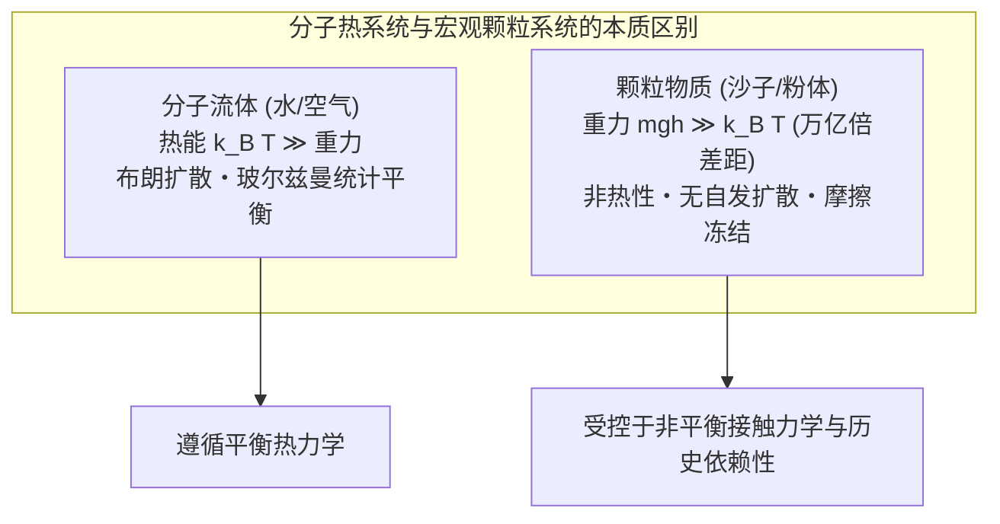
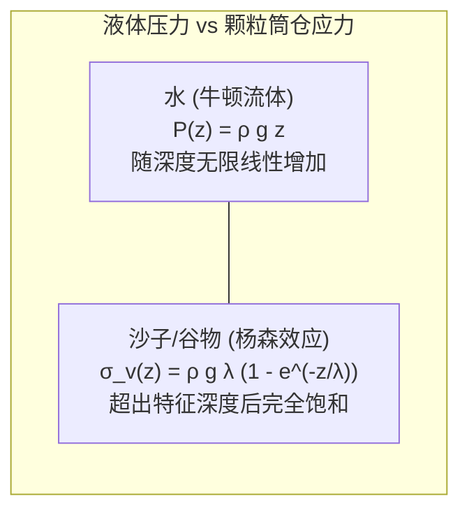
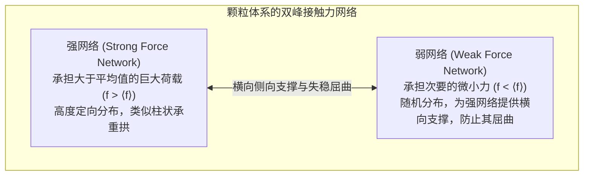
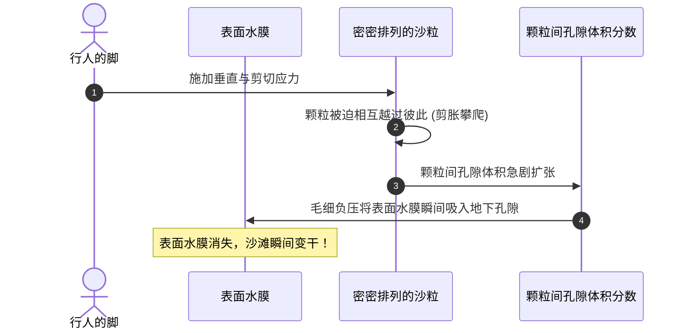
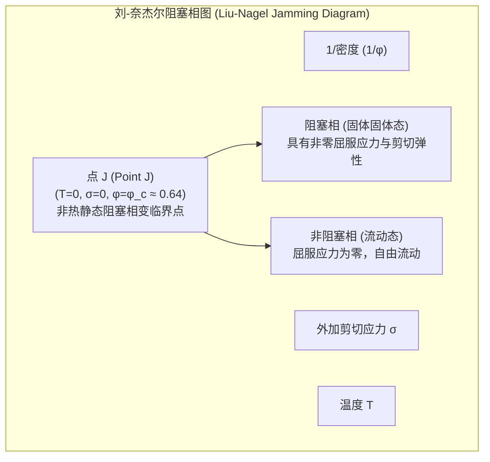

在沙滩上抓起一把干沙，细小的沙粒会像水流一样从指缝间滑落。然而，将同样的沙子堆积成堆并踩在上面，它却能像坚固的混凝土板一样稳稳承受成年人的体重。将沙子倒入漏斗或沙漏中，它能够顺畅地流动，但与水不同的是，沙漏底部流出沙子的速率完全不受上方残留沙子高度的影响，自始至终以恒定速率滴落。而当你剧烈摇晃装满混合坚果的容器时，最大最沉的巴西坚果不仅不会沉底，反而会不可思议地自动浮升至表面。

沙子、大米、面粉、矿石碎块、药粉以及覆盖在遥远小行星表面的风化层——在物理学中，这些由大量宏观离散颗粒构成的系统被称为<strong>颗粒物质（Granular Matter）</strong>。

颗粒物质无法被简单归入经典的物质三态（固体、液体、气体）。由于宏观颗粒的重力势能远远超越其热力学热涨落（$k_B T$），且颗粒间通过摩擦与非弹性碰撞不可逆地耗散机械能，颗粒系统本质上属于一种非热、远离平衡态的特殊体系。诺贝尔物理学奖得主皮埃尔-吉尔·德热纳（Pierre-Gilles de Gennes）曾将颗粒物质誉为“物质的第四态”，并呼吁凝聚态物理学界对其展开系统深入的探索。

本文将带领读者全面领略颗粒物质颠覆传统物理直觉的奇妙力学：从谷仓中杨森效应（Janssen Effect）导致的垂直应力饱和，到光弹性揭示的“应力链（Force Chains）”不均匀网络；从雷诺剪胀性到沙漏流动的贝弗鲁定律（Beverloo Law）；再到彻底革新凝聚态物理范式的“阻塞转变（Jamming Transition）”与自组织临界性。

---

## 一、 物质的“第四态”：非热性与不可逆耗散

### 1.1 热涨落的彻底缺席

在分子流体或气体中，经典热力学以绝对温度 $T$ 定义热能尺度 $k_B T$（室温下约为 $4.14 \times 10^{-21}\,\text{J}$）。这一微观热运动驱动着分子的布朗运动、自发扩散与熵弹性。

然而，对于一颗直径 $d = 1\,\text{mm}$、密度 $\rho = 2500\,\text{kg/m}^3$ 的普通石英沙粒，其自身质量约为 $1.31\,\text{mg}$。将其垂直抬升自身直径的高度（$h = 1\,\text{mm}$），所需的重力势能为：
$$\Delta E_g = m g h \approx 1.28 \times 10^{-8}\,\text{J}$$

重力势能与环境热能的比值高达：
$$\frac{\Delta E_g}{k_B T} \approx 3.1 \times 10^{12}$$

这意味着，重力对颗粒的作用力比室温热涨落高出了<strong>整整3万亿倍以上</strong>！在没有外部机械振动或剪切输入的情况下，颗粒物质绝不可能通过布朗运动发生自发扩散或重排。颗粒系统的有效热温度在物理意义上等于绝对零度（$T_{\text{eff}} \to 0$），整个体系永远被摩擦力和重力牢牢“冻结”在非平衡亚稳态的深渊中。

### 1.2 非弹性碰撞与能量衰减

分子碰撞在热力学中通常被视为完全弹性碰撞。然而，颗粒物质间的碰撞必然伴随着机械能的耗散，恢复系数 $e < 1$。每次碰撞都会将宏观动能转化为颗粒内部的晶格热振动或塑性形变。若没有持续的外界能量注入，运动中的颗粒气体会在极短时间内通过所谓的“非弹性崩塌（Inelastic Collapse）”丧失所有动能并发生聚集固化。

---

## 二、 静止沙粒的奇迹：杨森效应与侧壁应力饱和

### 2.1 谷仓佯谬：为什么粮仓底部不会被压垮？

流体力学中著名的斯蒂文定律表明，盛水容器底部的静水压力与液柱高度 $H$ 成正比：$P = \rho g H$。深度翻倍，底部的压强也随之翻倍。

然而在19世纪末，建造巨型谷物筒仓的工程师们发现了一个极为诡异的工程事实：不论向筒仓内倾倒多么深的小麦或玉米，<strong>底板所承受的垂直压力在超过某一特定深度后便彻底停止增加</strong>，呈现完全饱和的状态。筒仓的结构破坏往往不是发生在底部，而是在筒仓中部的侧壁产生爆裂。

1895年，德国工程师<strong>H. A. 杨森（H. A. Janssen）</strong>首次从颗粒间摩擦力和侧壁推力的角度建立了数学模型。

### 2.2 杨森公式的数学推导

设半径为 $R$ 的圆柱形筒仓内充填了散密度为 $\rho$ 的颗粒。分析位于深度 $z$ 至 $z + dz$ 之间微元水平层（厚度 $dz$，截面积 $A = \pi R^2$，周长 $U = 2\pi R$）的垂直受力平衡。

向上与向下的力平衡方程为：
$$A \sigma_v + A \rho g dz = A \left( \sigma_v + \frac{d\sigma_v}{dz} dz \right) + \tau_w U dz$$

化简可得：
$$\frac{d\sigma_v}{dz} = \rho g - \frac{2}{R} \tau_w$$

杨森引入了两个至关重要的物理假定：
1. <strong>库仑摩擦定律</strong>：侧壁处的剪切应力 $\tau_w$ 正比于压向侧壁的水平正应力 $\sigma_h$，即 $\tau_w = \mu_w \sigma_h$（$\mu_w$ 为壁面摩擦系数）。
2. <strong>偏向应力系数 $K$</strong>：由于颗粒的刚性接触与拱圈效应，垂直应力 $\sigma_v$ 的固定比例被偏转为水平方向的侧向压力：
   $$\sigma_h = K \sigma_v \quad (0 < K < 1)$$

由此得到垂直应力的一阶常微分方程：
$$\frac{d\sigma_v}{dz} = \rho g - \frac{2 K \mu_w}{R} \sigma_v$$

定义系统的<strong>杨森特征屏蔽长度 $\lambda$</strong>：
$$\lambda = \frac{R}{2 K \mu_w}$$

利用自由表面无外压条件 $\sigma_v(0) = 0$ 求解，便得到了名垂力学史的<strong>杨森应力饱和公式</strong>：

$$\sigma_v(z) = \rho g \lambda \left( 1 - e^{-z / \lambda} \right) = \frac{\rho g R}{2 K \mu_w} \left( 1 - e^{-\frac{2 K \mu_w}{R} z} \right)$$

- 在浅层区域（$z \ll \lambda$），展开指数项可得 $\sigma_v(z) \approx \rho g z$，颗粒系统表现出类似于液体的静水压特性；
- 但在深层区域（$z \gg \lambda$），指数项迅速趋于零，垂直应力完全收敛于上限值：
  $$\sigma_{\text{sat}} = \rho g \lambda = \frac{\rho g R}{2 K \mu_w}$$

新加入的所有上层颗粒重量，通过颗粒间的拱效应完全被转移至筒仓侧壁，最终由筒仓壁面的静摩擦力承受。这正是沙漏在整个运行过程中，底部流速能够完全不受上部沙子存量影响的根本力学原因！

---

## 三、 隐藏的骨架：应力链（Force Chains）的非均匀世界

### 3.1 光弹性实验揭示的惊人图景

在均匀弹性体（如金属或橡胶）中施加外力时，内部应力根据连续介质力学平滑散布。但颗粒物质并非连续介质。

20世纪70年代以来，物理学家利用光弹性材料（在机械应力下产生双折射现象的高分子聚合物圆盘）进行加载实验，发现了令人震撼的现象：外力绝非均匀分散于所有颗粒上，而是沿着少数细长、分叉的线状网络集中传递。这些承载主要荷载的通道被称为<strong>应力链（Force Chains / Stress Chains）</strong>。

### 3.2 接触力的指数衰减分布

实验与计算机离散元模拟（DEM）表明，颗粒间接触力 $f = F / \langle F \rangle$ 的概率密度分布 $P(f)$ 展现出普适的特征：
- 小于平均力的区域：分布较为平坦或微弱幂律衰减；
- 大于平均力的区域：分布严格呈现<strong>指数衰减（Exponential Decay）</strong>：
  $$P(f) \sim e^{-\beta f} \quad (\beta \approx 1.4 \sim 1.8)$$

这意味着体系中少数极度坚硬的“强应力链”承担了数倍乃至数十倍于平均水平的荷载，而其余大量的颗粒（弱网络）几乎不受力，仅仅充当了防止强应力链向侧方发生受压屈曲（Buckling）的脚手架。

一旦受到轻微的外界振动，弱网络颗粒发生位移，侧向支撑失效，细长脆弱的强应力链就会瞬间发生<strong>欧拉屈曲断裂</strong>，导致原本稳固如石的颗粒体系发生灾难性的崩塌与液化。

---

## 四、 雷诺剪胀性：为什么踩在湿沙上表面会变干？

在海浪退去的湿润沙滩上用力踏下一脚，每个人都会看到一个神奇的反常现象：脚踩下的瞬间，脚印周围原本泛着水光的沙面瞬间变得发白干燥；抬起脚后，水分才慢慢渗回表面。

常规直觉认为，受压的海绵应当将内部水分挤出。为什么踩压湿沙反而会把表面的水“吸”进沙体内部？

1885年，英国著名物理学家<strong>奥斯本·雷诺（Osborne Reynolds）</strong>给出了经典力学解释，并将这种密实颗粒材料在受剪切时宏观体积膨胀的性质定义为<strong>剪胀性（Dilatancy）</strong>。

在密实堆积状态下，每个沙粒都安稳地嵌套在相邻颗粒所形成的凹陷之中。当受到剪切变形时，颗粒无法相互穿透，必须顺着接触面<strong>“攀爬并越过（Overriding）”</strong>相邻颗粒的顶部。这种几何攀爬运动迫使相邻颗粒层之间的间距拉大，导致整个沙层的孔隙体积（Void Ratio）显著膨胀。地下孔隙一经扩大，表面的一层薄水膜便立刻被毛细负压吸入更深的空隙中，导致地表瞬间泛白干燥。

在土力学中，剪胀性是砂土抵抗剪切滑移、产生极高瞬态承载力的核心几何机制。

---

## 五、 沙漏的流体力学：贝弗鲁定律与孔口流动

### 5.1 托里拆利定律的彻底失效

对于普通液体（水或油），从容器底部直径为 $D$ 的小孔流出时，流速由能量守恒定律（托里拆利定律）决定：
$$v = \sqrt{2 g H}$$
液面高度 $H$ 越高，静水压越大，流速越快。随着液面下降，流速必然不断衰减。

但如果沙子是液体，沙漏也会随着剩余沙量的减少而越漏越慢，从而丧失作为计时仪器的价值。然而现实中，<strong>沙漏内部沙子的流出速度在整个过程中完全恒定不变</strong>。

### 5.2 贝弗鲁定律（Beverloo Law）

由于杨森效应的应力屏蔽，孔口上方承受的力学环境与总装填高度 $H$ 无关。此外，在孔口上方数个颗粒直径的高度上，由于颗粒间的动态拱效应，形成了一个稳定的<strong>“自由落体拱（Free-Fall Arch）”</strong>。颗粒从拱顶脱离后，仅在重力加速度 $g$ 下做初速度几乎为零的自由落体。

1961年，<strong>W. A. 贝弗鲁（W. A. Beverloo）</strong>提出了描述颗粒孔口质量流率 $W$（$\text{kg/s}$）的普适经验公式：

$$W = C \rho_b g^{1/2} \left( D - k d \right)^{5/2}$$

其中：
- $C$ 为无量纲几何系数（一般介于 $0.55 \sim 0.65$）；
- $\rho_b$ 为颗粒堆积松装密度；
- $g$ 为重力加速度；
- $D$ 为出料口孔径；
- $d$ 为颗粒平均直径；
- $k$ 为无量纲边界影响系数（约为 $1.0 \sim 3.0$）。

#### $D^{5/2}$ 幂律的量纲推导
1. 有效出流截面积正比于孔口尺度的平方：$A \propto D^2$
2. 颗粒在自由落体拱区加速获得的特征出流速度为：$v \sim \sqrt{g D}$
3. 质量流率 $W = \rho_b A v \propto \rho_b D^2 \sqrt{g D} = \rho_b g^{1/2} D^{5/2}$

公式中 $(D - k d)$ 则反映了颗粒中心无法紧贴孔口内壁运动的<strong>空滞环（Empty Annulus）</strong>几何效应。当孔口过小（$D \lesssim 4 \sim 6 d$）时，坚固的应力拱会完全跨越孔口两端，产生永久性的<strong>流动阻塞（Clogging）</strong>。

---

## 六、 阻塞转变（Jamming Transition）：物理学的新统一范式

### 6.1 什么是阻塞？

抽真空的咖啡粉包装袋坚硬如砖块；一旦划破塑料膜吸入空气，咖啡粉便立刻松散如流沙。这种在没有发生周期性晶格结晶的情况下，无序颗粒系统仅因密度增加或外力减少而<strong>突然获得剪切模量与屈服应力，自发转变为刚性固体的现象</strong>，被称为<strong>阻塞转变（Jamming Transition）</strong>。

### 6.2 点 J（Point J）与静定刚性渗透

1998年，物理学家<strong>安德烈亚·刘（Andrea Liu）</strong>与<strong>西德尼·奈杰尔（Sidney Nagel）</strong>提出了著名的“阻塞相图”，将颗粒体系的流动停滞、胶体玻璃化、乳液（如蛋黄酱）与泡沫的流变性统一在三维相空间（密度、剪切应力、温度）中。宏观颗粒处于 $T = 0$ 的底面上。

在零外力、零温度极限下，无摩擦硬球在<strong>随机紧密堆积极限（Random Close Packing, RCP）</strong>处遭遇阻塞临界点——<strong>点 J</strong>：
$$\phi_c \approx 0.64$$

在点 J，系统刚好满足麦克斯韦静定准则（Maxwell Criterion）：平均配位数（每个颗粒的接触数）恰好等于自由度维数的两倍：
$$Z_c = 2 D \quad (3\text{维空间下 } Z_c = 6)$$

在点 J 之上（$\phi > \phi_c$），多余配位数呈现普适平方根幂律演化：
$$Z - Z_c \propto (\phi - \phi_c)^{1/2}$$
体积模量呈现不连续阶跃跳变，而剪切模量 $G \sim (\phi - \phi_c)^{1/2}$ 则从零连续升起。比值 $G/K \to 0$ 说明阻塞相变点附近的固态呈现出“抗压极强、抗剪极软”的临界奇特物性。

---

## 七、 振动带来的反常：巴西坚果效应

在混合坚果罐中，体积极大的巴西坚果总是在运输晃动后神奇地浮到最上层。阿基米德浮力定律在颗粒世界被纯粹的<strong>几何尺寸效应</strong>所压倒。

引发<strong>巴西坚果效应（Brazil Nut Effect）</strong>的两个主要物理机制为：
1. <strong>几何孔隙渗透（Void Filling）</strong>：在振动腾空期，体系瞬态膨胀，微小颗粒因重力轻易下落并填补大坚果底部的狭窄空隙；大坚果下方不断垫入新的颗粒层，形成单向棘轮提升。
2. <strong>颗粒对流圈（Granular Convection）</strong>：容器壁摩擦在内部激发出中心向上、壁面狭窄向下的对流涡。大颗粒随中心上升流到达表层后，因尺寸超过壁面下降流边界层厚度，被永久困在表面。

---

## 八、 总结：一粒沙中见宇宙

沙子究竟是固体还是液体？
现代物理学的最终答案是：<strong>它既是固体，也是液体，同时也是气体。</strong> 它的相态不取决于分子的热振动，而取决于几何排布、摩擦接触与能量散逸的精密平衡。在这一粒微小的沙石之中，蕴含着现代非线性科学与复杂系物理学最激动人心的壮美篇章。
