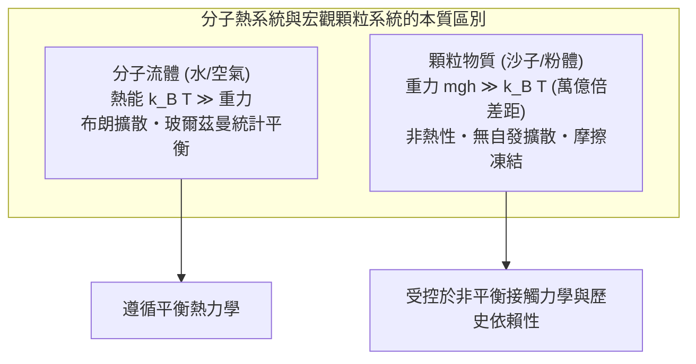
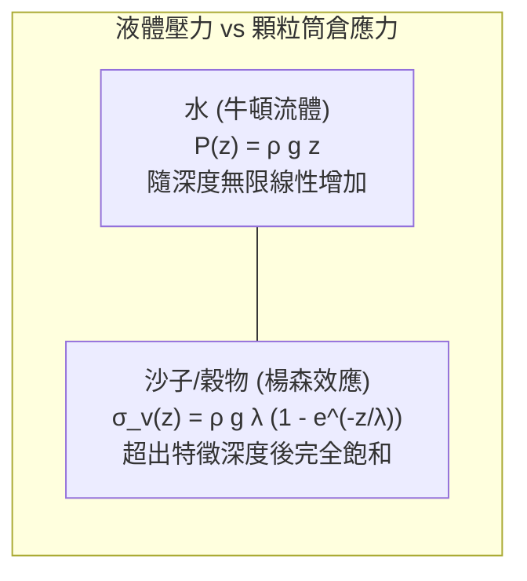
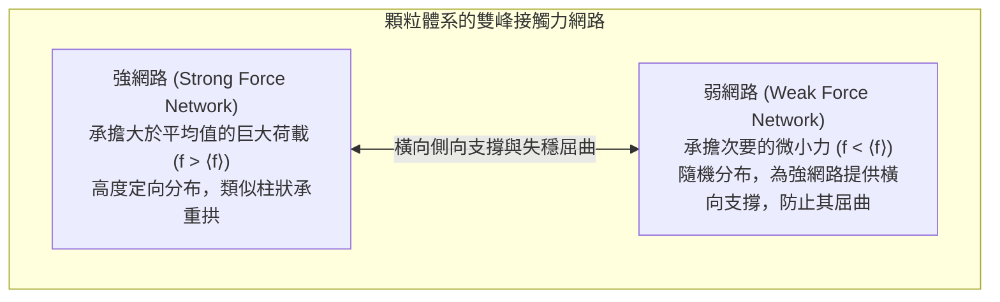
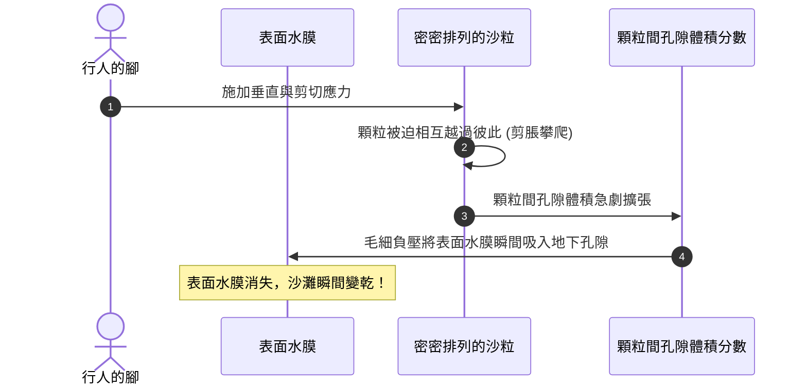
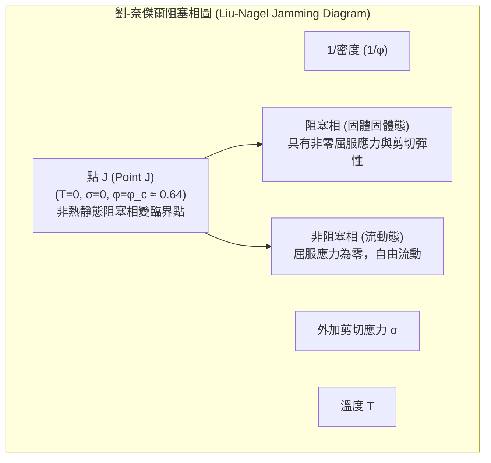

在沙灘上抓起一把乾沙，細小的沙粒會像水流一樣從指縫間滑落。然而，將同樣的沙子堆積成堆並踩在上面，它卻能像堅固的混凝土板一樣穩穩承受成年人的體重。將沙子倒入漏斗或沙漏中，它能夠順暢地流動，但與水不同的是，沙漏底部流出沙子的速率完全不受上方殘留沙子高度的影響，自始至終以恆定速率滴落。而當你劇烈搖晃裝滿混合堅果的容器時，最大最沉的巴西堅果不僅不會沉底，反而會不可思議地自動浮升至表面。

沙子、大米、麵粉、礦石碎塊、藥粉以及覆蓋在遙遠小行星表面的風化層——在物理學中，這些由大量宏觀離散顆粒構成的系統被稱為<strong>顆粒物質（Granular Matter）</strong>。

顆粒物質無法被簡單歸入經典的物質三態（固體、液體、氣體）。由於宏觀顆粒的重力勢能遠遠超越其熱力學熱漲落（$k_B T$），且顆粒間通過摩擦與非彈性碰撞不可逆地耗散機械能，顆粒系統本質上屬於一種非熱、遠離平衡態的特殊體系。諾貝爾物理學獎得主皮埃爾-吉爾·德熱納（Pierre-Gilles de Gennes）曾將顆粒物質譽為「物質的第四態」，並呼籲凝聚態物理學界對其展開系統深入的探索。

本文將帶領讀者全面領略顆粒物質顛覆傳統物理直覺的奇妙力學：從穀倉中楊森效應（Janssen Effect）導致的垂直應力飽和，到光彈性揭示的「應力鏈（Force Chains）」不均勻網路；從雷諾剪脹性到沙漏流動的貝弗魯定律（Beverloo Law）；再到徹底革新凝聚態物理範式的「阻塞轉變（Jamming Transition）」與自組織臨界性。

---

## 一、 物質的「第四態」：非熱性與不可逆耗散

### 1.1 熱漲落的徹底缺席

在分子流體或氣體中，經典熱力學以絕對溫度 $T$ 定義熱能尺度 $k_B T$（室溫下約為 $4.14 \times 10^{-21}\,\text{J}$）。這一微觀熱運動驅動著分子的布朗運動、自發擴散與熵彈性。

然而，對於一顆直徑 $d = 1\,\text{mm}$、密度 $\rho = 2500\,\text{kg/m}^3$ 的普通石英沙粒，其自身質量約為 $1.31\,\text{mg}$。將其垂直抬升自身直徑的高度（$h = 1\,\text{mm}$），所需的重力勢能為：
$$\Delta E_g = m g h \approx 1.28 \times 10^{-8}\,\text{J}$$

重力勢能與環境熱能的比值高達：
$$\frac{\Delta E_g}{k_B T} \approx 3.1 \times 10^{12}$$

這意味著，重力對顆粒的作用力比室溫熱漲落高出了<strong>整整3萬億倍以上</strong>！在沒有外部機械振動或剪切輸入的情況下，顆粒物質絕不可能通過布朗運動發生自發擴散或重排。顆粒系統的有效熱溫度在物理意義上等於絕對零度（$T_{\text{eff}} \to 0$），整個體系永遠被摩擦力和重力牢牢「凍結」在非平衡亞穩態的深淵中。

### 1.2 非彈性碰撞與能量衰減

分子碰撞在熱力學中通常被視為完全彈性碰撞。然而，顆粒物質間的碰撞必然伴隨著機械能的耗散，恢復係數 $e < 1$。每次碰撞都會將宏觀動能轉化為顆粒內部的晶格熱振動或塑性形變。若沒有持續的外界能量輸入，運動中的顆粒氣體會在極短時間內通過所謂的「非彈性崩塌（Inelastic Collapse）」喪失所有動能並發生聚集固化。

---

## 二、 靜止沙粒的奇蹟：楊森效應與側壁應力飽和

### 2.1 穀倉佯謬：為什麼糧倉底部不會被壓垮？

流體力學中著名的斯蒂文定律表明，盛水容器底部的靜水壓力與液柱高度 $H$ 成正比：$P = \rho g H$。深度翻倍，底部的壓強也隨之翻倍。

然而在19世紀末，建造巨型穀物筒倉的工程師們發現了一個極為詭異的工程事實：不論向筒倉內傾倒多麼深的小麥或玉米，<strong>底板所承受的垂直壓力在超過某一特定深度後便徹底停止增加</strong>，呈現完全飽和的狀態。筒倉的結構破壞往往不是發生在底部，而是在筒倉中部的側壁產生爆裂。

1895年，德國工程師<strong>H. A. 楊森（H. A. Janssen）</strong>首次從顆粒間摩擦力和側壁推力的角度建立了數學模型。

### 2.2 楊森公式的數學推導

設半徑為 $R$ 的圓柱形筒倉內充填了散密度為 $\rho$ 的顆粒。分析位於深度 $z$ 至 $z + dz$ 之間微元水平層（厚度 $dz$，截面積 $A = \pi R^2$，周長 $U = 2\pi R$）的垂直受力平衡。

向上與向下的力平衡方程為：
$$A \sigma_v + A \rho g dz = A \left( \sigma_v + \frac{d\sigma_v}{dz} dz \right) + \tau_w U dz$$

化簡可得：
$$\frac{d\sigma_v}{dz} = \rho g - \frac{2}{R} \tau_w$$

楊森引入了兩個至關重要的物理假定：
1. <strong>庫侖摩擦定律</strong>：側壁處的剪切應力 $\tau_w$ 正比於壓向側壁的水平正應力 $\sigma_h$，即 $\tau_w = \mu_w \sigma_h$（$\mu_w$ 為壁面摩擦係數）。
2. <strong>偏向應力係數 $K$</strong>：由於顆粒的剛性接觸與拱圈效應，垂直應力 $\sigma_v$ 的固定比例被偏轉為水平方向的側向壓力：
   $$\sigma_h = K \sigma_v \quad (0 < K < 1)$$

由此得到垂直應力的一階常微分方程：
$$\frac{d\sigma_v}{dz} = \rho g - \frac{2 K \mu_w}{R} \sigma_v$$

定義系統的<strong>楊森特徵屏蔽長度 $\lambda$</strong>：
$$\lambda = \frac{R}{2 K \mu_w}$$

利用自由表面無外壓條件 $\sigma_v(0) = 0$ 求解，便得到了名垂力學史的<strong>楊森應力飽和公式</strong>：

$$\sigma_v(z) = \rho g \lambda \left( 1 - e^{-z / \lambda} \right) = \frac{\rho g R}{2 K \mu_w} \left( 1 - e^{-\frac{2 K \mu_w}{R} z} \right)$$

- 在淺層區域（$z \ll \lambda$），展開指數項可得 $\sigma_v(z) \approx \rho g z$，顆粒系統表現出類似於液體的靜水壓特性；
- 但在深層區域（$z \gg \lambda$），指數項迅速趨於零，垂直應力完全收斂於上限值：
  $$\sigma_{\text{sat}} = \rho g \lambda = \frac{\rho g R}{2 K \mu_w}$$

新加入的所有上層顆粒重量，通過顆粒間的拱效應完全被轉移至筒倉側壁，最終由筒倉壁面的靜摩擦力承受。這正是沙漏在整個運行過程中，底部流速能夠完全不受上部沙子存量影響的根本力學原因！

---

## 三、 隱藏的骨架：應力鏈（Force Chains）的非均勻世界

### 3.1 光彈性實驗揭示的驚人圖景

在均勻彈性體（如金屬或橡膠）中施加外力時，內部應力根據連續介質力學平滑散布。但顆粒物質並非連續介質。

20世紀70年代以來，物理學家利用光彈性材料（在機械應力下產生雙折射現象的高分子聚合物圓盤）進行加載實驗，發現了令人震撼的現象：外力絕非均勻分散於所有顆粒上，而是沿著少數細長、分叉的線狀網路集中傳遞。這些承載主要荷載的通道被稱為<strong>應力鏈（Force Chains / Stress Chains）</strong>。

### 3.2 接觸力的指數衰減分布

實驗與計算機離散元模擬（DEM）表明，顆粒間接觸力 $f = F / \langle F \rangle$ 的概率密度分布 $P(f)$ 展現出普適的特徵：
- 小於平均力的區域：分布較為平坦或微弱冪律衰減；
- 大於平均力的區域：分布嚴格呈現<strong>指數衰減（Exponential Decay）</strong>：
  $$P(f) \sim e^{-\beta f} \quad (\beta \approx 1.4 \sim 1.8)$$

這意味著體系中少數極度堅硬的「強應力鏈」承擔了數倍乃至數十倍於平均水平的荷載，而其餘大量的顆粒（弱網路）幾乎不受力，僅僅充當了防止強應力鏈向側方發生受壓屈曲（Buckling）的腳手架。

一旦受到輕微的外界振動，弱網路顆粒發生位移，側向支撐失效，細長脆弱的強應力鏈就會瞬間發生<strong>歐拉屈曲斷裂</strong>，導致原本穩固如石的顆粒體系發生災難性的崩塌與液化。

---

## 四、 雷諾剪脹性：為什麼踩在濕沙上表面會變乾？

在海浪退去的濕潤沙灘上用力踏下一腳，每個人都會看到一個神奇的反常現象：腳踩下的瞬間，腳印周圍原本泛著水光的沙面瞬間變得發白乾燥；抬起腳後，水分才慢慢滲回表面。

常規直覺認為，受壓的海綿應當將內部水分擠出。為什麼踩壓濕沙反而會把表面的水「吸」進沙體內部？

1885年，英國著名物理學家<strong>奧斯本·雷諾（Osborne Reynolds）</strong>給出了經典力學解釋，並將這種密實顆粒材料在受剪切時宏觀體積膨脹的性質定義為<strong>剪脹性（Dilatancy）</strong>。

在密實堆積狀態下，每個沙粒都安穩地嵌套在相鄰顆粒所形成的凹陷之中。當受到剪切變形時，顆粒無法相互穿透，必須順著接觸面<strong>「攀爬並越過（Overriding）」</strong>相鄰顆粒的頂部。這種幾何攀爬運動迫使相鄰顆粒層之間的間距拉大，導致整個沙層的孔隙體積（Void Ratio）顯著膨脹。地下孔隙一經擴大，表面的一層薄水膜便立刻被毛細負壓吸入更深的空隙中，導致地表瞬間泛白乾燥。

在土力學中，剪脹性是砂土抵抗剪切滑移、產生極高瞬態承載力的核心幾何機制。

---

## 五、 沙漏的流體力學：貝弗魯定律與孔口流動

### 5.1 托里拆利定律的徹底失效

對於普通液體（水或油），從容器底部直徑為 $D$ 的小孔流出時，流速由能量守恆定律（托里拆利定律）決定：
$$v = \sqrt{2 g H}$$
液面高度 $H$ 越高，靜水壓越大，流速越快。隨著液面下降，流速必然不斷衰減。

但如果沙子是液體，沙漏也會隨著剩餘沙量的減少而越漏越慢，從而喪失作為計時儀器的價值。然而現實中，<strong>沙漏內部沙子的流出速度在整個過程中完全恆定不變</strong>。

### 5.2 貝弗魯定律（Beverloo Law）

由於楊森效應的應力屏蔽，孔口上方承受的力學環境與總裝填高度 $H$ 無關。此外，在孔口上方數個顆粒直徑的高度上，由於顆粒間的動態拱效應，形成了一個穩定的<strong>「自由落體拱（Free-Fall Arch）」</strong>。顆粒從拱頂脫離後，僅在重力加速度 $g$ 下做初速度幾乎為零的自由落體。

1961年，<strong>W. A. 貝弗魯（W. A. Beverloo）</strong>提出了描述顆粒孔口質量流率 $W$（$\text{kg/s}$）的普適經驗公式：

$$W = C \rho_b g^{1/2} \left( D - k d \right)^{5/2}$$

其中：
- $C$ 為無量綱幾何係數（一般介於 $0.55 \sim 0.65$）；
- $\rho_b$ 為顆粒堆積鬆裝密度；
- $g$ 為重力加速度；
- $D$ 為出料口孔徑；
- $d$ 為顆粒平均直徑；
- $k$ 為無量綱邊界影響係數（約為 $1.0 \sim 3.0$）。

#### $D^{5/2}$ 冪律的量綱推導
1. 有效出流截面積正比於孔口尺度的平方：$A \propto D^2$
2. 顆粒在自由落體拱區加速獲得的特徵出流速度為：$v \sim \sqrt{g D}$
3. 質量流率 $W = \rho_b A v \propto \rho_b D^2 \sqrt{g D} = \rho_b g^{1/2} D^{5/2}$

公式中 $(D - k d)$ 則反映了顆粒中心無法緊貼孔口內壁運動的<strong>空滯環（Empty Annulus）</strong>幾何效應。當孔口過小（$D \lesssim 4 \sim 6 d$）時，堅固的應力拱會完全跨越孔口兩端，產生永久性的<strong>流動阻塞（Clogging）</strong>。

---

## 六、 阻塞轉變（Jamming Transition）：物理學的新統一範式

### 6.1 什麼是阻塞？

抽真空的咖啡粉包裝袋堅硬如磚塊；一旦劃破塑料膜吸入空氣，咖啡粉便立刻鬆散如流沙。這種在沒有發生週期性晶格結晶的情況下，無序顆粒系統僅因密度增加或外力減少而<strong>突然獲得剪切模量與屈服應力，自發轉變為剛性固體的現象</strong>，被稱為<strong>阻塞轉變（Jamming Transition）</strong>。

### 6.2 點 J（Point J）與靜定剛性滲透

1998年，物理學家<strong>安德烈亞·劉（Andrea Liu）</strong>與<strong>西德尼·奈傑爾（Sidney Nagel）</strong>提出了著名的「阻塞相圖」，將顆粒體系的流動停滯、膠體玻璃化、乳液（如蛋黃醬）與泡沫的流變性統在一在三維相空間（密度、剪切應力、溫度）中。宏觀顆粒處於 $T = 0$ 的底面上。

在零外力、零溫度極限下，無摩擦硬球在<strong>隨機緊密堆積極限（Random Close Packing, RCP）</strong>處遭遇阻塞臨界點——<strong>點 J</strong>：
$$\phi_c \approx 0.64$$

在點 J，系統剛好滿足麥克斯韋靜定準則（Maxwell Criterion）：平均配位數（每個顆粒的接觸數）恰好等於自由度維數的兩倍：
$$Z_c = 2 D \quad (3\text{維空間下 } Z_c = 6)$$

在點 J 之上（$\phi > \phi_c$），多餘配位數呈現普適平方根冪律演化：
$$Z - Z_c \propto (\phi - \phi_c)^{1/2}$$
體積模量呈現不連續階躍跳變，而剪切模量 $G \sim (\phi - \phi_c)^{1/2}$ 則從零連續升起。比值 $G/K \to 0$ 說明阻塞相變點附近的固態呈現出「抗壓極強、抗剪極軟」的臨界奇特物性。

---

## 七、 振動帶來的反常：巴西堅果效應

在混合堅果罐中，體積極大的巴西堅果總是在運輸晃動後神奇地浮到最上層。阿基米德浮力定律在顆粒世界被純粹的<strong>幾何尺寸效應</strong>所壓倒。

引發<strong>巴西堅果效應（Brazil Nut Effect）</strong>的兩個主要物理機制為：
1. <strong>幾何孔隙滲透（Void Filling）</strong>：在振動騰空期，體系瞬態膨脹，微小顆粒因重力輕易下落並填補大堅果底部的狹窄空隙；大堅果下方不斷墊入新的顆粒層，形成單向棘輪提升。
2. <strong>顆粒對流圈（Granular Convection）</strong>：容器壁摩擦在內部激發出中心向上、壁面狹窄向下的對流渦。大顆粒隨中心上升流到達表層後，因尺寸超過壁面下降流邊界層厚度，被永久困在表面。

---

## 八、 總結：一粒沙中見宇宙

沙子究竟是固體還是液體？
現代物理學的最終答案是：<strong>它既是固體，也是液體，同時也是氣體。</strong> 它的相態不取決於分子的熱振動，而取決於幾何排布、摩擦接觸與能量散逸的精密平衡。在這一粒微小的沙石之中，蘊含著現代非線性科學與複雜系物理學最激動人心的壯美篇章。
