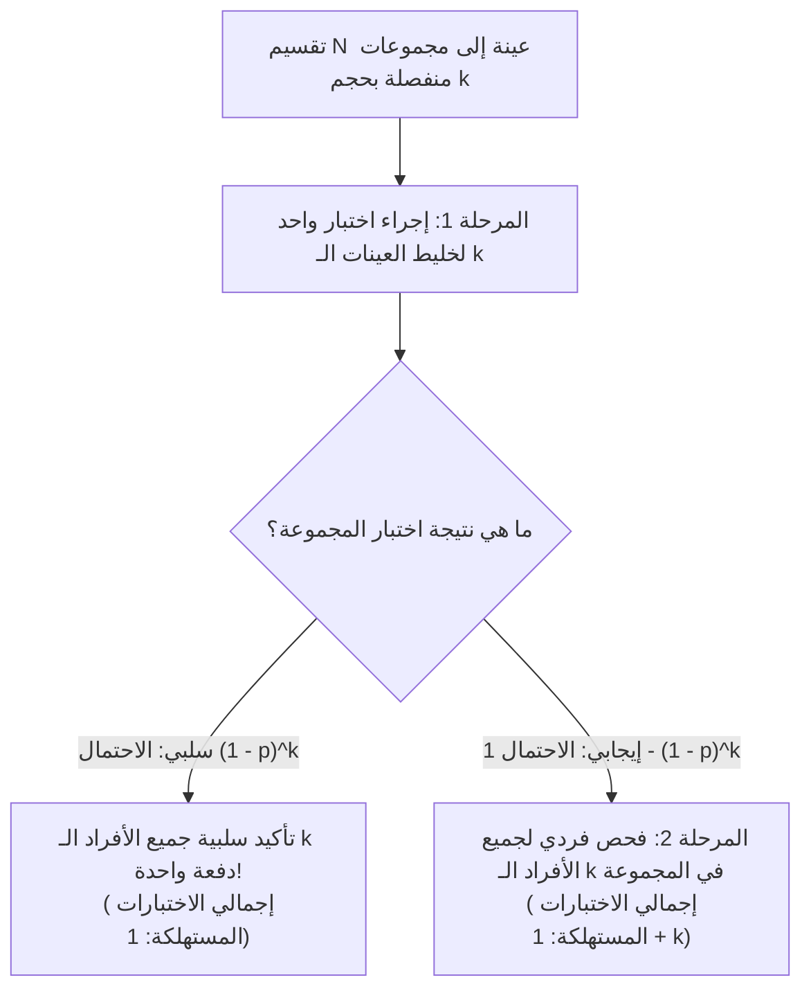
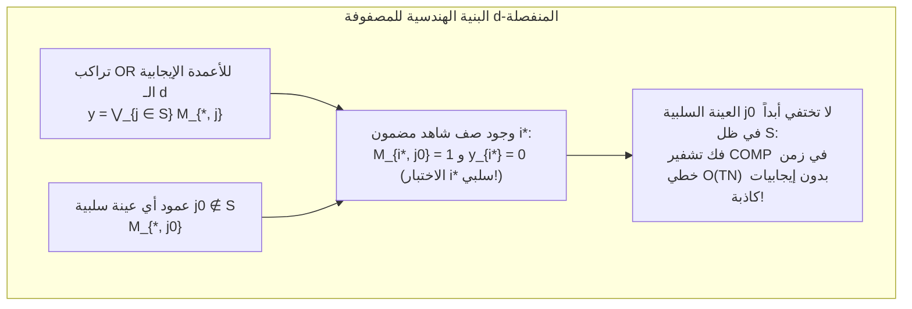

لنفترض أن شخصاً واحداً فقط مصاباً بعدوى يختبئ داخل مجتمع يضم $1,000$ شخص. كم عدد الاختبارات التشخيصية اللازمة لتحديد هذا الشخص الإيجابي بدقة $100\%$؟

الجواب البديهي هو فحص جميع الأشخاص الـ $1,000$ واحداً تلو الآخر، أي إجراء $1,000$ اختبار. غير أن الرياضيات ونظرية المعلومات تقدمان إجابة مختلفة تماماً؛ فإذا أمكن خلط (تجميع أو *Pooling*) العينات الحيوية بحيث يجيب اختبار واحد عن السؤال الثنائي: *«هل توجد عينة إيجابية واحدة على الأقل في هذا الخليط؟»*، فإن <strong>البحث التكيفي المتدرج (Adaptive Group Testing) لا يتطلب سوى $10$ اختبارات فقط</strong>. والأكثر إثارة للدهشة أنه <strong>حتى لو حددنا جدول الخلط بالكامل مسبقاً وأجرينا جميع الاختبارات في وقت واحد ضمن دفعة متوازية واحدة (الاختبار الجماعي غير التكيفي)، فإن بضع عشرات من الاختبارات تكفي</strong> لتحديد المصاب بدقة تامة دون الحاجة إلى أي إعادة اختبار.

ما يبدو وكأنه خدعة سحرية هو في الواقع حجر زاوية في الرياضيات المتقطعة والإحصاء ونظرية الترميز ونظرية المعلومات يُعرف باسم <strong>الاختبار الجماعي (Group Testing)</strong> و<strong>البحث التوافقي (Combinatorial Search)</strong>. في هذا المقال، نستعرض البنية الرياضية الكاملة لهذا العلم: بدءاً من ورقة روبرت دورفمان التاريخية عام 1943 والحدود الدنيا للإنتروبيا عند كلود شانون، مروراً بلغز العملات الـ 12 المزيفة وخوارزمية هوانغ للانقسام الثنائي المعمم، وصولاً إلى <strong>المصفوفات المنفصلة ($d$-Disjunct Matrices / الأكواد المتراكبة)</strong> لكاوتز وسينغلتون فوق الحقول المنتهية (متعددات حدود ريد-سولومون)، و<strong>الاستشعار المضغوط (Compressed Sensing)</strong> والفحص الجينومي فائق الإنتاجية (P-BEST).

---

## 1. اختراق عام 1943: التجميع ثنائي المراحل لروبرت دورفمان

### 1.1 الحرب العالمية الثانية وعنق الزجاجة في اختبار فاسرمان للدم

بدأت القصة الرياضية للاختبار الجماعي في ديسمبر 1943 عندما نشر الإحصائي الأمريكي <strong>روبرت دورفمان (Robert Dorfman)</strong> ورقة بحثية من ست صفحات في دورية *The Annals of Mathematical Statistics* بعنوان *"The Detection of Defective Members of Large Populations"*.

خلال الحرب العالمية الثانية، احتاج الجيش الأمريكي إلى فحص ملايين المجندين للكشف عن مرض الزهري باستخدام اختبار فاسرمان للدم. ونظراً لأن معدل انتشار المرض $p$ كان منخفضاً (عادة بين $p \approx 0.01$ و $p \approx 0.001$)، فإن الفحص الفردي كان يهدر أكثر من $99\%$ من الاختبارات لمجرد تأكيد خلو الجنود الأصحاء من المرض.

اقترح دورفمان <strong>إجراء التجميع ثنائي المراحل (Two-Stage Pooling)</strong>: تقسيم المجتمع البالغ عدده $N$ إلى مجموعات (أحواض أو Pools) منفصلة حجم كل منها $k$.

1. <strong>المرحلة الأولى (اختبار المجموعة)</strong>: خلط عينات الأفراد الـ $k$ في أنبوب واحد وإجراء اختبار واحد ($1$) على الخليط.
   - <strong>إذا كانت النتيجة سلبية (Negative)</strong> (باحتمال $(1 - p)^k$): يتمعلان خلو جميع الأفراد الـ $k$ دفعة واحدة باستهلاك <strong>اختبار واحد فقط</strong>!
   - <strong>إذا كانت النتيجة إيجابية (Positive)</strong> (باحتمال $1 - (1 - p)^k$): يوجد مصاب واحد على الأقل؛ ننتقل إلى المرحلة الثانية.
2. <strong>المرحلة الثانية (إعادة الفحص الفردي)</strong>: فحص العينات الأصلية لجميع الأفراد الـ $k$ في المجموعة الإيجابية بشكل فردي (بإجمالي $1 + k$ اختبارات لهذه المجموعة).

### 1.2 الاشتقاق التحليلي للحجم الأمثل للمجموعة $k^*$

لمجموعة واحدة بحجم $k$، تكون القيمة المتوقعة لعدد الاختبارات هي $\mathbb{E}[T_{\text{pool}}] = 1 \cdot (1 - p)^k + (1 + k)[1 - (1 - p)^k] = 1 + k[1 - (1 - p)^k]$. وبالقسمة على $k$، نحصل على <strong>العدد المتوقع للاختبارات لكل فرد</strong> $f(k) = \frac{\mathbb{E}[T]}{N}$:

$$\frac{\mathbb{E}[T]}{N} = \frac{1}{k} + 1 - (1 - p)^k \approx \frac{1}{k} + k p \implies \frac{d}{dk}\left(\frac{1}{k} + kp\right) = -\frac{1}{k^2} + p = 0 \implies k^* \approx \frac{1}{\sqrt{p}}, \qquad \frac{\mathbb{E}[T]_{\min}}{N} \approx 2\sqrt{p}$$

لنختبر هذا القانون بالأرقام:
- <strong>عندما يكون معدل الانتشار $p = 0.01$ ($1\%$)</strong>: الحجم الأمثل للمجموعة هو $k^* \approx \frac{1}{\sqrt{0.01}} = 10$ (القيمة الصحيحة الدقيقة: $k^* = 11$)، وينخفض متوسط الاختبارات لكل شخص إلى $\frac{\mathbb{E}[T]}{N} \approx 0.20$ (الدقيق: $0.1956$). أي أن فحص $1,000$ شخص يتطلب <strong>$196$ اختباراً فقط بدلاً من $1,000$ — بتوفير قدره $80.4\%$</strong>!
- <strong>عندما يكون معدل الانتشار $p = 0.0001$ ($0.01\%$)</strong>: الحجم الأمثل هو $k^* = 100$ وينخفض العدد المتوقع إلى $0.02$ اختبار للشخص، مما <strong>يلغي $98\%$ من إجمالي الاختبارات</strong>!

| معدل الانتشار $p$ | نسبة الإيجابيين | التقريب $1/\sqrt{p}$ | الحجم الأمثل الدقيق $k^*$ | الاختبارات المتوقعة للفرد $\mathbb{E}[T]/N$ | الاختبارات لكل $1,000$ شخص | نسبة التوفير |
| :--- | :--- | :--- | :--- | :--- | :--- | :--- |
| $p = 0.10$ | $1$ من $10$ | $3.16$ | $4$ | $0.5939$ | $594$ اختباراً | $40.6\%$ |
| $p = 0.05$ | $1$ من $20$ | $4.47$ | $5$ | $0.4262$ | $426$ اختباراً | $57.4\%$ |
| $p = 0.01$ | $1$ من $100$ | $10.0$ | $11$ | $0.1956$ | $196$ اختباراً | <strong>$80.4\%$</strong> |
| $p = 0.001$ | $1$ من $1,000$ | $31.6$ | $32$ | $0.0628$ | $63$ اختباراً | <strong>$93.7\%$</strong> |
| $p = 0.0001$ | $1$ من $10,000$ | $100.0$ | $101$ | $0.01995$ | $20$ اختباراً | <strong>$98.0\%$</strong> |

---

## 2. الحد الأدنى لنظرية المعلومات (حد العد وإنتروبيا شانون)

ما هو الحد الأدنى المطلق لعدد الاختبارات الذي تفرضه قوانين نظرية المعلومات لأي خوارزمية ممكنة؟

1. <strong>حد العد التوافقي (Counting Bound)</strong>: إذا كان هناك $d$ مصابين بين $N$ فرداً ($S \subset [N], |S| = d$)، فهناك $\binom{N}{d}$ مجموعة جزئية ممكنة. وبما أن كل اختبار ثنائي $\{0, 1\}$ يقدم بحد أقصى $1$ بت من معلومات شانون، فإن $T$ اختبارات تنتج على الأكثر $2^T$ متجهاً مختلفاً من النتائج:
   $$2^T \ge \binom{N}{d} \implies T \ge \log_2 \binom{N}{d} \approx d \log_2 \frac{N}{d} + O(d)$$
2. <strong>حد إنتروبيا شانون الاحتمالي</strong>: إذا كان كل فرد إيجابياً بشكل مستقل باحتمال $p$، فإن الإنتروبيا المشتركة لمتجه الحالة $\mathbf{X} \in \{0, 1\}^N$ هي $N \cdot H_2(p)$، مما يفرض:
   $$\frac{\mathbb{E}[T]}{N} \ge H_2(p) = -p\log_2 p - (1-p)\log_2(1-p)$$

---

## 3. الاختبار الجماعي التكيفي مقابل غير التكيفي

### 3.1 الانقسام الثنائي المعمم لهوانغ ومسألة العملات الـ 12 المزيفة

في <strong>الاختبار الجماعي التكيفي</strong>، يتم اختيار كل مجموعة بناءً على نتائج الاختبارات السابقة:
- عندما يكون $d = 1$، يقوم <strong>البحث الثنائي (Binary Splitting)</strong> بتقسيم فضاء المرشحين إلى النصف في كل خطوة، محققاً $\lceil \log_2 N \rceil$ اختباراً بالضبط ($10$ اختبارات لـ $1,000$ شخص).
- عندما يكون $d \ge 2$، تقوم <strong>خوارزمية الانقسام الثنائي المعمم لفرانك هوانغ (Hwang, 1972)</strong> باختبار مجموعة فرعية بحجم $2^\alpha \approx n/d$ بحيث تتساوى احتمالات النتيجة الإيجابية والسلبية قرب $1/2$ ($1$ بت لكل اختبار)، محققة الحد الأدنى النظري $T = d \log_2(N/d) + O(d)$.

وهذا المبدأ نفسه يفسر <strong>لغز العملات الـ 12 المزيفة والميزان ذي الكفتين (1945)</strong>: بين $12$ عملة توجد عملة واحدة مزيفة إما أثقل أو أخف من الحقيقية ($12 \times 2 = 24$ فرضية). يوفر الميزان $3$ نتائج $\{-1, 0, +1\}$، أي ما يصل إلى $\log_2 3 \approx 1.585$ بت لكل وزنة، ويميز حتى $3^3 = 27 \ge 24$ حالة في $3$ وزنات. إذا وضعنا $6$ عملات مقابل $6$ في الوزنة الأولى، فلن يتوازن الميزان أبداً ($0$)، مما يترك $12 > 3^2 = 9$ حالات (مستحيل الحل!). يجب وضع <strong>$4$ عملات في اليسار، و$4$ في اليمين، وترك $4$ خارج الميزان</strong> لتقسيم الفرضيات الـ $24$ بالتساوي إلى $8 : 8 : 8$.

<strong>العائق العملي في تفاعل البوليميراز المتسلسل (PCR)</strong>: نظراً لأن دورة RT-PCR الواحدة تستغرق حوالي $3$ ساعات، فإن تنفيذ $10$ مراحل تكيفية متتالية سيتطلب <strong>$30$ ساعة</strong>! لذلك تحتاج المختبرات السريرية إلى <strong>الاختبار الجماعي غير التكيفي (NAGT)</strong> الذي ينفذ جميع الاختبارات بالتوازي في جولة واحدة.

---

## 4. الاختبار الجماعي غير التكيفي (NAGT) والمصفوفات المنفصلة ($d$-Disjunct Matrices)

### 4.1 مصفوفة التجميع $\mathbf{M}$ والتراكب المنطقي OR

صاغ <strong>كاوتز وسينغلتون (Kautz & Singleton, 1964)</strong> التصميم غير التكيفي عبر مصفوفة ثنائية $\mathbf{M} \in \{0, 1\}^{T \times N}$، حيث يعني $M_{i, j} = 1$ إدراج العينة $j$ في المجموعة $i$. ويكون متجه النتائج $\mathbf{y} \in \{0, 1\}^T$ هو <strong>تراكب OR المنطقي</strong> لأعمدة المجموعة الإيجابية $S$ ($|S| \le d$):

$$\mathbf{y} = \mathbf{M} \odot \mathbf{x} = \bigvee_{j \in S} \mathbf{M}_{*, j}$$

### 4.2 المصفوفات المنفصلة ($d$-Disjunct) وفك التشفير الخطي COMP

تُسمى المصفوفة $\mathbf{M}$ <strong>مصفوفة $d$-منفصلة ($d$-Disjunct Matrix)</strong> إذا لم تكن مجموعة دعم أي عمود $j_0 \notin S$ محتواة أبداً في اتحاد مجموعات دعم أي $d$ أعمدة أخرى $S$:

$$\text{supp}(\mathbf{M}_{*, j_0}) \not\subseteq \bigcup_{j \in S} \text{supp}(\mathbf{M}_{*, j}) \qquad (\forall |S| \le d, \; \forall j_0 \notin S)$$

أي أنه لكل فرد سلبي $j_0 \notin S$، يوجد على الأقل <strong>«اختبار شاهد» واحد (صف $i^*$)</strong> يشارك فيه $j_0$ ($M_{i^*, j_0} = 1$) ولا يشارك فيه أي من المصابين الـ $d$ ($y_{i^*} = 0$).

بفضل هذه الخاصية، تقوم خوارزمية <strong>COMP</strong> بفك التشفير في زمن خطي $O(TN)$: يتم استبعاد كل عينة شاركت في اختبار سلبي، والعينات المتبقية هي الإيجابية بدقة $100\%$! ويفرض حد دياتشكوف-ريكوف / روسينكو / فوريدي $T = \Omega\left(\frac{d^2}{\log d} \log N\right)$ صفاً، بينما تحقق التركيبات الجبرية والاحتمالية $T = O(d^2 \log N)$.

### 4.3 الشبكة ثنائية الأبعاد («الإيجابيات الشبحية») وتصاميم ريد-سولومون

عند ترتيب $N = 100$ عينة في شبكة $10 \times 10$ ($10$ صفوف + $10$ أعمدة = $20$ اختباراً)، يتم تحديد مصاب واحد ($d = 1$) عند التقاطع الفريد. لكن عند وجود مصابين ($d = 2$) في $(2, 4)$ و $(6, 9)$، تنشط الصفوف $R_2, R_6$ والأعمدة $C_4, C_9$، مما يولد <strong>«إيجابيات شبحية» (Ghost Positives)</strong> كاذبة عند $(2, 9)$ و $(6, 4)$!

تغلب كاوتز وسينغلتون على ذلك بتعيين كثيرة حدود $P_j(x) \in \mathbb{F}_q[x]$ من الدرجة $\le k-1$ فوق حقل منتهٍ $\mathbb{F}_q$ لكل عينة $j$ (كود <strong>ريد-سولومون</strong>، $N = q^k$) وتكوين المجموعات وفق $y = P_j(x_m) \pmod q$ في $w \ge d(k-1)+1$ اتجاهات، مما يضمن مصفوفة $d$-منفصلة خالية تماماً من الأشباح!

---

## 5. الضوضاء، الاستشعار المضغوط (Compressed Sensing)، وطريقة P-BEST

| الخاصية | الاختبار الجماعي التكيفي (هوانغ) | الاختبار غير التكيفي ($d$-منفصلة) | الاستشعار المضغوط (Compressed Sensing) |
| :--- | :--- | :--- | :--- |
| <strong>الجبر الأساسي</strong> | شجرة قرار على $\{0, 1\}$ | شبه حلقة بوليانية $(\{0, 1\}, \lor, \land)$ | حقل الأعداد الحقيقية $(\mathbb{R}, +, \times)$، $\mathbf{y} = \mathbf{\Phi}\mathbf{x} + \mathbf{e}$ |
| <strong>شرط المصفوفة</strong> | تقسيم متساوي الاحتمال ($1$ بت/اختبار) | <strong>الانفصال ($d$-Disjunctness)</strong> | <strong>خاصية القياس المتساوي المقيد (RIP)</strong> |
| <strong>عدد القياسات $T$</strong> | $d \log_2(N/d) + O(d)$ | $O(d^2 \log N)$ (صفري الخطأ) / $O(d \log N)$ (احتمالي) | $O(d \log(N/d))$ |
| <strong>خوارزمية فك التشفير</strong> | بحث ثنائي متسلسل | <strong>COMP / DD / SCOMP / انتشار المعتقد</strong> | <strong>OMP / Basis Pursuit (تقليل $\ell_1$)</strong> |

1. <strong>تأثير التخفيف والاختبار الجماعي المشوش</strong>: لمواجهة تخفيف الحمض النووي الفيروسي وأخطاء المختبر، تضمن المصفوفات $(d, 2e)$-المنفصلة وجود $2e+1$ صفوف شاهدة (خوارزمية <strong>NCOMP</strong>)، إلى جانب <strong>انتشار المعتقد (Belief Propagation)</strong> و<strong>البرمجة الخطية (LP)</strong>.
2. <strong>الثنائية مع الاستشعار المضغوط</strong>: يمثل الاستشعار المضغوط (كانديس، تاو، دونوهو 2006) النظير الجبري المستمر في $\mathbb{R}$ للاختبار الجماعي البولياني.
3. <strong>قنوات الوصول المتعدد وفحص كوفيد-19 (P-BEST)</strong>: من خوارزميات فض التصادم اللاسلكي إلى بروتوكول <strong>P-BEST</strong> السريري (Shental et al., *Science Advances* 2020) الذي استخدم مصفوفة ريد-سولومون بحجم $48 \times 384$ لفحص $384$ مريضاً في $48$ تفاعل PCR متوازٍ فقط في جولة واحدة (مضاعفاً القدرة التشخيصية $8$ مرات)، تظل رياضيات الاختبار الجماعي شاهداً ساطعاً على قوة البحث التوافقي.
