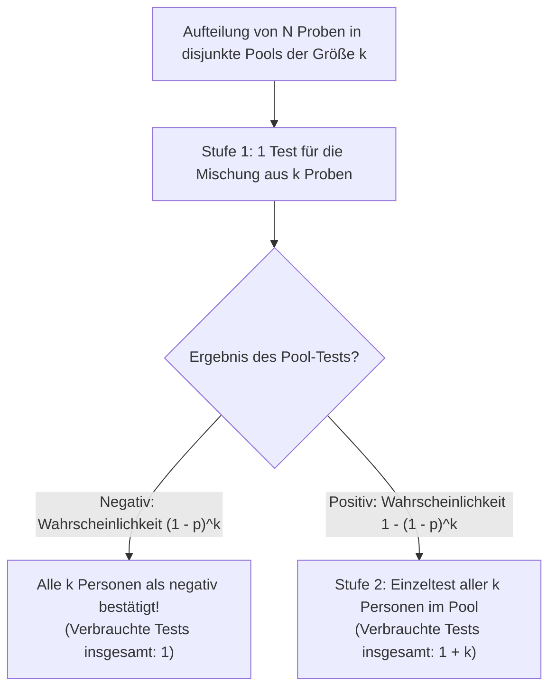
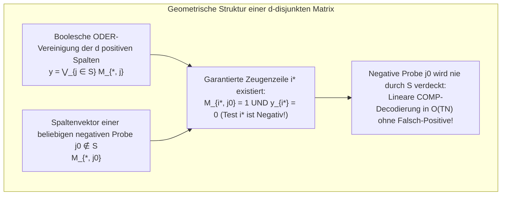

Angenommen, in einer Population von $1.000$ Personen befindet sich genau eine infizierte (positive) Person. Wie viele diagnostische Tests sind erforderlich, um diese eine Person mit $100\%$-iger Sicherheit zu identifizieren?

Die intuitive Antwort lautet: Man testet alle $1.000$ Personen einzeln nacheinander – also $1.000$ Tests. Die Mathematik und die Informationstheorie liefern jedoch eine völlig andere Antwort. Wenn wir Proben mischen (poolen) können, sodass ein einziger Test die binäre Frage beantwortet: *„Ist in dieser Mischung mindestens eine positive Probe enthalten?“*, dann genügen bei <strong>schrittweiser adaptiver Eingrenzung (Adaptive Group Testing) lediglich $10$ Tests</strong>. Noch erstaunlicher ist: <strong>Selbst wenn das gesamte Mischschema vorab festgelegt wird und alle Tests gleichzeitig in einem einzigen parallelen Durchgang (Non-Adaptive Group Testing) ausgeführt werden, reichen wenige Dutzend Tests aus</strong>, um die positive Person eindeutig zu bestimmen.

Was wie Magie wirkt, ist ein klassisches Teilgebiet der diskreten Mathematik, Statistik, Codierungstheorie und Informationstheorie: <strong>Group Testing (Gruppentestverfahren / Pooling)</strong> und <strong>kombinatorische Suche (Combinatorial Search)</strong>. In diesem Artikel entwickeln wir die vollständige mathematische Theorie von Robert Dorfmans bahnbrechender Arbeit aus dem Jahr 1943 über Claude Shannons informationstheoretische untere Schranken, das berühmte 12-Münzen-Problem und Hwangs verallgemeinerte Binärsuche bis hin zu den <strong>$d$-disjunkten Matrizen (Superimposed Codes)</strong> von Kautz und Singleton, endlichen Körpern (Reed-Solomon-Pooling) sowie modernen Anwendungen in <strong>Compressed Sensing</strong> und der Hochdurchsatz-PCR-Diagnostik (P-BEST).

---

## 1. Der Durchbruch von 1943: Robert Dorfmans zweistufiges Pooling

### 1.1 Der Zweite Weltkrieg und das Wassermann-Engpassproblem

Die mathematische Geschichte des Group Testing begann im Dezember 1943, als der Statistiker <strong>Robert Dorfman</strong> in *The Annals of Mathematical Statistics* seinen sechsseitigen Klassiker *"The Detection of Defective Members of Large Populations"* veröffentlichte.

Während des Zweiten Weltkriegs musste die US-Armee Millionen von Rekruten mittels des Wassermann-Bluttests auf Syphilis untersuchen. Da die Prävalenz $p$ niedrig war (typischerweise $p \approx 0{,}01$ bis $p \approx 0{,}001$), dienten bei Einzeltests über $99\%$ aller Analysen lediglich dazu, gesunde Soldaten als negativ zu bestätigen.

Dorfman schlug ein <strong>zweistufiges Pooling-Verfahren (Two-Stage Pooling)</strong> vor: Die Gesamtpopulation von $N$ Personen wird in disjunkte Gruppen (Pools) der Größe $k$ aufgeteilt.

1. <strong>Stufe 1 (Pool-Test)</strong>: Jeweils $k$ Blutproben werden zu einem Pool gemischt und mit $1$ Test geprüft.
   - <strong>Ist der Pool negativ</strong> (Wahrscheinlichkeit $(1 - p)^k$): Alle $k$ Personen sind mit einem einzigen Test als negativ bestätigt!
   - <strong>Ist der Pool positiv</strong> (Wahrscheinlichkeit $1 - (1 - p)^k$): Mindestens eine Person im Pool ist positiv; es folgt Stufe 2.
2. <strong>Stufe 2 (Einzelnachtestung)</strong>: Alle $k$ Einzelproben des positiven Pools werden individuell nachgetestet (insgesamt $1 + k$ Tests für diesen Pool).

### 1.2 Analytische Herleitung der optimalen Poolgröße $k^*$

Für einen einzelnen Pool der Größe $k$ beträgt der Erwartungswert der benötigten Tests $\mathbb{E}[T_{\text{pool}}] = 1 \cdot (1 - p)^k + (1 + k)[1 - (1 - p)^k] = 1 + k[1 - (1 - p)^k]$. Teilen wir durch $k$, erhalten wir die <strong>erwartete Anzahl an Tests pro Person</strong> $f(k) = \frac{\mathbb{E}[T]}{N}$:

$$\frac{\mathbb{E}[T]}{N} = \frac{1}{k} + 1 - (1 - p)^k \approx \frac{1}{k} + k p \implies \frac{d}{dk}\left(\frac{1}{k} + kp\right) = -\frac{1}{k^2} + p = 0 \implies k^* \approx \frac{1}{\sqrt{p}}, \qquad \frac{\mathbb{E}[T]_{\min}}{N} \approx 2\sqrt{p}$$

Setzen wir konkrete Zahlen ein:
- <strong>Bei einer Prävalenz von $p = 0{,}01$ ($1\%$)</strong> liefert die Formel $k^* \approx \frac{1}{\sqrt{0{,}01}} = 10$ (exaktes diskretes Optimum: $k^* = 11$). Die erwartete Testanzahl pro Person sinkt auf $\frac{\mathbb{E}[T]}{N} \approx 2\sqrt{0{,}01} = 0{,}20$ (exakt $0{,}1956$). Für $1.000$ Personen werden statt $1.000$ Tests nur <strong>ca. $196$ Tests benötigt – eine Einsparung von $80{,}4\%$</strong>!
- <strong>Bei einer Prävalenz von $p = 0{,}0001$ ($0{,}01\%$)</strong> beträgt die optimale Poolgröße $k^* = 100$, und der Aufwand sinkt auf $0{,}02$ Tests pro Person – <strong>eine Reduktion der Testanzahl um $98\%$</strong>!

| Prävalenz $p$ | Anteil Positiver | Asymptotisches $1/\sqrt{p}$ | Exaktes Optimum $k^*$ | Erwartete Tests / Person $\mathbb{E}[T]/N$ | Tests pro $1.000$ Personen | Einsparung |
| :--- | :--- | :--- | :--- | :--- | :--- | :--- |
| $p = 0{,}10$ | $1$ von $10$ | $3{,}16$ | $4$ | $0{,}5939$ | $594$ Tests | $40{,}6\%$ |
| $p = 0{,}05$ | $1$ von $20$ | $4{,}47$ | $5$ | $0{,}4262$ | $426$ Tests | $57{,}4\%$ |
| $p = 0{,}01$ | $1$ von $100$ | $10{,}0$ | $11$ | $0{,}1956$ | $196$ Tests | <strong>$80{,}4\%$</strong> |
| $p = 0{,}001$ | $1$ von $1.000$ | $31{,}6$ | $32$ | $0{,}0628$ | $63$ Tests | <strong>$93{,}7\%$</strong> |
| $p = 0{,}0001$ | $1$ von $10.000$ | $100{,}0$ | $101$ | $0{,}01995$ | $20$ Tests | <strong>$98{,}0\%$</strong> |

---

## 2. Informationstheoretische untere Schranke (Counting Bound & Shannon-Entropie)

Wie viele Tests sind im absoluten Minimum notwendig, wenn beliebige mehrstufige oder kombinatorische Verfahren zugelassen werden?

1. <strong>Kombinatorisches Modell</strong>: Unter $N$ Elementen befinden sich genau $d$ positive Elemente ($S \subset [N], |S| = d$). Es gibt $\binom{N}{d}$ mögliche Defektmengen. Da jeder binäre Test $\{0, 1\}$ höchstens $1$ Bit an Shannon-Information liefert, kann ein Vektor aus $T$ Testergebnissen höchstens $2^T$ Zustände unterscheiden:
   $$2^T \ge \binom{N}{d} \implies T \ge \log_2 \binom{N}{d} \approx d \log_2 \frac{N}{d} + O(d)$$
2. <strong>Probabilistisches Modell</strong>: Ist jedes Element unabhängig mit Wahrscheinlichkeit $p$ positiv, besitzt der Zustandsvektor $\mathbf{X} \in \{0, 1\}^N$ die Shannon-Entropie $N \cdot H_2(p)$, woraus direkt folgt:
   $$\frac{\mathbb{E}[T]}{N} \ge H_2(p) = -p\log_2 p - (1-p)\log_2(1-p)$$

---

## 3. Adaptives Group Testing vs. Nicht-Adaptives Design

### 3.1 Adaptives Binary Splitting und das 12-Münzen-Waagenproblem

Beim <strong>adaptiven Group Testing</strong> hängt die Wahl des nächsten Pools vom Ergebnis der vorherigen Tests ab:
- Für $d = 1$ halbiert die klassische <strong>Binärsuche (Binary Splitting)</strong> den Suchraum mit jedem Test und benötigt exakt $\lceil \log_2 N \rceil$ Tests ($10$ Tests für $N = 1.000$).
- Für allgemeines $d \ge 2$ testet <strong>Hwangs Generalized Binary Splitting Algorithm (1972)</strong> jeweils einen Pool der Größe $2^\alpha \approx n/d$, sodass die Wahrscheinlichkeit für ein negatives Ergebnis nahe $1/2$ liegt (maximale Entropie von $1$ Bit pro Test). Damit erreicht das Verfahren $T = d \log_2(N/d) + O(d)$ Tests und trifft die informationstheoretische Schranke asymptotisch exakt.

Dasselbe Prinzip erklärt das berühmte <strong>12-Münzen-Problem (Counterfeit Coin Problem)</strong>: Unter $12$ Münzen ist genau eine gefälscht und entweder schwerer oder leichter ($12 \times 2 = 24$ Hypothesen). Eine Balkenwaage liefert drei Ausgänge $\{-1, 0, +1\}$ (links schwerer, Gleichgewicht, rechts schwerer), also maximal $\log_2 3 \approx 1{,}585$ Bits pro Wägung bzw. $3^3 = 27 \ge 24$ unterscheidbare Zustände in $3$ Wägungen. Legt man beim ersten Wiegen $6$ gegen $6$ Münzen auf die Waage, kann kein Gleichgewicht eintreten; es bleiben $12 > 3^2 = 9$ Zustände übrig (unlösbar!). Erst die Aufteilung <strong>$4$ links, $4$ rechts, $4$ neben der Waage</strong> teilt den Hypothesenraum perfekt in $8 : 8 : 8$ und löst das Problem in $3$ Wägungen.

<strong>Der praktische Nachteil in der Molekularbiologie</strong>: Da ein einzelner RT-PCR-Lauf etwa $3$ Stunden dauert, würden $10$ serielle Stufen einer adaptiven Binärsuche <strong>$30$ Stunden</strong> dauern! In der Laborpraxis wird daher ein <strong>nicht-adaptives Verfahren (NAGT)</strong> benötigt, das alle $T$ Tests gleichzeitig in einer einzigen Runde ausführt.

---

## 4. Nicht-Adaptives Group Testing (NAGT) und $d$-disjunkte Matrizen

### 4.1 Die Pooling-Matrix $\mathbf{M}$ und Boolesche ODER-Überlagerung

<strong>William H. Kautz und Richard C. Singleton (1964)</strong> formulierten das nicht-adaptive Group Testing über eine binäre $T \times N$-Matrix $\mathbf{M} \in \{0, 1\}^{T \times N}$, wobei $M_{i, j} = 1$ bedeutet, dass Probe $j$ in Pool $i$ enthalten ist. Der Ergebnisvektor $\mathbf{y} \in \{0, 1\}^T$ ergibt sich als <strong>bitweise Boolesche ODER-Überlagerung (Superimposition)</strong> der Spalten der positiven Menge $S$ ($|S| \le d$):

$$\mathbf{y} = \mathbf{M} \odot \mathbf{x} = \bigvee_{j \in S} \mathbf{M}_{*, j}$$

### 4.2 $d$-separable vs. $d$-disjunkte Matrizen und COMP-Decodierung

Eine Matrix $\mathbf{M}$ heißt <strong>$d$-disjunkt ($d$-Disjunct Matrix)</strong>, wenn der Träger (Support) keiner Spalte $j_0 \notin S$ in der Vereinigung der Träger von $d$ beliebigen anderen Spalten $S$ enthalten ist:

$$\text{supp}(\mathbf{M}_{*, j_0}) \not\subseteq \bigcup_{j \in S} \text{supp}(\mathbf{M}_{*, j}) \qquad (\forall |S| \le d, \; \forall j_0 \notin S)$$

Das bedeutet: Für jede negative Probe $j_0 \notin S$ existiert mindestens ein <strong>„Zeugentest“ (Zeile $i^*$)</strong>, an dem $j_0$ teilnimmt ($M_{i^*, j_0} = 1$), aber keine einzige der $d$ positiven Proben ($y_{i^*} = 0$).

Dadurch gelingt die Decodierung mit dem <strong>COMP-Algorithmus (Combinatorial Orthogonal Matching Pursuit)</strong> in linearer Zeit $O(TN)$: Alle Proben, die in mindestens einem negativen Test vorkommen, werden als negativ gestrichen; die verbleibenden Proben sind exakt die positiven! Während die kombinatorische untere Schranke nach D'yachkov-Rykov, Ruszinkó und Füredi $T = \Omega\left(\frac{d^2}{\log d} \log N\right)$ Zeilen verlangt, erreichen explizite und zufällige Konstruktionen $T = O(d^2 \log N)$ Tests.

### 4.3 2D-Gitter-Pooling („Geister-Positive“) und Reed-Solomon-Polynom-Designs

Ordnet man $N = 100$ Proben in einem $10 \times 10$-Gitter an und testet $10$ Zeilen-Pools sowie $10$ Spalten-Pools ($T = 20$), lässt sich $d = 1$ positive Probe sofort am Schnittpunkt ablesen ($1$-disjunkt). Bei $d = 2$ positiven Proben an den Positionen $(2, 4)$ und $(6, 9)$ schlagen jedoch die Zeilen $R_2, R_6$ und Spalten $C_4, C_9$ an, wodurch an $(2, 9)$ und $(6, 4)$ zwei falsche <strong>„Geister-Positive“ (Shadow Defectives)</strong> entstehen!

Kautz und Singleton lösten dieses Problem durch <strong>Polynomauswertung über endlichen Körpern $\mathbb{F}_q$ (Reed-Solomon-Codes)</strong>: Jede Probe $j$ erhält ein Polynom $P_j(x) \in \mathbb{F}_q[x]$ vom Grad $\le k-1$ ($N = q^k$ Proben), und Pools werden für Paare $(x_m, y)$ gemäß $y = P_j(x_m) \pmod q$ gebildet. Da zwei verschiedene Polynome vom Grad $\le k-1$ höchstens $k-1$ Schnittpunkte haben, garantiert die Wahl von $w \ge d(k-1) + 1$ Projektionsrichtungen (z. B. Zeilen, Spalten und Diagonalen verschiedener Steigungen) eine exakt $d$-disjunkte Matrix ohne Geister-Positive!

---

## 5. Rauschen, Compressed Sensing und moderne Anwendungen (P-BEST)

| Merkmal | Adaptives Group Testing (Hwang) | Nicht-Adaptives Group Testing ($d$-disjunkt) | Compressed Sensing (Candès-Tao-Donoho) |
| :--- | :--- | :--- | :--- |
| <strong>Algebraische Struktur</strong> | Entscheidungsbaum über $\{0, 1\}$ | Boolescher Halbring $(\{0, 1\}, \lor, \land)$ | Reeller Körper $(\mathbb{R}, +, \times)$, $\mathbf{y} = \mathbf{\Phi}\mathbf{x} + \mathbf{e}$ |
| <strong>Matrix-Bedingung</strong> | Dynamische Gleichverteilung ($1$ Bit/Test) | <strong>$d$-Disjunktheit</strong> | <strong>Restricted Isometry Property (RIP)</strong> |
| <strong>Testanzahl $T$</strong> | $d \log_2(N/d) + O(d)$ | $O(d^2 \log N)$ (exakt) / $O(d \log N)$ (probabilistisch) | $O(d \log(N/d))$ |
| <strong>Decodier-Algorithmus</strong> | Sequenzielle Binärsuche | <strong>COMP / DD / SCOMP / Belief Propagation</strong> | <strong>OMP / Basis Pursuit ($\ell_1$-Minimierung)</strong> |

1. <strong>Verdünnungseffekt (Dilution Effect) und Noisy Group Testing</strong>: Um Messfehler und Verdünnungseffekte bei großen Pools abzufangen, nutzen fehlertolerante $(d, 2e)$-disjunkte Matrizen mindestens $2e+1$ Zeugenzeilen (<strong>NCOMP</strong>) oder probabilistische <strong>Belief-Propagation- (BP)</strong> und <strong>Lineare-Programmierungs-Decoder (LP)</strong>.
2. <strong>Dualität zu Compressed Sensing</strong>: Compressed Sensing überträgt das Group-Testing-Prinzip von der Booleschen ODER-Verknüpfung auf reellwertige lineare Projektionen dünnbesetzter Signale ($\|\mathbf{x}\|_0 \le d$).
3. <strong>Mehrfachzugriffskanäle und COVID-19 P-BEST</strong>: Von Kollisionsauflösungsprotokollen im Mobilfunk (Capetanakis-Baumalgorithmus) über Netzwerk-Streaming-Algorithmen (Count-Min Sketch) bis zum klinischen <strong>P-BEST-Verfahren</strong> (Shental et al., *Science Advances* 2020), das mittels einer $48 \times 384$ Reed-Solomon-Pooling-Matrix $384$ Patientenproben in nur $48$ parallelen PCR-Reaktionen in einem einzigen Durchgang untersucht (8-facher Durchsatz), beweist das Group Testing die enorme Kraft kombinatorischer Mathematik.
