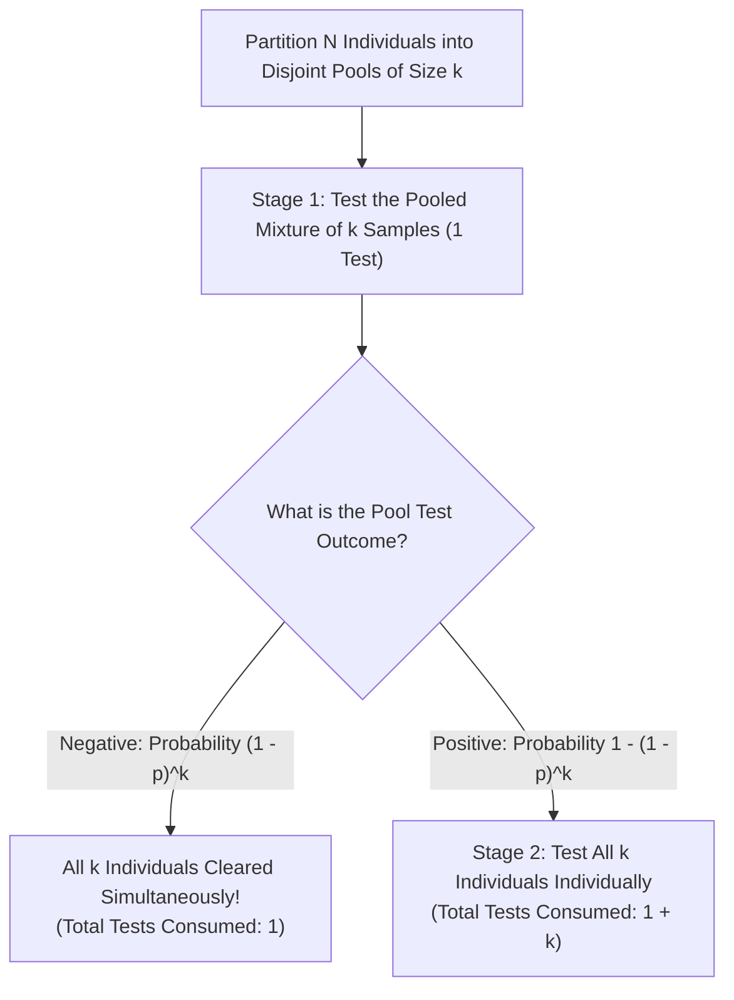
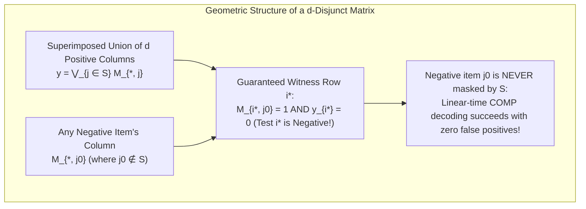

Suppose a single infected individual is hidden inside a population of $1,000$ people. How many diagnostic tests are required to identify that one positive person with $100\%$ certainty?

Common sense suggests testing all $1,000$ individuals one by one—requiring $1,000$ tests. Yet mathematics and information theory reveal something extraordinary. If biological specimens can be mixed (pooled) together so that a single test answers the binary question *"Is at least one positive sample present in this mixture?"*, then <strong>sequentially narrowing down the candidates (adaptive group testing) requires only $10$ tests</strong>. Even more remarkably, <strong>if we fix all mixing patterns in advance and run every test simultaneously in a single parallel batch (non-adaptive group testing), just a few dozen tests suffice</strong> to pinpoint the positive individual(s) without a single retest.

What looks like a sleight of hand is in fact a cornerstone of discrete mathematics, coding theory, statistics, and theoretical computer science known as <strong>Group Testing</strong> and <strong>Combinatorial Search</strong>. In this article, we trace the complete mathematical architecture of group testing: starting from Robert Dorfman's 1943 wartime breakthrough, deriving Claude Shannon's information-theoretic lower bounds, contrasting adaptive binary splitting and the classic 12-coin counterfeit puzzle against Kautz and Singleton's non-adaptive <strong>disjunct matrices (superimposed codes)</strong> and finite-field Reed–Solomon pooling designs, and finally connecting the theory to noisy channels, <strong>compressed sensing</strong>, multiple-access collision resolution, and modern high-throughput genomic screening.

---

## 1. The 1943 Wartime Breakthrough: Robert Dorfman's Two-Stage Pooling

### 1.1 World War II and the Wassermann Blood-Test Bottleneck

The formal mathematical theory of group testing was born in December 1943, when economist and statistician <strong>Robert Dorfman</strong> published a landmark six-page paper in *The Annals of Mathematical Statistics* titled *"The Detection of Defective Members of Large Populations."*

During World War II, the United States Public Health Service and the U.S. Army faced a massive logistical challenge: screening millions of Selective Service inductees for syphilis using the Wassermann blood test. Performing the chemical assay individually on every draftee was slow and expensive. Worse still, because the prevalence $p$ of syphilis among draftees was low (typically around $p \approx 0.01$ to $p \approx 0.001$), <strong>more than $99\%$ of individual tests merely confirmed that a healthy soldier was negative</strong>.

Dorfman proposed a deceptively simple paradigm shift. Instead of testing blood sera one by one, divide the $N$ inductees into groups (pools) of size $k$. Take half of each soldier's blood serum in a group of $k$ people, mix those $k$ aliquots together into a single composite vial, and run a single Wassermann test on the pooled mixture.

### 1.2 Dorfman's Two-Stage Algorithm

Assume a population of $N$ individuals in which each person is independently positive (defective) with probability $p$ and negative with probability $q = 1 - p$ (the <strong>probabilistic group testing model</strong>). Dorfman's two-stage procedure partitions the $N$ samples into $N/k$ disjoint pools of size $k$ and processes each pool as follows:

1. <strong>Stage 1 (Pool Test)</strong>: Mix the $k$ samples in the pool and perform $1$ test on the combined mixture.
   - <strong>If the pool tests Negative</strong> (which occurs if and only if all $k$ members are negative, with probability $(1 - p)^k$): all $k$ individuals are cleared at once! <strong>Total tests used for these $k$ people: just $1$.</strong>
   - <strong>If the pool tests Positive</strong> (which occurs if at least one member is positive, with probability $1 - (1 - p)^k$): proceed to Stage 2.
2. <strong>Stage 2 (Individual Retesting)</strong>: Retrieve the preserved original samples of all $k$ individuals in the positive pool and test each of them individually, requiring $k$ additional tests. <strong>Total tests used for this positive pool: $1 + k$.</strong>

### 1.3 Analytical Derivation of Expected Tests and the Optimal Pool Size $k^*$

How should we choose the pool size $k$ to minimize the expected number of tests? If $k$ is too small, we spend too many tests in Stage 1. If $k$ is too large, almost every pool will contain at least one positive sample, triggering Stage 2 individual retesting on nearly the entire population. Let us solve this optimization problem analytically.

For a single pool of size $k$, let $T_{\text{pool}}$ denote the number of tests consumed. With probability $(1 - p)^k$, the pool is negative and $T_{\text{pool}} = 1$. With probability $1 - (1 - p)^k$, the pool is positive and $T_{\text{pool}} = 1 + k$. Thus, the expected number of tests for one pool of size $k$ is:

$$\mathbb{E}[T_{\text{pool}}] = 1 \cdot (1 - p)^k + (1 + k)\left[1 - (1 - p)^k\right] = 1 + k\left[1 - (1 - p)^k\right]$$

Dividing by the pool size $k$ gives the <strong>expected number of tests per individual</strong>, denoted $f(k) = \frac{\mathbb{E}[T]}{N}$ (for $k \ge 2$):

$$f(k) = \frac{\mathbb{E}[T]}{N} = \frac{1}{k} + 1 - (1 - p)^k$$

When the prevalence $p$ is small ($p \ll 1$ and $kp \ll 1$), we can apply the first-order Taylor (binomial) expansion $(1 - p)^k = 1 - kp + \frac{k(k-1)}{2}p^2 - \dots \approx 1 - kp$. Substituting this into $f(k)$ yields a transparent trade-off between Stage 1 overhead and Stage 2 retesting risk:

$$f(k) \approx \frac{1}{k} + k p$$

Treating $k$ as a continuous variable and differentiating with respect to $k$ (or applying the AM–GM inequality $\frac{1}{k} + kp \ge 2\sqrt{\frac{1}{k} \cdot kp} = 2\sqrt{p}$) immediately yields the optimal pool size $k^*$ and the minimum expected tests per person:

$$\frac{d}{dk}\left(\frac{1}{k} + kp\right) = -\frac{1}{k^2} + p = 0 \implies k^* \approx \frac{1}{\sqrt{p}}, \qquad \frac{\mathbb{E}[T]_{\min}}{N} \approx 2\sqrt{p}$$

> [!TIP]
> <strong>Dorfman's Square-Root Law and Finucan's Refinement</strong>:
> Under two-stage pooling at low prevalence $p$, the optimal pool size scales inversely with the square root of prevalence ($k^* \approx 1/\sqrt{p}$), compressing the per-person testing cost from $1$ down to $2\sqrt{p}$. Retaining the second-order binomial term $(1-p)^k \approx 1 - kp + \frac{1}{2}k(k-1)p^2$, H. M. Finucan (1964) showed that the exact integer optimum is closely approximated by $k^* \approx \frac{1}{\sqrt{p}} + \frac{1}{2}$.

### 1.4 Concrete Numerical Examples: $80\%$ to $98\%$ Reduction in Tests

Let us evaluate both the asymptotic formula and the exact binomial expectation $f(k) = \frac{1}{k} + 1 - (1 - p)^k$ across realistic prevalence regimes:

- <strong>When prevalence is $p = 0.01$ ($1\%$ positive rate)</strong>:
  The analytical formula gives $k^* \approx \frac{1}{\sqrt{0.01}} = 10$ samples per pool (the exact discrete minimum occurs at $k^* = 11$).
  With $k = 10$, the approximate cost is $\frac{\mathbb{E}[T]}{N} \approx \frac{1}{10} + 10(0.01) = 0.20$ tests per person (exact value: $\frac{1}{10} + 1 - 0.99^{10} = 0.1956$).
  Thus, screening $1,000$ people requires only <strong>$200$ tests (exact: $196$ tests) instead of $1,000$—an immediate $80\%$ reduction in testing volume!</strong>
- <strong>When prevalence is $p = 0.0001$ ($0.01\%$ positive rate, or $1$ in $10,000$)</strong>:
  The optimal pool size is $k^* \approx \frac{1}{\sqrt{0.0001}} = 100$ samples per pool.
  The expected number of tests per person drops to $\frac{\mathbb{E}[T]}{N} \approx 2\sqrt{0.0001} = 0.02$ (exact value: $0.01995$).
  Screening $10,000$ people requires only <strong>$200$ tests instead of $10,000$—eliminating $98\%$ of all tests!</strong>

| Prevalence $p$ | Positive Rate | Asymptotic $1/\sqrt{p}$ | Exact Optimal $k^*$ | Exact Expected Tests / Person $\mathbb{E}[T]/N$ | Expected Tests per $1,000$ People | Test Reduction Rate |
| :--- | :--- | :--- | :--- | :--- | :--- | :--- |
| $p = 0.10$ | $1$ in $10$ | $3.16$ | $4$ | $0.5939$ | $594$ tests | $40.6\%$ saved |
| $p = 0.05$ | $1$ in $20$ | $4.47$ | $5$ | $0.4262$ | $426$ tests | $57.4\%$ saved |
| $p = 0.01$ | $1$ in $100$ | $10.0$ | $11$ | $0.1956$ | $196$ tests | <strong>$80.4\%$ saved</strong> |
| $p = 0.001$ | $1$ in $1,000$ | $31.6$ | $32$ | $0.0628$ | $63$ tests | <strong>$93.7\%$ saved</strong> |
| $p = 0.0001$ | $1$ in $10,000$ | $100.0$ | $101$ | $0.01995$ | $20$ tests | <strong>$98.0\%$ saved</strong> |

In 1957, statistician Andrew Sterrett noticed a simple way to improve Stage 2 of Dorfman's procedure: when a pool of size $k$ tests positive at low prevalence, it almost always contains *only one* positive individual. Instead of immediately testing all $k$ individuals in parallel, Sterrett proposed testing them one by one until the first positive individual is found, and then <strong>re-pooling the remaining untested members of that group into a single sub-pool</strong>. Because the remaining sub-pool is very likely negative, it clears in $1$ test, reducing the asymptotic expected cost from $2\sqrt{p}$ down to $\sqrt{2p} \approx 1.414\sqrt{p}$ per person.

---

## 2. The Information-Theoretic Lower Bound: How Few Tests Are Theoretically Possible?

Dorfman's two-stage method reduces the per-person testing cost to $O(\sqrt{p})$, or equivalently $O(\sqrt{Nd})$ total tests when $d = Np$ positives are present among $N$ items. But is $O(\sqrt{Nd})$ the fundamental limit of nature, or merely an artifact of stopping after two stages?

To find the absolute minimum number of tests required by *any* conceivable group testing algorithm, we turn to <strong>Claude Shannon's Information Theory</strong> and the combinatorial <strong>Counting Bound</strong>.

### 2.1 The Combinatorial Counting Bound

In the <strong>combinatorial group testing model</strong>, we have a population of $N$ items indexed by $[N] = \{1, 2, \dots, N\}$, containing an unknown defective (positive) subset $S \subset [N]$ of exact size $|S| = d$ (or at most $d$).

Every group test specifies a subset $Q \subset [N]$ and returns a binary outcome $y \in \{0, 1\}$:
- $y = 1$ (Positive) if $Q \cap S \neq \emptyset$,
- $y = 0$ (Negative) if $Q \cap S = \emptyset$.

Suppose an algorithm performs $T$ binary tests in total (whether adaptively or non-adaptively) and uniquely identifies the defective set $S$ without error. Because each test produces a binary output in $\{0, 1\}$, the entire sequence of $T$ test outcomes is a binary vector $\mathbf{y} = (y_1, y_2, \dots, y_T) \in \{0, 1\}^T$, which can take at most $2^T$ distinct values.

On the other hand, there are $\binom{N}{d}$ possible ways to choose a defective subset $S$ of size $d$ from $N$ items (or $\sum_{i=0}^d \binom{N}{i}$ ways if $|S| \le d$). By the pigeonhole principle, for the mapping from $S$ to $\mathbf{y}$ to be injective (one-to-one), the number of possible outcome vectors must be at least the number of possible defective sets:

$$2^T \ge \binom{N}{d} \implies T \ge \log_2 \binom{N}{d}$$

Using the standard binomial bounds $\left(\frac{N}{d}\right)^d \le \binom{N}{d} \le \left(\frac{eN}{d}\right)^d$ (or Stirling's approximation) in the sparse regime $d \ll N$, we obtain the fundamental <strong>Information-Theoretic Lower Bound</strong>:

$$T \ge \log_2 \binom{N}{d} = d \log_2 \frac{N}{d} + d \log_2 e - O(\log d) \approx d \log_2 \frac{N}{d}$$

### 2.2 The Probabilistic Shannon Entropy Bound

We can derive the exact counterpart of this bound in the probabilistic model where each item $j \in [N]$ is independently defective with probability $p$, represented by i.i.d. Bernoulli random variables $X_j \sim \text{Bernoulli}(p)$. The total uncertainty (Shannon entropy) contained in the population state vector $\mathbf{X} = (X_1, \dots, X_N) \in \{0, 1\}^N$ is:

$$H(\mathbf{X}) = \sum_{j=1}^N H(X_j) = N \cdot H_2(p), \qquad H_2(p) = -p \log_2 p - (1 - p)\log_2(1 - p)$$

where $H_2(p)$ is the binary entropy function measured in bits. Since each binary test outcome $Y_t \in \{0, 1\}$ can convey at most $H(Y_t) \le \log_2 2 = 1$ bit of Shannon information, and exact recovery requires the conditional entropy given the test outcomes to vanish ($H(\mathbf{X} \mid Y_1, \dots, Y_T) = 0$), subadditivity of entropy dictates that the expected number of tests $\mathbb{E}[T]$ must satisfy:

$$\mathbb{E}[T] \ge H(\mathbf{X}) = N \cdot H_2(p) \implies \frac{\mathbb{E}[T]}{N} \ge H_2(p) = -p \log_2 p - (1 - p)\log_2(1 - p)$$

For small prevalence $p \ll 1$, expanding $-(1-p)\log_2(1-p) \approx \frac{p}{\ln 2}$ gives $H_2(p) \approx p \log_2 \frac{1}{p} + \frac{p}{\ln 2}$. Setting $d = Np$, we recover $\mathbb{E}[T] \ge d \log_2 \frac{N}{d} + O(d)$, matching the combinatorial counting bound seamlessly. Even if a small probability of decoding error $P_e \le \epsilon$ is permitted, <strong>Fano's Inequality</strong> proves that $T \ge (1 - \epsilon) d \log_2(N/d) - 1$ tests remain strictly necessary.

> [!IMPORTANT]
> <strong>The Gap Between Dorfman Pooling and the Information-Theoretic Limit</strong>:
> Consider $N = 1,000$ items containing $d = 1$ defective item ($p = 0.001$):
> - <strong>Individual Testing</strong>: $1,000$ tests.
> - <strong>Dorfman Two-Stage Pooling</strong>: $2\sqrt{Nd} \approx \mathbf{63}$ <strong>tests</strong>.
> - <strong>Information-Theoretic Lower Bound</strong>: $\lceil \log_2 \binom{1000}{1} \rceil = \lceil \log_2 1000 \rceil = \mathbf{10}$ <strong>tests</strong>.
>
> Because Dorfman's first stage tests $32$ pools of size $32$, each negative pool has probability $(1-0.001)^{32} \approx 0.9685$ of being negative. A binary test with outcome probabilities $(0.9685, 0.0315)$ carries only $H_2(0.0315) \approx 0.20$ bits of information—wasting $80\%$ of the channel capacity of a binary test! To achieve the information-theoretic bound of $10$ tests, every single test must be designed so that its probability of testing positive is as close to $1/2$ as possible ($H_2(0.5) = 1.0$ bit).

---

## 3. Adaptive Group Testing: Binary Splitting and the 12-Coin Balance Problem

Group testing algorithms are divided into two fundamental paradigms based on whether later tests can depend on earlier outcomes:

1. <strong>Adaptive Group Testing</strong>: Tests are performed sequentially in multiple stages. The composition of the $(t+1)$-th pool is chosen dynamically based on the outcomes $(y_1, \dots, y_t)$ of all previous tests.
2. <strong>Non-Adaptive Group Testing (NAGT)</strong>: All $T$ pools are designed completely in advance and executed <strong>simultaneously in a single parallel stage</strong>, before any test outcome is observed.

Let us first examine how adaptive group testing achieves the exact information-theoretic optimum.

### 3.1 Binary Splitting and Hwang's Generalized Binary Splitting Algorithm

When $N$ items contain exactly $d = 1$ defective item, achieving $T = \lceil \log_2 N \rceil$ tests is straightforward via <strong>Binary Splitting (Binary Search)</strong>:

1. Pool the first $\lceil N/2 \rceil$ items and run $1$ test.
2. If the test is <strong>Positive</strong>, the single defective item lies in the first half; if <strong>Negative</strong>, it lies in the second half. Either way, <strong>every single test cuts the candidate space in half, extracting exactly $1$ bit of information</strong>!
3. Recursively bisect the surviving half until a single item remains after $\lceil \log_2 N \rceil$ stages (for $N = 1,000$, just $\lceil \log_2 1000 \rceil = 10$ tests).

What if there are $d > 1$ defectives? Naively applying binary search to the whole population $d$ times takes $d \log_2 N$ tests, which exceeds the information-theoretic bound $d \log_2(N/d)$ when $d$ is large. Furthermore, if we pool $N/2$ items when $d = 10$, the pool will almost certainly contain at least one defective item, yielding a positive outcome with probability near $1$ and conveying almost zero bits of information.

In 1972, <strong>Frank K. Hwang</strong> resolved this with <strong>Hwang's Generalized Binary Splitting Algorithm</strong>, which achieves the information-theoretic lower bound up to an additive $O(d)$ term for any $N$ and $d$:

- Suppose $n$ unclassified items remain, containing $d$ defectives. The average spacing between defectives is roughly $n / d$.
- Instead of pooling half of all $n$ items, Hwang's algorithm chooses a power of two $2^\alpha$ on the order of $n / d$—specifically, $\alpha = \lfloor \log_2 \frac{n - d + 1}{d} \rfloor$—and tests a pool $Q$ of size $2^\alpha$.
- <strong>Case 1 (Pool $Q$ tests Negative)</strong>: All $2^\alpha \approx n/d$ items in $Q$ are immediately cleared as negative using just $1$ test! We update $n \leftarrow n - 2^\alpha$ while $d$ stays unchanged.
- <strong>Case 2 (Pool $Q$ tests Positive)</strong>: We know $Q$ contains at least one defective. We immediately run $\alpha$ steps of standard binary splitting inside $Q$ to isolate <strong>one guaranteed defective item</strong> (plus clearing all negative sub-halves encountered along the binary search path), using $1 + \alpha \approx 1 + \log_2(n/d)$ tests! We then decrement $d \leftarrow d - 1$.

Repeating this until all $d$ defectives are found requires at most:

$$T \le d \log_2 \frac{N}{d} + O(d)$$

tests, proving that adaptive group testing is asymptotically optimal and matches the counting bound $\log_2 \binom{N}{d}$ within less than $1$ extra test per defective item.

### 3.2 The 12-Coin Counterfeit Balance Puzzle: Ternary Information Theory in Action

Perhaps the most famous illustration of combinatorial search and information maximization appeared in 1945—just two years after Dorfman's paper—in the classic <strong>12-Coin Counterfeit Balance Problem</strong>:

> <strong>Problem Statement</strong>: You are given $12$ identical-looking coins. Eleven are genuine and have the exact same weight, while <strong>one coin is counterfeit and is either slightly heavier or slightly lighter than a genuine coin (you do not know which)</strong>. Using a two-pan mechanical balance scale at most <strong>$3$ times</strong>, identify the counterfeit coin *and* determine whether it is heavier or lighter.

Let us analyze this puzzle through the lens of Shannon entropy and decision trees:
- <strong>Size of the Hypothesis Space</strong>: Each of the $12$ coins could be either Heavy ($\text{H}$) or Light ($\text{L}$), yielding $12 \times 2 = 24$ equally likely states (or $25$ states if an all-genuine state were included).
- <strong>Information Capacity of a Balance Scale</strong>: Unlike a binary blood test $\{0, 1\}$, a balance scale comparing a left pan against a right pan has <strong>three possible outcomes</strong>:
  1. Left pan goes down ($-1$)
  2. Scale balances ($0$)
  3. Right pan goes down ($+1$)
  Thus, each weighing is a <strong>ternary query</strong> capable of delivering at most $\log_2 3 \approx 1.585$ bits ($1$ trit) of information. In $T = 3$ weighings, the maximum number of distinguishable states is:
  $$3^T = 3^3 = 27 \ge 24$$

Because $27 \ge 24$, information theory tells us that $3$ weighings *can* suffice—<strong>provided we never let any branch of the decision tree contain more than $3^{3-t}$ remaining hypotheses after weighing $t$</strong> (at most $9$ states after Weighing 1, at most $3$ states after Weighing 2, and $1$ state after Weighing 3).

Why does the naive first move—"put $6$ coins on the left pan and $6$ coins on the right pan"—fail catastrophically? Because the counterfeit coin is guaranteed to be on one of the pans, <strong>the scale can never balance ($0$) on the first weighing!</strong> The ternary test degenerates into a binary test: either the left pan sinks ($12$ remaining hypotheses: $6$ Left-Heavy or $6$ Right-Light) or the right pan sinks ($12$ hypotheses). Since only $2$ weighings remain and $3^2 = 9 < 12$, recovery becomes mathematically impossible!

To maximize entropy on Weighing 1, we must split the $24$ hypotheses evenly into three buckets of size $8$, $8$, and $8$ by placing <strong>$4$ coins on the left pan $\{1, 2, 3, 4\}$, $4$ coins on the right pan $\{5, 6, 7, 8\}$, and leaving $4$ coins off the scale $\{9, 10, 11, 12\}$</strong>:

1. <strong>Weighing 1: $\{1, 2, 3, 4\}$ vs. $\{5, 6, 7, 8\}$</strong>
   - <strong>If Balanced ($0$)</strong>: Coins $\{1, \dots, 8\}$ are proven genuine! The counterfeit lies in $\{9, 10, 11, 12\}$ ($8$ states: $9\text{H}, 9\text{L}, \dots, 12\text{L}$). On Weighing 2, weigh genuine coins $\{1, 2, 3\}$ against candidates $\{9, 10, 11\}$: if balanced, coin $12$ is counterfeit (weigh $12$ against $1$ on Weighing 3 to find H/L); if unbalanced, we immediately know whether the counterfeit in $\{9, 10, 11\}$ is Heavy or Light ($3$ states left), and Weighing 3 compares $9$ vs. $10$ to finish.
   - <strong>If Left Pan Sinks ($-1$)</strong>: Coins $\{9, 10, 11, 12\}$ are proven genuine, and the remaining $8$ hypotheses are $\{1\text{H}, 2\text{H}, 3\text{H}, 4\text{H}, 5\text{L}, 6\text{L}, 7\text{L}, 8\text{L}\}$.
2. <strong>Weighing 2 (after Left Pan Sinks): Compare $\{1, 2, 5\}$ vs. $\{3, 6, 9\text{(genuine)}\}$</strong> (leaving $\{4, 7, 8\}$ off the scale).
   Notice the brilliant adaptive trick: we <strong>rotate and mix</strong> heavy candidates ($1, 2$ on left; $3$ on right; $4$ off) with light candidates ($5$ on left; $6$ on right; $7, 8$ off):
   - <strong>If Left Pan Sinks ($-1$)</strong>: Only <strong>$3$ states</strong> remain consistent: $\{1\text{H}, 2\text{H}, 6\text{L}\}$. Weighing 3 compares $\{1\}$ vs. $\{2\}$ (heavier one is H; if balanced, $6$ is L).
   - <strong>If Right Pan Sinks ($+1$)</strong>: Only <strong>$2$ states</strong> remain consistent: $\{3\text{H}, 5\text{L}\}$. Weighing 3 compares $\{3\}$ vs. $\{9\text{(genuine)}\}$.
   - <strong>If Balanced ($0$)</strong>: Only the <strong>$3$ states</strong> left off the scale remain: $\{4\text{H}, 7\text{L}, 8\text{L}\}$. Weighing 3 compares $\{7\}$ vs. $\{8\}$ (lighter one is L; if balanced, $4$ is H).

> [!NOTE]
> <strong>Why 13 Coins Without a Reference Coin Fails Despite $2 \times 13 = 26 \le 27$</strong>:
> A famous follow-up asks: since $3^3 = 27$ and $13$ coins represent $2 \times 13 = 26 \le 27$ states, can we solve $13$ coins in $3$ weighings? Without an extra known-genuine reference coin, the answer is <strong>no</strong>! On Weighing 1, we must place an equal number of coins $k$ on both pans. If the scale tips, $2k$ states remain ($k$ heavy on the sinking pan, $k$ light on the rising pan). To stay within $3^2 = 9$ states after Weighing 1, we need $2k \le 9 \implies k \le 4$. But if $k \le 4$, at least $13 - 2(4) = 5$ coins sit off the scale, leaving $2 \times 5 = 10 > 9$ states if the scale balances! This illustrates a crucial lesson in combinatorial search: the information-theoretic counting bound is a *necessary* condition, but discrete symmetry constraints at the first step can prevent a valid tree partition.

### 3.3 The Practical Bottleneck of Adaptive Testing in PCR and Genomics

If adaptive binary splitting achieves the exact information-theoretic minimum number of tests $d \log_2(N/d)$, why don't clinical laboratories use $10$-stage binary search to screen $1,000$ patient swabs for viral infections?

The reason is <strong>serial latency and laboratory logistics</strong>:
1. <strong>Time Delay</strong>: A single reverse-transcription polymerase chain reaction (RT-PCR) assay requires RNA extraction and roughly $2$ to $3$ hours of thermal cycling. Running a $10$-stage adaptive binary search sequentially means waiting for Stage 1 to finish before pipetting Stage 2, waiting for Stage 2 before pipetting Stage 3, and so on—taking <strong>$10 \times 3\text{ hours} = 30\text{ hours}$</strong> to return a diagnosis!
2. <strong>Sample Handling and Cross-Contamination</strong>: Repeatedly retrieving, uncapping, and re-pipetting original patient swabs across $10$ sequential rounds invites human error, robotic liquid-handling bottlenecks, and sample degradation.

In high-throughput medical diagnostics, DNA library screening, and network monitoring, what we truly want is an algorithm that <strong>fixes the entire pooling schedule in advance and runs all $T$ pooled tests simultaneously in a single $3$-hour PCR batch</strong>, while still mathematically guaranteeing that we can decode all $d$ positive individuals directly from that single batch of outcomes. This brings us to <strong>Non-Adaptive Group Testing (NAGT)</strong>.

---

## 4. Non-Adaptive Group Testing (NAGT) and Disjunct Matrices

### 4.1 The Pooling Matrix $\mathbf{M}$ and Boolean OR Superimposition

Non-adaptive group testing was placed on a rigorous algebraic foundation in 1964 by <strong>William H. Kautz and Richard C. Singleton</strong> in their classic paper *"Nonrandom Binary Superimposed Codes."*

In a non-adaptive group testing scheme with $N$ items and $T$ simultaneous tests, the entire experimental design is specified by a binary $T \times N$ <strong>pooling matrix (testing matrix)</strong> $\mathbf{M} \in \{0, 1\}^{T \times N}$:
- Each row $i \in \{1, 2, \dots, T\}$ represents the $i$-th pooled test.
- Each column $j \in \{1, 2, \dots, N\}$ represents the $j$-th item (individual sample), with column support $\text{supp}(\mathbf{M}_{*, j}) = \{i \in [T] \mid M_{i, j} = 1\}$.
- Entry $M_{i, j} = 1$ means sample $j$ is included in pool $i$; $M_{i, j} = 0$ means it is excluded.

Let $\mathbf{x} = (x_1, x_2, \dots, x_N)^\top \in \{0, 1\}^N$ denote the unknown binary status vector of the population, where $x_j = 1$ if item $j$ is positive (defective) and $x_j = 0$ if negative. The defective set is $S = \text{supp}(\mathbf{x}) = \{j \in [N] \mid x_j = 1\}$ with cardinality $|S| = \|\mathbf{x}\|_0 \le d$.

When all $T$ tests are executed in parallel, the $i$-th test returns $y_i = 1$ if and only if at least one positive item $j \in S$ participates in pool $i$ ($M_{i, j} = 1$). Thus, the observed outcome vector $\mathbf{y} = (y_1, y_2, \dots, y_T)^\top \in \{0, 1\}^T$ is given by the <strong>Boolean matrix-vector product</strong> over the Boolean semiring $(\{0, 1\}, \lor, \land)$:

$$y_i = \bigvee_{j=1}^N \left(M_{i, j} \land x_j\right) = \bigvee_{j \in S} M_{i, j} \qquad (i = 1, 2, \dots, T)$$

In compact vector notation:

$$\mathbf{y} = \mathbf{M} \odot \mathbf{x} = \bigvee_{j \in S} \mathbf{M}_{*, j}$$

That is, the test outcome vector $\mathbf{y}$ is the <strong>bitwise Boolean OR superimposition</strong> of the columns of $\mathbf{M}$ corresponding to the defective items $S$.

### 4.2 $d$-Separable vs. $d$-Disjunct (Superimposed Code) Matrices

What structural property must the binary matrix $\mathbf{M} \in \{0, 1\}^{T \times N}$ possess so that we can uniquely and efficiently recover any defective set $S$ of size $|S| \le d$ from the superimposed column union $\mathbf{y} = \bigvee_{j \in S} \mathbf{M}_{*, j}$? Kautz and Singleton distinguished two hierarchy levels:

1. <strong>$d$-Separable Matrices ($\bar{d}$-Separable)</strong>:
   A matrix $\mathbf{M}$ is $d$-separable (strictly, $\bar{d}$-separable for up to $d$ defectives) if the Boolean OR sums of any two distinct subsets of at most $d$ columns are distinct:
   $$\bigvee_{j \in S_1} \mathbf{M}_{*, j} \neq \bigvee_{k \in S_2} \mathbf{M}_{*, k} \qquad (\forall S_1 \neq S_2 \subset [N], \; |S_1|, |S_2| \le d)$$
   While $d$-separability guarantees information-theoretic uniqueness (the map $S \mapsto \mathbf{y}$ is injective), <strong>decoding a general $d$-separable matrix requires searching over all $\binom{N}{d}$ possible column subsets</strong>, incurring an intractable $O(T N^d)$ computational complexity!

2. <strong>$d$-Disjunct Matrices (Superimposed Codes)</strong>:
   A matrix $\mathbf{M}$ is called <strong>$d$-disjunct</strong> if the support of any single column $j_0$ is *never* contained in the union of the supports of any $d$ other columns $S$:
   $$\text{supp}(\mathbf{M}_{*, j_0}) \not\subseteq \bigcup_{j \in S} \text{supp}(\mathbf{M}_{*, j}) \qquad (\forall S \subset [N] \text{ with } |S| \le d, \; \forall j_0 \notin S)$$
   Equivalently, for every negative item $j_0 \notin S$ and any set of at most $d$ positive items $S$, <strong>there exists at least one "witness test" (row $i^* \in [T]$) in which item $j_0$ participates ($M_{i^*, j_0} = 1$) while none of the $d$ positive items participate ($M_{i^*, j} = 0$ for all $j \in S$)</strong>.

### 4.3 Linear-Time Decoding: COMP, Definite Defectives (DD), and SCOMP

The magic of a $d$-disjunct matrix is that it transforms an $\binom{N}{d}$ combinatorial search into a trivial <strong>$O(TN)$ linear-time decoding algorithm</strong> known as <strong>COMP (Combinatorial Orthogonal Matching Pursuit)</strong>:

- <strong>The COMP Decoding Rule</strong>:
  Given outcome vector $\mathbf{y} \in \{0, 1\}^T$, declare an item $j \in [N]$ to be positive if and only if every test in which item $j$ participates tested positive:
  $$\hat{S}_{\text{COMP}} = \left\{ j \in [N] \;\middle|\; \text{supp}(\mathbf{M}_{*, j}) \subseteq \text{supp}(\mathbf{y}) \right\}$$
  Equivalently, <strong>every negative test ($y_i = 0$) immediately eliminates all items $j$ with $M_{i, j} = 1$ as definitely negative</strong>, and whatever items survive all negative tests are declared positive!

Let us verify why $\hat{S}_{\text{COMP}} = S$ holds with $100\%$ certainty whenever $|S| \le d$ and $\mathbf{M}$ is $d$-disjunct:
1. <strong>Zero False Negatives ($S \subseteq \hat{S}_{\text{COMP}}$)</strong>: By definition of the OR channel $\mathbf{y} = \bigvee_{j \in S} \mathbf{M}_{*, j}$, if $j \in S$, then $\text{supp}(\mathbf{M}_{*, j}) \subseteq \text{supp}(\mathbf{y})$. Thus a true positive never participates in a negative test and is never eliminated.
2. <strong>Zero False Positives ($\hat{S}_{\text{COMP}} \subseteq S$)</strong>: Take any negative item $j_0 \notin S$. By the $d$-disjunct property, there exists a witness row $i^*$ where $M_{i^*, j_0} = 1$ and $M_{i^*, j} = 0$ for all $j \in S$. Consequently, test $i^*$ returns $y_{i^*} = 0$ (Negative), which eliminates $j_0$! Hence no negative item can ever "hide inside the shadow" of the $d$ positive columns.

When working with random pooling matrices in probabilistic group testing (where occasional column shadowing might occur if $T$ is pushed below the strict $d$-disjunct threshold), two sharper polynomial-time decoders improve upon COMP:
- <strong>DD (Definite Defectives)</strong>: First run COMP to eliminate all items appearing in negative tests; call the surviving candidate set $\mathcal{P}$. Next, inspect each positive test $i$ ($\mathbf{y}_i = 1$). If a positive test $i$ contains <strong>only a single surviving candidate $j \in \mathcal{P}$</strong>, then item $j$ *must* be truly positive! DD outputs only these uniquely explained positives, guaranteeing zero false positives.
- <strong>SCOMP (Sequential COMP)</strong>: Start with the Definite Defectives found by DD. If some positive tests remain unexplained, greedily add the surviving candidate in $\mathcal{P}$ that explains the largest number of currently unexplained positive tests, repeating until all positive tests are accounted for.

### 4.4 The $O(d^2 \log N)$ Upper and Lower Bounds for $d$-Disjunct Matrices

How many rows $T$ must a $d$-disjunct matrix $\mathbf{M} \in \{0, 1\}^{T \times N}$ have?

- <strong>Probabilistic Existence & Explicit Constructions ($T = O(d^2 \log N)$)</strong>:
  Suppose we construct $\mathbf{M}$ randomly by setting each entry $M_{i, j} = 1$ independently with probability $p_{\text{pool}} = \frac{1}{d + 1}$. For a fixed negative column $j_0$ and a fixed set $S$ of $d$ positive columns, the probability that a single row $i$ acts as a valid witness ($M_{i, j_0} = 1$ and $M_{i, j} = 0$ for all $j \in S$) is:
  $$q_{\text{witness}} = \frac{1}{d + 1} \left(1 - \frac{1}{d + 1}\right)^d \ge \frac{1}{(d + 1)e}$$
  The probability that all $T$ independent rows fail to be a witness for this specific pair $(j_0, S)$ is $(1 - q_{\text{witness}})^T \le \exp(-T / [(d+1)e])$. Taking a union bound over all $N \binom{N-1}{d} \le N^{d+1}$ choices of $(j_0, S)$, the probability that $\mathbf{M}$ fails to be $d$-disjunct is strictly less than $1$ whenever:
  $$N^{d+1} \exp\left(-\frac{T}{(d+1)e}\right) < 1 \implies T = O\left(d^2 \log N\right)$$
- <strong>The Combinatorial Lower Bound ($T = \Omega\left(\frac{d^2}{\log d} \log N\right)$)</strong>:
  Can any clever deterministic design beat $d^2 \log N$ and reach the information-theoretic $d \log N$ scaling while remaining strictly $d$-disjunct? A celebrated theorem proved independently by <strong>D'yachkov and Rykov (1982)</strong>, <strong>Ruszinkó (1994)</strong>, and <strong>Füredi (1996)</strong> shows that *every* $d$-disjunct matrix (and even every $d$-separable matrix) with $N$ columns must have at least:
  $$T \ge \Omega\left(\frac{d^2}{\log d} \log N\right)$$
  rows! This quadratic $d^2$ factor is the fundamental mathematical price of requiring <strong>zero-error, single-stage (non-adaptive) worst-case guarantees</strong> across all $\binom{N}{d}$ subsets. (If one relaxes the worst-case guarantee to allow an exponentially small failure probability $\epsilon \to 0$ over a random defective set, non-adaptive random designs with DD or linear-programming decoding recover the information-theoretic scaling $T = O(d \log N)$.)

---

## 5. Concrete Pooling Constructions: From 2D Grids to Reed–Solomon Finite-Field Designs

How do we explicitly construct clean, structured pooling matrices without relying on random number generators? Let us walk through two foundational geometric and algebraic designs.

### 5.1 2D Grid (Array) Pooling and the Problem of "Ghost Positives"

Suppose we have $N = 100$ samples and arrange them in a $10 \times 10$ square grid indexed by row $r \in \{1, \dots, 10\}$ and column $c \in \{1, \dots, 10\}$. We form $T = 20$ pools in a single stage:
- $10$ <strong>Row Pools</strong> $R_1, \dots, R_{10}$ (each mixing the $10$ samples in row $r$),
- $10$ <strong>Column Pools</strong> $C_1, \dots, C_{10}$ (each mixing the $10$ samples in column $c$).

This defines a $20 \times 100$ binary pooling matrix $\mathbf{M}$ in which every column has weight $w = 2$ (one row pool and one column pool), and any two columns share at most $\lambda = 1$ pool in common:
- <strong>When $d = 1$ positive sample is present</strong> (say at grid position $(4, 7)$):
  Only row pool $R_4$ and column pool $C_7$ test positive. Their unique intersection $(4, 7)$ immediately pinpoints the positive individual in <strong>$20$ tests instead of $100$</strong>! Indeed, since $w = 2 > 1 \times \lambda = 1$, the $10 \times 10$ grid matrix is strictly <strong>$1$-disjunct</strong>.
- <strong>When $d = 2$ positive samples are present</strong> (say at $(2, 4)$ and $(6, 9)$):
  Now row pools $R_2, R_6$ and column pools $C_4, C_9$ test positive. When we run COMP (eliminating all negative rows and columns), <strong>four candidate intersections survive</strong>: the two true positives $(2, 4)$ and $(6, 9)$, alongside two <strong>false "ghost positives" (shadow defectives) at $(2, 9)$ and $(6, 4)$</strong>!

Why did ghost positives appear? Because sample $(2, 9)$ has its row pool $R_2$ triggered by $(2, 4)$ and its column pool $C_9$ triggered by $(6, 9)$. Its $2$-element column support is completely covered by the union of the supports of the two true positives—proving that a 2D row-column grid is $1$-disjunct, <strong>not $2$-disjunct</strong>.

### 5.2 Kautz–Singleton Polynomial Pooling (Reed–Solomon Designs over $\mathbb{F}_q$)

How can we eliminate the ghost positives $(2, 9)$ and $(6, 4)$ without waiting for a second round of retesting? Geometrically, rows are lines of slope $0$ and columns are lines of slope $\infty$. If we also pool along <strong>diagonal lines of slope $1$</strong> (and slope $2$, etc., wrapping around modulo a prime $q$), the ghost points will not lie on the same diagonal lines as the true positives!

Kautz and Singleton (1964) formalized this geometric insight using <strong>polynomial evaluation over finite fields (Reed–Solomon codes)</strong>:

1. Choose a prime power $q$ and consider the finite field $\mathbb{F}_q = \{0, 1, \dots, q - 1\}$ with arithmetic modulo $q$ (when $q$ is prime).
2. Assign to each sample $j \in \{1, \dots, N\}$ a distinct polynomial $P_j(x) \in \mathbb{F}_q[x]$ of degree at most $k - 1$:
   $$P_j(x) = a_{j, 0} + a_{j, 1} x + a_{j, 2} x^2 + \dots + a_{j, k-1} x^{k-1} \pmod{q}$$
   Since there are $q$ choices for each of the $k$ coefficients, this accommodates up to <strong>$N = q^k$ samples</strong>.
3. Choose $w \le q$ distinct evaluation points (slopes/directions) $x_1, x_2, \dots, x_w \in \mathbb{F}_q$. For each direction $x_m$ and each value $y \in \mathbb{F}_q$, create a pool labeled $(x_m, y)$. This gives <strong>$T = w \cdot q$ total pools</strong> partitioned into $w$ parallel layers of $q$ pools each.
4. <strong>Pooling Rule</strong>: Place sample $j$ into pool $(x_m, y)$ if and only if its polynomial evaluates to $y$ at $x_m$:
   $$M_{(x_m, y), \, j} = 1 \quad \Longleftrightarrow \quad y = P_j(x_m) \pmod{q}$$

Let us prove why this Reed–Solomon pooling matrix is guaranteed to be <strong>$d$-disjunct</strong>:
- Every sample $j$ participates in exactly $w$ pools (one per direction $x_m$).
- By the Fundamental Theorem of Algebra over $\mathbb{F}_q$, two distinct polynomials $P_{j_0}(x)$ and $P_j(x)$ of degree at most $k - 1$ can agree at <strong>at most $\lambda = k - 1$ values of $x$</strong>.
- Therefore, any single positive sample $j \in S$ can overlap with a negative sample $j_0 \notin S$ in at most $k - 1$ pools. Across all $d$ positive samples in $S$, the total number of pools of $j_0$ that can be "contaminated" (covered) by $S$ is at most $d(k - 1)$.
- Consequently, as long as we choose the number of pooling directions $w$ (with $w \le q$) to satisfy:
  $$w \ge d(k - 1) + 1 \implies d \le \left\lfloor \frac{w - 1}{k - 1} \right\rfloor$$
  every negative sample $j_0 \notin S$ is guaranteed to have <strong>at least $w - d(k - 1) \ge 1$ uncontaminated witness pool that tests Negative</strong>!

> [!TIP]
> <strong>Worked Concrete Example: $N = 100$ Samples with $d = 2$ Positives via Linear Polynomials ($k = 2$)</strong>
> Let us upgrade our $10 \times 10$ grid to handle $d = 2$ positives in a single stage without ghosts!
> Choose the smallest prime $q \ge 10$, namely <strong>$q = 11$</strong>, and degree $k - 1 = 1$ (linear polynomials $P_j(x) = a_0 + a_1 x \bmod 11$, where $(a_0, a_1)$ are the row and column coordinates of sample $j$, supporting up to $N = 11^2 = 121$ samples).
> To make the matrix $2$-disjunct ($d = 2$), the condition $w \ge d(k - 1) + 1 = 2(1) + 1 = 3$ tells us we need <strong>$w = 3$ directions</strong> (say $x = 0, 1, 2$):
> - Direction $x = 0$: $P_j(0) = a_0 \bmod 11$ ($11$ Row Pools)
> - Direction $x = 1$: $P_j(1) = a_0 + a_1 \bmod 11$ ($11$ Diagonal Pools of slope $1$)
> - Direction $x = 2$: $P_j(2) = a_0 + 2a_1 \bmod 11$ ($11$ Diagonal Pools of slope $2$)
>
> Using just <strong>$T = 3 \times 11 = 33$ simultaneous tests</strong>, any $2$ positive samples among $100$ (or $121$) individuals are identified in a <strong>single PCR round with zero ghost positives</strong>!

---

## 6. Beyond Classical Group Testing: Noise, Compressed Sensing, and Modern Applications

The mathematical machinery of group testing extends far beyond wartime blood screening. Over the past eight decades, it has evolved into a foundational pillar across information theory, signal processing, networking, and computational biology.

### 6.1 Noisy Group Testing: Dilution Effects, NCOMP, and Belief Propagation

Real biochemical and communication systems deviate from the ideal noiseless Boolean OR channel in two critical ways:

1. <strong>The Dilution Effect and False Negatives</strong>:
   When a single positive specimen is mixed with $k - 1$ negative specimens, the concentration of viral RNA or antibodies is diluted by a factor of $1/k$. In RT-PCR, each $2$-fold dilution shifts the cycle threshold ($\text{Ct}$ value) upward by $\Delta \text{Ct} = \log_2 k$ cycles (for instance, a pool of size $k = 32$ increases $\text{Ct}$ by $5$ cycles). If a borderline patient has a high initial $\text{Ct}$ near the limit of detection (e.g., $\text{Ct} \approx 36$ out of $40$), over-pooling can push the signal below the detection threshold, causing a <strong>false negative</strong>. Modern noisy group testing models (such as the Burnashev–Simmons dilution model) explicitly incorporate a pool-size-dependent false-negative probability $P(\text{FN} \mid k, |S \cap Q|)$ and constrain row weights to $k \le 32$.
2. <strong>Error-Tolerant Disjunct Matrices and Noisy Decoders (NCOMP, BP, and LP)</strong>:
   Suppose up to $e$ test outcomes in $\mathbf{y} \in \{0, 1\}^T$ can flip due to laboratory error (false positives or false negatives). Standard COMP fails if even a single test containing a positive item flips to negative.
   To overcome this, we strengthen the matrix requirement to a <strong>$(d, 2e)$-disjunct matrix</strong>: for every negative item $j_0 \notin S$, there must exist not just $1$, but <strong>at least $2e + 1$ witness rows</strong> where $M_{i, j_0} = 1$ and $M_{i, j} = 0$ ($\forall j \in S$).
   Then the <strong>NCOMP (Noisy COMP)</strong> decoder simply counts how many negative tests each item participates in:
   - Any true positive $j \in S$ can appear in at most $e$ negative tests (caused solely by false-negative flips).
   - Any true negative $j_0 \notin S$ participates in at least $2e + 1$ witness tests, of which at most $e$ can flip to positive, leaving at least $e + 1$ negative tests!
   Thus, <strong>thresholding at $\le e$ negative tests</strong> guarantees exact recovery under arbitrary patterns of up to $e$ test errors! For probabilistic noise models, <strong>Belief Propagation (BP / message passing on factor graphs)</strong> and <strong>Linear Programming (LP) relaxation</strong> achieve near-capacity noisy reconstruction in polynomial time.

### 6.2 Deep Duality with Compressed Sensing ($\ell_0 / \ell_1$ Sparse Recovery)

In 2006, Emmanuel Candès, Justin Romberg, Terence Tao, and David Donoho launched the revolution of <strong>Compressed Sensing (Compressive Sampling)</strong>, showing that high-dimensional sparse signals (such as medical MRI scans or radio astronomy images) can be reconstructed from far fewer linear measurements than required by the Nyquist–Shannon sampling theorem.

Mathematically, compressed sensing and non-adaptive group testing are <strong>algebraic twins</strong> operating over different algebraic structures:

| Structural Feature | Non-Adaptive Group Testing (NAGT) | Compressed Sensing (CS) |
| :--- | :--- | :--- |
| <strong>Underlying Algebra</strong> | Boolean Semiring $(\{0, 1\}, \lor, \land)$ | Real / Complex Field $(\mathbb{R}, +, \times)$ |
| <strong>Unknown Sparse Signal $\mathbf{x}$</strong> | Binary vector $\mathbf{x} \in \{0, 1\}^N$ with $\|\mathbf{x}\|_0 \le d$ | Real vector $\mathbf{x} \in \mathbb{R}^N$ with $\|\mathbf{x}\|_0 \le d$ |
| <strong>Measurement Model</strong> | $\mathbf{y} = \mathbf{M} \odot \mathbf{x} = \bigvee_{j \in S} \mathbf{M}_{*, j} \in \{0, 1\}^T$ | $\mathbf{y} = \mathbf{\Phi} \mathbf{x} + \mathbf{e} = \sum_{j \in S} x_j \mathbf{\Phi}_{*, j} + \mathbf{e} \in \mathbb{R}^T$ |
| <strong>Matrix Geometry Condition</strong> | <strong>$d$-Disjunctness</strong> / $d$-Separability | <strong>Restricted Isometry Property (RIP)</strong> / Incoherence |
| <strong>Greedy Decoder</strong> | <strong>COMP / SCOMP</strong> (Boolean Matching Pursuit) | <strong>OMP</strong> (Orthogonal Matching Pursuit) |
| <strong>Convex Relaxation Decoder</strong> | <strong>LP Group Testing</strong> ($\min \sum x_j$ s.t. $\mathbf{M}\mathbf{x} \ge \mathbf{y}$) | <strong>Basis Pursuit / LASSO</strong> ($\min \|\mathbf{x}\|_1$ s.t. $\|\mathbf{\Phi}\mathbf{x} - \mathbf{y}\|_2 \le \epsilon$) |
| <strong>Minimum Measurements $T$</strong> | $T = \Theta(d^2 \log N)$ (zero-error) or $\Theta(d \log(N/d))$ (probabilistic) | $T = \Theta(d \log(N/d))$ (universal RIP via random matrices) |

Even more remarkably, when a PCR machine outputs not just a binary $\{0, 1\}$ call but a quantitative viral load estimate (derived from the fluorescence intensity and $\text{Ct}$ value of each pool), the measurement model becomes a real-valued linear combination $\mathbf{y} = \mathbf{M}\mathbf{x}$ of non-negative sparse viral concentrations $\mathbf{x} \in \mathbb{R}_{\ge 0}^N$. This hybrid paradigm—known as <strong>Quantitative Group Testing (Adder Channel Group Testing)</strong> or <strong>Non-Negative Compressed Sensing</strong>—breaks through the Boolean $d^2 \log N$ barrier and reconstructs $d$ positives in just $T = O(d \log(N/d))$ (and in noiseless settings, even $T = 2d$) non-adaptive measurements!

### 6.3 Multiple-Access Collision Channels and Network Heavy-Hitter Detection

In wireless networking (Wi-Fi, cellular random access, and RFID tag inventory), thousands of $N$ user terminals share a single radio frequency channel, but at any given millisecond only a sparse subset of $d \ll N$ active terminals have a packet to transmit.

When the base station polls a subset $Q \subset [N]$ of terminals in a time slot:
- If $|Q \cap S| = 0$, the channel is silent (Idle).
- If $|Q \cap S| \ge 1$, energy/collision is detected on the channel (Busy).

Identifying the $d$ active transmitters in the minimum number of time slots is <strong>mathematically identical to group testing</strong>! The celebrated <strong>Binary Tree Conflict Resolution Algorithm</strong> developed independently by John Capetanakis (1979) and Boris Tsybakov & Viktor Mikhailov (1978) splits colliding terminal groups recursively into left and right subtrees—a direct real-time implementation of adaptive binary splitting over a multiple-access channel. Similarly, in high-speed Internet routers, data-stream sketching structures such as the <strong>Count-Min Sketch</strong> (Cormode & Muthukrishnan, 2005) and <strong>Bloom Filters</strong> operate as non-adaptive random $d$-disjunct hash matrices to pinpoint heavy-hitter IP flows and DDoS attackers in $O(d \log N)$ memory counters without tracking millions of individual IP addresses.

### 6.4 High-Throughput Genomic Screening and COVID-19 P-BEST Pooling

In molecular biology and genomics, non-adaptive group testing has been a workhorse since the Human Genome Project of the 1990s, when researchers at Bell Labs and Los Alamos (Bruno et al., 1995; Torney, 1999) designed $d$-disjunct pooling matrices to screen tens of thousands of yeast artificial chromosome (YAC) and bacterial artificial chromosome (BAC) clones for sequence-tagged sites (STS) in a single robotic hybridization round.

During the COVID-19 pandemic in 2020, when global shortages of RT-PCR reagents threatened public health surveillance, a team led by <strong>Noam Shental, Shai Levy, and Tomer Hertz</strong> (*Science Advances*, 2020) deployed <strong>P-BEST (Pooling-Based Efficient SARS-CoV-2 Testing)</strong> in clinical diagnostic laboratories in Israel:
- P-BEST uses a <strong>non-adaptive $48 \times 384$ Kautz–Singleton Reed–Solomon pooling matrix</strong> ($T = 48$ pools for $N = 384$ patient swabs), where a liquid-handling robot dispenses aliquots of each patient's swab into exactly $w = 6$ out of the $48$ pools.
- All $48$ pools are amplified simultaneously in a <strong>single $3$-hour RT-PCR run (1 stage)</strong>.
- Using a compressed-sensing / combinatorial decoding algorithm, P-BEST accurately identifies up to $d = 4$ or $5$ positive carriers out of $384$ samples <strong>in one shot, with zero second-stage retesting</strong>, achieving an <strong>8-fold increase in testing throughput ($87.5\%$ reduction in reagent consumption)</strong>!

---

## 7. Conclusion: The Mathematical Philosophy of Superimposition and Disjunctness

Let us synthesize the mathematical principles that make group testing work:

1. <strong>Dorfman's Two-Stage Pooling (1943)</strong> proved that when prevalence $p$ is low, testing pools of size $k^* \approx 1/\sqrt{p}$ clears negative samples in bulk, slashing the expected number of tests per person from $1$ down to $2\sqrt{p}$ (saving $80\%$ of tests at $p = 1\%$ and $98\%$ at $p = 0.01\%$).
2. <strong>Shannon's Information-Theoretic Lower Bound</strong> established that because each binary test yields at most $1$ bit of information, identifying $d$ defectives among $N$ items requires at least $T \ge \log_2 \binom{N}{d} \approx d \log_2(N/d)$ tests (or $\mathbb{E}[T] \ge N H_2(p)$ in the probabilistic model).
3. <strong>Adaptive Group Testing (Hwang's Generalized Binary Splitting & the 12-Coin Balance Problem)</strong> reaches this exact information-theoretic limit by dynamically choosing each pool size so that positive and negative outcomes are nearly equiprobable, extracting the maximum $1$ bit (or $\log_2 3$ bits on a balance scale) per test.
4. <strong>Non-Adaptive Group Testing (Kautz–Singleton $d$-Disjunct Matrices & Reed–Solomon Designs)</strong> sacrifices a factor of $d / \log d$ in test count ($T = O(d^2 \log N)$) in exchange for <strong>complete parallelism</strong>: by ensuring that no column is covered by the union of any $d$ other columns, it eliminates "ghost positives" and enables trivial $O(TN)$ single-stage decoding via COMP.
5. Finally, the core philosophy of group testing—<strong>deliberately superimposing sparse unknowns through an algebraic measurement matrix and exploiting sparsity to separate them</strong>—unifies combinatorial search, error-correcting codes, compressed sensing, wireless collision resolution, and modern genomic screening into a single mathematical edifice.
