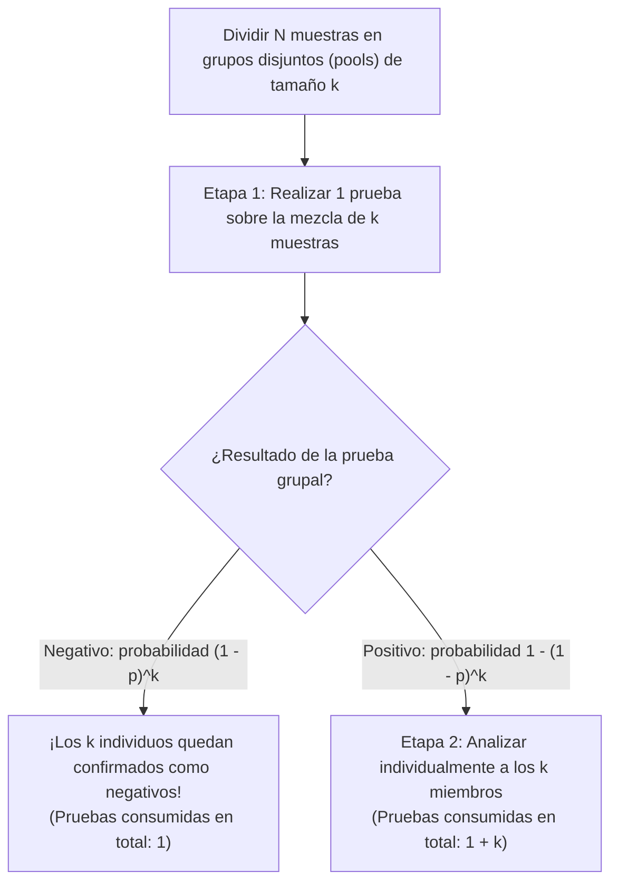
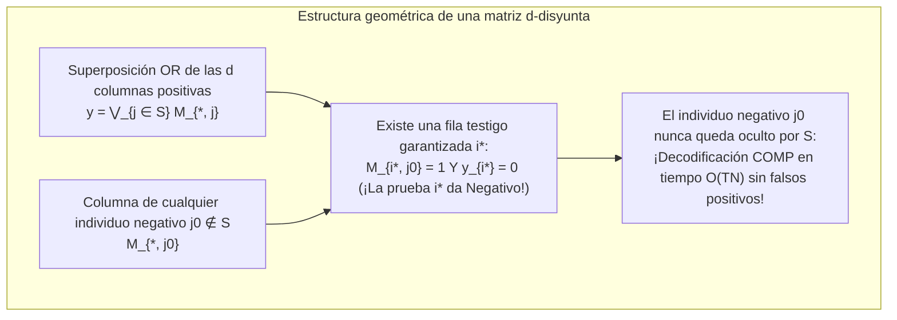

Supongamos que en una población de $1.000$ personas se oculta exactamente un individuo infectado (positivo). ¿Cuántas pruebas diagnósticas se necesitan para identificar a esa persona con un $100\,\%$ de certeza?

El sentido común sugiere analizar a las $1.000$ personas una por una, realizando $1.000$ pruebas. Sin embargo, las matemáticas y la teoría de la información revelan algo extraordinario. Si podemos mezclar (*poolear*) muestras biológicas de modo que un solo ensayo responda a la pregunta binaria *«¿Hay al menos una muestra positiva en esta mezcla?»*, entonces <strong>la búsqueda adaptativa por bipartición requiere tan solo $10$ pruebas</strong>. Y lo que es aún más sorprendente: <strong>incluso si fijamos de antemano todo el esquema de mezclas y ejecutamos todas las pruebas simultáneamente en una única tanda paralela (prueba de grupo no adaptativa), bastan unas pocas docenas de pruebas</strong> para identificar al individuo positivo sin necesidad de repetir ningún análisis.

Lo que parece un truco de magia es en realidad una rama fundamental de la matemática discreta, la estadística, la teoría de códigos y la teoría de la información conocida como <strong>Group Testing (pruebas grupales)</strong> y <strong>búsqueda combinatoria (Combinatorial Search)</strong>. En este artículo exploramos toda su estructura matemática: desde el artículo histórico de Robert Dorfman en 1943 y las cotas inferiores de entropía de Claude Shannon, pasando por el clásico problema de las 12 monedas y la búsqueda binaria generalizada de Hwang, hasta las <strong>matrices $d$-disyuntas (códigos superpuestos)</strong> de Kautz y Singleton sobre cuerpos finitos (Reed-Solomon), el <strong>sensado comprimido (Compressed Sensing)</strong> y el cribado genómico masivo (P-BEST).

---

## 1. El avance de 1943: El agrupamiento en dos etapas de Robert Dorfman

### 1.1 La Segunda Guerra Mundial y el cuello de botella de la prueba de Wassermann

La historia matemática del Group Testing nació en diciembre de 1943, cuando el estadístico <strong>Robert Dorfman</strong> publicó en *The Annals of Mathematical Statistics* su célebre artículo de seis páginas *"The Detection of Defective Members of Large Populations"*.

Durante la Segunda Guerra Mundial, el Ejército de los Estados Unidos necesitaba detectar la sífilis en millones de reclutas mediante la prueba serológica de Wassermann. Como la prevalencia $p$ era muy baja (típicamente $p \approx 0{,}01$ a $p \approx 0{,}001$), analizar a cada soldado individualmente desperdiciaba más del $99\,\%$ de los reactivos en confirmar resultados negativos.

Dorfman propuso un <strong>algoritmo de agrupamiento en dos etapas (Two-Stage Pooling)</strong>: dividir a los $N$ individuos en grupos disjuntos (pools) de tamaño $k$.

1. <strong>Etapa 1 (Prueba de grupo)</strong>: Mezclar las $k$ muestras del grupo y realizar $1$ sola prueba sobre la mezcla.
   - <strong>Si el grupo resulta Negativo</strong> (probabilidad $(1 - p)^k$): ¡los $k$ individuos quedan descartados simultáneamente consumiendo <strong>$1$ sola prueba</strong>!
   - <strong>Si el grupo resulta Positivo</strong> (probabilidad $1 - (1 - p)^k$): al menos uno de los $k$ miembros es positivo; se pasa a la Etapa 2.
2. <strong>Etapa 2 (Reanálisis individual)</strong>: Analizar individualmente las $k$ muestras originales del grupo positivo (consumiendo $1 + k$ pruebas en total para ese grupo).

### 1.2 Derivación analítica del tamaño óptimo de grupo $k^*$

Para un grupo de tamaño $k$, el número esperado de pruebas es $\mathbb{E}[T_{\text{pool}}] = 1 \cdot (1 - p)^k + (1 + k)[1 - (1 - p)^k] = 1 + k[1 - (1 - p)^k]$. Dividiendo por $k$, obtenemos el <strong>número esperado de pruebas por persona</strong> $f(k) = \frac{\mathbb{E}[T]}{N}$:

$$\frac{\mathbb{E}[T]}{N} = \frac{1}{k} + 1 - (1 - p)^k \approx \frac{1}{k} + k p \implies \frac{d}{dk}\left(\frac{1}{k} + kp\right) = -\frac{1}{k^2} + p = 0 \implies k^* \approx \frac{1}{\sqrt{p}}, \qquad \frac{\mathbb{E}[T]_{\min}}{N} \approx 2\sqrt{p}$$

Veamos con números concretos el impacto de esta ley de la raíz cuadrada:
- <strong>Cuando la prevalencia es $p = 0{,}01$ ($1\,\%$)</strong>: el tamaño óptimo de grupo es $k^* \approx \frac{1}{\sqrt{0{,}01}} = 10$ (óptimo entero exacto: $k^* = 11$), y el número esperado de pruebas por persona cae a $\frac{\mathbb{E}[T]}{N} \approx 0{,}20$ (exacto: $0{,}1956$). ¡Cribamos a $1.000$ personas con solo <strong>$196$ pruebas en lugar de $1.000$, logrando un ahorro del $80{,}4\,\%$</strong>!
- <strong>Cuando la prevalencia es $p = 0{,}0001$ ($0{,}01\,\%$)</strong>: el tamaño óptimo es $k^* = 100$ y el coste baja a $0{,}02$ pruebas por persona, ¡<strong>reduciendo el número de pruebas en un $98\,\%$</strong>!

| Prevalencia $p$ | Tasa de positivos | Óptimo asintótico $1/\sqrt{p}$ | Óptimo exacto $k^*$ | Pruebas esperadas / persona $\mathbb{E}[T]/N$ | Pruebas por cada $1.000$ personas | Reducción |
| :--- | :--- | :--- | :--- | :--- | :--- | :--- |
| $p = 0{,}10$ | $1$ de cada $10$ | $3{,}16$ | $4$ | $0{,}5939$ | $594$ pruebas | $40{,}6\,\%$ |
| $p = 0{,}05$ | $1$ de cada $20$ | $4{,}47$ | $5$ | $0{,}4262$ | $426$ pruebas | $57{,}4\,\%$ |
| $p = 0{,}01$ | $1$ de cada $100$ | $10{,}0$ | $11$ | $0{,}1956$ | $196$ pruebas | <strong>$80{,}4\,\%$</strong> |
| $p = 0{,}001$ | $1$ de cada $1.000$ | $31{,}6$ | $32$ | $0{,}0628$ | $63$ pruebas | <strong>$93{,}7\,\%$</strong> |
| $p = 0{,}0001$ | $1$ de cada $10.000$ | $100{,}0$ | $101$ | $0{,}01995$ | $20$ pruebas | <strong>$98{,}0\,\%$</strong> |

---

## 2. La cota inferior de la teoría de la información (Counting Bound y Entropía de Shannon)

¿Cuál es el mínimo absoluto de pruebas que exige la naturaleza para cualquier algoritmo posible?

1. <strong>Cota combinatoria de conteo (Counting Bound)</strong>: Si existen $d$ positivos entre $N$ elementos ($S \subset [N], |S| = d$), hay $\binom{N}{d}$ subconjuntos posibles. Dado que cada prueba binaria $\{0, 1\}$ aporta como máximo $1$ bit de información de Shannon, $T$ pruebas generan a lo sumo $2^T$ vectores de resultados distintos:
   $$2^T \ge \binom{N}{d} \implies T \ge \log_2 \binom{N}{d} \approx d \log_2 \frac{N}{d} + O(d)$$
2. <strong>Cota probabilística de entropía de Shannon</strong>: Si cada individuo es positivo independientemente con probabilidad $p$, la entropía conjunta del vector de estado $\mathbf{X} \in \{0, 1\}^N$ es $N \cdot H_2(p)$, lo que impone:
   $$\frac{\mathbb{E}[T]}{N} \ge H_2(p) = -p\log_2 p - (1-p)\log_2(1-p)$$

---

## 3. Pruebas de grupo adaptativas vs. no adaptativas

### 3.1 Bipartición adaptativa de Hwang y el problema de las 12 monedas

En el <strong>Group Testing adaptativo</strong>, cada grupo se diseña en función de los resultados anteriores:
- Para $d = 1$, la <strong>búsqueda binaria (Binary Splitting)</strong> divide por la mitad el conjunto de candidatos en cada paso, logrando exactamente $\lceil \log_2 N \rceil$ pruebas ($10$ pruebas para $N = 1.000$).
- Para $d \ge 2$, el <strong>algoritmo de bipartición generalizada de Frank K. Hwang (1972)</strong> selecciona en cada paso un subgrupo de tamaño $2^\alpha \approx n/d$ para que las probabilidades de resultado positivo y negativo sean cercanas a $1/2$ ($1$ bit de información por prueba), alcanzando el óptimo teórico $T = d \log_2(N/d) + O(d)$.

Este mismo principio gobierna el famoso <strong>problema de las 12 monedas y la balanza (1945)</strong>: entre $12$ monedas hay $1$ falsa que pesa más o menos que las auténticas ($12 \times 2 = 24$ estados posibles). Una balanza de dos platillos tiene $3$ resultados $\{-1, 0, +1\}$, proporcionando hasta $\log_2 3 \approx 1{,}585$ bits por pesada y distinguiendo hasta $3^3 = 27 \ge 24$ estados en $3$ pesadas. Si en la primera pesada colocamos $6$ contra $6$, la balanza jamás quedará en equilibrio ($0$), dejando $12 > 3^2 = 9$ estados (imposible de resolver). Solo colocando <strong>$4$ monedas en el platillo izquierdo, $4$ en el derecho y dejando $4$ fuera</strong> se particionan las $24$ hipótesis en $8 : 8 : 8$, resolviendo el acertijo en $3$ pesadas.

<strong>La limitación práctica en PCR y genómica</strong>: Como cada ciclo de amplificación RT-PCR tarda unas $3$ horas, ejecutar $10$ etapas adaptativas en serie requeriría <strong>$30$ horas</strong>. Por ello, los laboratorios clínicos necesitan el <strong>Group Testing no adaptativo (NAGT)</strong>, que ejecuta todas las pruebas en paralelo en una sola ronda.

---

## 4. Group Testing No Adaptativo (NAGT) y Matrices $d$-Disyuntas

### 4.1 La matriz de agrupamiento $\mathbf{M}$ y la superposición OR booleana

<strong>Kautz y Singleton (1964)</strong> formalizaron el diseño no adaptativo mediante una matriz binaria $\mathbf{M} \in \{0, 1\}^{T \times N}$, donde $M_{i, j} = 1$ indica que la muestra $j$ participa en el pool $i$. El vector de resultados $\mathbf{y} \in \{0, 1\}^T$ es la <strong>superposición OR booleana</strong> de las columnas correspondientes al conjunto positivo $S$ ($|S| \le d$):

$$\mathbf{y} = \mathbf{M} \odot \mathbf{x} = \bigvee_{j \in S} \mathbf{M}_{*, j}$$

### 4.2 Matrices $d$-disyuntas y decodificación COMP en tiempo lineal

Una matriz $\mathbf{M}$ es <strong>$d$-disyunta ($d$-Disjunct Matrix)</strong> si el soporte de ninguna columna $j_0 \notin S$ está contenido en la unión de los soportes de cualesquiera otras $d$ columnas $S$:

$$\text{supp}(\mathbf{M}_{*, j_0}) \not\subseteq \bigcup_{j \in S} \text{supp}(\mathbf{M}_{*, j}) \qquad (\forall |S| \le d, \; \forall j_0 \notin S)$$

Es decir, para todo individuo negativo $j_0 \notin S$, existe al menos una <strong>«prueba testigo» (fila $i^*$)</strong> en la que participa $j_0$ ($M_{i^*, j_0} = 1$) pero no participa ninguno de los $d$ positivos ($y_{i^*} = 0$).

Esto permite decodificar con el algoritmo <strong>COMP (Combinatorial Orthogonal Matching Pursuit)</strong> en tiempo lineal $O(TN)$: basta con descartar como negativos a todos los individuos que participan en alguna prueba negativa; ¡los restantes son exactamente los positivos! Mientras que la cota inferior de D'yachkov-Rykov / Ruszinkó / Füredi exige $T = \Omega\left(\frac{d^2}{\log d} \log N\right)$ filas, las construcciones probabilísticas y algebraicas logran $T = O(d^2 \log N)$.

### 4.3 Cuadrícula 2D («falsos positivos fantasma») y diseños polinómicos de Reed-Solomon

Si disponemos $N = 100$ muestras en una cuadrícula $10 \times 10$ ($10$ pools de filas + $10$ pools de columnas = $20$ pruebas), $d = 1$ positivo se localiza en la única intersección ($1$-disyunta). Pero si hay $d = 2$ positivos en $(2, 4)$ y $(6, 9)$, se activan las filas $R_2, R_6$ y las columnas $C_4, C_9$, generando dos <strong>«positivos fantasma» (Ghost Positives)</strong> en $(2, 9)$ y $(6, 4)$.

Kautz y Singleton eliminaron los fantasmas asignando a cada muestra $j$ un polinomio $P_j(x) \in \mathbb{F}_q[x]$ de grado $\le k-1$ sobre un cuerpo finito $\mathbb{F}_q$ (código de <strong>Reed-Solomon</strong>, $N = q^k$) y agrupando según $y = P_j(x_m) \pmod q$ en $w \ge d(k-1)+1$ direcciones (filas, columnas y diagonales modulares). Como dos polinomios distintos de grado $\le k-1$ coinciden en a lo sumo $k-1$ puntos, ¡la matriz resultante es estrictamente $d$-disyunta!

---

## 5. Ruido, Sensado Comprimido (Compressed Sensing) y el método P-BEST

| Característica | Group Testing Adaptativo (Hwang) | Group Testing No Adaptativo ($d$-disyunta) | Compressed Sensing (Candès-Tao-Donoho) |
| :--- | :--- | :--- | :--- |
| <strong>Álgebra subyacente</strong> | Árbol de decisión sobre $\{0, 1\}$ | Semianillo booleano $(\{0, 1\}, \lor, \land)$ | Cuerpo real $(\mathbb{R}, +, \times)$, $\mathbf{y} = \mathbf{\Phi}\mathbf{x} + \mathbf{e}$ |
| <strong>Condición de la matriz</strong> | Partición equiprobable ($1$ bit/prueba) | <strong>$d$-Disyuntividad</strong> | <strong>Propiedad de Isometría Restringida (RIP)</strong> |
| <strong>Número de pruebas $T$</strong> | $d \log_2(N/d) + O(d)$ | $O(d^2 \log N)$ (cero error) / $O(d \log N)$ (probabilístico) | $O(d \log(N/d))$ |
| <strong>Decodificador</strong> | Búsqueda binaria secuencial | <strong>COMP / DD / SCOMP / Propagación de creencias</strong> | <strong>OMP / Basis Pursuit (minimización $\ell_1$)</strong> |

1. <strong>Efecto de dilución y Group Testing con ruido</strong>: Frente a la dilución viral y errores de ensayo, las matrices $(d, 2e)$-disyuntas garantizan $2e+1$ filas testigo (decodificador <strong>NCOMP</strong>), complementadas por <strong>Belief Propagation (BP)</strong> y <strong>programación lineal (LP)</strong>.
2. <strong>Dualidad con el Compressed Sensing</strong>: El sensado comprimido traslada el principio del Group Testing desde la superposición OR booleana hasta las proyecciones lineales en $\mathbb{R}$.
3. <strong>Canales de acceso múltiple y cribado COVID-19 P-BEST</strong>: Desde la resolución de colisiones inalámbricas (algoritmo en árbol de Capetanakis) y el Count-Min Sketch en enrutadores, hasta el método clínico <strong>P-BEST</strong> (Shental et al., *Science Advances* 2020), que utiliza una matriz de Reed-Solomon de $48 \times 384$ para analizar a $384$ personas en solo $48$ reacciones PCR simultáneas en una sola ronda (multiplicando por $8$ la capacidad diagnóstica), el Group Testing demuestra el extraordinario poder práctico de la combinatoria.
