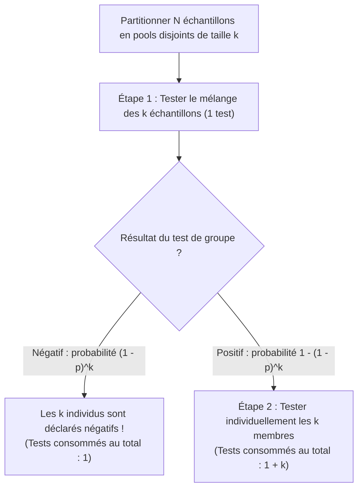
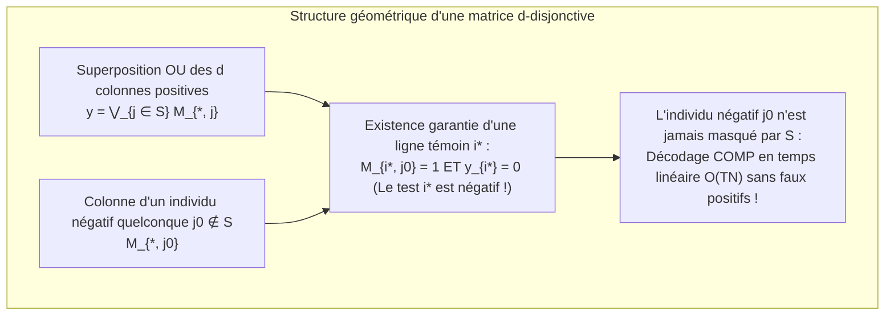

Supposons qu'un seul individu infecté se cache au sein d'une population de $1\,000$ personnes. Combien de tests diagnostiques faut-il réaliser pour identifier cette personne positive avec une certitude de $100\,\%$ ?

L'intuition suggère de tester les $1\,000$ personnes une par une, soit $1\,000$ tests. Pourtant, les mathématiques et la théorie de l'information apportent une réponse radicalement différente. Si l'on peut mélanger (grouper ou *pooler*) des prélèvements de sorte qu'un seul test réponde à la question binaire *« Y a-t-il au moins un échantillon positif dans ce mélange ? »*, alors <strong>une recherche adaptative par dichotomie ne requiert que $10$ tests</strong>. Plus fascinant encore : <strong>même si l'on fixe à l'avance le plan de mélange et que l'on exécute tous les tests simultanément en une seule étape parallèle (test de groupe non adaptatif), quelques dizaines de tests suffisent</strong> pour identifier l'individu positif sans aucun re-test.

Cette discipline au carrefour des probabilités, de la combinatoire, de la théorie des codes et de la théorie de l'information s'appelle le <strong>test de groupe (Group Testing)</strong> et la <strong>recherche combinatoire (Combinatorial Search)</strong>. Dans cet article, nous retraçons son architecture mathématique complète : de l'article fondateur de Robert Dorfman en 1943 aux bornes inférieures d'entropie de Claude Shannon, du célèbre problème des 12 pièces de monnaie et de l'algorithme de Hwang aux <strong>matrices $d$-disjonctives (codes superposés)</strong> de Kautz et Singleton sur les corps finis (Reed-Solomon), jusqu'à ses liens profonds avec l'<strong>acquisition comprimée (Compressed Sensing)</strong> et le dépistage génomique à haut débit (P-BEST).

---

## 1. La percée de 1943 : Le pooling à deux étapes de Robert Dorfman

### 1.1 La Seconde Guerre mondiale et le goulot d'étranglement du test de Wassermann

L'histoire mathématique du test de groupe débute en décembre 1943 lorsque le statisticien américain <strong>Robert Dorfman</strong> publie dans *The Annals of Mathematical Statistics* un court article de six pages intitulé *"The Detection of Defective Members of Large Populations"*.

Pendant la Seconde Guerre mondiale, l'armée américaine devait dépister la syphilis chez des millions de conscrits à l'aide du test sanguin de Wassermann. Comme la prévalence $p$ était faible (typiquement $p \approx 0{,}01$ à $p \approx 0{,}001$), tester chaque soldat individuellement gaspillait plus de $99\,\%$ des tests uniquement pour confirmer des résultats négatifs.

Dorfman proposa une <strong>procédure de groupage à deux étapes (Two-Stage Pooling)</strong> : diviser la population de $N$ individus en groupes disjoints (pools) de taille $k$.

1. <strong>Étape 1 (Test de groupe)</strong> : Mélanger les $k$ échantillons du groupe et effectuer $1$ seul test sur le mélange.
   - <strong>Si le mélange est négatif</strong> (probabilité $(1 - p)^k$) : les $k$ individus sont déclarés négatifs d'un seul coup avec <strong>$1$ seul test consommé</strong> !
   - <strong>Si le mélange est positif</strong> (probabilité $1 - (1 - p)^k$) : au moins un individu est positif ; on passe à l'étape 2.
2. <strong>Étape 2 (Tests individuels de confirmation)</strong> : Tester individuellement chacun des $k$ membres du groupe positif (soit un total de $1 + k$ tests pour ce groupe).

### 1.2 Dérivation analytique de la taille optimale de groupe $k^*$

Pour un groupe de taille $k$, l'espérance du nombre de tests est $\mathbb{E}[T_{\text{pool}}] = 1 \cdot (1 - p)^k + (1 + k)[1 - (1 - p)^k] = 1 + k[1 - (1 - p)^k]$. En divisant par $k$, on obtient le <strong>nombre espéré de tests par individu</strong> $f(k) = \frac{\mathbb{E}[T]}{N}$ :

$$\frac{\mathbb{E}[T]}{N} = \frac{1}{k} + 1 - (1 - p)^k \approx \frac{1}{k} + k p \implies \frac{d}{dk}\left(\frac{1}{k} + kp\right) = -\frac{1}{k^2} + p = 0 \implies k^* \approx \frac{1}{\sqrt{p}}, \qquad \frac{\mathbb{E}[T]_{\min}}{N} \approx 2\sqrt{p}$$

Illustrons cette loi de la racine carrée par des chiffres concrets :
- <strong>Pour une prévalence $p = 0{,}01$ ($1\,\%$)</strong> : la taille optimale est $k^* \approx \frac{1}{\sqrt{0{,}01}} = 10$ (optimum entier exact : $k^* = 11$). Le coût tombe à $\frac{\mathbb{E}[T]}{N} \approx 0{,}20$ test par personne (exact : $0{,}1956$). Dépister $1\,000$ personnes ne demande plus que <strong>$196$ tests au lieu de $1\,000$, soit une réduction de $80{,}4\,\%$</strong> !
- <strong>Pour une prévalence $p = 0{,}0001$ ($0{,}01\,\%$)</strong> : la taille optimale est $k^* = 100$, réduisant le nombre de tests à $0{,}02$ par personne, soit <strong>$98\,\%$ d'économie</strong> !

| Prévalence $p$ | Taux de positivité | Taille asymptotique $1/\sqrt{p}$ | Optimum exact $k^*$ | Tests espérés / personne $\mathbb{E}[T]/N$ | Tests pour $1\,000$ personnes | Réduction |
| :--- | :--- | :--- | :--- | :--- | :--- | :--- |
| $p = 0{,}10$ | $1$ sur $10$ | $3{,}16$ | $4$ | $0{,}5939$ | $594$ tests | $40{,}6\,\%$ |
| $p = 0{,}05$ | $1$ sur $20$ | $4{,}47$ | $5$ | $0{,}4262$ | $426$ tests | $57{,}4\,\%$ |
| $p = 0{,}01$ | $1$ sur $100$ | $10{,}0$ | $11$ | $0{,}1956$ | $196$ tests | <strong>$80{,}4\,\%$</strong> |
| $p = 0{,}001$ | $1$ sur $1\,000$ | $31{,}6$ | $32$ | $0{,}0628$ | $63$ tests | <strong>$93{,}7\,\%$</strong> |
| $p = 0{,}0001$ | $1$ sur $10\,000$ | $100{,}0$ | $101$ | $0{,}01995$ | $20$ tests | <strong>$98{,}0\,\%$</strong> |

---

## 2. La borne inférieure de la théorie de l'information (Shannon & Counting Bound)

Jusqu'où peut-on théoriquement descendre si l'on autorise un nombre quelconque d'étapes ou des mélanges sophistiqués ?

1. <strong>Borne combinatoire (Counting Bound)</strong> : S'il y a exactement $d$ positifs parmi $N$ individus ($S \subset [N], |S| = d$), il existe $\binom{N}{d}$ sous-ensembles possibles. Chaque test binaire $\{0, 1\}$ apportant au plus $1$ bit d'information de Shannon, $T$ tests produisent au plus $2^T$ vecteurs de résultats distincts :
   $$2^T \ge \binom{N}{d} \implies T \ge \log_2 \binom{N}{d} \approx d \log_2 \frac{N}{d} + O(d)$$
2. <strong>Borne d'entropie de Shannon (modèle probabiliste)</strong> : Si chaque individu est indépendamment positif avec probabilité $p$, l'entropie totale du vecteur d'état $\mathbf{X} \in \{0, 1\}^N$ vaut $N \cdot H_2(p)$, d'où :
   $$\frac{\mathbb{E}[T]}{N} \ge H_2(p) = -p\log_2 p - (1-p)\log_2(1-p)$$

---

## 3. Test de groupe adaptatif vs non adaptatif

### 3.1 Dichotomie adaptative de Hwang et le problème des 12 pièces

Dans le <strong>test de groupe adaptatif</strong>, chaque mélange est choisi en fonction des résultats précédents :
- Pour $d = 1$, la <strong>recherche dichotomique (Binary Splitting)</strong> divise par deux l'espace des candidats à chaque étape et atteint exactement $\lceil \log_2 N \rceil$ tests ($10$ tests pour $N = 1\,000$).
- Pour $d \ge 2$, l'<strong>algorithme de dichotomie généralisée de Frank K. Hwang (1972)</strong> teste des sous-groupes de taille $2^\alpha \approx n/d$ afin d'équilibrer les probabilités de sortie positive et négative autour de $1/2$ ($1$ bit d'entropie par test), atteignant l'optimum asymptotique $T = d \log_2(N/d) + O(d)$.

C'est exactement le même principe qui régit le célèbre <strong>problème des 12 pièces de monnaie (1945)</strong> : parmi $12$ pièces se trouve $1$ fausse pièce, soit plus lourde, soit plus légère ($12 \times 2 = 24$ hypothèses). Une balance à deux plateaux offre $3$ résultats $\{-1, 0, +1\}$, soit $\log_2 3 \approx 1{,}585$ bit par pesée et $3^3 = 27 \ge 24$ états discernables en $3$ pesées. Si l'on place $6$ pièces contre $6$ dès la première pesée, l'équilibre ($0$) est impossible, laissant $12 > 3^2 = 9$ hypothèses (échec garanti). Il faut impérativement peser <strong>$4$ pièces contre $4$ (et en laisser $4$ de côté)</strong> pour diviser les $24$ états en $8 : 8 : 8$ et résoudre le problème en $3$ pesées.

<strong>L'obstacle pratique en biologie moléculaire</strong> : Un cycle de RT-PCR durant environ $3$ heures, exécuter $10$ étapes adaptatives en série prendrait <strong>$30$ heures</strong> ! D'où la nécessité cruciale du <strong>test de groupe non adaptatif (NAGT)</strong>, où tous les tests sont réalisés simultanément en une seule étape.

---

## 4. Test de groupe non adaptatif (NAGT) et matrices $d$-disjonctives

### 4.1 Matrice de groupage $\mathbf{M}$ et superposition OU booléenne

<strong>Kautz et Singleton (1964)</strong> ont formalisé le test non adaptatif par une matrice binaire $\mathbf{M} \in \{0, 1\}^{T \times N}$ où $M_{i, j} = 1$ indique que l'échantillon $j$ est inclus dans le pool $i$. Le vecteur des résultats $\mathbf{y} \in \{0, 1\}^T$ est la <strong>superposition par OU booléen (Boolean OR)</strong> des colonnes des individus positifs $S$ ($|S| \le d$) :

$$\mathbf{y} = \mathbf{M} \odot \mathbf{x} = \bigvee_{j \in S} \mathbf{M}_{*, j}$$

### 4.2 Matrices $d$-disjonctives et décodage COMP en temps linéaire

Une matrice $\mathbf{M}$ est dite <strong>$d$-disjonctive ($d$-Disjunct Matrix)</strong> si le support d'aucune colonne $j_0 \notin S$ n'est inclus dans l'union des supports de $d$ autres colonnes quelconques $S$ :

$$\text{supp}(\mathbf{M}_{*, j_0}) \not\subseteq \bigcup_{j \in S} \text{supp}(\mathbf{M}_{*, j}) \qquad (\forall |S| \le d, \; \forall j_0 \notin S)$$

Autrement dit, pour tout individu négatif $j_0 \notin S$, il existe au moins un <strong>« test témoin » (ligne $i^*$)</strong> auquel $j_0$ participe ($M_{i^*, j_0} = 1$) mais auquel aucun des $d$ positifs ne participe ($y_{i^*} = 0$).

Grâce à cette propriété, l'algorithme <strong>COMP (Combinatorial Orthogonal Matching Pursuit)</strong> décode $\mathbf{y}$ en temps linéaire $O(TN)$ : il suffit d'éliminer tous les individus présents dans au moins un test négatif ; les individus restants sont exactement les positifs ! Le théorème de D'yachkov-Rykov / Ruszinkó / Füredi impose la borne inférieure $T = \Omega\left(\frac{d^2}{\log d} \log N\right)$, tandis que les constructions probabilistes et algébriques atteignent $T = O(d^2 \log N)$.

### 4.3 Grille 2D (« faux positifs fantômes ») et plans polynomiaux de Reed-Solomon

En disposant $N = 100$ échantillons sur une grille $10 \times 10$ ($10$ pools lignes + $10$ pools colonnes = $20$ tests), $d = 1$ positif est identifié à l'intersection unique ($1$-disjonctif). Mais si $d = 2$ positifs se trouvent en $(2, 4)$ et $(6, 9)$, les lignes $R_2, R_6$ et colonnes $C_4, C_9$ sont positives, créant deux <strong>« positifs fantômes » (Ghost Positives)</strong> aux intersections $(2, 9)$ et $(6, 4)$ !

Kautz et Singleton éliminent ces fantômes en associant à chaque échantillon $j$ un polynôme $P_j(x) \in \mathbb{F}_q[x]$ de degré $\le k-1$ sur un corps fini $\mathbb{F}_q$ (code de <strong>Reed-Solomon</strong>, $N = q^k$) et en formant les pools selon $y = P_j(x_m) \pmod q$ dans $w \ge d(k-1)+1$ directions (lignes, colonnes et diagonales de différentes pentes). Deux polynômes distincts de degré $\le k-1$ ayant au plus $k-1$ intersections, la matrice résultante est strictement $d$-disjonctive !

---

## 5. Tests bruités, Acquisition Comprimée (Compressed Sensing) et P-BEST

| Caractéristique | Test Adaptatif (Dichotomie de Hwang) | Test Non Adaptatif (Matrice $d$-disjonctive) | Acquisition Comprimée (Compressed Sensing) |
| :--- | :--- | :--- | :--- |
| <strong>Algèbre sous-jacente</strong> | Arbre de décision sur $\{0, 1\}$ | Demi-anneau booléen $(\{0, 1\}, \lor, \land)$ | Corps des réels $(\mathbb{R}, +, \times)$, $\mathbf{y} = \mathbf{\Phi}\mathbf{x} + \mathbf{e}$ |
| <strong>Condition géométrique</strong> | Partition équiprobable ($1$ bit/test) | <strong>$d$-Disjonctivité</strong> | <strong>Propriété d'isométrie restreinte (RIP)</strong> |
| <strong>Nombre de mesures $T$</strong> | $d \log_2(N/d) + O(d)$ | $O(d^2 \log N)$ (zéro erreur) / $O(d \log N)$ (probabiliste) | $O(d \log(N/d))$ |
| <strong>Algorithme de décodage</strong> | Recherche dichotomique séquentielle | <strong>COMP / DD / SCOMP / Propagation de croyance</strong> | <strong>OMP / Basis Pursuit (minimisation $\ell_1$)</strong> |

1. <strong>Effet de dilution et tests de groupe bruités</strong> : Face à la dilution virale et aux erreurs de test, les matrices $(d, 2e)$-disjonctives garantissent $2e+1$ tests témoins (décodage <strong>NCOMP</strong>), complétées par la <strong>propagation de croyance (Belief Propagation)</strong> et la <strong>programmation linéaire (LP)</strong>.
2. <strong>Dualité avec le Compressed Sensing</strong> : Développée par Candès, Tao et Donoho (2006), l'acquisition comprimée est l'exact analogue continu sur $\mathbb{R}$ du test de groupe booléen.
3. <strong>Réseaux à accès multiple et dépistage COVID-19 P-BEST</strong> : De la résolution de collisions radio (algorithme en arbre de Capetanakis) aux filtres de Bloom et au protocole clinique <strong>P-BEST</strong> (Shental et al., *Science Advances* 2020) qui dépiste $384$ patients en une seule étape de $48$ pools PCR grâce à une matrice de Reed-Solomon (multipliant par $8$ la capacité de test), le Group Testing illustre magistralement la puissance des mathématiques combinatoires.
