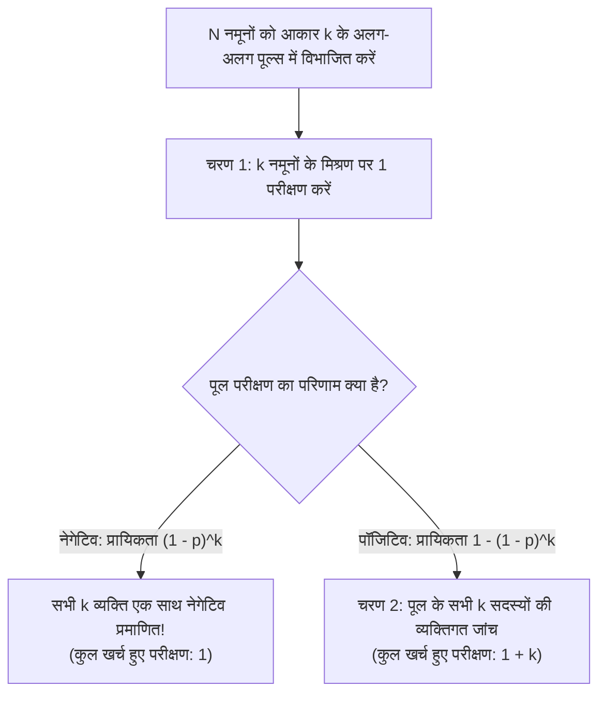
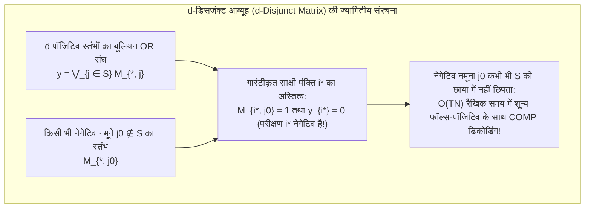

मान लीजिए कि $1,000$ लोगों की आबादी में केवल $1$ संक्रमित (पॉजिटिव) व्यक्ति छिपा है। $100\%$ सटीकता के साथ उस एक पॉजिटिव व्यक्ति की पहचान करने के लिए कितने नैदानिक परीक्षणों (diagnostic tests) की आवश्यकता होगी?

सामान्य सहज ज्ञान कहता है कि सभी $1,000$ लोगों की एक-एक करके जांच की जाए—जिसमें कुल $1,000$ परीक्षण लगेंगे। किंतु गणित और सूचना सिद्धांत (Information Theory) एक बिल्कुल अलग और चमत्कारी उत्तर देते हैं। यदि हम जैविक नमूनों को आपस में मिलाकर (*pooling*) यह द्विआधारी (binary) प्रश्न पूछ सकें कि *«क्या इस मिश्रण में कम से कम एक पॉजिटिव नमूना मौजूद है?»*, तो <strong>चरणबद्ध अनुकूली खोज (Adaptive Group Testing) में केवल $10$ परीक्षणों</strong> की आवश्यकता होती है! इससे भी अधिक आश्चर्यजनक बात यह है कि <strong>यदि हम शुरुआत में ही मिश्रण का पैटर्न पूरी तरह तय कर लें और सभी परीक्षणों को एक ही समानांतर चक्र (Non-Adaptive Group Testing) में एक साथ चलाएं, तब भी केवल कुछ दर्जन परीक्षणों</strong> में बिना किसी दोबारा जांच के उस संक्रमित व्यक्ति की सटीक पहचान की जा सकती है।

जादू जैसा दिखने वाला यह सिद्धांत विविक्त गणित (Discrete Mathematics), सांख्यिकी, कोडिंग सिद्धांत और सूचना सिद्धांत का एक अत्यंत महत्वपूर्ण स्तंभ है जिसे <strong>ग्रुप टेस्टिंग (Group Testing / सामूहिक परीक्षण)</strong> और <strong>कॉम्बिनेटरियल सर्च (Combinatorial Search)</strong> कहा जाता है। इस लेख में हम रॉबर्ट डॉर्फमैन (Robert Dorfman) के 1943 के ऐतिहासिक शोधपत्र से लेकर क्लॉड शैनन की सूचना-सैद्धांतिक निचली सीमा, प्रसिद्ध '12 नकली सिक्कों की तराजू पहेली', ह्वांग (Hwang) के द्विआधारी विभाजन, काउत्ज़ और सिंगलटन (Kautz & Singleton) के <strong>$d$-डिसजंक्ट आव्यूह ($d$-Disjunct Matrix)</strong>, रीड-सोलोमन (Reed-Solomon) परिमित क्षेत्र डिज़ाइन, और आधुनिक <strong>कम्प्रेस्ड सेंसिंग (Compressed Sensing)</strong> तथा COVID-19 के P-BEST परीक्षण तक की संपूर्ण गणितीय संरचना को विस्तार से समझेंगे।

---

## 1. 1943 की ऐतिहासिक सफलता: रॉबर्ट डॉर्फमैन की दो-स्तरीय पूलिंग (Dorfman Pooling)

### 1.1 द्वितीय विश्व युद्ध और वासरमैन रक्त परीक्षण की चुनौती

ग्रुप टेस्टिंग के गणितीय इतिहास की शुरुआत दिसंबर 1943 में हुई, जब अमेरिकी सांख्यिकीविद् <strong>रॉबर्ट डॉर्फमैन (Robert Dorfman)</strong> ने *The Annals of Mathematical Statistics* में *"The Detection of Defective Members of Large Populations"* शीर्षक से मात्र छह पृष्ठों का एक क्रांतिकारी शोधपत्र प्रकाशित किया।

द्वितीय विश्व युद्ध के दौरान, अमेरिकी सेना को लाखों नए सैनिकों में सिफलिस (syphilis) की जांच के लिए वासरमैन रक्त परीक्षण (Wassermann test) करना पड़ा। चूंकि सैनिकों में संक्रमण की व्यापकता दर (prevalence $p$) बहुत कम थी (लगभग $p \approx 0.01$ से $p \approx 0.001$), इसलिए प्रत्येक सैनिक की अलग-अलग जांच करने पर $99\%$ से अधिक संसाधन केवल यह पुष्टि करने में खर्च हो रहे थे कि स्वस्थ सैनिक नेगेटिव हैं।

डॉर्फमैन ने <strong>दो-स्तरीय पूलिंग विधि (Two-Stage Pooling)</strong> का प्रस्ताव रखा: कुल $N$ लोगों को $k$ आकार के अलग-अलग समूहों (पूल्स) में विभाजित करें।

1. <strong>चरण 1 (पूल परीक्षण)</strong>: समूह के $k$ नमूनों को मिलाकर एक मिश्रित पूल बनाएं और उस पर केवल $1$ परीक्षण करें।
   - <strong>यदि पूल नेगेटिव आता है</strong> (प्रायिकता $(1 - p)^k$): तो समूह के सभी $k$ सदस्य एक साथ नेगेटिव घोषित हो जाते हैं! <strong>$k$ लोगों के लिए केवल $1$ परीक्षण खर्च हुआ।</strong>
   - <strong>यदि पूल पॉजिटिव आता है</strong> (प्रायिकता $1 - (1 - p)^k$): तो समूह में कम से कम एक व्यक्ति पॉजिटिव है; अब चरण 2 पर जाएं।
2. <strong>चरण 2 (व्यक्तिगत पुनः परीक्षण)</strong>: पॉजिटिव आए पूल के सभी $k$ सदस्यों के मूल नमूनों की अलग-अलग जांच करें (इस पूल के लिए कुल $1 + k$ परीक्षण लगते हैं)।

### 1.2 इष्टतम पूल आकार $k^*$ की विश्लेषणात्मक व्युत्पत्ति

आकार $k$ के एक पूल के लिए अपेक्षित परीक्षणों की संख्या $\mathbb{E}[T_{\text{pool}}] = 1 \cdot (1 - p)^k + (1 + k)[1 - (1 - p)^k] = 1 + k[1 - (1 - p)^k]$ है। इसे $k$ से भाग देने पर <strong>प्रति व्यक्ति अपेक्षित परीक्षणों की संख्या</strong> $f(k) = \frac{\mathbb{E}[T]}{N}$ प्राप्त होती है:

$$\frac{\mathbb{E}[T]}{N} = \frac{1}{k} + 1 - (1 - p)^k \approx \frac{1}{k} + k p \implies \frac{d}{dk}\left(\frac{1}{k} + kp\right) = -\frac{1}{k^2} + p = 0 \implies k^* \approx \frac{1}{\sqrt{p}}, \qquad \frac{\mathbb{E}[T]_{\min}}{N} \approx 2\sqrt{p}$$

आइए ठोस आंकड़ों से इस वर्गमूल नियम (Square-Root Law) का प्रभाव देखें:
- <strong>जब संक्रमण दर $p = 0.01$ ($1\%$) हो</strong>: इष्टतम पूल आकार $k^* \approx \frac{1}{\sqrt{0.01}} = 10$ (सटीक पूर्णांक मान: $k^* = 11$) होता है, और प्रति व्यक्ति परीक्षण घटकर $\frac{\mathbb{E}[T]}{N} \approx 0.20$ (सटीक: $0.1956$) रह जाता है। अर्थात $1,000$ लोगों की जांच के लिए $1,000$ के बजाय <strong>केवल $196$ परीक्षणों की आवश्यकता होती है—सीधे $80.4\%$ की बचत</strong>!
- <strong>जब संक्रमण दर $p = 0.0001$ ($0.01\%$) हो</strong>: इष्टतम पूल आकार $k^* = 100$ होता है और प्रति व्यक्ति परीक्षण $0.02$ रह जाता है—जिससे <strong>$98\%$ परीक्षण लागत समाप्त हो जाती है</strong>!

| व्यापकता दर $p$ | पॉजिटिव अनुपात | सन्निकट $1/\sqrt{p}$ | सटीक इष्टतम $k^*$ | प्रति व्यक्ति अपेक्षित परीक्षण $\mathbb{E}[T]/N$ | प्रति $1,000$ व्यक्ति परीक्षण | परीक्षण में बचत |
| :--- | :--- | :--- | :--- | :--- | :--- | :--- |
| $p = 0.10$ | $10$ में $1$ | $3.16$ | $4$ | $0.5939$ | $594$ परीक्षण | $40.6\%$ बचत |
| $p = 0.05$ | $20$ में $1$ | $4.47$ | $5$ | $0.4262$ | $426$ परीक्षण | $57.4\%$ बचत |
| $p = 0.01$ | $100$ में $1$ | $10.0$ | $11$ | $0.1956$ | $196$ परीक्षण | <strong>$80.4\%$ बचत</strong> |
| $p = 0.001$ | $1,000$ में $1$ | $31.6$ | $32$ | $0.0628$ | $63$ परीक्षण | <strong>$93.7\%$ बचत</strong> |
| $p = 0.0001$ | $10,000$ में $1$ | $100.0$ | $101$ | $0.01995$ | $20$ परीक्षण | <strong>$98.0\%$ बचत</strong> |

---

## 2. सूचना-सैद्धांतिक निचली सीमा (Counting Bound और शैनन एन्ट्रॉपी)

किसी भी संभावित एल्गोरिदम के लिए प्रकृति और सूचना सिद्धांत द्वारा निर्धारित न्यूनतम परीक्षण संख्या क्या है?

1. <strong>कॉम्बिनेटरियल काउंटिंग बाउंड (Counting Bound)</strong>: यदि $N$ नमूनों में ठीक $d$ पॉजिटिव नमूने हैं ($S \subset [N], |S| = d$), तो कुल $\binom{N}{d}$ संभावित उपसमुच्चय हो सकते हैं। चूंकि प्रत्येक द्विआधारी परीक्षण $\{0, 1\}$ अधिकतम $1$ बिट शैनन सूचना देता है, इसलिए $T$ परीक्षणों से अधिकतम $2^T$ भिन्न परिणाम सदिश मिल सकते हैं:
   $$2^T \ge \binom{N}{d} \implies T \ge \log_2 \binom{N}{d} \approx d \log_2 \frac{N}{d} + O(d)$$
2. <strong>प्रायिकतामूलक शैनन एन्ट्रॉपी सीमा</strong>: यदि प्रत्येक व्यक्ति स्वतंत्र रूप से प्रायिकता $p$ के साथ पॉजिटिव है, तो अवस्था सदिश $\mathbf{X} \in \{0, 1\}^N$ की कुल शैनन एन्ट्रॉपी $N \cdot H_2(p)$ होती है, जिससे:
   $$\frac{\mathbb{E}[T]}{N} \ge H_2(p) = -p\log_2 p - (1-p)\log_2(1-p)$$

---

## 3. अनुकूली (Adaptive) बनाम गैर-अनुकूली (Non-Adaptive) ग्रुप टेस्टिंग

### 3.1 ह्वांग का सामान्यीकृत द्विआधारी विभाजन और 12 सिक्कों की तराजू पहेली

<strong>अनुकूली ग्रुप टेस्टिंग (Adaptive Group Testing)</strong> में पिछले परिणामों के आधार पर अगला पूल चुना जाता है:
- $d = 1$ के लिए, <strong>द्विआधारी खोज (Binary Splitting)</strong> प्रत्येक चरण में उम्मीदवारों को आधा करती है और ठीक $\lceil \log_2 N \rceil$ परीक्षणों ($N = 1,000$ के लिए $10$ परीक्षण) में संक्रमित व्यक्ति को खोज लेती है।
- $d \ge 2$ के लिए, <strong>फ्रैंक ह्वांग का सामान्यीकृत द्विआधारी विभाजन एल्गोरिदम (Hwang, 1972)</strong> आकार $2^\alpha \approx n/d$ के उप-पूल का परीक्षण करता है ताकि पॉजिटिव और नेगेटिव आने की प्रायिकता $1/2$ के पास रहे ($1$ बिट सूचना प्रति परीक्षण), और $T = d \log_2(N/d) + O(d)$ परीक्षणों में इष्टतम सीमा प्राप्त करता है।

यही सिद्धांत प्रसिद्ध <strong>12 नकली सिक्कों और तराजू की पहेली (1945)</strong> को संचालित करता है: $12$ सिक्कों में $1$ नकली सिक्का है जो असली से भारी या हल्का है ($12 \times 2 = 24$ अवस्थाएं)। तराजू के $3$ संभावित परिणाम $\{-1, 0, +1\}$ होते हैं, जो प्रति तौल $\log_2 3 \approx 1.585$ बिट सूचना देते हैं और $3$ तौल में $3^3 = 27 \ge 24$ अवस्थाओं को अलग कर सकते हैं। यदि पहली बार में दोनों पलड़ों पर $6-6$ सिक्के रखे जाएं, तो तराजू कभी बराबर ($0$) नहीं होगा और $12 > 3^2 = 9$ अवस्थाएं बचेंगी (असंभव!)। इसलिए पहली तौल में <strong>बाएं पलड़े पर $4$, दाएं पर $4$, और बाहर $4$ सिक्के</strong> रखने पड़ते हैं ताकि $24$ संभावनाएं $8 : 8 : 8$ में बराबर बंट सकें।

<strong>PCR और जीनोमिक्स में व्यावहारिक बाधा</strong>: चूंकि एक RT-PCR चक्र में लगभग $3$ घंटे लगते हैं, इसलिए $10$ अनुकूली चरणों को क्रमवार चलाने में <strong>$30$ घंटे</strong> लग जाएंगे! इसलिए प्रयोगशालाओं को <strong>गैर-अनुकूली ग्रुप टेस्टिंग (NAGT)</strong> की आवश्यकता होती है, जिसमें सभी $T$ परीक्षण एक ही चक्र में एक साथ किए जाते हैं।

---

## 4. गैर-अनुकूली ग्रुप टेस्टिंग (NAGT) और $d$-डिसजंक्ट आव्यूह ($d$-Disjunct Matrix)

### 4.1 पूलिंग आव्यूह $\mathbf{M}$ और बूलियन OR अध्यारोपण

<strong>काउत्ज़ और सिंगलटन (Kautz & Singleton, 1964)</strong> ने गैर-अनुकूली डिज़ाइन को एक द्विआधारी आव्यूह $\mathbf{M} \in \{0, 1\}^{T \times N}$ द्वारा परिभाषित किया, जहां $M_{i, j} = 1$ का अर्थ है कि नमूना $j$ को पूल $i$ में मिलाया गया है। परिणाम सदिश $\mathbf{y} \in \{0, 1\}^T$ पॉजिटिव समुच्चय $S$ ($|S| \le d$) के स्तंभों का <strong>बिटवाइज़ बूलियन OR अध्यारोपण (Superimposition)</strong> होता है:

$$\mathbf{y} = \mathbf{M} \odot \mathbf{x} = \bigvee_{j \in S} \mathbf{M}_{*, j}$$

### 4.2 $d$-डिसजंक्ट आव्यूह और रैखिक-समय COMP डिकोडिंग

एक आव्यूह $\mathbf{M}$ को <strong>$d$-डिसजंक्ट ($d$-Disjunct Matrix)</strong> कहा जाता है यदि किसी भी स्तंभ $j_0 \notin S$ का सपोर्ट (support) किन्हीं अन्य $d$ स्तंभों $S$ के सपोर्ट के संघ (union) में कभी समाहित न हो:

$$\text{supp}(\mathbf{M}_{*, j_0}) \not\subseteq \bigcup_{j \in S} \text{supp}(\mathbf{M}_{*, j}) \qquad (\forall |S| \le d, \; \forall j_0 \notin S)$$

अर्थात, प्रत्येक नेगेटिव नमूने $j_0 \notin S$ के लिए कम से कम एक <strong>«साक्षी परीक्षण» (पंक्ति $i^*$)</strong> अवश्य मौजूद होता है जिसमें $j_0$ शामिल है ($M_{i^*, j_0} = 1$) किंतु $d$ पॉजिटिव नमूनों में से कोई भी शामिल नहीं है ($y_{i^*} = 0$)।

इस गुण के कारण <strong>COMP (Combinatorial Orthogonal Matching Pursuit)</strong> एल्गोरिदम $O(TN)$ समय में परिणाम डिकोड कर लेता है: किसी भी नेगेटिव पूल में शामिल सभी नमूनों को हटा दें; शेष बचे नमूने $100\%$ पॉजिटिव हैं! रुसिंको (Ruszinkó) और फ्यूरेडी (Füredi) के प्रमेय अनुसार $d$-डिसजंक्ट आव्यूह के लिए न्यूनतम $T = \Omega\left(\frac{d^2}{\log d} \log N\right)$ पंक्तियां आवश्यक हैं, जबकि प्रायिकतामूलक और बीजगणितीय निर्माण $T = O(d^2 \log N)$ प्राप्त करते हैं।

### 4.3 2D ग्रिड पूलिंग («घोस्ट पॉजिटिव») और रीड-सोलोमन बहुपद डिज़ाइन

यदि $N = 100$ नमूनों को $10 \times 10$ ग्रिड में रखकर $10$ पंक्ति पूल और $10$ स्तंभ पूल ($T = 20$ परीक्षण) बनाए जाएं, तो $d = 1$ पॉजिटिव अद्वितीय प्रतिच्छेदन बिंदु पर तुरंत मिल जाता है। परंतु यदि $d = 2$ पॉजिटिव $(2, 4)$ और $(6, 9)$ पर हों, तो पंक्तियां $R_2, R_6$ और स्तंभ $C_4, C_9$ पॉजिटिव हो जाते हैं, जिससे $(2, 9)$ और $(6, 4)$ पर दो नकली <strong>«घोस्ट पॉजिटिव» (Ghost Positives)</strong> उत्पन्न हो जाते हैं!

काउत्ज़ और सिंगलटन ने परिमित क्षेत्र $\mathbb{F}_q$ पर प्रत्येक नमूने $j$ को $\le k-1$ घात का एक बहुपद $P_j(x) \in \mathbb{F}_q[x]$ (<strong>रीड-सोलोमन कोड</strong>, $N = q^k$) सौंपकर और $w \ge d(k-1)+1$ दिशाओं में $y = P_j(x_m) \pmod q$ के अनुसार पूल बनाकर घोस्ट पॉजिटिव को पूरी तरह समाप्त कर दिया!

---

## 5. नॉइज़ी ग्रुप टेस्टिंग, कम्प्रेस्ड सेंसिंग और COVID-19 P-BEST

| विशेषता | अनुकूली ग्रुप टेस्टिंग (Hwang) | गैर-अनुकूली ग्रुप टेस्टिंग ($d$-डिसजंक्ट) | कम्प्रेस्ड सेंसिंग (Compressed Sensing) |
| :--- | :--- | :--- | :--- |
| <strong>आधारभूत बीजगणित</strong> | $\{0, 1\}$ पर निर्णय वृक्ष | बूलियन सेमीरिंग $(\{0, 1\}, \lor, \land)$ | वास्तविक संख्या क्षेत्र $(\mathbb{R}, +, \times)$, $\mathbf{y} = \mathbf{\Phi}\mathbf{x} + \mathbf{e}$ |
| <strong>आव्यूह ज्यामितीय शर्त</strong> | सम-प्रायिक विभाजन ($1$ बिट/परीक्षण) | <strong>$d$-डिसजंक्टनेस ($d$-Disjunctness)</strong> | <strong>रिस्ट्रिक्टेड आइसोमेट्री प्रॉपर्टी (RIP)</strong> |
| <strong>परीक्षणों की संख्या $T$</strong> | $d \log_2(N/d) + O(d)$ | $O(d^2 \log N)$ (त्रुटिहीन) / $O(d \log N)$ (प्रायिकतामूलक) | $O(d \log(N/d))$ |
| <strong>डिकोडिंग एल्गोरिदम</strong> | अनुक्रमिक द्विआधारी खोज | <strong>COMP / DD / SCOMP / बिलीफ प्रोपेगेशन</strong> | <strong>OMP / बेसिस परस्यूट ($\ell_1$-न्यूनतमीकरण)</strong> |

1. <strong>तनुकरण प्रभाव (Dilution Effect) और नॉइज़ी ग्रुप टेस्टिंग</strong>: वायरल RNA के तनुकरण और परीक्षण त्रुटियों से निपटने के लिए $(d, 2e)$-डिसजंक्ट आव्यूह $2e+1$ साक्षी पंक्तियों की गारंटी देते हैं (<strong>NCOMP</strong> एल्गोरिदम), साथ ही <strong>बिलीफ प्रोपेगेशन (BP)</strong> और <strong>रैखिक प्रोग्रामिंग (LP)</strong> का उपयोग किया जाता है।
2. <strong>कम्प्रेस्ड सेंसिंग के साथ द्वैतता</strong>: कैंडेस, ताओ और डोनोहो (2006) की कम्प्रेस्ड सेंसिंग बूलियन ग्रुप टेस्टिंग का वास्तविक संख्याओं ($\mathbb{R}$) पर सतत विस्तार है।
3. <strong>मल्टीपल-एक्सेस चैनल और COVID-19 P-BEST परीक्षण</strong>: वायरलेस नेटवर्क के ट्री कोलिजन रेज़ोल्यूशन और राउटर के Count-Min Sketch से लेकर 2020 में इज़राइल के शोधकर्ताओं (Shental et al., *Science Advances*) द्वारा विकसित <strong>P-BEST पद्धति</strong> (जिसने $48 \times 384$ रीड-सोलोमन आव्यूह द्वारा केवल $48$ समानांतर PCR पूल्स में $384$ रोगियों की एक ही बार में जांच कर क्षमता को $8$ गुना बढ़ा दिया) तक, ग्रुप टेस्टिंग का गणित आधुनिक विज्ञान की एक अमूल्य धरोहर है।
