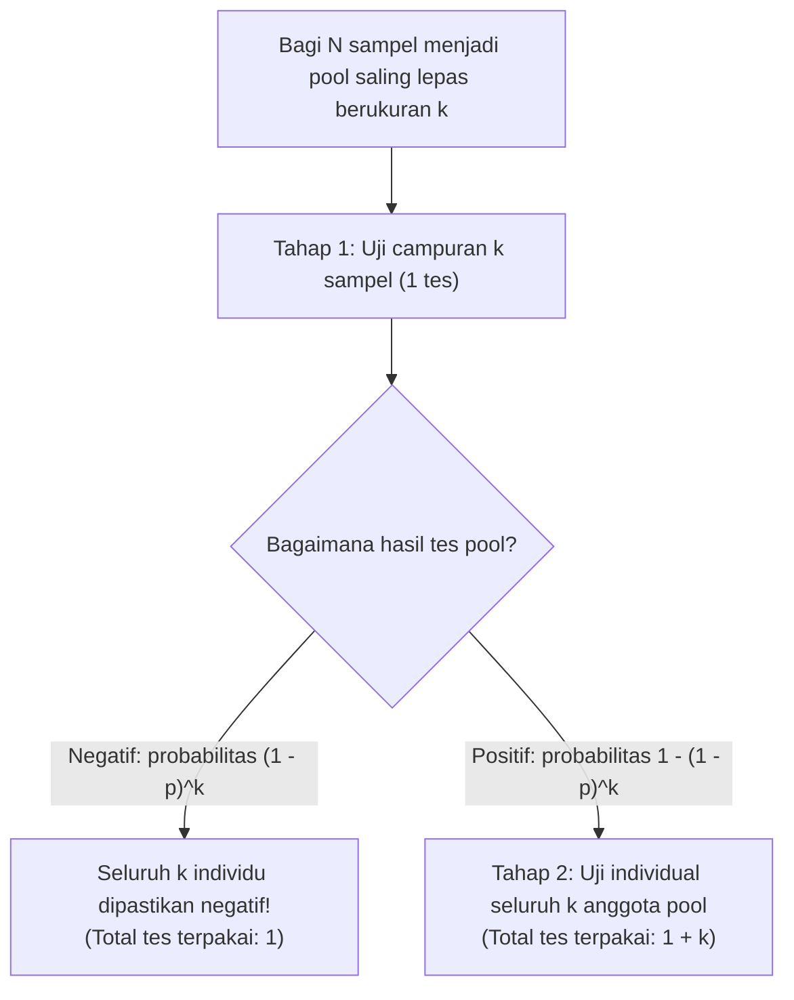
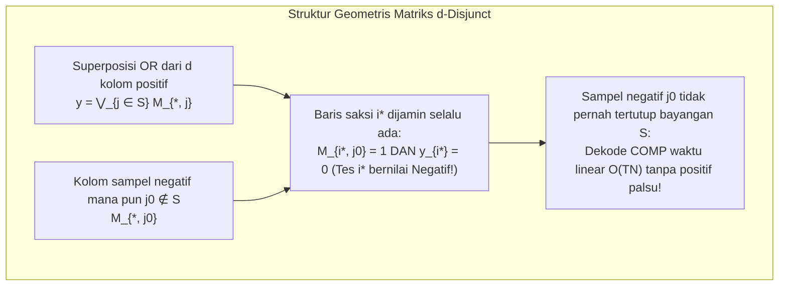

Bayangkan terdapat tepat satu orang yang terinfeksi (positif) di dalam populasi berjumlah $1.000$ orang. Berapa banyak tes diagnostik yang diperlukan untuk mengidentifikasi satu orang positif tersebut dengan kepastian $100\%$?

Akal sehat menyarankan untuk menguji seluruh $1.000$ orang satu per satu—yang berarti membutuhkan $1.000$ tes. Namun, matematika dan teori informasi memberikan jawaban yang sama sekali berbeda. Jika spesimen biologis dapat dicampur (*pooling*) sehingga satu pengujian menjawab pertanyaan biner *«Apakah terdapat setidaknya satu sampel positif di dalam campuran ini?»*, maka <strong>pencarian adaptif bertahap (Adaptive Group Testing) hanya memerlukan $10$ tes</strong>. Lebih menakjubkan lagi: <strong>bahkan jika seluruh pola pencampuran ditetapkan di awal dan semua tes dijalankan secara serentak dalam satu tahap paralel (Non-Adaptive Group Testing), hanya beberapa lusin tes yang dibutuhkan</strong> untuk menemukan individu positif tersebut tanpa perlu tes ulang.

Apa yang tampak seperti trik sulap ini sebenarnya adalah cabang fundamental dari matematika diskrit, statistika, teori pengkodean, dan teori informasi yang dikenal sebagai <strong>Group Testing (Pengujian Kelompok / Pooling)</strong> dan <strong>Pencarian Kombinatorial (Combinatorial Search)</strong>. Dalam artikel ini, kita akan membedah arsitektur matematikanya secara menyeluruh: mulai dari makalah klasik Robert Dorfman tahun 1943 dan batas bawah entropi Claude Shannon, masalah 12 koin palsu dan pembagian biner Hwang, hingga <strong>matriks $d$-disjunct (kode tumpang-tindih)</strong> Kautz dan Singleton di atas میدان hingga (Reed-Solomon), <strong>Compressed Sensing</strong>, serta skrining genomik berkecepatan tinggi (P-BEST).

---

## 1. Terobosan Tahun 1943: Pooling Dua Tahap Robert Dorfman

### 1.1 Perang Dunia II dan Hambatan Tes Darah Wassermann

Sejarah matematika Group Testing dimulai pada Desember 1943 ketika ahli statistik Amerika <strong>Robert Dorfman</strong> menerbitkan makalah enam halaman yang bersejarah di *The Annals of Mathematical Statistics* berjudul *"The Detection of Defective Members of Large Populations"*.

Selama Perang Dunia II, Angkatan Darat AS harus melakukan skrining sifilis terhadap jutaan calon tentara menggunakan tes darah Wassermann. Karena prevalensi $p$ cukup rendah (umumnya $p \approx 0{,}01$ hingga $p \approx 0{,}001$), pengujian satu per satu membuang lebih dari $99\%$ reagen hanya untuk memastikan bahwa tentara yang sehat berstatus negatif.

Dorfman mengusulkan <strong>prosedur pooling dua tahap (Two-Stage Pooling)</strong>: membagi $N$ individu ke dalam kelompok-kelompok (pool) saling lepas berukuran $k$.

1. <strong>Tahap 1 (Tes Pool)</strong>: Campurkan $k$ sampel dalam satu tabung pool dan lakukan $1$ tes pada campuran tersebut.
   - <strong>Jika hasil pool Negatif</strong> (probabilitas $(1 - p)^k$): seluruh $k$ individu dinyatakan negatif sekaligus hanya dengan <strong>$1$ tes</strong>!
   - <strong>Jika hasil pool Positif</strong> (probabilitas $1 - (1 - p)^k$): setidaknya ada satu individu positif; lanjutkan ke Tahap 2.
2. <strong>Tahap 2 (Tes Ulang Individual)</strong>: Uji satu per satu seluruh $k$ sampel asli dari pool yang positif tersebut (menghabiskan total $1 + k$ tes untuk pool itu).

### 1.2 Derivasi Analitis Ukuran Pool Optimal $k^*$

Untuk satu pool berukuran $k$, nilai ekspektasi jumlah tes adalah $\mathbb{E}[T_{\text{pool}}] = 1 \cdot (1 - p)^k + (1 + k)[1 - (1 - p)^k] = 1 + k[1 - (1 - p)^k]$. Dengan membagi terhadap $k$, diperoleh <strong>ekspektasi jumlah tes per orang</strong> $f(k) = \frac{\mathbb{E}[T]}{N}$:

$$\frac{\mathbb{E}[T]}{N} = \frac{1}{k} + 1 - (1 - p)^k \approx \frac{1}{k} + k p \implies \frac{d}{dk}\left(\frac{1}{k} + kp\right) = -\frac{1}{k^2} + p = 0 \implies k^* \approx \frac{1}{\sqrt{p}}, \qquad \frac{\mathbb{E}[T]_{\min}}{N} \approx 2\sqrt{p}$$

Mari kita lihat penghematan luar biasa ini dengan angka konkret:
- <strong>Saat prevalensi $p = 0{,}01$ ($1\%$)</strong>: ukuran pool optimal adalah $k^* \approx \frac{1}{\sqrt{0{,}01}} = 10$ (optimum bulat eksak: $k^* = 11$), dan biaya tes turun menjadi $\frac{\mathbb{E}[T]}{N} \approx 0{,}20$ tes per orang (eksak: $0{,}1956$). Skrining $1.000$ orang hanya memerlukan <strong>$196$ tes alih-alih $1.000$—penghematan langsung sebesar $80{,}4\%$</strong>!
- <strong>Saat prevalensi $p = 0{,}0001$ ($0{,}01\%$)</strong>: ukuran pool optimal adalah $k^* = 100$ dan jumlah tes turun menjadi $0{,}02$ per orang, <strong>mengeliminasi $98\%$ dari seluruh tes</strong>!

| Prevalensi $p$ | Rasio Positif | Asimtotik $1/\sqrt{p}$ | Optimum Eksak $k^*$ | Ekspektasi Tes / Orang $\mathbb{E}[T]/N$ | Tes per $1.000$ Orang | Penghematan Tes |
| :--- | :--- | :--- | :--- | :--- | :--- | :--- |
| $p = 0{,}10$ | $1$ dari $10$ | $3{,}16$ | $4$ | $0{,}5939$ | $594$ tes | $40{,}6\%$ |
| $p = 0{,}05$ | $1$ dari $20$ | $4{,}47$ | $5$ | $0{,}4262$ | $426$ tes | $57{,}4\%$ |
| $p = 0{,}01$ | $1$ dari $100$ | $10{,}0$ | $11$ | $0{,}1956$ | $196$ tes | <strong>$80{,}4\%$</strong> |
| $p = 0{,}001$ | $1$ dari $1.000$ | $31{,}6$ | $32$ | $0{,}0628$ | $63$ tes | <strong>$93{,}7\%$</strong> |
| $p = 0{,}0001$ | $1$ dari $10.000$ | $100{,}0$ | $101$ | $0{,}01995$ | $20$ tes | <strong>$98{,}0\%$</strong> |

---

## 2. Batas Bawah Teori Informasi (Counting Bound & Entropi Shannon)

Berapa jumlah tes paling minimum yang diizinkan oleh hukum teori informasi Claude Shannon untuk algoritma apa pun?

1. <strong>Batas Pencacahan Kombinatorial (Counting Bound)</strong>: Jika terdapat $d$ sampel positif di antara $N$ sampel ($S \subset [N], |S| = d$), terdapat $\binom{N}{d}$ kemungkinan himpunan bagian. Karena setiap tes biner $\{0, 1\}$ memberikan paling banyak $1$ bit informasi Shannon, $T$ tes menghasilkan paling banyak $2^T$ vektor hasil yang berbeda:
   $$2^T \ge \binom{N}{d} \implies T \ge \log_2 \binom{N}{d} \approx d \log_2 \frac{N}{d} + O(d)$$
2. <strong>Batas Entropi Shannon Probabilistik</strong>: Jika setiap individu positif secara independen dengan probabilitas $p$, entropi gabungan vektor status $\mathbf{X} \in \{0, 1\}^N$ adalah $N \cdot H_2(p)$, sehingga:
   $$\frac{\mathbb{E}[T]}{N} \ge H_2(p) = -p\log_2 p - (1-p)\log_2(1-p)$$

---

## 3. Group Testing Adaptif vs. Non-Adaptif

### 3.1 Pembagian Biner Adaptif Hwang dan Masalah 12 Koin Palsu

Dalam <strong>Group Testing adaptif</strong>, komposisi pool berikutnya ditentukan berdasarkan hasil tes sebelumnya:
- Untuk $d = 1$, <strong>pencarian biner (Binary Splitting)</strong> membagi dua ruang kandidat pada setiap langkah dan mencapai tepat $\lceil \log_2 N \rceil$ tes ($10$ tes untuk $N = 1.000$).
- Untuk $d \ge 2$, <strong>algoritma pembagian biner tergeneralisasi Frank K. Hwang (1972)</strong> menguji sub-pool berukuran $2^\alpha \approx n/d$ agar probabilitas hasil positif dan negatif seimbang mendekati $1/2$ ($1$ bit entropi per tes), mencapai batas bawah optimal $T = d \log_2(N/d) + O(d)$.

Prinsip maksimisasi informasi yang sama menjelaskan <strong>masalah 12 koin palsu dan timbangan dua lengan (1945)</strong>: di antara $12$ koin terdapat $1$ koin palsu yang lebih berat atau lebih ringan ($12 \times 2 = 24$ hipotesis). Timbangan memiliki $3$ hasil $\{-1, 0, +1\}$, memberikan maksimal $\log_2 3 \approx 1{,}585$ bit per penimbangan dan membedakan hingga $3^3 = 27 \ge 24$ keadaan dalam $3$ penimbangan. Jika pada penimbangan pertama kita menaruh $6$ lawan $6$ koin, timbangan tidak mungkin seimbang ($0$), menyisakan $12 > 3^2 = 9$ keadaan (mustahil diselesaikan!). Kita wajib menaruh <strong>$4$ koin di kiri, $4$ di kanan, dan $4$ di luar timbangan</strong> untuk membagi $24$ hipotesis menjadi $8 : 8 : 8$ secara merata.

<strong>Kelemahan praktis dalam PCR dan genomika</strong>: Karena satu siklus RT-PCR memakan waktu sekitar $3$ jam, menjalankan $10$ tahap adaptif secara berurutan membutuhkan <strong>$30$ jam</strong>! Oleh karena itu, laboratorium diagnostik membutuhkan <strong>Group Testing non-adaptif (NAGT)</strong> yang menjalankan seluruh $T$ tes secara paralel dalam satu putaran tunggal.

---

## 4. Group Testing Non-Adaptif (NAGT) dan Matriks $d$-Disjunct

### 4.1 Matriks Pooling $\mathbf{M}$ dan Superposisi OR Boolean

<strong>Kautz dan Singleton (1964)</strong> memformulasikan pengujian non-adaptif melalui matriks biner $\mathbf{M} \in \{0, 1\}^{T \times N}$, di mana $M_{i, j} = 1$ berarti sampel $j$ dimasukkan ke dalam pool $i$. Vektor hasil $\mathbf{y} \in \{0, 1\}^T$ adalah <strong>superposisi OR Boolean</strong> dari kolom-kolom himpunan positif $S$ ($|S| \le d$):

$$\mathbf{y} = \mathbf{M} \odot \mathbf{x} = \bigvee_{j \in S} \mathbf{M}_{*, j}$$

### 4.2 Matriks $d$-Disjunct dan Dekode COMP Waktu Linear

Sebuah matriks $\mathbf{M}$ disebut <strong>$d$-disjunct ($d$-Disjunct Matrix)</strong> jika dukungan (support) dari kolom mana pun $j_0 \notin S$ tidak pernah termuat di dalam gabungan dukungan dari $d$ kolom lainnya $S$:

$$\text{supp}(\mathbf{M}_{*, j_0}) \not\subseteq \bigcup_{j \in S} \text{supp}(\mathbf{M}_{*, j}) \qquad (\forall |S| \le d, \; \forall j_0 \notin S)$$

Artinya, bagi setiap sampel negatif $j_0 \notin S$, selalu terdapat setidaknya satu <strong>«tes saksi» (baris $i^*$)</strong> di mana $j_0$ ikut serta ($M_{i^*, j_0} = 1$) tetapi tidak satu pun dari $d$ sampel positif ikut serta ($y_{i^*} = 0$).

Berkat sifat ini, algoritma <strong>COMP (Combinatorial Orthogonal Matching Pursuit)</strong> mendekode $\mathbf{y}$ dalam waktu linear $O(TN)$: cukup eliminasi semua sampel yang muncul dalam tes negatif; sampel yang tersisa adalah $100\%$ positif! Batas bawah kombinatorial D'yachkov-Rykov / Ruszinkó / Füredi mensyaratkan $T = \Omega\left(\frac{d^2}{\log d} \log N\right)$ baris, sedangkan konstruksi probabilistik dan eksplisit mencapai $T = O(d^2 \log N)$.

### 4.3 Grid 2D («Positif Hantu») dan Desain Polinomial Reed-Solomon

Jika kita menyusun $N = 100$ sampel dalam grid $10 \times 10$ ($10$ pool baris + $10$ pool kolom = $20$ tes), $d = 1$ positif langsung ditemukan pada perpotongan tunggal ($1$-disjunct). Namun jika ada $d = 2$ positif di $(2, 4)$ dan $(6, 9)$, baris $R_2, R_6$ dan kolom $C_4, C_9$ menjadi positif, menciptakan dua <strong>«positif hantu» (Ghost Positives)</strong> di $(2, 9)$ dan $(6, 4)$!

Kautz dan Singleton menghilangkan positif hantu dengan memetakan setiap sampel $j$ ke polinomial $P_j(x) \in \mathbb{F}_q[x]$ berderajat $\le k-1$ di atas medan hingga $\mathbb{F}_q$ (kode <strong>Reed-Solomon</strong>, $N = q^k$) dan membentuk pool berdasarkan $y = P_j(x_m) \pmod q$ dalam $w \ge d(k-1)+1$ arah proyeksi. Karena dua polinomial berbeda berderajat $\le k-1$ berpotongan di paling banyak $k-1$ titik, matriks tersebut dijamin $d$-disjunct!

---

## 5. Derau, Compressed Sensing, dan Metode COVID-19 P-BEST

| Karakteristik | Group Testing Adaptif (Hwang) | Group Testing Non-Adaptif ($d$-Disjunct) | Compressed Sensing (Candès-Tao-Donoho) |
| :--- | :--- | :--- | :--- |
| <strong>Aljabar Dasar</strong> | Pohon keputusan di atas $\{0, 1\}$ | Semiring Boolean $(\{0, 1\}, \lor, \land)$ | Medan bilangan riil $(\mathbb{R}, +, \times)$, $\mathbf{y} = \mathbf{\Phi}\mathbf{x} + \mathbf{e}$ |
| <strong>Syarat Matriks</strong> | Partisi ekuiprobabel ($1$ bit/tes) | <strong>Sifat $d$-Disjunct</strong> | <strong>Restricted Isometry Property (RIP)</strong> |
| <strong>Jumlah Pengukuran $T$</strong> | $d \log_2(N/d) + O(d)$ | $O(d^2 \log N)$ (nol galat) / $O(d \log N)$ (probabilistik) | $O(d \log(N/d))$ |
| <strong>Algoritma Dekode</strong> | Pencarian biner sekuensial | <strong>COMP / DD / SCOMP / Belief Propagation</strong> | <strong>OMP / Basis Pursuit (minimisasi $\ell_1$)</strong> |

1. <strong>Efek Pengenceran (Dilution Effect) dan Noisy Group Testing</strong>: Untuk mengatasi pengenceran RNA virus dan galat uji, matriks $(d, 2e)$-disjunct menjamin $2e+1$ baris saksi (algoritma <strong>NCOMP</strong>), didukung oleh <strong>Belief Propagation (BP)</strong> dan <strong>pemrograman linear (LP)</strong>.
2. <strong>Dualitas dengan Compressed Sensing</strong>: Compressed Sensing adalah kembaran aljabar kontinu di atas $\mathbb{R}$ dari Group Testing Boolean.
3. <strong>Kanal Akses Jamak dan Skrining COVID-19 P-BEST</strong>: Dari resolusi tabrakan nirkabel (algoritma pohon Capetanakis) dan Count-Min Sketch hingga metode klinis <strong>P-BEST</strong> (Shental et al., *Science Advances* 2020) yang menggunakan matriks Reed-Solomon $48 \times 384$ untuk menguji $384$ pasien hanya dengan $48$ pool PCR paralel dalam satu putaran (meningkatkan kapasitas uji $8$ kali lipat), matematika Group Testing terus menjadi fondasi teknologi modern.
