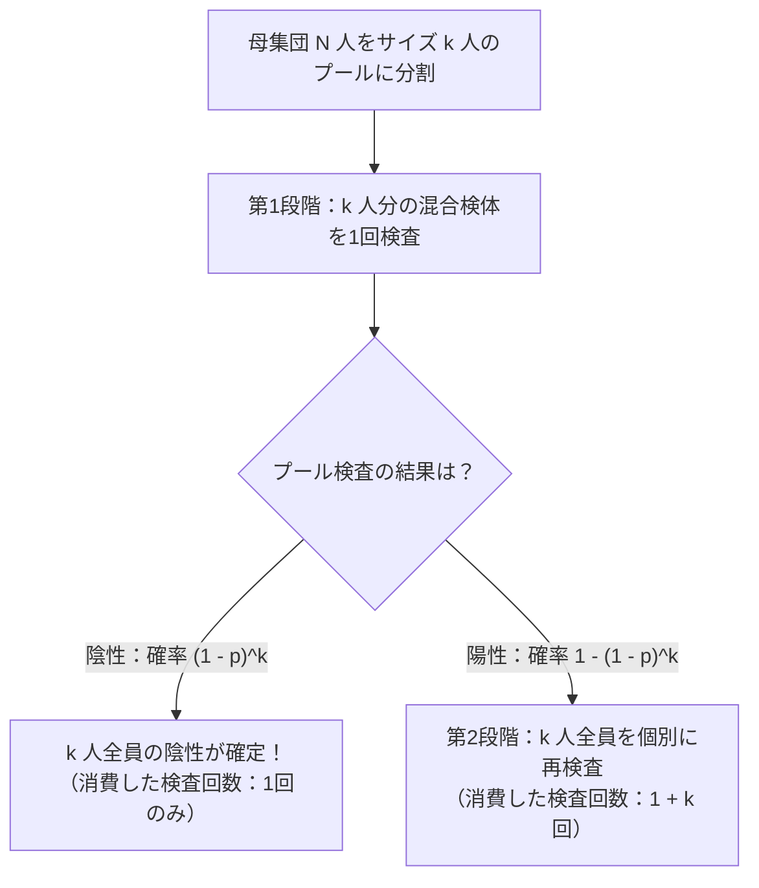
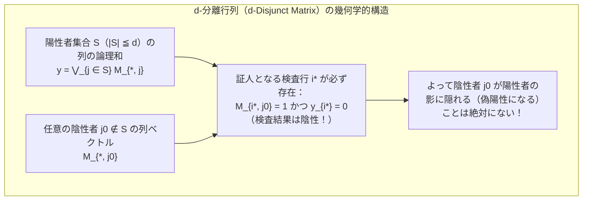

1,000人の集団の中に、たった1人だけ感染症の陽性者が紛れ込んでいるとしよう。誰が陽性であるかを100%の精度で特定するためには、何回検査を行えばよいだろうか。

直感的な答えは「1,000人全員を1人ずつ順番に検査する（合計1,000回）」である。しかし、数学と情報理論が導き出す答えはまったく異なる。もし検体を自由に混ぜ合わせて「この混合液の中に陽性者が少なくとも1人含まれているか？」を判定できるならば、<strong>段階的に絞り込む方法（適応型検査）ならわずか10回</strong>、さらには<strong>最初から混ぜ方のパターンを固定して全検査を同時並行で一斉に回す方法（非適応型検査）であってもわずか数十回</strong>の検査で、1,000人の中から陽性者をピンポイントで特定できる。

一見すると魔法か手品のように思えるこの手法は、統計学・離散数学・符号理論・情報理論が交差する<strong>グループテスト（Group Testing：集団検査法）</strong>および<strong>組合せ探索（Combinatorial Search）</strong>と呼ばれるれっきとした数学分野である。本稿では、第二次世界大戦中の1943年にロバート・ドーフマン（Robert Dorfman）が発表した歴史的論文から出発し、シャノンの情報理論が定める絶対的な下界、パズルとして名高い「12枚の偽コイン問題」と適応型二分探索、カウツとシングルトン（Kautz & Singleton）が築いた<strong>分離行列（Disjunct Matrix / 重畳符号）</strong>の代数構造、そして現代のゲノムスクリーニング・通信路の衝突解決・<strong>圧縮センシング（Compressed Sensing）</strong>に至る壮大な数理体系を、基礎から厳密に解き明かす。

---

## 1. 1943年のブレイクスルー：ドーフマンの二段階プール検査法

### 1.1 第二次世界大戦とワッセルマン血液検査のボトルネック

グループテストの数学的歴史は、1943年、アメリカの統計学者<strong>ロバート・ドーフマン（Robert Dorfman）</strong>が統計学誌『*The Annals of Mathematical Statistics*』に発表したわずか6ページの短い論文 *"The Detection of Defective Members of Large Populations"*（大規模母集団における不良メンバーの検出）によって幕を開けた。

当時、第二次世界大戦のさなかにあったアメリカ陸軍は、徴兵された数百万人の兵士全員に対して梅毒（syphilis）のスクリーニング検査（ワッセルマン反応による血液検査）を実施する必要に迫られていた。ところが、当時のワッセルマン検査は試薬のコストが高く、検査技師の手間も時間もかかる上、対象となる徴兵集団における実際の梅毒陽性率（有病率 $p$）は $p \approx 0.01$（$1\%$）から $p \approx 0.001$（$0.1\%$）程度と極めて低かった。つまり、1人ずつ律儀に血液検査を行っていたのでは、<strong>全体の99%以上の検査が「陰性を確認するだけ」のために費やされる</strong>という巨大な無駄が生じていたのである。

ここでドーフマンは、極めてシンプルかつ革命的な発想の転換を提案した。採血した検体を最初から1人ずつ検査するのではなく、<strong>$k$ 人分の血清を少量ずつ試験管に混ぜ合わせて1つの「プール（混合検体）」を作り、まずそのプール全体に対して1回だけ検査を行う</strong>のである。

### 1.2 ドーフマンの二段階アルゴリズム（Two-Stage Pooling）

母集団の総人数を $N$ とし、各個人の検査結果が互いに独立に確率 $p$ で陽性（$1$）、確率 $q = 1 - p$ で陰性（$0$）になると仮定しよう（これを<strong>確率的グループテストモデル</strong>と呼ぶ）。ドーフマンの二段階プール検査法は、全 $N$ 人をそれぞれサイズ $k$ 人のグループ（プール）に分割し、各プールに対して以下の手順を実行する。

1. <strong>第1段階（プール検査）</strong>：$k$ 人分の検体を混合したプールを1回検査する。
   - <strong>プールが陰性（Negative）だった場合</strong>：そのプールに含まれる $k$ 人の中に陽性者は1人もいないことが確定する。したがって、<strong>たった1回の検査で $k$ 人全員の陰性が証明され、このプールの検査は終了する</strong>。
   - <strong>プールが陽性（Positive）だった場合</strong>：$k$ 人の中に少なくとも1人の陽性者が含まれていることがわかる。このときのみ第2段階へ進む。
2. <strong>第2段階（個別再検査）</strong>：陽性となったプールに属する $k$ 人全員の元の個別検体を取り出し、1人ずつ個別に $k$ 回の検査を行って誰が陽性かを確定する（第1段階と合わせて合計 $1 + k$ 回の検査を要する）。

### 1.3 期待検査回数の導出と最適プールサイズ $k^*$ の解析解

では、1つのプールに含まれる人数 $k$ をいくつに設定すれば、全体の期待検査回数を最小化できるだろうか？ $k$ を大きくしすぎると、1つのプールに少なくとも1人の陽性者が紛れ込む確率が跳ね上がり、ほとんどのプールが陽性となって個別再検査（第2段階）が必要になってしまう。逆に $k$ を小さくしすぎると、第1段階のプール検査自体の回数が増えてしまう。このトレードオフを数式で厳密に解いてみよう。

1つのプール（サイズ $k$）に着目したとき、$k$ 人全員が陰性である確率は、独立性より $(1 - p)^k$ である。したがって、少なくとも1人が陽性となってプール検査が陽性を示す確率は $1 - (1 - p)^k$ となる。この1つのプールを処理するのに必要な検査回数 $T_{\text{pool}}$ の期待値 $\mathbb{E}[T_{\text{pool}}]$ は、次のように計算できる。

$$\mathbb{E}[T_{\text{pool}}] = 1 \cdot (1 - p)^k + (1 + k) \cdot \left[1 - (1 - p)^k\right] = 1 + k\left[1 - (1 - p)^k\right]$$

これをプールの人数 $k$ で割ることで、<strong>1人あたりの期待検査回数 $f(k) = \frac{\mathbb{E}[T]}{N}$</strong> が得られる（ただし $k \ge 2$）。

$$f(k) = \frac{\mathbb{E}[T]}{N} = \frac{1}{k} + 1 - (1 - p)^k$$

ここで、有病率 $p$ が十分に小さい（$p \ll 1$ かつ $kp \ll 1$）状況を考え、$(1 - p)^k$ を $p = 0$ のまわりで1次テイラー展開（二項近似）すると、$(1 - p)^k \approx 1 - kp$ となる。これを上式に代入すると、極めて見通しの良い近似式が現れる。

$$f(k) \approx \frac{1}{k} + k p$$

第1項の $\frac{1}{k}$ は「第1段階のプール検査にかかる1人あたりの固定コスト」であり、第2項の $kp$ は「プールが陽性になって第2段階の個別検査が発動する期待ペナルティコスト」である。相加平均と相乗平均の不等式（AM-GM不等式）を使うか、あるいは連続変数とみなして $k$ で微分して $0$ と置くことで、最小値を与える最適プールサイズ $k^*$ が直ちに求まる。

$$\frac{d}{dk}\left(\frac{1}{k} + kp\right) = -\frac{1}{k^2} + p = 0 \implies k^* \approx \frac{1}{\sqrt{p}}$$

そして、この最適プールサイズ $k^* = \frac{1}{\sqrt{p}}$ を代入したときの1人あたりの最小期待検査回数は次のようになる。

$$\frac{\mathbb{E}[T]_{\min}}{N} \approx \frac{1}{1/\sqrt{p}} + \left(\frac{1}{\sqrt{p}}\right)p = 2\sqrt{p}$$

> [!TIP]
> <strong>ドーフマンの平方根法則とフィヌカンの精密化</strong>：
> 有病率 $p$ が小さいとき、最適なプールサイズは $k^* \approx \frac{1}{\sqrt{p}}$ となり、1人あたりの検査回数は元の $1$ 回から $2\sqrt{p}$ 回へと劇的に減少する。より高次のテイラー展開 $(1-p)^k \approx 1 - kp + \frac{k(k-1)}{2}p^2$ まで考慮したフィヌカン（Finucan, 1964）の精密公式では、最適プールサイズは $k^* \approx \frac{1}{\sqrt{p}} + \frac{1}{2}$ で与えられる。

### 1.4 具体的な数値で見る圧倒的な検査削減効果

この公式 $k^* \approx 1/\sqrt{p}$ と $\mathbb{E}[T]/N \approx 2\sqrt{p}$（および厳密な二項式 $\frac{1}{k} + 1 - (1-p)^k$）に具体的な数値を代入して、どれほど劇的に検査回数が減るかを確認してみよう。

- <strong>有病率 $p = 0.01$（$1\%$）の場合</strong>：
  最適プールサイズは $k^* \approx \frac{1}{\sqrt{0.01}} = 10$ 人（厳密な最小値は $k^* = 11$ 人）。
  $k = 10$ のとき、近似式では $\frac{\mathbb{E}[T]}{N} \approx \frac{1}{10} + 10(0.01) = 0.20$ 回/人（厳密値でも $\frac{1}{10} + 1 - 0.99^{10} = 0.1956$ 回/人）。
  つまり、<strong>1,000人を検査するのに約200回（厳密には約196回）の検査で済み、検査回数を一気に80%以上削減できる</strong>！
- <strong>有病率 $p = 0.0001$（$0.01\%$、1万人に1人）の場合</strong>：
  最適プールサイズは $k^* \approx \frac{1}{\sqrt{0.0001}} = 100$ 人。
  このとき1人あたりの期待検査回数は $\frac{\mathbb{E}[T]}{N} \approx 2\sqrt{0.0001} = 0.02$ 回/人（厳密値 $0.01995$ 回/人）。
  つまり、<strong>10,000人を検査するのにわずか200回の検査で済み、実に98%もの検査コストが消滅する</strong>！

| 有病率 $p$ | 陽性者の割合 | 近似最適サイズ $1/\sqrt{p}$ | 厳密最適サイズ $k^*$ | 1人あたり期待検査数 $\mathbb{E}[T]/N$（厳密値） | 1,000人あたりの期待検査回数 | 検査削減率 |
| :--- | :--- | :--- | :--- | :--- | :--- | :--- |
| $p = 0.10$ | 10人に1人 | $3.16$ | $4$ 人 | $0.5939$ 回 | $594$ 回 | $40.6\%$ 削減 |
| $p = 0.05$ | 20人に1人 | $4.47$ | $5$ 人 | $0.4262$ 回 | $426$ 回 | $57.4\%$ 削減 |
| $p = 0.01$ | 100人に1人 | $10.0$ | $11$ 人 | $0.1956$ 回 | $196$ 回 | <strong>$80.4\%$ 削減</strong> |
| $p = 0.001$ | 1,000人に1人 | $31.6$ | $32$ 人 | $0.0628$ 回 | $63$ 回 | <strong>$93.7\%$ 削減</strong> |
| $p = 0.0001$ | 10,000人に1人 | $100.0$ | $101$ 人 | $0.01995$ 回 | $20$ 回 | <strong>$98.0\%$ 削減</strong> |

なお、統計学者アンドリュー・ステレット（Andrew Sterrett, 1957）は、ドーフマン法の第2段階をさらに改良した。プールが陽性になった際、陽性者の大半は「プール内に1人だけ」である確率が高い。そこで第2段階で $k$ 人を1人ずつ順番に検査していき、<strong>最初の1人の陽性者が見つかった時点で、残りの未検査メンバーをもう一度1つのミニ・プールに混ぜて検査する</strong>のである。もし他に陽性者がいなければそのミニ・プールは1回で陰性となるため、1人あたりの期待検査回数は $2\sqrt{p}$ からさらに $\sqrt{2p} \approx 1.414\sqrt{p}$ 近くまで削減される。

---

## 2. 情報理論的下界：なぜそれ以上は検査を減らせないのか？

ドーフマンの二段階法は有病率 $p$ に対して $O(\sqrt{p})$ の検査回数を達成したが、ここで数学者なら誰もが抱く根本的な疑問が生じる。「2段階ではなく3段階、4段階と工夫したり、もっと巧妙な混ぜ方を設計したりすれば、<strong>原理的にどこまで検査回数を減らすことができるのか？</strong>」

この問いに絶対的な限界線を引くのが、クロード・シャノン（Claude Shannon）が1948年に打ち立てた<strong>情報理論（Information Theory）</strong>と組合せ論の<strong>情報理論的下界（Information-Theoretic Lower Bound / Counting Bound）</strong>である。

### 2.1 組合せ論的モデルにおける計数下界（Counting Bound）

まず、<strong>組合せ論的グループテスト（Combinatorial Group Testing）</strong>の標準的な定式化を導入しよう。全 $N$ 個の検体（アイテム集合 $[N] = \{1, 2, \dots, N\}$）の中に、ちょうど $d$ 個（あるいは高々 $d$ 個）の陽性検体（不良品集合 $S \subset [N], |S| = d$）が存在すると仮定する。

私たちが実行する各検査（テスト）は、「選択した部分集合 $Q \subset [N]$ の中に、陽性集合 $S$ の要素が少なくとも1つ含まれているか（$Q \cap S \neq \emptyset$ か）？」を問う2値（バイナリ）クエリであり、その出力は「陽性（$1$）」か「陰性（$0$）」の2通り（高々 $1$ ビットの情報量）しか持たない。

もし合計 $T$ 回の検査を行って、どのような陽性集合 $S$ であっても100%の精度で一意に特定できるアルゴリズムが存在したならば、$T$ 回の検査結果の列 $(y_1, y_2, \dots, y_T) \in \{0, 1\}^T$ が取り得るパターン総数 $2^T$ は、少なくとも陽性集合 $S$ の選び方の総数 $\binom{N}{d}$ 以上でなければならない（鳩の巣原理）。したがって、いかなるグループテストのアルゴリズム（適応型であれ非適応型であれ）も、必ず次の不等式を満たさなければならない。

$$2^T \ge \binom{N}{d} \implies T \ge \log_2 \binom{N}{d}$$

さらに、高々 $d$ 個の陽性者をすべて識別する場合は $2^T \ge \sum_{i=0}^d \binom{N}{i}$ となる。ここで、二項係数の基本的な評価式 $\left(\frac{N}{d}\right)^d \le \binom{N}{d} \le \left(\frac{eN}{d}\right)^d$（あるいはスターリングの公式）を用いると、$d \ll N$ のスパース（疎）な領域において、必要最小限の検査回数 $T$ の下界は次のように漸近展開される。

$$T \ge \log_2 \binom{N}{d} = d \log_2 \frac{N}{d} + O(d)$$

これが組合せ論的グループテストにおける<strong>情報理論的下界</strong>である。

### 2.2 確率的モデルにおけるシャノン・エントロピー下界

次に、各個人が独立に確率 $p$ で陽性となる確率的モデル（平均陽性者数 $\mathbb{E}[|S|] = Np$）でも同様の下界を導こう。$N$ 人全員の真の陽性・陰性状態を表す確率変数ベクトルを $\mathbf{X} = (X_1, X_2, \dots, X_N) \in \{0, 1\}^N$ とすると、各 $X_i \sim \text{Bernoulli}(p)$ は独立であるから、状態ベクトル $\mathbf{X}$ が持つ<strong>シャノン・エントロピー（不確実性の総量）</strong> $H(\mathbf{X})$ は、2値エントロピー関数 $H_2(p)$ の $N$ 倍となる。

$$H(\mathbf{X}) = \sum_{i=1}^N H(X_i) = N \cdot H_2(p), \qquad H_2(p) = -p \log_2 p - (1 - p)\log_2(1 - p)$$

一方、1回の検査（陰性か陽性かの2値出力 $Y_t \in \{0, 1\}$）が持ち得るエントロピーは最大でも $H(Y_t) \le 1$ ビット（陰性と陽性の確率がちょうど $1/2$ ずつのとき最大値 $1$ ビット）である。したがって、期待検査回数 $\mathbb{E}[T]$ によって獲得できる情報量の総和は高々 $\mathbb{E}[T]$ ビットであり、誤りなく $\mathbf{X}$ を復元するための条件 $H(\mathbf{X} \mid \mathbf{Y}) = 0$（あるいは誤り確率 $\epsilon \to 0$ におけるファノの不等式）から、直ちに次の普遍的な下界が導かれる。

$$\mathbb{E}[T] \ge N \cdot H_2(p) \implies \frac{\mathbb{E}[T]}{N} \ge H_2(p) = -p \log_2 p - (1 - p)\log_2(1 - p)$$

ここで $p \ll 1$ のとき、$-(1-p)\log_2(1-p) = \frac{1-p}{\ln 2}\left(p - \frac{p^2}{2} + \dots\right) \approx \frac{p}{\ln 2}$ であるから、

$$H_2(p) \approx p \log_2 \frac{1}{p} + \frac{p}{\ln 2}$$

となり、$d = Np$ を代入すれば $\mathbb{E}[T] \ge Np \log_2 \frac{1}{p} = d \log_2 \frac{N}{d}$ となって、組合せ論的下界と完全に一致する！

> [!IMPORTANT]
> <strong>ドーフマン法と情報理論的下界のギャップ</strong>：
> 1,000人の中に陽性者が $d = 1$ 人（$p = 0.001$）いるケースで比較してみよう。
> - <strong>個別検査</strong>：$1,000$ 回
> - <strong>ドーフマンの二段階法</strong>：$2\sqrt{Np} \times N = 2\sqrt{1000 \times 1} \approx \mathbf{63}$ <strong>回</strong>
> - <strong>情報理論的下界</strong>：$\log_2 \binom{1000}{1} = \log_2 1000 \approx \mathbf{9.97}$ <strong>回（切り上げて $10$ 回）</strong>
>
> ドーフマン法は検査を2段階に制限しているため、1人あたりの検査数が $O(\sqrt{p})$ に留まり、情報理論的下界である $O(p \log(1/p))$ との間にはまだ大きなギャップがある。この限界突破こそが、次章で解説する「多段階の適応型探索」と「高次元の非適応型分離行列」の原動力となった。

---

## 3. 適応型グループテスト（Adaptive Group Testing）：二分探索と12枚の偽コイン問題

グループテストのアルゴリズムは、検査の進め方によって大きく2つのパラダイムに分かれる。

1. <strong>適応型グループテスト（Adaptive Group Testing）</strong>：1回目の検査結果を見てから2回目にどの検体を混ぜるかを決め、2回目の結果を見てから3回目を決める……というように、<strong>過去の検査結果に依存して逐次的に次のプールを構成する方法</strong>。
2. <strong>非適応型グループテスト（Non-Adaptive Group Testing: NAGT）</strong>：検査を始める前にすべての混合パターン（どの検体をどの試験管に入れるか）を完全に固定してしまい、<strong>全 $T$ 回の検査を一斉に同時並行（1ラウンド）で実行する方法</strong>。

まずは、情報理論的下界をピタリと達成する「適応型グループテスト」の数理から見ていこう。

### 3.1 二分探索（Binary Splitting）とハフマン・ファン（Hwang）の一般化二分探索

1,000人（より一般に $N = 2^m$ 人）の中に陽性者がちょうど $d = 1$ 人いるとしよう。このとき、情報理論的下界 $T = \lceil \log_2 N \rceil$ 回で陽性者を特定する適応型アルゴリズムは、計算機科学でおなじみの<strong>二分探索（Binary Search / Binary Splitting）</strong>そのものである。

1. まず前半の $N/2$ 人（500人）の検体を混ぜて1回検査する。
2. もし<strong>陽性</strong>なら、陽性者は前半の500人の中にいる。もし<strong>陰性</strong>なら、陽性者は後半の500人の中にいる。いずれにせよ、<strong>たった1回の検査で候補者の数が正確に半分（$1$ ビットの情報獲得）に絞り込まれる</strong>！
3. 残った500人をさらに250人ずつに分け、その片方を混ぜて検査する。これを繰り返せば、$1000 \to 500 \to 250 \to 125 \to 63 \to 32 \to 16 \to 8 \to 4 \to 2 \to 1$ と、<strong>わずか $\lceil \log_2 1000 \rceil = 10$ 回の検査</strong>で1人の陽性者を確実に特定できる。

では、陽性者が $d = 1$ 人ではなく一般の $d$ 人いる場合はどうすればよいか？ 単純に全体で二分探索を繰り返すと、1人を見つけるたびに $\log_2 N$ 回かかり、合計 $d \log_2 N$ 回かかってしまう（下界の $d \log_2 (N/d)$ よりも少し多い）。
これを解決したのが、1972年にフランク・ファン（Frank K. Hwang）が考案した<strong>ファンの一般化二分探索アルゴリズム（Hwang's Generalized Binary Splitting Algorithm）</strong>である。

ファンのアイデアは極めて美しい。まだ検査していない残り $n$ 個の検体の中に、残り $d$ 個の陽性者が含まれているとき、最初から半分（$n/2$）を混ぜてしまうと、$d \ge 2$ のときはほとんど確実に陽性になってしまい、陰性になる確率が低すぎて情報量（エントロピー）が無駄になる。そこで、<strong>1回目のプール検査が「陰性になる確率」と「陽性になる確率」がほぼ $1/2$ ずつで釣り合うようなサイズ $2^\alpha$（具体的には $\alpha = \lfloor \log_2 \frac{n - d + 1}{d} \rfloor \approx \log_2(n/d)$）のグループを切り出して検査する</strong>のである！

- もしそのサイズ $2^\alpha$ のプールが<strong>陰性</strong>なら、一気に $2^\alpha \approx n/d$ 個の検体がシロ（陰性）として除外される。
- もし<strong>陽性</strong>なら、そのサイズ $2^\alpha$ のプールに対して通常の二分探索を $\alpha$ 回だけ実行すれば、<strong>わずか $1 + \alpha \approx \log_2(n/d)$ 回の検査で確実に1人の陽性者を発掘できる</strong>（しかも二分探索の過程で陰性と判明した半分ずつのサブグループも同時にシロとして除外できる）。

この操作を $d$ 回繰り返すことで、ファンの一般化二分探索は任意の $N, d$ に対して

$$T \le d \log_2 \frac{N}{d} + O(d)$$

回の検査で全陽性者を特定し、<strong>情報理論的下界 $\log_2 \binom{N}{d}$ との差が高々 $d$ 回未満という漸近的最適性を達成する</strong>。また確率的モデルにおいても、ソーベルとグロール（Sobel & Groll, 1959）の動的計画法に基づく再帰的分割アルゴリズムがシャノン・エントロピー下界 $N H_2(p)$ に肉薄することが知られている。

### 3.2 離散探索の金字塔：「12枚の偽コインと天秤問題」の情報理論

適応型グループテストの本質である「1回のテストで得られる情報量を最大化し、探索空間を均等に分割する」という原理を最も鮮やかに示す古典的パズルが、ドーフマン論文のわずか2年後（1945年）にハワード・グロスマン（Howard Grossman）らによって広められた<strong>「12枚の偽コイン問題（The Twelve-Coin Counterfeit Balance Problem）」</strong>である。

> <strong>問題設定</strong>：見た目がまったく同じ12枚のコインがある。このうち11枚は本物で同じ重さだが、<strong>1枚だけ偽物のコインが紛れ込んでおり、本物よりわずかに重いか、あるいは軽いかのどちらかである（どちらかは事前にはわからない）</strong>。上皿天秤を<strong>高々3回</strong>使うだけで、どのコインが偽物であるか、かつそれが本物より重いか軽いかを100%確実に特定せよ。

この問題を情報理論（エントロピーと3進木）の視点から解剖してみよう。
まず、解くべき未知の状態（仮説）は、「1番〜12番のどのコインが偽物か（12通り）」$\times$「その偽物が重いか軽いか（2通り）」の合計 $12 \times 2 = 24$ 通り存在する。
一方、上皿天秤による1回の計測（テスト）は、プール検査のような2値出力 $\{0, 1\}$ ではなく、
- <strong>左の皿が下がる（Left heavy: $-1$）</strong>
- <strong>釣り合う（Balanced: $0$）</strong>
- <strong>右の皿が下がる（Right heavy: $+1$）</strong>

という<strong>3値（Ternary）の出力 $\{-1, 0, +1\}$</strong> を返す。つまり、天秤を1回使うごとに最大で $\log_2 3 \approx 1.585$ ビット（3進数で1桁＝1トリット）の情報を引き出すことができ、$T = 3$ 回の計測で識別できる状態数の情報理論的上限は

$$3^T = 3^3 = 27 \ge 24$$

となる。$27 \ge 24$ であるから、情報理論の下界からは「3回で特定できる可能性がある」ことがわかる。

しかし、ここには絶妙な罠がある。もし1回目の天秤計測で「左に6枚、右に6枚」を乗せてしまったらどうなるだろうか？ 偽物は必ず左右のどちらかに入っているため、<strong>天秤が「釣り合う（$0$）」という結果が絶対に起こらなくなり、出力が「左が下がる」か「右が下がる」の2通り（$12$ 状態ずつ）に退化してしまう</strong>のである！ すると残り2回の天秤で最大 $3^2 = 9$ 通りしか識別できないため、$12 > 9$ となって絶対に3回では解けなくなる。

各ステップで残りの候補数を $3^{3-t}$ 以下（1回目終了後に $9$ 通り以下、2回目終了後に $3$ 通り以下、3回目終了後に $1$ 通り）に抑え込むためには、<strong>3つの出力分岐 $\{-1, 0, +1\}$ に候補状態が8通りずつ均等に振り分けられるように、1回目は「左に4枚 $\{1,2,3,4\}$、右に4枚 $\{5,6,7,8\}$」を乗せ、残りの4枚 $\{9,10,11,12\}$ を天秤の外に置かなければならない</strong>！

1. <strong>第1回計測：$\{1,2,3,4\}$ vs $\{5,6,7,8\}$</strong>
   - <strong>釣り合った場合（$0$）</strong>：天秤に乗せた $\{1,\dots,8\}$ はすべて<strong>本物（基準コイン）</strong>であることが確定し、偽物は外に置いた $\{9,10,11,12\}$ の中にあり、重いか軽いかの $4 \times 2 = 8$ 通りに絞られる。第2回計測で本物3枚 $\{1,2,3\}$ と候補3枚 $\{9,10,11\}$ を比較すれば、釣り合えば $12$ 番が偽物（第3回で重軽判定）、傾けば $\{9,10,11\}$ のどれかが偽物かつ重軽の向きまで確定するため、第3回で $9$ と $10$ を比較して完全に特定できる。
   - <strong>左が下がった場合（$-1$）</strong>：外に置いた $\{9,10,11,12\}$ はすべて本物と確定し、残る可能性は「$\{1,2,3,4\}$ のどれかが<strong>重い（H）</strong>」か「$\{5,6,7,8\}$ のどれかが<strong>軽い（L）</strong>」のちょうど $4 + 4 = 8$ 通りに絞られる！
2. <strong>第2回計測（左が下がった場合の適応的組換え）：$\{1, 2, 5\}$ vs $\{3, 6, 9(\text{本物})\}$</strong>（外に $\{4, 7, 8\}$ を置く）
   このように「重い候補（$1,2,3,4$）」と「軽い候補（$5,6,7,8$）」を左右の皿と皿の外にまたがって<strong>入れ替え・シャッフル</strong>して乗せるのが適応型探索の真骨頂である。
   - <strong>左が下がった場合（$-1$）</strong>：左の重い候補 $\{1, 2\}$ か右の軽い候補 $\{6\}$ の計<strong>3通り</strong>（$1\text{H}, 2\text{H}, 6\text{L}$）に絞られる。第3回で $\{1\}$ vs $\{2\}$ を測れば、傾いた方が重い偽物、釣り合えば $6$ が軽い偽物と確定する！
   - <strong>右が下がった場合（$+1$）</strong>：右の重い候補 $\{3\}$ か左の軽い候補 $\{5\}$ の計<strong>2通り</strong>（$3\text{H}, 5\text{L}$）に絞られる。第3回で $\{3\}$ vs $\{9(\text{本物})\}$ を測れば確定する！
   - <strong>釣り合った場合（$0$）</strong>：外に置いた $\{4\text{H}, 7\text{L}, 8\text{L}\}$ の計<strong>3通り</strong>に絞られる。第3回で $\{7\}$ vs $\{8\}$ を測れば、上がった方が軽い偽物、釣り合えば $4$ が重い偽物と確定する！

> [!NOTE]
> <strong>なぜ「13枚のコイン（基準コインなし）」は $2 \times 13 = 26 \le 27$ なのに3回で解けないのか？</strong>
> 情報理論的下界 $3^3 = 27$ だけを見ると、13枚のコイン（$26$ 状態）でも3回で特定できそうに思える。しかし実際には不可能である。なぜなら、最初は本物と確定しているコインが1枚もないため、第1回計測では左右に同じ枚数 $k$ 枚ずつを乗せるしかない。このとき、天秤が傾くと「左の $k$ 枚が重いか右の $k$ 枚が軽い」の $2k$ 状態が残り、これを残り2回（上限 $9$ 状態）で解くには $2k \le 9 \implies k \le 4$ でなければならない。ところが $k \le 4$ にすると、皿の外に $13 - 2k \ge 5$ 枚のコインが残り、天秤が釣り合った場合に $2(13 - 2k) \ge 10 > 9$ 状態が残って破綻するのである（最初から本物の基準コインが1枚でも与えられていれば、13枚でも3回で解くことができる）。ちなみに、天秤の結果を後からまとめて見る<strong>非適応型（一斉）アルゴリズム</strong>で12枚のコイン問題を3回で解くことも可能であり、その場合は各コインに対して $(1,2,3)$ 回の計測でどの皿に乗せるかを表す符号語を、自己双対（反パリティ）条件を満たすように $\{ -1, 0, +1 \}^3$ から設計する組合せデザインとなる。

### 3.3 なぜPCR検査や遺伝子スクリーニングでは「適応型」が使えないのか？

適応型二分探索は、検査回数 $T$ を理論限界 $d \log_2(N/d)$ まで最小化できる究極のアルゴリズムに見える。しかし、現実の医療現場（COVID-19のRT-PCR検査など）や分子生物学のハイスループット・スクリーニングでは、10段階の二分探索は<strong>致命的な弱点</strong>を抱えている。

それは<strong>時間（レイテンシ）と作業工程の直列ボトルネック</strong>である。
RT-PCR検査では、検体からRNAを抽出し、逆転写とサーマルサイクラーによる温度サイクル増幅を行うのに、<strong>1ステージあたり約2〜3時間</strong>を要する。もし $N = 1,000$ 人の検体に対して10段階の適応型二分探索を行えば、1回目の結果が出てから2回目のピペッティングを行い、2回目の結果が出てから3回目を混ぜる……という作業を10回直列に繰り返さなければならず、<strong>結果が出るまでに $3\text{時間} \times 10\text{段階} = 30\text{時間}$ 以上</strong>かかってしまう！ さらに、元の検体チューブを10回も開け閉めして分注し直すため、コンタミネーション（交差汚染）や人為的ミスのリスクも激増する。

「検査回数は情報理論的下界より少し増えてもいいから、<strong>最初からピペッティングの混ぜ方パターンを完全に決めておき、すべてのプール検査を1回のPCR装置稼働（わずか3時間・1ステージ）で同時並行に終わらせたい！</strong>」
この強烈な実用的要請から生まれたのが、次章で詳述する<strong>非適応型グループテスト（Non-Adaptive Group Testing: NAGT）</strong>である。

---

## 4. 非適応型グループテスト（NAGT）と分離行列（Disjunct Matrix）の代数構造

### 4.1 プール行列 $\mathbf{M}$ とブール代数上のOR重畳演算

非適応型グループテスト（NAGT）は、1964年にウィリアム・カウツ（William H. Kautz）とリチャード・シングルトン（Richard C. Singleton）が発表した記念碑的論文 *"Nonrandom Binary Superimposed Codes"*（非ランダム2値重畳符号）によって数学的基礎が確立された。

$N$ 個の検体に対して $T$ 個のプール検査を同時並行で行う非適応型デザインは、要素が $0$ または $1$ からなる $T$ 行 $N$ 列の<strong>プール行列（テスト行列 / Measurement Matrix）</strong> $\mathbf{M} \in \{0, 1\}^{T \times N}$ によって完全に記述される。

- 行列の行 $i \in \{1, 2, \dots, T\}$ は <strong>$i$ 番目のプール検査</strong>に対応する。
- 行列の列 $j \in \{1, 2, \dots, N\}$ は <strong>$j$ 番目の検体（個人）</strong>に対応する。
- 成分 $M_{i, j} = 1$ のとき「検体 $j$ をプール $i$ に混ぜる」ことを意味し、$M_{i, j} = 0$ のとき「混ぜない」ことを意味する。

いま、各検体の真の陽性・陰性状態を表す未知の2値ベクトルを $\mathbf{x} = (x_1, x_2, \dots, x_N)^\top \in \{0, 1\}^N$ としよう。陽性者の集合を $S = \text{supp}(\mathbf{x}) = \{j \in [N] \mid x_j = 1\}$ とすると、陽性者数が高々 $d$ 人であるという仮定は、ベクトル $\mathbf{x}$ のハミング重み（非ゼロ要素数）が $\|\mathbf{x}\|_0 = |S| \le d$ である（すなわち $\mathbf{x}$ が $d$-スパースである）ことと同値である。

このとき、$i$ 番目のプール検査の結果 $y_i \in \{0, 1\}$ は、そのプールに1人でも陽性者が含まれていれば $1$、全員陰性なら $0$ となる。したがって、論理和（Boolean OR：$\lor$）と論理積（Boolean AND：$\land$）を用いれば、観測される検査結果ベクトル $\mathbf{y} = (y_1, y_2, \dots, y_T)^\top \in \{0, 1\}^T$ は次のように書ける。

$$y_i = \bigvee_{j=1}^N \left(M_{i, j} \land x_j\right) = \bigvee_{j \in S} M_{i, j} \qquad (i = 1, 2, \dots, T)$$

行列記法で書けば、通常の線形代数における実数体上の行列積 $\mathbf{y} = \mathbf{M}\mathbf{x}$ の「加算（$+$）を論理和（$\lor$）に、乗算（$\times$）を論理積（$\land$）に置き換えた」<strong>ブール行列積（Boolean Matrix-Vector Multiplication）</strong>そのものである！

$$\mathbf{y} = \mathbf{M} \odot \mathbf{x} = \bigvee_{j \in S} \mathbf{M}_{*, j}$$

すなわち、観測ベクトル $\mathbf{y}$ は、<strong>陽性者集合 $S$ に対応するプール行列 $\mathbf{M}$ の列ベクトル $\mathbf{M}_{*, j}$ たちの「ビットごとの論理和（OR重畳：Superimposition）」</strong>として与えられる。非適応型グループテストの目的は、たった1回の観測ベクトル $\mathbf{y}$ と既知の行列 $\mathbf{M}$ から、未知の陽性者集合 $S$（$|S| \le d$）を一意かつ高速に復元（デコード）できるような、行数 $T$ ができるだけ小さい行列 $\mathbf{M}$ を設計することである。

### 4.2 $d$-分離可能行列（Separable Matrix）と $d$-分離行列（Disjunct Matrix）

どのようなプール行列 $\mathbf{M}$ を作れば、高々 $d$ 人の陽性者集合 $S$ を一意に特定できるだろうか？ ここで組合せ論における2つの重要な概念——<strong>$d$-分離可能（$d$-Separable）</strong>と<strong>$d$-分離（$d$-Disjunct / $d$-Superimposed）</strong>——を定義しよう。列ベクトル $\mathbf{M}_{*, j}$ において成分が $1$ である行インデックスの集合（サポート）を $\text{supp}(\mathbf{M}_{*, j}) = \{i \in [T] \mid M_{i, j} = 1\}$ と表記する。

1. <strong>$d$-分離可能行列（$d$-Separable Matrix）</strong>：
   高々 $d$ 個の列からなる任意の異なる2つの部分集合 $S_1, S_2 \subset [N]$（$S_1 \neq S_2, |S_1| \le d, |S_2| \le d$）に対して、それらの列の論理和（サポートの和集合）がすべて異なる行列。
   $$\bigcup_{j \in S_1} \text{supp}(\mathbf{M}_{*, j}) \neq \bigcup_{k \in S_2} \text{supp}(\mathbf{M}_{*, k}) \qquad (\forall S_1 \neq S_2, \; |S_1|, |S_2| \le d)$$
   この条件さえ満たせば、異なる陽性者集合 $S_1$ と $S_2$ が同じ検査結果ベクトル $\mathbf{y}$ を生み出すことは絶対にないため、情報理論的には $\mathbf{y}$ から真の $S$ を一意に復元できる。しかし、それを見つけるためには最大で $\binom{N}{d}$ 通りの列の組み合わせを総当たりで照合しなければならず、<strong>計算量が $O(N^d)$ に爆発してしまい実用的ではない</strong>という欠点がある。

2. <strong>$d$-分離行列（$d$-Disjunct Matrix / カウツ・シングルトン重畳符号）</strong>：
   任意の $d$ 個の列の部分集合 $S \subset [N]$（$|S| \le d$）と、その集合に含まれない任意の1つの列 $j_0 \notin S$ に対して、<strong>列 $j_0$ のサポートが $S$ の列たちのサポートの和集合に決して完全には包含されない</strong>行列。
   $$\text{supp}(\mathbf{M}_{*, j_0}) \not\subseteq \bigcup_{j \in S} \text{supp}(\mathbf{M}_{*, j}) \qquad (\forall S \subset [N], |S| \le d, \; \forall j_0 \notin S)$$
   言い換えれば、<strong>「どの陰性者 $j_0 \notin S$ に対しても、その陰性者 $j_0$ は参加しているが、$d$ 人の陽性者 $S$ は誰一人として参加していない『陰性になる検査（行 $i$）』が少なくとも1つは必ず存在する」</strong>という極めて強力な性質である！

### 4.3 COMPアルゴリズムとDD・SCOMPによる高速デコーディング

プール行列 $\mathbf{M}$ が $d$-分離行列（$d$-Disjunct）であれば、検査結果 $\mathbf{y}$ から陽性者集合 $S$ を復元するデコード計算は、総当たり探索 $O(N^d)$ どころか、わずか $O(TN)$ 時間の驚くほど単純なアルゴリズムで完了する。これを<strong>COMP（Combinatorial Orthogonal Matching Pursuit：組合せ直交マッチング追跡）</strong>と呼ぶ。

- <strong>COMPアルゴリズムの動作原理</strong>：
  1. <strong>陰性検査によるシロ確定</strong>：結果が陰性（$y_i = 0$）だった検査行 $i$ に参加していたすべての検体（$M_{i, j} = 1$ なる $j$）は、100%確実に<strong>陰性（シロ）</strong>である。なぜなら、もしその中に陽性者が1人でもいれば検査 $i$ は陽性になっていたはずだからだ。
  2. <strong>残った検体をすべて陽性と判定</strong>：1回でも陰性の検査に参加した検体をすべて除外し、参加したすべての検査が陽性だった検体集合 $\hat{S}_{\text{COMP}} = \{j \in [N] \mid \text{supp}(\mathbf{M}_{*, j}) \subseteq \text{supp}(\mathbf{y})\}$ を陽性者として出力する。

なぜこれで完璧に復元できるのか？
まず、真の陽性者 $j \in S$ が参加した検査は必ず陽性になるため、真の陽性者が除外されること（偽陰性：False Negative）は絶対にない（$S \subseteq \hat{S}_{\text{COMP}}$）。
一方、真の陰性者 $j_0 \notin S$ については、行列 $\mathbf{M}$ が $d$-分離行列であるという定義そのものにより、「$j_0$ は参加しているが $S$ のメンバーは誰も参加していない検査行 $i^*$」が少なくとも1つ存在する。その検査 $i^*$ の結果は必ず陰性（$y_{i^*} = 0$）となるため、陰性者 $j_0$ はステップ1で確実に除外される（偽陽性：False Positiveもゼロ）！ したがって、<strong>$\hat{S}_{\text{COMP}} = S$ が100%の精度で成立する</strong>のである。

なお、ランダム行列など厳密には $d$-分離ではない行列を使う場合や、より少ない検査数で復元したい場合には、COMPをさらに改良した以下のアルゴリズムが用いられる。
- <strong>DD（Definite Defectives：確定陽性法）</strong>：まずCOMPのステップ1で確実な陰性者をすべて除外する。次に、残った候補者の中で「ある陽性検査行 $i$（$y_i = 1$）において、残存候補者の中で<strong>自分1人だけが参加している</strong>」ような検体を探し、それらを確定陽性者として抽出する。
- <strong>SCOMP（Sequential COMP：逐次COMP法）</strong>：DDで確定した陽性者だけではまだ説明がつかない（カバーされていない）陽性検査行が残っている場合、残存候補者の中で「未説明の陽性検査行を最も多くカバーする検体」を貪欲法（Greedy）で1人ずつ陽性者リストに追加していく。

### 4.4 具体的な $d$-分離行列の例：9検体・6検査による1-分離行列

抽象的な定義を具体化するため、$N = 9$ 個の検体から $d = 1$ 人の陽性者を $T = 6$ 回の非適応型検査で特定する $6 \times 9$ の $1$-分離行列 $\mathbf{M}$ を実際に書き下してみよう（各検体をちょうど2回の検査に参加させる $3 \times 3$ グリッド配置に対応する）。

$$\mathbf{M} = \begin{pmatrix}
1 & 1 & 1 & 0 & 0 & 0 & 0 & 0 & 0 \\
0 & 0 & 0 & 1 & 1 & 1 & 0 & 0 & 0 \\
0 & 0 & 0 & 0 & 0 & 0 & 1 & 1 & 1 \\
1 & 0 & 0 & 1 & 0 & 0 & 1 & 0 & 0 \\
0 & 1 & 0 & 0 & 1 & 0 & 0 & 1 & 0 \\
0 & 0 & 1 & 0 & 0 & 1 & 0 & 0 & 1
\end{pmatrix}$$

ここで各列のハミング重みはすべて $w = 2$ であり、どの2つの列も同時に $1$ となる行は高々1つしかないため、任意の列のサポートが他の1つの列のサポートに包含されることは決してない（すなわち $1$-分離行列である）。
いま、検体 $5$ 番だけが陽性（$S = \{5\}$）だとすると、検査結果ベクトル $\mathbf{y}$ は第5列そのものとなり、

$$\mathbf{y} = \mathbf{M}_{*, 5} = (0, 1, 0, 0, 1, 0)^\top$$

すなわち「プール2とプール5だけが陽性、プール1, 3, 4, 6は陰性」という結果が一斉に得られる。COMPアルゴリズムにより、陰性だったプール1（検体1,2,3）、プール3（検体7,8,9）、プール4（検体1,4,7）、プール6（検体3,6,9）のメンバーをすべて消去すれば、生き残るのは検体 $5$ 番ただ1人である！

---

## 5. 具体的なプール設計法：2次元グリッドから有限体上のリード・ソロモン多項式プールへ

では、より大規模な $N$ と複数の陽性者 $d \ge 2$ に対して、現場のロボット分注器（ピペッティングマシン）でも簡単に実装でき、かつ数学的に厳密な $d$-分離行列はどうやって構成するのだろうか？

### 5.1 2次元グリッド・プーリング（Array Pooling）と「ゴースト陽性者」の罠

臨床検査室で最も直感的に使われている非適応型デザインが、検体を正方形の格子状に並べる<strong>2次元グリッド・プーリング（2D Grid / Matrix Pooling）</strong>である。

たとえば $N = 100$ 個の検体を $10 \times 10$ の正方格子 $(r, c)$（行 $r \in \{1,\dots,10\}$、列 $c \in \{1,\dots,10\}$）に並べたとしよう。
- 横の行ごとに10人ずつ混ぜた <strong>10個の「行プール」 $R_1, \dots, R_{10}$</strong>
- 縦の列ごとに10人ずつ混ぜた <strong>10個の「列プール」 $C_1, \dots, C_{10}$</strong>

の<strong>合計 $T = 10 + 10 = 20$ 個のプール</strong>を作り、一斉に検査する。

- <strong>陽性者が $d = 1$ 人の場合</strong>：
  たとえば座標 $(3, 7)$ の検体だけが陽性であれば、行プールでは $R_3$ だけが陽性、列プールでは $C_7$ だけが陽性となる。陽性となった行と列の交差点 $(3, 7)$ を見るだけで、<strong>100人中1人の陽性者をたった20回の検査で一発特定できる</strong>（すなわち2次元グリッド行列は $1$-分離行列である）。
- <strong>陽性者が $d = 2$ 人の場合（「シャドウ／ゴースト陽性」の発生）</strong>：
  ところが、もし2人の陽性者がそれぞれ異なる行・異なる列、たとえば <strong>$(2, 4)$ と $(6, 9)$</strong> にいたとしたらどうなるだろうか？
  このとき、陽性反応を示すのは行プール $R_2, R_6$ と列プール $C_4, C_9$ である。すると、行と列の交差点は真の陽性者である $(2, 4)$ と $(6, 9)$ だけでなく、<strong>実際には陰性であるはずの $(2, 9)$ と $(6, 4)$ の2箇所も「行も列も陽性」となってしまい、真の陽性者と区別がつかなくなる</strong>！

この $(2, 9)$ や $(6, 4)$ のような偽の交差点を<strong>ゴースト陽性（Ghost Positives / Shadow Defectives）</strong>と呼ぶ。つまり、単純な行と列だけの2次元グリッド行列は $1$-分離行列ではあっても <strong>$2$-分離行列ではない</strong>のである（2人の場合は絞られた高々4人の候補者に対して第2段階の確認検査を行うか、最初から斜め方向のプールを追加する必要がある）。

### 5.2 カウツ・シングルトン構成と有限体上のリード・ソロモン多項式設計

ゴースト陽性を完全に排除し、任意の $d$ 人の陽性者を1ステージ（非適応型）で確実に分離するエレガントな代数的構成法が、カウツとシングルトン（1964）によって提案された<strong>有限体上の多項式プール設計（リード・ソロモン符号型重畳符号）</strong>である。

その仕組みを直感的に理解しよう。先ほどの2次元グリッドでは「横の行（傾き $0$ の直線）」と「縦の列（傾き $\infty$ の直線）」の2方向からしか射影を取らなかったため、2つの点が作れる長方形の対角頂点にゴーストが生じた。ならば、<strong>さらに「傾き $1$ の斜め直線」「傾き $2$ の斜め直線」……と複数の異なる角度から射影（プール）を追加すれば、真の陽性者以外のゴーストはいずれかの角度の直線プールで必ず陰性となって消滅する</strong>はずである！

これを一般の次数で厳密に定式化するため、素数（または素数のべき乗）$q$ を選び、要素数 $q$ の<strong>有限体（ガロア体） $\mathbb{F}_q = \{0, 1, \dots, q-1\}$</strong> を考える。

1. 各検体 $j \in \{1, 2, \dots, N\}$ に対して、有限体 $\mathbb{F}_q$ 上の次数が高々 $k - 1$ 次の多項式
   $$P_j(x) = a_{j, 0} + a_{j, 1} x + a_{j, 2} x^2 + \dots + a_{j, k-1} x^{k-1} \in \mathbb{F}_q[x]$$
   を1つずつ一意に割り当てる。係数の選び方は $q^k$ 通りあるため、最大で <strong>$N = q^k$ 個の検体</strong>を表現できる（これは符号理論における<strong>リード・ソロモン符号［Reed-Solomon Code］</strong>の符号語にほかならない）。
2. 検査（プール）は、有限体上の「座標ペア $(x, y) \in \mathbb{F}_q \times \mathbb{F}_q$」ごとに1つずつ用意する。したがって、<strong>検査（行）の総数は $T = q^2$ 個</strong>となる。
3. プール行列 $\mathbf{M}$ の成分を次のように定義する：
   $$\text{検体 } j \text{ をプール } (x, y) \text{ に混ぜる} \quad \Longleftrightarrow \quad y = P_j(x) \pmod{q}$$
   すなわち、各検体 $j$ は、$x = 0, 1, \dots, q-1$ のそれぞれのグループ（全 $q$ グループ）において、ちょうど1つのプール $(x, P_j(x))$ にだけ参加する（各列の重みはちょうど $w = q$）。

さて、この $T \times N$ 行列（$T = q^2, N = q^k$）は、何人の陽性者まで分離できるだろうか？
代数学の基本定理により、<strong>異なる2つの $(k-1)$ 次以下の多項式 $P_j(x)$ と $P_{j'}(x)$ のグラフが交わる点（$P_j(x) = P_{j'}(x)$ となる $x \in \mathbb{F}_q$）の個数は、高々 $\lambda = k - 1$ 個しかない</strong>！
したがって、ある陰性者 $j_0 \notin S$ の多項式 $P_{j_0}(x)$ が、$d$ 人の陽性者 $S = \{j_1, \dots, j_d\}$ の多項式たちと共有し得るプールの総数は、最大でも $d \times (k - 1)$ 個である。
陰性者 $j_0$ は全部で $q$ 個のプールに参加しているので、もし

$$q > d(k - 1) \implies d \le \left\lfloor \frac{q - 1}{k - 1} \right\rfloor$$

が成り立てば、包除原理（鳩の巣原理）により、$j_0$ が参加する $q$ 個のプールのうち少なくとも $q - d(k-1) \ge 1$ 個のプールには、$S$ のどの陽性者も絶対に参加できない！ すなわち、<strong>この行列は数学的に100%保証された $d$-分離行列（$d$-Disjunct Matrix）となる</strong>のである。

> [!TIP]
> <strong>具体例（1次多項式 $k=2$ による斜めグリッド設計）</strong>：
> $q = 11$（素数）、$k = 2$（1次式 $P_j(x) = a_0 + a_1 x \bmod 11$）としよう。
> - 検体数は最大 $N = q^2 = 11^2 = 121$ 検体。
> - 検査プール数は $T = q^2 = 121$ ではなく、使用する評価点 $x$ の個数を $q$ 個から $w = d(k-1) + 1 = d + 1$ 個に制限できるため、たとえば $d = 2$ 人の陽性者を分離するなら $w = 3$ 方向（$x = 0, 1, 2$：横の行・縦の列・傾き1の斜め対角線）のプールだけで十分であり、<strong>わずか $T = 3 \times 11 = 33$ 回の検査で $121$ 人の中から任意の $2$ 人の陽性者をゴーストなしで一意に特定できる</strong>！

### 5.3 非適応型グループテストの検査回数スケーリング：$O(d^2 \log N)$ と理論限界

一般的な $N$ と $d$ に対して、$d$-分離行列を作るには最低何行（何回）の検査 $T$ が必要だろうか？

1. <strong>存在論的上界（確率的手法・ランダム行列 / カウツ・シングルトン構成）</strong>：
   各検体が独立に確率 $p_{\text{pool}} = \frac{1}{d+1}$ で各プールに参加するようなランダム2値行列（または定重み行列）を生成し、ユニオン・バウンド（Union Bound）を適用すると、
   $$T = O\left(d^2 \log N\right)$$
   行で $d$-分離行列が確実に存在することが証明できる（カウツ・シングルトン構成やポーラット・ロス［Porat & Rothschild, 2008］の明示的構成でも $T = O(d^2 \log N)$ が多項式時間で構築可能である）。

2. <strong>組合せ論的下界（D'yachkov-Rykov / Ruszinkó / Füredi の定理）</strong>：
   一方で、「もっと賢い行列を作れば、非適応型でも情報理論的下界 $O(d \log(N/d))$ 行で $d$-分離行列が作れるのではないか？」という期待は、組合せ論の定理によって打ち砕かれた。ディヤチコフとリコフ（D'yachkov & Rykov, 1982）、ルシンコ（Ruszinkó, 1994）、およびフュレディ（Füredi, 1996）は、いかなる $d$-分離行列であっても、必ず
   $$T = \Omega\left(\frac{d^2}{\log d} \log N\right)$$
   行が必要であることを証明した。

つまり、すべての陽性者集合に対して100%失敗しない（Zero-Error / Combinatorial）非適応型グループテストを行おうとすると、適応型に比べて検査回数が <strong>$d$ から $d^2 / \log d$ へと約 $d$ 倍増加する</strong>という本質的な「同時並行化の代償」が存在するのである。（ただし、ごく微小な誤り確率 $\epsilon \to 0$ を許容する<strong>確率的NAGT</strong>であれば、ランダム行列とDD/信念伝播デコーディングによって $T = O(d \log N)$ で復元可能であることも近年証明されている。）

| パラダイム / 手法 | 必要な検査回数 $T$（漸近オーダー） | 検査ステージ数（所要時間） | デコード計算量 | 誤り保証の性質 |
| :--- | :--- | :--- | :--- | :--- |
| <strong>個別検査（Individual Testing）</strong> | $T = N$ | $1$ ステージ | $O(N)$ | ゼロエラー（全件検査） |
| <strong>ドーフマンの二段階法（Dorfman 1943）</strong> | $\mathbb{E}[T] \approx 2\sqrt{Nd}$ | $2$ ステージ | $O(N)$ | ゼロエラー（2段階） |
| <strong>適応型二分探索（Hwang 1972）</strong> | $T = d \log_2(N/d) + O(d)$ | $O(d \log(N/d))$ ステージ | $O(d \log N)$ | ゼロエラー（情報理論的下界達成） |
| <strong>非適応型 $d$-分離行列（Kautz-Singleton / COMP）</strong> | $T = O(d^2 \log N)$ （下界 $\Omega(\frac{d^2}{\log d}\log N)$） | <strong>$1$ ステージ（完全並列）</strong> | $O(TN) = O(d^2 N \log N)$ | ゼロエラー（任意の $|S|\le d$ を保証） |
| <strong>確率的NAGT（微小エラー許容・DD / LP法）</strong> | $T = O(d \log(N/d))$ | <strong>$1$ ステージ（完全並列）</strong> | $O(TN)$ または $\text{poly}(N)$ | 高確率成功（$\mathbb{P}_{\text{err}} \to 0$） |

---

## 6. ノイズのあるグループテスト、圧縮センシング、そして現代テクノロジーへの展開

グループテストの数学は、単なる血液検査の効率化にとどまらず、現代の情報科学・通信工学・信号処理・分子生物学の根幹を支える普遍的なフレームワークへと進化を遂げた。その代表的な4つの展開を見ていこう。

### 6.1 希釈効果（Dilution Effect）とノイズ耐性グループテスト（Noisy Group Testing）

これまでの議論では「プールの中に1人でも陽性者がいれば100%確実に陽性反応が出る（ノイズなし）」と仮定してきた。しかし現実の生化学検査では、2種類のノイズが避けられない。

1. <strong>希釈効果（Dilution Effect）と偽陰性（False Negative）</strong>：
   1つのプールにあまりにも多くの検体 $k$ を混ぜすぎると、1人の陽性検体に含まれるウイルスRNAや抗体の濃度が $1/k$ に薄まり（PCRのサイクル閾値 Ct値が $\log_2 k$ だけ上昇し）、検出限界を下回って<strong>偽陰性</strong>を引き起こすリスクが生じる（バーンバウム・シモンズ・モデルなど）。そのため実用的なPCRプール検査では、ウイルス量の低い境界例も見逃さないよう、1プールあたりの最大混合数を $k \le 32$ 程度に制限する設計が採られる。
2. <strong>検査エラーと NCOMP / 信念伝播法（Belief Propagation）・線形計画法（LP Decoding）</strong>：
   もし検査結果ベクトル $\mathbf{y}$ の一部が確率的に反転する（対称2進通信路やZ通信路のノイズが乗る）場合、通常のCOMPアルゴリズムでは「たった1回の偽陰性エラー」が起きただけで、そのプールに入っていた真の陽性者がシロとして誤って除外されてしまう。
   これを防ぐため、<strong>誤り耐性分離行列（Error-Tolerant $(d, e)$-Disjunct Matrix）</strong>が導入される。これは「陰性者 $j_0 \notin S$ が参加し、陽性者 $S$ が誰も参加しない検査行が、少なくとも $1$ 個ではなく <strong>$2e + 1$ 個以上存在する</strong>」ように設計された行列である。このとき、<strong>NCOMP（Noisy COMP）</strong>アルゴリズムは「陰性となった検査への参加回数が閾値 $e$ 回以下であれば陽性と判定する」という多数決ルールを採用することで、最大 $e$ 個の検査エラー（偽陽性・偽陰性）を完全に自動訂正できる！ さらに統計物理由来の<strong>信念伝播法（Belief Propagation / メッセージパッシング）</strong>や<strong>線形計画緩和（LP Decoding）</strong>を用いれば、シャノン通信路容量に近い最小限の検査数でベイズ最適な陽性確率推定が可能となる。

### 6.2 圧縮センシング（Compressed Sensing）との深い双対性

2006年にエマニュエル・キャンデス（Emmanuel Candès）、ジャスティン・ロンバーグ（Justin Romberg）、テレンス・タオ（Terence Tao）、およびデイヴィッド・ドノホー（David Donoho）によって確立され、MRIの高速撮像や電波天文学に革命を起こした<strong>圧縮センシング（Compressed Sensing / Compressive Sampling）</strong>は、実はグループテストの「実数体 $\mathbb{R}$ 上への連続アナログ拡張」にほかならない。

両者の数学的構造を並べて比較すると、その驚くべき対応関係が一目で浮かび上がる。

- <strong>グループテスト（ブール代数 $(\{0, 1\}, \lor, \land)$ 上のスパース復元）</strong>：
  未知の $d$-スパース2値ベクトル $\mathbf{x} \in \{0, 1\}^N$（$\|\mathbf{x}\|_0 \le d$）に対し、2値プール行列 $\mathbf{M} \in \{0, 1\}^{T \times N}$ による論理和重畳
  $$\mathbf{y} = \mathbf{M} \odot \mathbf{x} \quad \left(y_i = \bigvee_{j=1}^N (M_{i,j} \land x_j)\right)$$
  から $\mathbf{x}$ を復元する。行列に求められる幾何学的条件は<strong>$d$-分離性（Disjunctness）</strong>である。
- <strong>圧縮センシング（実数体 $(\mathbb{R}, +, \times)$ 上のスパース復元）</strong>：
  未知の $d$-スパース実数ベクトル $\mathbf{x} \in \mathbb{R}^N$（$\|\mathbf{x}\|_0 \le d$）に対し、観測行列 $\mathbf{\Phi} \in \mathbb{R}^{T \times N}$ による通常の線形射影
  $$\mathbf{y} = \mathbf{\Phi} \mathbf{x} + \mathbf{e} \quad \left(y_i = \sum_{j=1}^N \Phi_{i,j} x_j + e_i\right)$$
  から $\mathbf{x}$ を復元する。行列に求められる幾何学的条件は<strong>制限等長性（RIP: Restricted Isometry Property）</strong>や<strong>相互コヒーレンス（Mutual Coherence）</strong>であり、復元アルゴリズムとしてはOMP（直交マッチング追跡：COMPの原型！）や、$\ell_0$ ノルムを凸な $\ell_1$ ノルムに緩和した<strong>基底追跡（Basis Pursuit / LASSO）</strong>
  $$\min_{\mathbf{x} \in \mathbb{R}^N} \|\mathbf{x}\|_1 \quad \text{subject to} \quad \mathbf{\Phi}\mathbf{x} = \mathbf{y}$$
  が用いられる。

さらに興味深いことに、PCR検査のサイクル閾値（Ct値）から各プールのウイルスRNAの「定量的な合計濃度」が測定できる場合、グループテストはブール論理和から実数の非負線形和へと移行し、<strong>定量グループテスト（Quantitative Group Testing）</strong>あるいは非負圧縮センシングとなって、検査回数をさらに $T = O(d \log(N/d))$（さらには $2d$ 回）へと劇的に圧縮できることが知られている。

### 6.3 多元接続通信路の衝突解決（Multiple-Access Channels）とネットワーク監視

グループテストの数理がそのまま使われているもう一つの巨大フィールドが、無線通信（Wi-Fiや携帯電話基地局、RFIDタグ読み取り）における<strong>多元接続通信路（MAC: Multiple-Access Channel）の衝突解決アルゴリズム</strong>である。

何千台ものIoT端末（全体で $N$ 台）が1つの基地局と通信しており、ある瞬間にそのうちのごく一部である $d$ 台のアクティブ端末だけがパケットを送信しようとしているとしよう。基地局が特定の端末グループ $Q \subset [N]$ に送信許可を与えたとき、
- グループ $Q$ の中にアクティブ端末が $0$ 台なら「無音（Idle: $0$）」
- $1$ 台以上あれば「信号検出または衝突（Busy / Collision: $1$）」

が観測される。これはまさに「アクティブ端末＝陽性者」「基地局のポーリング＝プール検査」とみなしたグループテストそのものである！ 1970年代後半にカペタナキス（Capetanakis, 1979）やツィバコフ・ミハイロフ（Tsybakov & Mikhailov, 1978）が開発した<strong>二分木衝突解決アルゴリズム（Binary Tree Conflict Resolution / Splitting Algorithm）</strong>は、パケット衝突が起きるたびに送信許可グループを半分に分割して再送させる手法であり、適応型グループテストの二分探索と数学的に完全に同型である。また、インターネットのルーターにおいて膨大な通信フローの中から帯域を占有している少数の「ヘビーヒッター（Heavy Hitters）」やマルウェア通信を特定する<strong>Count-Min Sketch</strong>や<strong>ブルームフィルタ（Bloom Filter）</strong>も、非適応型グループテストのハッシュ版（ランダム分離行列）として設計・解析されている。

### 6.4 ゲノムライブラリのスクリーニングと COVID-19「P-BEST」法

最後に、グループテストが現代の生命科学とパンデミック対策で果たした決定的な貢献に触れておこう。

1990年代のヒトゲノム計画において、数万個のDNAクローン（YACやBACライブラリ）の中から特定の配列（STSマーカー）を含むクローンを探し出す際、ベル研究所のブルーノ（Bruno et al., 1995）やデヴィッド・トーニー（Torney）らは、非適応型グループテストの組合せデザインを導入し、スクリーニング作業を数十倍に高速化した。

そして2020年、COVID-19のパンデミックが発生し世界中でPCR試薬と検査能力の枯渇が深刻化した際、イスラエルのベングリオン大学・テクニオンのノアム・シェンタル（Noam Shental）らの研究チームは、『*Science Advances*』誌において<strong>P-BEST（Pooling-Based Efficient SARS-CoV-2 Testing）</strong>と呼ばれる非適応型グループテスト手法を発表し、実際の臨床現場に導入した。
P-BEST法は、まさに前章で解説した<strong>カウツ・シングルトンのリード・ソロモン多項式設計</strong>をそのまま実装したものである。
- <strong>検体数 $N = 384$ 個</strong>に対して、<strong>わずか $T = 48$ 個のプール</strong>を作成する（各検体はロボット分注器によって48個のプールのうちちょうど6個のプールに等量ずつ分配される）。
- 48個のプールを1回のPCR稼働（1ステージ）で同時に検査し、得られた48次元の結果ベクトルとCt値から、圧縮センシングと組合せデコーディングのアルゴリズムを用いて、<strong>最大 $d = 4 \sim 5$ 人までの陽性者を、個別再検査（第2段階）を一切行うことなく、たった1回の検査ラウンドで100%特定する</strong>ことに成功した！ これにより、検査スループットは一気に<strong>8倍（検査コスト87.5%削減）</strong>へと跳ね上がったのである。

---

## 7. まとめ：組合せ探索が教える「情報の重ね合わせと分離」の哲学

本稿で辿ってきたグループテストの数学的旅路を振り返ろう。

1. <strong>ドーフマンの二段階プール検査（1943年）</strong>は、有病率 $p$ が低い母集団においてサイズ $k^* \approx 1/\sqrt{p}$ のプールを作ることで、1人あたりの期待検査数を $1$ から $2\sqrt{p}$ へと劇的に引き下げ、検査コストを80%〜98%削減できることを示した。
2. <strong>シャノンの情報理論的下界</strong>は、1回の2値検査が最大 $1$ ビットの情報しか生まないことから、$N$ 人中 $d$ 人の陽性者を特定するには最低でも $\log_2 \binom{N}{d} \approx d \log_2(N/d)$ 回（確率モデルでは $N H_2(p)$ 回）の検査が不可欠であるという絶対的な物理限界を明らかにした。
3. <strong>適応型グループテスト（ファンの一般化二分探索や12枚の偽コイン問題）</strong>は、各ステップで検査結果の分岐確率が均等になるように次のプールを動的に組み替えることで、情報理論的下界をピタリと達成する。
4. <strong>非適応型グループテスト（カウツ・シングルトンの $d$-分離行列とリード・ソロモン多項式設計）</strong>は、有限体上の代数幾何学的直交性を利用して $T = O(d^2 \log N)$ 行のプール行列 $\mathbf{M}$ を構成することで、<strong>すべての検査を1ステージで同時並行に実行しながら、ゴースト陽性を一切出さずに $O(TN)$ 時間のCOMPアルゴリズムで瞬時に陽性者を特定する</strong>道を切り拓いた。
5. そしてこの「スパースな未知ベクトルを少数の混合観測から復元する」という思想は、ブール代数上のグループテストから実数体上の<strong>圧縮センシング</strong>、無線通信の<strong>衝突解決プロトコル</strong>、そしてパンデミックに立ち向かう<strong>ハイスループットPCRスクリーニング（P-BEST）</strong>へと受け継がれている。

「1つずつ順番に調べる」という素朴な直感を超え、<strong>対象を数学的に計算されたパターンで重ね合わせ（Superimpose）、観測結果の論理構造から個々の真実を鮮やかに分離（Disjunct）する</strong>——グループテストの数学は、限られた観測資源から最大限の情報を引き出す人類の知恵の結晶なのである。
