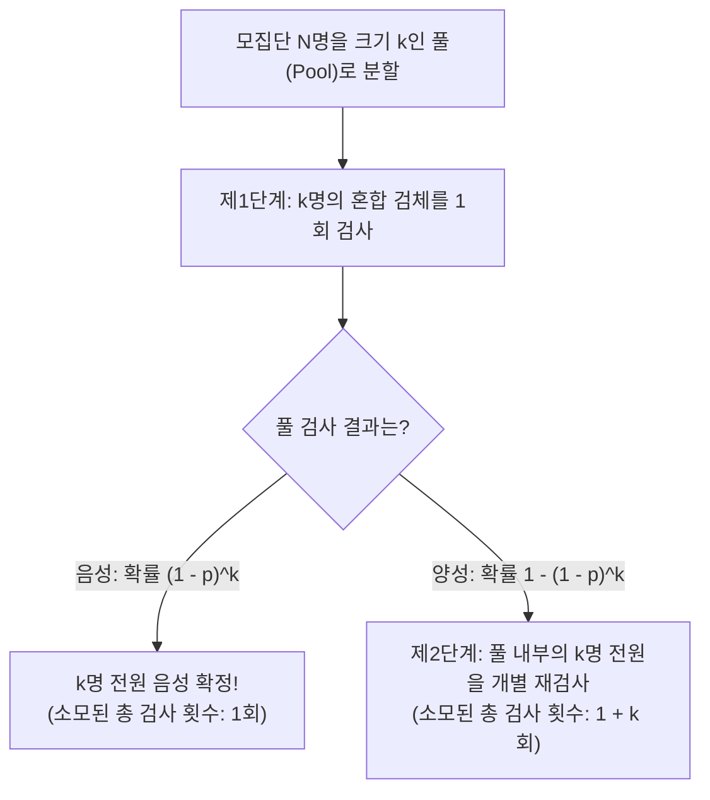
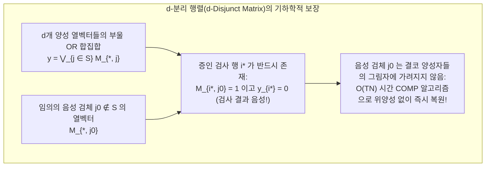

$1,000$명의 집단 속에 단 $1$명의 감염병 양성자가 숨어 있다고 가정해 보자. 누가 양성인지 $100\%$의 정확도로 찾아내기 위해서는 최소 몇 번의 진단검사를 수행해야 할까?

직관적인 답은 "$1,000$명 전원을 한 명씩 순서대로 검사한다(총 $1,000$회)"이다. 그러나 수학과 정보이론이 도출하는 답은 전혀 다르다. 만약 여러 사람의 검체를 자유롭게 섞어서(Pooling) "이 혼합 용액 안에 양성자가 최소 1명이라도 포함되어 있는가?"를 판정할 수 있다면, <strong>단계적으로 후보를 좁혀 나가는 적응형 검사(Adaptive Group Testing)로는 단 $10$회</strong>, 나아가 <strong>처음부터 혼합 패턴을 완전히 고정해 두고 모든 검사를 단 한 번의 배치로 동시에 실행하는 비적응형 검사(Non-Adaptive Group Testing)로도 불과 수십 회</strong>의 검사만으로 $1,000$명 중 양성자를 정확히 특정할 수 있다.

마치 마술처럼 보이는 이 기법은 통계학, 이산수학, 부호이론(Coding Theory), 정보이론이 교차하는 <strong>그룹 테스팅(Group Testing, 집단 풀링 검사)</strong> 및 <strong>조합 탐색(Combinatorial Search)</strong>이라는 정통 수학 분야다. 본고에서는 제2차 세계대전 중인 1943년 로버트 도프만(Robert Dorfman)이 발표한 역사적 논문에서 출발하여, 클로드 섀넌(Claude Shannon)의 정보이론적 하한, 고전 퍼즐의 금자탑인 '12개의 가짜 동전 양팔저울 문제'와 황광명(Frank K. Hwang)의 일반화 이진 분할 탐색, 카우츠와 싱글턴(Kautz & Singleton)이 확립한 <strong>분리 행렬($d$-Disjunct Matrix / 중첩 부호)</strong>과 리드-솔로몬(Reed-Solomon) 유한체 다항식 설계, 그리고 현대의 <strong>압축 센싱(Compressed Sensing)</strong>과 다중접속 채널 충돌 해결 및 고처리량 유전체 스크리닝(P-BEST)에 이르는 수학적 체계를 엄밀하게 파헤친다.

---

## 1. 1943년의 돌파구: 도프만의 2단계 풀링 검사법(Dorfman's Two-Stage Pooling)

### 1.1 제2차 세계대전 징집병 매독 스크리닝과 바서만 혈액검사의 병목

그룹 테스팅의 수학적 역사는 1943년 미국의 통계학자 <strong>로버트 도프만(Robert Dorfman)</strong>이 통계학 학술지 『*The Annals of Mathematical Statistics*』에 발표한 6쪽짜리 논문 *"The Detection of Defective Members of Large Populations"*에 의해 막을 올렸다.

당시 제2차 세계대전 중이던 미국 육군은 징집된 수백만 명의 병사 전원을 대상으로 매독(syphilis) 감염 여부를 판별하는 바서만 혈액검사(Wassermann test)를 실시해야 했다. 그러나 시약 비용과 검사 시간이 막대했던 반면, 실제 징집 집단 내의 유병률(양성 확률 $p$)은 $p \approx 0.01$($1\%$)에서 $p \approx 0.001$($0.1\%$) 수준으로 매우 낮았다. 즉, 한 사람씩 개별적으로 검사하면 <strong>전체 검사의 $99\%$ 이상이 '건강한 병사가 음성임을 확인하는 데' 소모되는</strong> 엄청난 비효율이 발생하고 있었다.

도프만은 발상을 전환하여 전체 $N$명의 검체를 크기 $k$명씩의 그룹(풀, Pool)으로 나눈 뒤, $k$명의 혈청을 조금씩 섞어 하나의 혼합 시료로 만들어 먼저 단 $1$회의 검사만 수행하는 <strong>2단계 풀링(Two-Stage Pooling)</strong> 알고리즘을 제안했다.

### 1.2 도프만의 2단계 알고리즘과 최적 풀 크기 $k^*$ 유도

모집단 $N$명에서 각 개인이 독립적으로 확률 $p$로 양성($1$), 확률 $q = 1 - p$로 음성($0$)이라고 하자. 크기 $k$인 하나의 풀을 검사할 때의 절차는 다음과 같다.

1. <strong>제1단계(혼합 풀 검사)</strong>: $k$명의 검체를 섞은 풀에 대해 $1$회 검사를 수행한다.
   - <strong>결과가 음성(Negative)인 경우</strong>(확률 $(1 - p)^k$): 풀에 속한 $k$명 전원이 음성임이 확정된다! <strong>단 $1$회의 검사만으로 $k$명 전원이 통과된다.</strong>
   - <strong>결과가 양성(Positive)인 경우</strong>(확률 $1 - (1 - p)^k$): 최소 1명의 양성자가 포함되어 있으므로 제2단계로 넘어간다.
2. <strong>제2단계(개별 재검사)</strong>: 양성 판정을 받은 풀에 속한 $k$명 전원의 원본 검체를 개별적으로 $k$회 검사하여 양성자를 찾아낸다(총 $1 + k$회 검사 소모).

크기 $k$인 풀 하나당 기대 검사 횟수는 $\mathbb{E}[T_{\text{pool}}] = 1 \cdot (1 - p)^k + (1 + k)[1 - (1 - p)^k] = 1 + k[1 - (1 - p)^k]$이며, 이를 $k$로 나누면 <strong>1인당 기대 검사 횟수 $f(k) = \frac{\mathbb{E}[T]}{N}$</strong>를 얻는다. 유병률 $p \ll 1$일 때 1차 테일러 근사 $(1 - p)^k \approx 1 - kp$를 적용하고 $k$에 대해 미분하면 최적 풀 크기 $k^*$와 최소 기대 검사 수가 해석적으로 도출된다.

$$\frac{\mathbb{E}[T]}{N} = \frac{1}{k} + 1 - (1 - p)^k \approx \frac{1}{k} + k p \implies \frac{d}{dk}\left(\frac{1}{k} + kp\right) = -\frac{1}{k^2} + p = 0 \implies k^* \approx \frac{1}{\sqrt{p}}, \qquad \frac{\mathbb{E}[T]_{\min}}{N} \approx 2\sqrt{p}$$

구체적인 수치로 확인해 보자:
- <strong>유병률 $p = 0.01$($1\%$)일 때</strong>: 최적 풀 크기는 $k^* \approx \frac{1}{\sqrt{0.01}} = 10$명(엄밀해는 $11$명)이며, 1인당 기대 검사 횟수는 약 $2\sqrt{0.01} = 0.20$회(엄밀값 $0.1956$회)가 된다. 즉, <strong>$1,000$명을 검사하는 데 $1,000$회가 아니라 단 $196$회의 검사만 필요하여 검사 횟수를 $80.4\%$나 절감</strong>할 수 있다!
- <strong>유병률 $p = 0.0001$($0.01\%$)일 때</strong>: 최적 풀 크기는 $k^* = 100$명이며, 1인당 검사 횟수는 $2\sqrt{0.0001} = 0.02$회로 줄어들어 <strong>검사 비용의 $98\%$가 사라진다</strong>!

| 유병률 $p$ | 양성자 비율 | 근사 최적 크기 $1/\sqrt{p}$ | 엄밀 최적 크기 $k^*$ | 1인당 기대 검사 수 $\mathbb{E}[T]/N$ | $1,000$명당 기대 검사 횟수 | 검사 절감률 |
| :--- | :--- | :--- | :--- | :--- | :--- | :--- |
| $p = 0.10$ | $10$명 중 $1$명 | $3.16$ | $4$명 | $0.5939$ | $594$회 | $40.6\%$ 절감 |
| $p = 0.05$ | $20$명 중 $1$명 | $4.47$ | $5$명 | $0.4262$ | $426$회 | $57.4\%$ 절감 |
| $p = 0.01$ | $100$명 중 $1$명 | $10.0$ | $11$명 | $0.1956$ | $196$회 | <strong>$80.4\%$ 절감</strong> |
| $p = 0.001$ | $1,000$명 중 $1$명 | $31.6$ | $32$명 | $0.0628$ | $63$회 | <strong>$93.7\%$ 절감</strong> |
| $p = 0.0001$ | $10,000$명 중 $1$명 | $100.0$ | $101$명 | $0.01995$ | $20$회 | <strong>$98.0\%$ 절감</strong> |

---

## 2. 정보이론적 하한(Information-Theoretic Lower Bound)

2단계에만 머무르지 않고 다단계 혹은 고차원 조합 설계를 허용한다면, 원리적으로 검사 횟수를 어디까지 줄일 수 있을까? 클로드 섀넌의 정보이론이 그 절대적 한계를 제시한다.

1. <strong>조합론적 계수 하한(Counting Bound)</strong>:
   $N$개의 검체 중 정확히 $d$개의 양성 검체 집합 $S \subset [N]$($|S| = d$)가 존재할 때, 가능한 양성 집합의 총수는 $\binom{N}{d}$가지다. 반면, 각 검사의 결과는 $\{0, 1\}$의 이진 출력으로 최대 $1$비트(bit)의 정보만 제공하므로, $T$회의 검사로 표현할 수 있는 결과 벡터 $\mathbf{y} \in \{0, 1\}^T$의 경우의 수는 최대 $2^T$가지다. 비둘기집 원리에 의해 다음 부등식이 반드시 성립해야 한다.
   $$2^T \ge \binom{N}{d} \implies T \ge \log_2 \binom{N}{d} \approx d \log_2 \frac{N}{d} + O(d)$$
2. <strong>확률론적 섀넌 엔트로피 하한(Shannon Entropy Bound)</strong>:
   각 검체가 독립적으로 확률 $p$로 양성인 확률 모델에서는 전체 상태 벡터 $\mathbf{X}$의 엔트로피가 $N H_2(p)$이므로, 기대 검사 횟수는 반드시 이진 엔트로피 함수 $H_2(p)$ 이상이어야 한다.
   $$\frac{\mathbb{E}[T]}{N} \ge H_2(p) = -p\log_2 p - (1-p)\log_2(1-p)$$

---

## 3. 적응형 그룹 테스팅과 '12개의 가짜 동전 문제'

### 3.1 이진 분할(Binary Splitting)과 황광명(Hwang)의 일반화 이진 분할 알고리즘

이전 검사 결과를 보고 다음 혼합 풀을 동적으로 구성하는 <strong>적응형 그룹 테스팅(Adaptive Group Testing)</strong>은 정보이론적 하한을 정확히 달성한다.
- $d = 1$일 때는 매 단계마다 후보 집단의 절반을 섞어 검사하는 <strong>이진 탐색(Binary Splitting)</strong>을 통해 정확히 $\lceil \log_2 N \rceil$회($N=1,000$일 때 단 $10$회) 만에 양성자를 찾아낸다.
- 일반적인 $d \ge 2$일 때는 <strong>황광명(Frank K. Hwang, 1972)의 일반화 이진 분할 알고리즘(Generalized Binary Splitting)</strong>이 남은 $n$개의 검체에서 크기 $2^\alpha \approx n/d$인 풀을 잘라 검사함으로써(양성과 음성 확률을 약 $1/2$씩으로 맞춰 매 검사당 $1$비트의 엔트로피를 추출), 총 $T = d \log_2(N/d) + O(d)$회 만에 모든 양성자를 찾아낸다.

이러한 정보량 극대화 원리를 가장 우아하게 보여주는 퍼즐이 <strong>'12개의 가짜 동전과 양팔저울 문제'</strong>다. 12개의 동전 중 1개가 가짜이며 진짜보다 무거운지 가벼운지 모른다고 할 때, 가능한 가설 상태는 총 $12 \times 2 = 24$가지다. 양팔저울은 왼쪽 기울어짐($-1$), 수평($0$), 오른쪽 기울어짐($+1$)의 3진 출력을 내므로 $3$회 측정으로 최대 $3^3 = 27 \ge 24$가지 상태를 구별할 수 있다. 만약 첫 측정에서 양쪽에 6개씩 올리면 저울이 수평을 이룰 확률이 $0$이 되어 출력이 2가지(각 $12$상태 $> 3^2 = 9$)로 퇴화하므로 절대 풀 수 없다. 반드시 첫 측정에서 <strong>왼쪽에 4개, 오른쪽에 4개, 저울 밖에 4개</strong>를 두어 24가지 가설을 $8 : 8 : 8$로 균등 분할하고, 두 번째 측정에서 무거운 후보와 가벼운 후보를 양쪽 접시에 교차 배치해야만 3번 만에 가짜 동전과 경중을 100% 판별할 수 있다.

그러나 실제 <strong>RT-PCR 검사나 유전체 스크리닝에서는 적응형 다단계 탐색을 쓰기 어렵다</strong>. PCR 증폭 1회에 3시간이 걸리므로 $10$단계 적응형 검사를 직렬로 수행하면 $30$시간이 소요되기 때문이다! 따라서 모든 검사를 <strong>단 1라운드에 동시에 병렬 실행하는 비적응형 그룹 테스팅(NAGT)</strong>이 필수적이다.

---

## 4. 비적응형 그룹 테스팅(NAGT)과 분리 행렬($d$-Disjunct Matrix)

### 4.1 풀링 행렬 $\mathbf{M}$과 부울 OR 중첩 연산

1964년 <strong>카우츠와 싱글턴(Kautz & Singleton)</strong>은 $T \times N$ 이진 <strong>풀링 행렬 $\mathbf{M} \in \{0, 1\}^{T \times N}$</strong>을 이용해 비적응형 그룹 테스팅의 대수적 구조를 정립했다($M_{i, j} = 1$은 검체 $j$를 풀 $i$에 혼합함을 의미). 양성자 집합 $S \subset [N]$($|S| \le d$)에 대해, $T$개의 동시 검사 결과 벡터 $\mathbf{y} \in \{0, 1\}^T$는 양성 열벡터들의 <strong>비트별 부울 논리합(Boolean OR 중첩)</strong>으로 주어진다.

$$\mathbf{y} = \mathbf{M} \odot \mathbf{x} = \bigvee_{j \in S} \mathbf{M}_{*, j}$$

### 4.2 $d$-분리 행렬($d$-Disjunct Matrix)과 COMP 선형 시간 디코딩

행렬 $\mathbf{M}$에서 임의의 열 $j_0 \notin S$의 지지집합(Support, $1$이 위치한 행들의 집합)이 임의의 다른 $d$개 열들의 지지집합의 합집합에 포함되지 않을 때, 즉

$$\text{supp}(\mathbf{M}_{*, j_0}) \not\subseteq \bigcup_{j \in S} \text{supp}(\mathbf{M}_{*, j}) \qquad (\forall |S| \le d, \; \forall j_0 \notin S)$$

을 만족할 때 $\mathbf{M}$을 <strong>$d$-분리 행렬($d$-Disjunct Matrix)</strong>이라 부른다. 이 성질은 <strong>"어떠한 음성 검체 $j_0 \notin S$에 대해서도, $j_0$는 참여했지만 $d$명의 양성자는 단 한 명도 참여하지 않은 '음성 증인 검사(Witness Row $i^*$)'가 최소 1개 이상 반드시 존재한다"</strong>는 것을 보장한다!

따라서 <strong>COMP(조합 직교 매칭 추적) 알고리즘</strong>은 단순히 <strong>"음성이 나온 검사에 한 번이라도 참여한 검체를 모두 소거하고 남은 검체를 양성으로 판정"</strong>하는 것만으로 $O(TN)$ 시간에 완벽히 $S$를 복원한다. 조합론적 하한 정리(Ruszinkó / Füredi)에 의해 엄밀한 $d$-분리 행렬은 최소 $T = \Omega\left(\frac{d^2}{\log d}\log N\right)$개의 행이 필요하며, 확률적 방법이나 유한체 구성을 통해 $T = O(d^2 \log N)$개의 행으로 구축할 수 있다.

### 4.3 2차원 그리드 풀링의 '유령 양성'과 리드-솔로몬 유한체 다항식 설계

$100$개의 검체를 $10 \times 10$ 격자에 배열하고 가로 10개 행과 세로 10개 열로 총 $20$개 풀을 만들면 $1$명의 양성자는 행과 열의 교점으로 즉시 특정된다($1$-분리 행렬). 그러나 $d = 2$명의 양성자가 $(2, 4)$와 $(6, 9)$에 있으면, 교점인 $(2, 9)$와 $(6, 4)$에도 행과 열이 모두 양성이 되는 <strong>'유령 양성자(Ghost Positives)'</strong>가 발생한다!
카우츠와 싱글턴은 이를 해결하기 위해 유한체 $\mathbb{F}_q$ 위의 $(k-1)$차 다항식 $P_j(x)$(<strong>리드-솔로몬 부호</strong>)를 각 검체에 할당하고, 서로 다른 기울기의 대각선 방향 $w \ge d(k-1)+1$개로 투영하여 유령 양성자를 완벽히 제거하는 대수적 풀링 설계를 완성했다.

---

## 5. 잡음 그룹 테스팅, 압축 센싱(Compressed Sensing), 그리고 P-BEST로의 확장

| 비교 항목 | 적응형 그룹 테스팅 (Hwang 이진 분할) | 비적응형 그룹 테스팅 (NAGT / $d$-분리 행렬) | 압축 센싱 (Compressed Sensing) |
| :--- | :--- | :--- | :--- |
| <strong>대수적 구조</strong> | 부울 결정 트리 $(\{0, 1\}, \lor, \land)$ | 부울 반환 행렬곱 $\mathbf{y} = \mathbf{M} \odot \mathbf{x}$ | 실수체 선형 투영 $\mathbf{y} = \mathbf{\Phi}\mathbf{x} + \mathbf{e} \in \mathbb{R}^T$ |
| <strong>행렬 기하 조건</strong> | 동적 등확률 분할 (매 단계 $1$ bit) | <strong>$d$-분리성 ($d$-Disjunctness)</strong> | <strong>제한 등거리성 (RIP)</strong> / 비간섭성 |
| <strong>필요 검사 횟수 $T$</strong> | $d \log_2(N/d) + O(d)$ (정보이론 최적) | $O(d^2 \log N)$ (무오류) / $O(d \log N)$ (고확률) | $O(d \log(N/d))$ |
| <strong>핵심 복원 알고리즘</strong> | 순차적 이진 탐색 | <strong>COMP / DD / SCOMP / 신뢰 전파(BP)</strong> | <strong>OMP / 기저 추적($\ell_1$ 최소화 LASSO)</strong> |

1. <strong>희석 효과와 잡음 그룹 테스팅(Noisy Group Testing)</strong>: 검체를 너무 많이 섞어 바이러스 농도가 묽어지는 희석 효과(Dilution Effect)나 위음성·위양성 오류에 대비해, 최소 $2e+1$개의 증인 행을 갖는 오류 내성 분리 행렬과 <strong>NCOMP</strong>, <strong>신뢰 전파(Belief Propagation)</strong>, <strong>선형 계획법(LP Decoding)</strong>이 사용된다.
2. <strong>압축 센싱(Compressed Sensing)과의 쌍대성</strong>: 칸데스(Candès), 타오(Tao), 도노호(Donoho)의 압축 센싱은 부울 논리합($\lor$) 위에서 작동하던 그룹 테스팅을 실수체($\mathbb{R}$) 위의 선형 연산 $\mathbf{y} = \mathbf{\Phi}\mathbf{x}$로 확장한 대수적 쌍둥이다.
3. <strong>다중접속 충돌 해결과 코로나19 P-BEST 검사법</strong>: 무선 통신의 이진 트리 충돌 해결 알고리즘부터, 2020년 이스라엘 연구진(Shental et al., *Science Advances*)이 개발하여 실제 임상에 적용한 <strong>P-BEST 기법</strong>(리드-솔로몬 설계 기반의 $48 \times 384$ 분리 행렬과 압축 센싱 디코딩을 결합해 단 $48$개의 풀로 $384$명의 검체를 1라운드 만에 검사하여 처리량을 8배로 높인 혁신)에 이르기까지, 그룹 테스팅의 수학은 현대 과학과 공학의 핵심 엔진으로 작동하고 있다.
