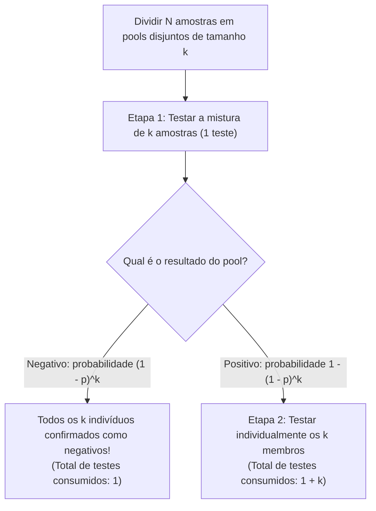
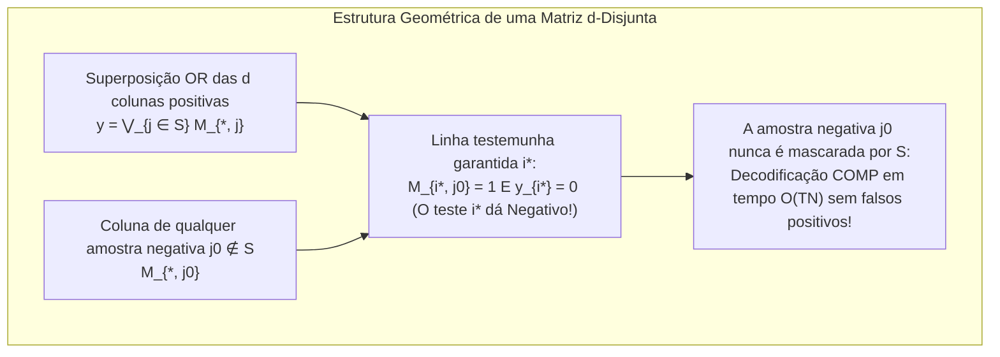

Suponha que um único indivíduo infectado esteja escondido em uma população de $1.000$ pessoas. Quantos testes diagnósticos são necessários para identificar essa pessoa positiva com $100\,\%$ de certeza?

O senso comum sugere testar todas as $1.000$ pessoas uma a uma — exigindo $1.000$ testes. No entanto, a matemática e a teoria da informação revelam algo surpreendente. Se pudermos misturar (*agrupar* ou fazer *pooling* de) amostras biológicas de modo que um único teste responda à pergunta binária *«Há pelo menos uma amostra positiva nesta mistura?»*, então <strong>uma busca adaptativa por divisão binária requer apenas $10$ testes</strong>. Mais impressionante ainda: <strong>mesmo que fixemos todo o padrão de mistura antecipadamente e executemos todos os testes simultaneamente em uma única rodada paralela (teste em grupo não adaptativo), apenas algumas dezenas de testes são suficientes</strong> para identificar o indivíduo positivo sem nenhum reteste.

O que parece mágica é um pilar da matemática discreta, estatística, teoria de códigos e teoria da informação conhecido como <strong>Group Testing (Teste em Grupo / Pooling)</strong> e <strong>busca combinatória (Combinatorial Search)</strong>. Neste artigo, percorremos toda a sua estrutura matemática: desde o artigo histórico de Robert Dorfman em 1943 e os limites inferiores de entropia de Claude Shannon, passando pelo clássico problema das 12 moedas e a busca binária generalizada de Hwang, até as <strong>matrizes $d$-disjuntas (códigos sobrepostos)</strong> de Kautz e Singleton sobre corpos finitos (Reed-Solomon), o <strong>sensoriamento comprimido (Compressed Sensing)</strong> e a triagem genômica de alto rendimento (P-BEST).

---

## 1. O avanço de 1943: O pooling em duas etapas de Robert Dorfman

### 1.1 A Segunda Guerra Mundial e o gargalo do teste de Wassermann

A história matemática do Group Testing nasceu em dezembro de 1943, quando o estatístico norte-americano <strong>Robert Dorfman</strong> publicou no *The Annals of Mathematical Statistics* seu artigo clássico de seis páginas *"The Detection of Defective Members of Large Populations"*.

Durante a Segunda Guerra Mundial, o Exército dos EUA precisava testar milhões de recrutas para sífilis usando o exame de sangue de Wassermann. Como a prevalência $p$ era baixa (tipicamente $p \approx 0{,}01$ a $p \approx 0{,}001$), testar cada soldado individualmente desperdiçava mais de $99\,\%$ dos testes apenas para confirmar resultados negativos.

Dorfman propôs um <strong>procedimento de agrupamento em duas etapas (Two-Stage Pooling)</strong>: dividir os $N$ indivíduos em grupos disjuntos (pools) de tamanho $k$.

1. <strong>Etapa 1 (Teste do Pool)</strong>: Misturar as $k$ amostras do grupo e realizar $1$ único teste na mistura combinada.
   - <strong>Se o pool testar Negativo</strong> (probabilidade $(1 - p)^k$): todos os $k$ indivíduos são declarados negativos de uma só vez, consumindo <strong>apenas $1$ teste</strong>!
   - <strong>Se o pool testar Positivo</strong> (probabilidade $1 - (1 - p)^k$): pelo menos um membro é positivo; avança-se para a Etapa 2.
2. <strong>Etapa 2 (Reteste Individual)</strong>: Testar individualmente cada uma das $k$ amostras originais do pool positivo (consumindo $1 + k$ testes no total para esse grupo).

### 1.2 Derivação analítica do tamanho ótimo de pool $k^*$

Para um pool de tamanho $k$, o número esperado de testes é $\mathbb{E}[T_{\text{pool}}] = 1 \cdot (1 - p)^k + (1 + k)[1 - (1 - p)^k] = 1 + k[1 - (1 - p)^k]$. Dividindo por $k$, obtemos o <strong>número esperado de testes por pessoa</strong> $f(k) = \frac{\mathbb{E}[T]}{N}$:

$$\frac{\mathbb{E}[T]}{N} = \frac{1}{k} + 1 - (1 - p)^k \approx \frac{1}{k} + k p \implies \frac{d}{dk}\left(\frac{1}{k} + kp\right) = -\frac{1}{k^2} + p = 0 \implies k^* \approx \frac{1}{\sqrt{p}}, \qquad \frac{\mathbb{E}[T]_{\min}}{N} \approx 2\sqrt{p}$$

Vejamos com números concretos o impacto dessa lei da raiz quadrada:
- <strong>Quando a prevalência é $p = 0{,}01$ ($1\,\%$)</strong>: o tamanho ótimo do pool é $k^* \approx \frac{1}{\sqrt{0{,}01}} = 10$ (ótimo inteiro exato: $k^* = 11$), e o custo cai para $\frac{\mathbb{E}[T]}{N} \approx 0{,}20$ teste por pessoa (exato: $0{,}1956$). Testar $1.000$ pessoas exige apenas <strong>$196$ testes em vez de $1.000$ — uma redução imediata de $80{,}4\,\%$</strong>!
- <strong>Quando a prevalência é $p = 0{,}0001$ ($0{,}01\,\%$)</strong>: o tamanho ótimo é $k^* = 100$ e o número esperado de testes cai para $0{,}02$ por pessoa, <strong>eliminando $98\,\%$ de todos os testes</strong>!

| Prevalência $p$ | Taxa de Positivos | Assintótico $1/\sqrt{p}$ | Ótimo Exato $k^*$ | Testes Esperados / Pessoa $\mathbb{E}[T]/N$ | Testes por $1.000$ Pessoas | Redução de Testes |
| :--- | :--- | :--- | :--- | :--- | :--- | :--- |
| $p = 0{,}10$ | $1$ em $10$ | $3{,}16$ | $4$ | $0{,}5939$ | $594$ testes | $40{,}6\,\%$ |
| $p = 0{,}05$ | $1$ em $20$ | $4{,}47$ | $5$ | $0{,}4262$ | $426$ testes | $57{,}4\,\%$ |
| $p = 0{,}01$ | $1$ em $100$ | $10{,}0$ | $11$ | $0{,}1956$ | $196$ testes | <strong>$80{,}4\,\%$</strong> |
| $p = 0{,}001$ | $1$ em $1.000$ | $31{,}6$ | $32$ | $0{,}0628$ | $63$ testes | <strong>$93{,}7\,\%$</strong> |
| $p = 0{,}0001$ | $1$ em $10.000$ | $100{,}0$ | $101$ | $0{,}01995$ | $20$ testes | <strong>$98{,}0\,\%$</strong> |

---

## 2. O Limite Inferior da Teoria da Informação (Counting Bound e Entropia de Shannon)

Qual é o número mínimo absoluto de testes exigido pelas leis da informação para qualquer algoritmo concebível?

1. <strong>Limite Combinatório de Contagem (Counting Bound)</strong>: Se existem $d$ positivos entre $N$ itens ($S \subset [N], |S| = d$), há $\binom{N}{d}$ subconjuntos possíveis. Como cada teste binário $\{0, 1\}$ fornece no máximo $1$ bit de informação de Shannon, $T$ testes produzem no máximo $2^T$ vetores de resultados distintos:
   $$2^T \ge \binom{N}{d} \implies T \ge \log_2 \binom{N}{d} \approx d \log_2 \frac{N}{d} + O(d)$$
2. <strong>Limite Probabilístico da Entropia de Shannon</strong>: Se cada item é positivo independentemente com probabilidade $p$, a entropia conjunta do vetor de estado $\mathbf{X} \in \{0, 1\}^N$ é $N \cdot H_2(p)$, exigindo:
   $$\frac{\mathbb{E}[T]}{N} \ge H_2(p) = -p\log_2 p - (1-p)\log_2(1-p)$$

---

## 3. Group Testing Adaptativo vs. Não Adaptativo

### 3.1 Divisão Binária Adaptativa de Hwang e o Problema das 12 Moedas

No <strong>Group Testing adaptativo</strong>, cada pool é escolhido dinamicamente com base nos resultados anteriores:
- Para $d = 1$, a <strong>busca binária (Binary Splitting)</strong> corta o espaço de candidatos pela metade a cada teste, atingindo exatamente $\lceil \log_2 N \rceil$ testes ($10$ testes para $N = 1.000$).
- Para $d \ge 2$, o <strong>algoritmo de divisão binária generalizada de Frank K. Hwang (1972)</strong> testa subgrupos de tamanho $2^\alpha \approx n/d$ para que as probabilidades de resultado positivo e negativo fiquem próximas de $1/2$ ($1$ bit de entropia por teste), alcançando o ótimo assintótico $T = d \log_2(N/d) + O(d)$.

Esse mesmo princípio governa o famoso <strong>problema das 12 moedas e a balança de dois pratos (1945)</strong>: entre $12$ moedas há $1$ moeda falsa, mais pesada ou mais leve ($12 \times 2 = 24$ hipóteses). Uma balança fornece $3$ resultados $\{-1, 0, +1\}$, extraindo até $\log_2 3 \approx 1{,}585$ bits por pesagem e distinguindo até $3^3 = 27 \ge 24$ estados em $3$ pesagens. Colocar $6$ moedas contra $6$ na primeira pesagem impede o equilíbrio ($0$), deixando $12 > 3^2 = 9$ estados (impossível resolver!). É preciso colocar <strong>$4$ moedas no prato esquerdo, $4$ no direito e deixar $4$ de fora</strong>, dividindo as $24$ hipóteses em $8 : 8 : 8$ e resolvendo o enigma em $3$ pesagens.

<strong>O gargalo prático em PCR e genômica</strong>: Como cada ciclo de RT-PCR leva cerca de $3$ horas, executar $10$ etapas adaptativas em série levaria <strong>$30$ horas</strong>! Por isso, laboratórios de diagnóstico em massa precisam do <strong>Group Testing não adaptativo (NAGT)</strong>, onde todos os $T$ testes rodam simultaneamente em uma única etapa.

---

## 4. Group Testing Não Adaptativo (NAGT) e Matrizes $d$-Disjuntas

### 4.1 A Matriz de Pooling $\mathbf{M}$ e a Superposição OR Booleana

<strong>Kautz e Singleton (1964)</strong> formalizaram o teste não adaptativo por meio de uma matriz binária $\mathbf{M} \in \{0, 1\}^{T \times N}$, onde $M_{i, j} = 1$ indica que a amostra $j$ entra no pool $i$. O vetor de resultados $\mathbf{y} \in \{0, 1\}^T$ é a <strong>superposição OR booleana</strong> das colunas do conjunto positivo $S$ ($|S| \le d$):

$$\mathbf{y} = \mathbf{M} \odot \mathbf{x} = \bigvee_{j \in S} \mathbf{M}_{*, j}$$

### 4.2 Matrizes $d$-Disjuntas e Decodificação COMP em Tempo Linear

Uma matriz $\mathbf{M}$ é chamada <strong>$d$-disjunta ($d$-Disjunct Matrix)</strong> se o suporte de nenhuma coluna $j_0 \notin S$ estiver contido na união dos suportes de quaisquer outras $d$ colunas $S$:

$$\text{supp}(\mathbf{M}_{*, j_0}) \not\subseteq \bigcup_{j \in S} \text{supp}(\mathbf{M}_{*, j}) \qquad (\forall |S| \le d, \; \forall j_0 \notin S)$$

Isto é, para cada indivíduo negativo $j_0 \notin S$, existe pelo menos um <strong>«teste testemunha» (linha $i^*$)</strong> do qual $j_0$ participa ($M_{i^*, j_0} = 1$), mas nenhum dos $d$ positivos participa ($y_{i^*} = 0$).

Graças a essa propriedade, o algoritmo <strong>COMP (Combinatorial Orthogonal Matching Pursuit)</strong> decodifica $\mathbf{y}$ em tempo linear $O(TN)$: basta eliminar todas as amostras que participam de algum teste negativo; as amostras sobreviventes são exatamente as positivas! Enquanto o limite inferior combinatório de D'yachkov-Rykov / Ruszinkó / Füredi exige $T = \Omega\left(\frac{d^2}{\log d} \log N\right)$ linhas, construções probabilísticas e algébricas atingem $T = O(d^2 \log N)$.

### 4.3 Grade 2D («Falsos Positivos Fantasmas») e Polinômios de Reed-Solomon

Ao organizar $N = 100$ amostras em uma grade $10 \times 10$ ($10$ pools de linha + $10$ pools de coluna = $20$ testes), $d = 1$ positivo é identificado na interseção única ($1$-disjunta). Porém, se houver $d = 2$ positivos em $(2, 4)$ e $(6, 9)$, as linhas $R_2, R_6$ e colunas $C_4, C_9$ positivam, criando dois <strong>«positivos fantasmas» (Ghost Positives)</strong> em $(2, 9)$ e $(6, 4)$!

Kautz e Singleton eliminaram os fantasmas associando a cada amostra $j$ um polinômio $P_j(x) \in \mathbb{F}_q[x]$ de grau $\le k-1$ sobre um corpo finito $\mathbb{F}_q$ (código de <strong>Reed-Solomon</strong>, $N = q^k$) e formando pools segundo $y = P_j(x_m) \pmod q$ em $w \ge d(k-1)+1$ direções. Como dois polinômios distintos de grau $\le k-1$ se cruzam em no máximo $k-1$ pontos, a matriz resultante é estritamente $d$-disjunta!

---

## 5. Ruído, Sensoriamento Comprimido (Compressed Sensing) e P-BEST

| Característica | Group Testing Adaptativo (Hwang) | Group Testing Não Adaptativo ($d$-disjunta) | Compressed Sensing (Candès-Tao-Donoho) |
| :--- | :--- | :--- | :--- |
| <strong>Álgebra Subjacente</strong> | Árvore de decisão sobre $\{0, 1\}$ | Semianel booleano $(\{0, 1\}, \lor, \land)$ | Corpo real $(\mathbb{R}, +, \times)$, $\mathbf{y} = \mathbf{\Phi}\mathbf{x} + \mathbf{e}$ |
| <strong>Condição Geométrica</strong> | Partição equiprovável ($1$ bit/teste) | <strong>$d$-Disjuntividade</strong> | <strong>Propriedade de Isometria Restrita (RIP)</strong> |
| <strong>Número de Testes $T$</strong> | $d \log_2(N/d) + O(d)$ | $O(d^2 \log N)$ (zero erro) / $O(d \log N)$ (probabilístico) | $O(d \log(N/d))$ |
| <strong>Decodificador</strong> | Busca binária sequencial | <strong>COMP / DD / SCOMP / Belief Propagation</strong> | <strong>OMP / Basis Pursuit (minimização $\ell_1$)</strong> |

1. <strong>Efeito de Diluição e Group Testing Ruidoso</strong>: Contra diluição viral e erros laboratoriais, matrizes $(d, 2e)$-disjuntas garantem $2e+1$ linhas testemunhas (decodificador <strong>NCOMP</strong>), aliadas à <strong>propagação de crença (Belief Propagation)</strong> e <strong>programação linear (LP)</strong>.
2. <strong>Dualidade com o Compressed Sensing</strong>: O sensoriamento comprimido é o gêmeo algébrico contínuo em $\mathbb{R}$ do Group Testing booleano.
3. <strong>Canais de Acesso Múltiplo e Triagem COVID-19 P-BEST</strong>: Da resolução de colisões sem fio (algoritmo em árvore de Capetanakis) e Count-Min Sketch em roteadores ao protocolo clínico <strong>P-BEST</strong> (Shental et al., *Science Advances* 2020), que usa uma matriz de Reed-Solomon $48 \times 384$ para testar $384$ pacientes em apenas $48$ reações PCR simultâneas em uma única rodada (aumentando em $8$ vezes a capacidade de testes), o Group Testing demonstra o poder extraordinário da matemática combinatória.
