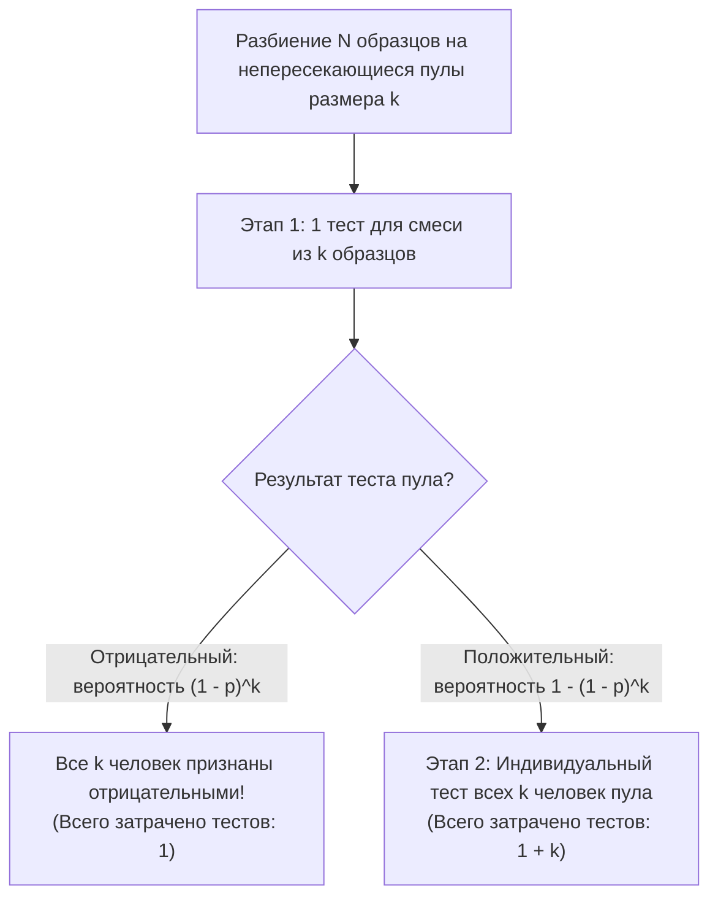
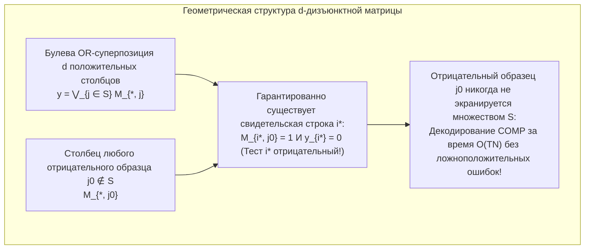

Представьте, что среди популяции из $1\,000$ человек скрывается ровно один инфицированный (положительный) пациент. Сколько диагностических тестов необходимо провести, чтобы со $100\%$-ной точностью определить этого человека?

Интуитивный ответ — протестировать всех $1\,000$ человек по очереди, затратив $1\,000$ тестов. Однако математика и теория информации дают совершенно иной ответ. Если биологические образцы можно смешивать (объединять в пулы — *pooling*) так, чтобы один анализ отвечал на бинарный вопрос *«Присутствует ли в этой смеси хотя бы один положительный образец?»*, то <strong>последовательный адаптивный двоичный поиск потребует всего $10$ тестов</strong>. Более того: <strong>даже если заранее зафиксировать схему смешивания и провести все тесты одновременно за один параллельный цикл (неадаптивное групповое тестирование), достаточно всего нескольких десятков тестов</strong>, чтобы безошибочно выявить инфицированного без единого повторного анализа.

Эта область на стыке дискретной математики, математической статистики, теории кодирования и теории информации называется <strong>групповым тестированием (Group Testing)</strong> и <strong>комбинаторным поиском (Combinatorial Search)</strong>. В этой статье мы подробно разберем весь математический фундамент метода: от исторической работы Роберта Дорфмана 1943 года и теоретико-информационных нижних границ Клода Шеннона, через классическую задачу о 12 монетах и обобщенный алгоритм бинарного расщепления Хванга, к <strong>$d$-дизъюнктным матрицам (суперпозиционным кодам)</strong> Кауца — Синглтона над конечными полями (коды Рида — Соломона), <strong>сжатому зондированию (Compressed Sensing)</strong> и высокопроизводительному геномному скринингу (P-BEST).

---

## 1. Прорыв 1943 года: Двухэтапный пулинг Роберта Дорфмана

### 1.1 Вторая мировая война и узкое место реакции Вассермана

Математическая теория группового тестирования родилась в декабре 1943 года, когда американский статистик <strong>Роберт Дорфман (Robert Dorfman)</strong> опубликовал в журнале *The Annals of Mathematical Statistics* шестистраничную статью *"The Detection of Defective Members of Large Populations"*.

Во время Второй мировой войны армии США требовалось проверить миллионы призывников на сифилис с помощью анализа крови (реакции Вассермана). Поскольку распространенность инфекции $p$ была низкой (обычно от $p \approx 0{,}01$ до $p \approx 0{,}001$), при индивидуальном тестировании более $99\%$ всех реактивов и времени уходило на простое подтверждение того, что здоровый призывник не болен.

Дорфман предложил <strong>двухэтапную процедуру пулинга (Two-Stage Pooling)</strong>: разделить $N$ человек на непересекающиеся группы (пулы) размера $k$.

1. <strong>Этап 1 (Тестирование пула)</strong>: Смешать $k$ образцов сыворотки одной группы в одной пробирке и провести $1$ тест.
   - <strong>Если пул отрицательный</strong> (вероятность $(1 - p)^k$): все $k$ человек признаются здоровыми сразу! <strong>Затрачен всего $1$ тест на $k$ человек.</strong>
   - <strong>Если пул положительный</strong> (вероятность $1 - (1 - p)^k$): в группе есть хотя бы один инфицированный; переходим к Этапу 2.
2. <strong>Этап 2 (Индивидуальная перепроверка)</strong>: Протестировать индивидуально все $k$ исходных образцов из положительного пула (суммарно $1 + k$ тестов на этот пул).

### 1.2 Аналитический вывод оптимального размера пула $k^*$

Для одного пула размера $k$ математическое ожидание числа тестов равно $\mathbb{E}[T_{\text{pool}}] = 1 \cdot (1 - p)^k + (1 + k)[1 - (1 - p)^k] = 1 + k[1 - (1 - p)^k]$. Разделив на $k$, получаем <strong>ожидаемое число тестов на одного человека</strong> $f(k) = \frac{\mathbb{E}[T]}{N}$:

$$\frac{\mathbb{E}[T]}{N} = \frac{1}{k} + 1 - (1 - p)^k \approx \frac{1}{k} + k p \implies \frac{d}{dk}\left(\frac{1}{k} + kp\right) = -\frac{1}{k^2} + p = 0 \implies k^* \approx \frac{1}{\sqrt{p}}, \qquad \frac{\mathbb{E}[T]_{\min}}{N} \approx 2\sqrt{p}$$

Проверим этот закон квадратного корня на конкретных числах:
- <strong>При распространенности $p = 0{,}01$ ($1\%$)</strong>: оптимальный размер пула равен $k^* \approx \frac{1}{\sqrt{0{,}01}} = 10$ (точный целочисленный оптимум: $k^* = 11$), а среднее число тестов на человека падает до $\frac{\mathbb{E}[T]}{N} \approx 0{,}20$ (точное значение: $0{,}1956$). На $1\,000$ человек требуется всего <strong>$196$ тестов вместо $1\,000$ — экономия $80{,}4\%$</strong>!
- <strong>При распространенности $p = 0{,}0001$ ($0{,}01\%$)</strong>: оптимальный размер пула $k^* = 100$, а затраты падают до $0{,}02$ теста на человека — <strong>сокращение числа тестов на $98\%$</strong>!

| Распространенность $p$ | Доля положительных | Асимптотика $1/\sqrt{p}$ | Точный оптимум $k^*$ | Ожидаемое число тестов / чел. $\mathbb{E}[T]/N$ | Тестов на $1\,000$ человек | Экономия тестов |
| :--- | :--- | :--- | :--- | :--- | :--- | :--- |
| $p = 0{,}10$ | $1$ из $10$ | $3{,}16$ | $4$ | $0{,}5939$ | $594$ теста | $40{,}6\%$ |
| $p = 0{,}05$ | $1$ из $20$ | $4{,}47$ | $5$ | $0{,}4262$ | $426$ тестов | $57{,}4\%$ |
| $p = 0{,}01$ | $1$ из $100$ | $10{,}0$ | $11$ | $0{,}1956$ | $196$ тестов | <strong>$80{,}4\%$</strong> |
| $p = 0{,}001$ | $1$ из $1\,000$ | $31{,}6$ | $32$ | $0{,}0628$ | $63$ теста | <strong>$93{,}7\%$</strong> |
| $p = 0{,}0001$ | $1$ из $10\,000$ | $100{,}0$ | $101$ | $0{,}01995$ | $20$ тестов | <strong>$98{,}0\%$</strong> |

---

## 2. Теоретико-информационная нижняя граница (Граница подсчета и энтропия Шеннона)

Каково абсолютное минимальное число тестов, диктуемое законами теории информации Клода Шеннона для любого алгоритма?

1. <strong>Комбинаторная граница подсчета (Counting Bound)</strong>: Если среди $N$ объектов ровно $d$ дефектных ($S \subset [N], |S| = d$), существует $\binom{N}{d}$ возможных подмножеств. Поскольку каждый бинарный тест $\{0, 1\}$ несет не более $1$ бита информации, $T$ тестов дают максимум $2^T$ различных векторов исходов:
   $$2^T \ge \binom{N}{d} \implies T \ge \log_2 \binom{N}{d} \approx d \log_2 \frac{N}{d} + O(d)$$
2. <strong>Вероятностная граница энтропии Шеннона</strong>: Если каждый элемент независим и положителен с вероятностью $p$, полная энтропия вектора состояний $\mathbf{X} \in \{0, 1\}^N$ равна $N \cdot H_2(p)$, откуда:
   $$\frac{\mathbb{E}[T]}{N} \ge H_2(p) = -p\log_2 p - (1-p)\log_2(1-p)$$

---

## 3. Адаптивное против неадаптивного группового тестирования

### 3.1 Обобщенное бинарное расщепление Хванга и задача о 12 монетах

В <strong>адаптивном групповом тестировании</strong> каждый следующий пул формируется на основе предыдущих результатов:
- При $d = 1$ классический <strong>бинарный поиск (Binary Splitting)</strong> делит множество кандидатов пополам на каждом шаге и находит положительный образец ровно за $\lceil \log_2 N \rceil$ тестов ($10$ тестов для $N = 1\,000$).
- При $d \ge 2$ <strong>обобщенный алгоритм бинарного расщепления Фрэнка Хванга (Hwang, 1972)</strong> тестирует подгруппы размера $2^\alpha \approx n/d$, выравнивая вероятности положительного и отрицательного исходов около $1/2$ ($1$ бит энтропии за тест), и достигает теоретического оптимума $T = d \log_2(N/d) + O(d)$.

Тот же принцип лежит в основе знаменитой <strong>задачи о 12 монетах на чашечных весах (1945)</strong>: среди $12$ монет одна фальшивая — легче или тяжелее настоящих ($12 \times 2 = 24$ гипотезы). Чашечные весы имеют $3$ исхода $\{-1, 0, +1\}$, давая до $\log_2 3 \approx 1{,}585$ бита за взвешивание и различая до $3^3 = 27 \ge 24$ состояний за $3$ взвешивания. Если при первом взвешивании положить $6$ против $6$ монет, равновесие ($0$) невозможно, и останется $12 > 3^2 = 9$ состояний (задача неразрешима!). Необходимо положить <strong>$4$ монеты на левую чашу, $4$ на правую и оставить $4$ в стороне</strong>, разбивая $24$ гипотезы в пропорции $8 : 8 : 8$, что позволяет гарантированно найти фальшивую монету за $3$ взвешивания.

<strong>Практический недостаток в ПЦР-диагностике</strong>: Один цикл ОТ-ПЦР занимает около $3$ часов, поэтому $10$ последовательных адаптивных стадий потребовали бы <strong>$30$ часов</strong>! Для массового лабораторного скрининга необходимо <strong>неадаптивное групповое тестирование (NAGT)</strong>, выполняющее все $T$ тестов параллельно за один цикл.

---

## 4. Неадаптивное групповое тестирование (NAGT) и $d$-дизъюнктные матрицы

### 4.1 Матрица пулинга $\mathbf{M}$ и булева суперпозиция ИЛИ (OR)

<strong>Уильям Кауц и Ричард Синглтон (Kautz & Singleton, 1964)</strong> описали неадаптивный дизайн бинарной матрицей $\mathbf{M} \in \{0, 1\}^{T \times N}$, где $M_{i, j} = 1$ означает включение образца $j$ в пул $i$. Вектор результатов $\mathbf{y} \in \{0, 1\}^T$ представляет собой <strong>побитовую булеву дизъюнкцию (OR-суперпозицию)</strong> столбцов положительного множества $S$ ($|S| \le d$):

$$\mathbf{y} = \mathbf{M} \odot \mathbf{x} = \bigvee_{j \in S} \mathbf{M}_{*, j}$$

### 4.2 $d$-дизъюнктные матрицы и декодирование COMP за линейное время

Матрица $\mathbf{M}$ называется <strong>$d$-дизъюнктной ($d$-Disjunct Matrix)</strong>, если носитель (множество единиц) ни одного столбца $j_0 \notin S$ не содержится в объединении носителей любых $d$ других столбцов $S$:

$$\text{supp}(\mathbf{M}_{*, j_0}) \not\subseteq \bigcup_{j \in S} \text{supp}(\mathbf{M}_{*, j}) \qquad (\forall |S| \le d, \; \forall j_0 \notin S)$$

Иными словами, для любого отрицательного образца $j_0 \notin S$ существует хотя бы один <strong>«свидетельский тест» (строка $i^*$)</strong>, в котором $j_0$ участвует ($M_{i^*, j_0} = 1$), но не участвует ни один из $d$ положительных образцов ($y_{i^*} = 0$).

Алгоритм <strong>COMP (Combinatorial Orthogonal Matching Pursuit)</strong> декодирует результат за линейное время $O(TN)$: все образцы, попавшие хотя бы в один отрицательный пул, исключаются как здоровые, а оставшиеся образцы в точности составляют множество инфицированных $S$! По теореме Дьячкова — Рыкова (1982), Русинко (1994) и Фюреди (1996) любая $d$-дизъюнктная матрица требует $T = \Omega\left(\frac{d^2}{\log d} \log N\right)$ строк, а вероятностные и алгебраические конструкции достигают $T = O(d^2 \log N)$.

### 4.3 Двумерная сетка («фантомные положительные») и полиномиальные дизайны Рида — Соломона

Если разместить $N = 100$ проб в таблице $10 \times 10$ ($10$ пулов строк + $10$ пулов столбцов = $20$ тестов), то $d = 1$ положительный образец однозначно находится на пересечении положительной строки и столбца ($1$-дизъюнктность). Но при $d = 2$ положительных образцах в $(2, 4)$ и $(6, 9)$ сработают строки $R_2, R_6$ и столбцы $C_4, C_9$, порождая два ложных <strong>«фантомных положительных» (Ghost Positives)</strong> на пересечениях $(2, 9)$ и $(6, 4)$!

Кауц и Синглтон устранили фантомы, сопоставив каждому образцу $j$ полином $P_j(x) \in \mathbb{F}_q[x]$ степени $\le k-1$ над конечным полем $\mathbb{F}_q$ (код <strong>Рида — Соломона</strong>, $N = q^k$) и формируя пулы по правилу $y = P_j(x_m) \pmod q$ в $w \ge d(k-1)+1$ направлениях (строки, столбцы и модулярные диагонали разных наклонов). Так как два полинома степени $\le k-1$ пересекаются не более чем в $k-1$ точках, матрица гарантированно является $d$-дизъюнктной!

---

## 5. Шум, сжатое зондирование (Compressed Sensing) и метод P-BEST

| Характеристика | Адаптивное тестирование (Хванг) | Неадаптивное тестирование ($d$-дизъюнктное) | Сжатое зондирование (Compressed Sensing) |
| :--- | :--- | :--- | :--- |
| <strong>Базовая алгебра</strong> | Дерево решений над $\{0, 1\}$ | Булево полукольцо $(\{0, 1\}, \lor, \land)$ | Поле вещественных чисел $(\mathbb{R}, +, \times)$, $\mathbf{y} = \mathbf{\Phi}\mathbf{x} + \mathbf{e}$ |
| <strong>Условие на матрицу</strong> | Равновероятное ветвление ($1$ бит/тест) | <strong>$d$-дизъюнктность</strong> | <strong>Свойство ограниченной изометрии (RIP)</strong> |
| <strong>Число измерений $T$</strong> | $d \log_2(N/d) + O(d)$ | $O(d^2 \log N)$ (без ошибок) / $O(d \log N)$ (вероятностное) | $O(d \log(N/d))$ |
| <strong>Алгоритм декодирования</strong> | Последовательный бинарный поиск | <strong>COMP / DD / SCOMP / Belief Propagation</strong> | <strong>OMP / Basis Pursuit ($\ell_1$-минимизация)</strong> |

1. <strong>Эффект разбавления и помехоустойчивое тестирование</strong>: Для борьбы с разбавлением вирусной РНК и ошибками тестов применяются $(d, 2e)$-дизъюнктные матрицы с $2e+1$ свидетельскими строками (алгоритм <strong>NCOMP</strong>), а также декодирование методом <strong>распространения доверия (Belief Propagation)</strong> и <strong>линейного программирования (LP)</strong>.
2. <strong>Двойственность со сжатым зондированием</strong>: Теория Compressed Sensing (Кандес, Тао, Донохо, 2006) — это непрерывный вещественный аналог группового тестирования над полем $\mathbb{R}$.
3. <strong>Каналы множественного доступа и скрининг COVID-19 P-BEST</strong>: От древовидных алгоритмов разрешения коллизий в радиосетях (Капетанакис; Цыбаков — Михайлов, 1978) и алгоритма Count-Min Sketch до клинического метода <strong>P-BEST</strong> (Shental et al., *Science Advances* 2020), который с помощью матрицы Рида — Соломона $48 \times 384$ позволяет проверить $384$ пациентов всего за $48$ параллельных ПЦР-реакций в один этап (увеличивая пропускную способность в $8$ раз), математика группового тестирования остается фундаментальным инструментом современной науки.
