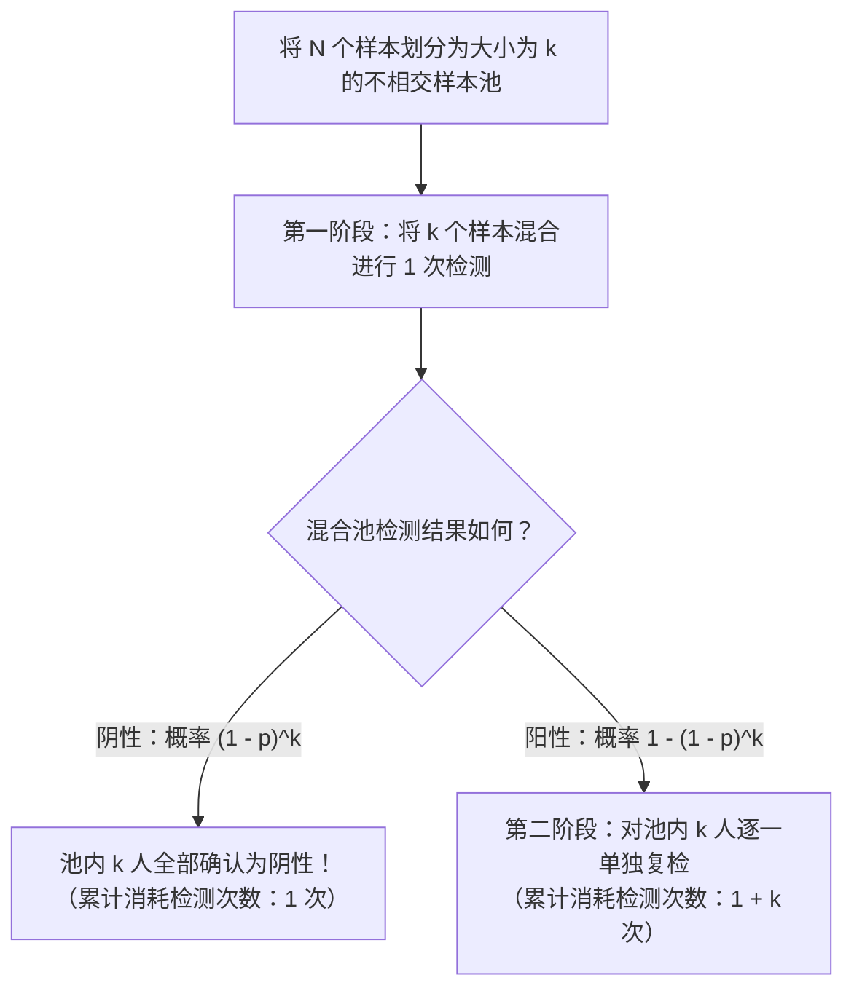
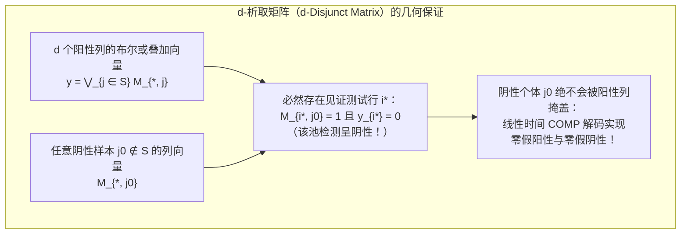

假设在 $1,000$ 人的群体中，恰好隐藏着 $1$ 名某种传染病的阳性感染者。为了以 $100\%$ 的准确率找出这名阳性个体，至少需要进行多少次检测？

直觉告诉我们需要逐一检测全部 $1,000$ 人，即进行 $1,000$ 次检测。然而，数学与信息论给出了截然不同的答案：如果我们允许将多人的生物样本混合（Pooling）在一起检测“混合样本中是否至少含有一名阳性个体”，那么<strong>采用分步缩小的自适应策略（Adaptive Group Testing）只需区区 $10$ 次检测</strong>；更令人惊叹的是，<strong>即便在检测开始前就完全固定所有混合方案、将全部检测在同一批次并行完成（非自适应群测试，Non-Adaptive Group Testing），也仅仅需要几十次检测</strong>就能一步到位地精准锁定阳性感染者。

这一看似魔术的方法，正是横跨数理统计、离散数学、编码理论与信息论的<strong>群测试（Group Testing，又称分组检测或混检）</strong>与<strong>组合搜索（Combinatorial Search）</strong>理论。本文将从1943年罗伯特·多夫曼（Robert Dorfman）的二战奠基论文出发，严格推导香农信息论下界，对比“12枚假币天平称重问题”与黄光明（Frank K. Hwang）广义二分搜索，剖析考茨与辛格尔顿（Kautz & Singleton）提出的<strong>析取矩阵（Disjunct Matrix / 叠加码）</strong>与有限域里德-所罗门（Reed-Solomon）多项式设计，并揭示其与现代<strong>压缩感知（Compressed Sensing）</strong>、多址通信冲突消解以及 COVID-19 高通量 P-BEST 核酸混检之间的深刻数学对偶性。

---

## 1. 1943年的战时突破：多夫曼二阶段混检法（Dorfman Pooling）

### 1.1 二战征兵筛查与瓦氏血液检测瓶颈

群测试的数学史始于1943年12月。当时美国统计学家<strong>罗伯特·多夫曼（Robert Dorfman）</strong>在《数理统计年鉴》（*The Annals of Mathematical Statistics*）上发表了一篇仅6页却影响深远的论文——*"The Detection of Defective Members of Large Populations"*（大规模群体中缺陷个体的检测）。

第二次世界大战期间，美国陆军需要对数百万应征入伍的新兵进行梅毒（Syphilis）筛查。当时的标准检测手段是瓦氏反应血液检测（Wassermann test），不仅试剂昂贵、操作繁琐，而且在新兵群体中梅毒的真实患病率 $p$ 极低（通常在 $p \approx 0.01$ 到 $p \approx 0.001$ 之间）。这意味着如果对每个人单独验血，<strong>超过 $99\%$ 的检测资源都耗费在“确认健康人为阴性”这一重复劳动上</strong>。

多夫曼提出了一个极具洞察力的两阶段方案：不再逐一检测，而是将 $N$ 名新兵按每组 $k$ 人划分为若干个不相交的样本池（Pool），将同组 $k$ 人的血清各取一部分混合在一支试管中进行检测。

### 1.2 多夫曼二阶段算法流程

假设群体总人数为 $N$，每个个体独立地以概率 $p$ 呈阳性（$1$），以概率 $q = 1 - p$ 呈阴性（$0$）。多夫曼二阶段混检法对每个大小为 $k$ 的样本池执行以下两步：

1. <strong>第一阶段（混合池初筛）</strong>：将池内 $k$ 个样本混合，仅进行 $1$ 次检测。
   - <strong>若混合池呈阴性（Negative）</strong>（概率为 $(1 - p)^k$）：说明这 $k$ 个人全部为阴性！<strong>仅用 $1$ 次检测就排除了 $k$ 个人的感染可能，该组检测直接结束。</strong>
   - <strong>若混合池呈阳性（Positive）</strong>（概率为 $1 - (1 - p)^k$）：说明这 $k$ 人中至少有 $1$ 人为阳性，进入第二阶段。
2. <strong>第二阶段（个体复核）</strong>：对呈阳性的混合池内的全部 $k$ 个原始留存样本逐一进行单独检测（共消耗 $1 + k$ 次检测），从而精确定位所有阳性个体。

### 1.3 期望检测次数推导与最优池大小 $k^*$ 的解析解

如何选择每组的人数 $k$ 才能使总期望检测次数最少？若 $k$ 太小，第一阶段的混合池数量过多；若 $k$ 太大，几乎每个混合池都会包含至少一名阳性感染者而呈阳性，导致几乎所有人都要进行第二阶段复检。

对于一个大小为 $k$ 的样本池，其消耗的检测次数 $T_{\text{pool}}$ 的数学期望为：

$$\mathbb{E}[T_{\text{pool}}] = 1 \cdot (1 - p)^k + (1 + k)\left[1 - (1 - p)^k\right] = 1 + k\left[1 - (1 - p)^k\right]$$

将其除以池大小 $k$，即得到<strong>人均期望检测次数 $f(k) = \frac{\mathbb{E}[T]}{N}$</strong>（当 $k \ge 2$ 时）：

$$f(k) = \frac{\mathbb{E}[T]}{N} = \frac{1}{k} + 1 - (1 - p)^k$$

当患病率 $p \ll 1$（且 $kp \ll 1$）时，利用一阶泰勒展开（二项近似）$(1 - p)^k \approx 1 - kp$，上式简化为：

$$f(k) \approx \frac{1}{k} + k p$$

利用均值不等式（AM-GM 不等式）或对 $k$ 求导并令导数为零，立即求得最优池大小 $k^*$ 与最小人均检测次数：

$$\frac{d}{dk}\left(\frac{1}{k} + kp\right) = -\frac{1}{k^2} + p = 0 \implies k^* \approx \frac{1}{\sqrt{p}}, \qquad \frac{\mathbb{E}[T]_{\min}}{N} \approx 2\sqrt{p}$$

让我们代入具体数值感受这一平方根法则的威力：
- <strong>当患病率 $p = 0.01$（$1\%$ 阳性率）时</strong>：最优池大小 $k^* \approx \frac{1}{\sqrt{0.01}} = 10$ 人（精确离散最优解为 $k^* = 11$）。此时人均检测次数仅为 $\frac{\mathbb{E}[T]}{N} \approx 2\sqrt{0.01} = 0.20$ 次（精确值为 $0.1956$ 次）。这意味着<strong>筛查 $1,000$ 人只需要约 $200$ 次（精确为 $196$ 次）检测，直接节省了 $80\%$ 的检测量</strong>！
- <strong>当患病率 $p = 0.0001$（万分之一阳性率）时</strong>：最优池大小 $k^* \approx \frac{1}{\sqrt{0.0001}} = 100$ 人，人均检测次数降至 $\frac{\mathbb{E}[T]}{N} \approx 2\sqrt{0.0001} = 0.02$ 次。<strong>筛查 $10,000$ 人仅需 $200$ 次检测，消除了整整 $98\%$ 的检测成本</strong>！

| 患病率 $p$ | 阳性比例 | 渐近最优池大小 $1/\sqrt{p}$ | 精确最优池大小 $k^*$ | 人均期望检测数 $\mathbb{E}[T]/N$（精确值） | 每 $1,000$ 人期望检测次数 | 节省检测比例 |
| :--- | :--- | :--- | :--- | :--- | :--- | :--- |
| $p = 0.10$ | $1/10$ | $3.16$ | $4$ 人 | $0.5939$ | $594$ 次 | 节省 $40.6\%$ |
| $p = 0.05$ | $1/20$ | $4.47$ | $5$ 人 | $0.4262$ | $426$ 次 | 节省 $57.4\%$ |
| $p = 0.01$ | $1/100$ | $10.0$ | $11$ 人 | $0.1956$ | $196$ 次 | <strong>节省 $80.4\%$</strong> |
| $p = 0.001$ | $1/1,000$ | $31.6$ | $32$ 人 | $0.0628$ | $63$ 次 | <strong>节省 $93.7\%$</strong> |
| $p = 0.0001$ | $1/10,000$ | $100.0$ | $101$ 人 | $0.01995$ | $20$ 次 | <strong>节省 $98.0\%$</strong> |

---

## 2. 香农信息论下界：检测次数最少能压缩到多少？

多夫曼方法将人均检测数从 $1$ 降到了 $2\sqrt{p}$（当总阳性人数为 $d = Np$ 时，总检测数为 $2\sqrt{Nd}$）。但如果允许使用任意多阶段或任意复杂的组合设计，<strong>宇宙物理定律所允许的绝对最少检测次数是多少？</strong>

1. <strong>组合模型下的计数下界（Counting Bound）</strong>：
   假设 $N$ 个样本中恰好有 $d$ 个阳性样本（未知阳性集合 $S \subset [N], |S| = d$）。共有 $\binom{N}{d}$ 种可能的阳性集合。每次二元检测的输出仅为 $\{0, 1\}$（阴性或阳性），最多提供 $1$ 比特（bit）的香农信息量。经过 $T$ 次检测后，结果向量 $\mathbf{y} \in \{0, 1\}^T$ 最多有 $2^T$ 种可能取值。由鸽巢原理，要唯一区分所有 $\binom{N}{d}$ 种状态，必须满足：
   $$2^T \ge \binom{N}{d} \implies T \ge \log_2 \binom{N}{d} \approx d \log_2 \frac{N}{d} + O(d)$$
2. <strong>概率模型下的香农熵下界（Shannon Entropy Bound）</strong>：
   若每个个体独立以概率 $p$ 呈阳性，则总体状态向量 $\mathbf{X} \in \{0, 1\}^N$ 的联合香农熵为 $H(\mathbf{X}) = N H_2(p)$。由于每次检测最多提取 $1$ 比特信息，任何无差错群测试算法的期望检测次数必满足：
   $$\frac{\mathbb{E}[T]}{N} \ge H_2(p) = -p\log_2 p - (1-p)\log_2(1-p)$$

以 $N = 1,000, d = 1$（$p = 0.001$）为例：单独检测需 $1,000$ 次，多夫曼二阶段法需 $63$ 次，而信息论下界仅为 $\lceil \log_2 1000 \rceil = \mathbf{10}$ <strong>次</strong>！

---

## 3. 自适应群测试 vs. 非自适应群测试两大范式

### 3.1 自适应群测试：黄氏广义二分搜索与“12枚假币问题”

在<strong>自适应群测试（Adaptive Group Testing）</strong>中，每一次检测都可以根据前一次检测的结果动态调整样本池：
- 当 $d = 1$ 时，经典的<strong>二分搜索（Binary Splitting）</strong>每次将候选集对半切分，每次检测阳性与阴性概率均为 $1/2$（满载 $1$ 比特信息），仅需 $\lceil \log_2 N \rceil$ 次（$1,000$ 人仅需 $10$ 次）即可锁定阳性者。
- 当 $d > 1$ 时，<strong>黄光明（Frank K. Hwang, 1972）的广义二分搜索算法（Generalized Binary Splitting）</strong>每次从剩余 $n$ 个样本中切出大小为 $2^\alpha \approx n/d$ 的子池进行测试（使得该池呈阴性的概率接近 $1/2$）。若呈阴性则一次排除 $2^\alpha$ 人；若呈阳性则在该子池内进行 $\alpha$ 次二分搜索找出 $1$ 名阳性者。总检测次数达到 $T = d \log_2(N/d) + O(d)$，完美逼近信息论下界！

这一“最大化单次测试信息熵”的思想在1945年著名的<strong>“12枚假币天平问题”</strong>中得到了最精彩的展现：12枚硬币中有1枚假币（不知偏重还是偏轻，共 $12 \times 2 = 24$ 种可能状态）。天平每次称重具有左倾（$-1$）、平衡（$0$）、右倾（$+1$）三种输出（三元测试，每次最多提供 $\log_2 3 \approx 1.585$ 比特信息），因此 $3$ 次称重最多可区分 $3^3 = 27 \ge 24$ 种状态。若第一次在左右盘各放6枚，天平必然倾斜（不可能平衡），三元测试退化为二元测试（剩12种状态 $> 3^2 = 9$），导致无解；唯有第一次在<strong>左盘放4枚、右盘放4枚、盘外留4枚</strong>，将24种状态均匀分割为 $8 : 8 : 8$ 三支，并在第二次称重时将“疑似偏重”与“疑似偏轻”的硬币在左右盘之间交叉轮换，才能在3次内100%锁定假币及其轻重！

<strong>自适应方法的致命工程瓶颈</strong>：在 RT-PCR 核酸检测或基因测序中，每一轮 PCR 扩增需要 $2 \sim 3$ 小时。若对 $1,000$ 个样本执行 $10$ 轮自适应二分搜索，必须串行等待 $10 \times 3 = 30$ 小时，且反复开盖移液极易造成气溶胶交叉污染。因此，实际高通量筛查迫切需要将所有测试在<strong>同一轮（单阶段）并行完成</strong>！

---

## 4. 非自适应组合群测试（NAGT）与析取矩阵（Disjunct Matrix）

### 4.1 布尔测试矩阵 $\mathbf{M}$ 与逻辑或（OR）叠加模型

1964年，<strong>考茨与辛格尔顿（Kautz & Singleton）</strong>创立了<strong>非自适应群测试（NAGT）</strong>与叠加码（Superimposed Codes）的代数理论。我们将 $T$ 次并行混检与 $N$ 个样本的关系表示为一个 $T \times N$ 的二元<strong>测试矩阵 $\mathbf{M} \in \{0, 1\}^{T \times N}$</strong>，其中 $M_{i, j} = 1$ 表示样本 $j$ 被加入第 $i$ 个混合池。

设未知的个体状态向量为 $\mathbf{x} \in \{0, 1\}^N$（阳性集合 $S = \{j \mid x_j = 1\}, |S| \le d$），则观测到的 $T$ 维检测结果向量 $\mathbf{y} \in \{0, 1\}^T$ 是矩阵 $\mathbf{M}$ 中对应于阳性集合 $S$ 的各列向量的<strong>按位布尔逻辑或（Boolean OR）叠加</strong>：

$$\mathbf{y} = \mathbf{M} \odot \mathbf{x} = \bigvee_{j \in S} \mathbf{M}_{*, j} \quad \left(y_i = \bigvee_{j=1}^N (M_{i, j} \land x_j)\right)$$

### 4.2 $d$-可分矩阵 vs. $d$-析取矩阵（$d$-Disjunct Matrix）与 COMP 解码

- <strong>$d$-可分矩阵（$d$-Separable Matrix）</strong>：任意两个不同的大小不超过 $d$ 的列子集 $S_1 \neq S_2$ 的逻辑或叠加结果均不相同。虽然信息论上可唯一还原 $S$，但解码需要遍历 $\binom{N}{d}$ 种组合，计算复杂度高达 $O(N^d)$。
- <strong>$d$-析取矩阵（$d$-Disjunct Matrix）</strong>：任意一个列 $j_0 \notin S$ 的非零位置集合（支撑集 $\text{supp}(\mathbf{M}_{*, j_0})$），<strong>绝不完全包含于任意其他 $d$ 个列的支撑集之并</strong>：
  $$\text{supp}(\mathbf{M}_{*, j_0}) \not\subseteq \bigcup_{j \in S} \text{supp}(\mathbf{M}_{*, j}) \qquad (\forall |S| \le d, \; \forall j_0 \notin S)$$
  这意味着：<strong>对于每一个阴性个体 $j_0 \notin S$，必定至少存在一个“见证测试行 $i^*$”，使得 $j_0$ 参与了测试 $i^*$（$M_{i^*, j_0} = 1$），而所有 $d$ 名阳性个体均未参与测试 $i^*$（从而测试 $i^*$ 的结果必为阴性 $y_{i^*} = 0$）！</strong>

凭借 $d$-析取性质，我们可以使用极简的 <strong>COMP（组合正交匹配追踪）算法</strong>在 $O(TN)$ 线性时间内完成解码：<strong>凡是参与过任何一次阴性测试（$y_i = 0$）的样本全部排除为阴性，剩余未被排除的样本即100%为全部真阳性个体！</strong> 组合学定理（D'yachkov-Rykov / Ruszinkó / Füredi）证明了零误差 $d$-析取矩阵的行数下界为 $T = \Omega\left(\frac{d^2}{\log d} \log N\right)$，而概率构造与显式构造均可达到 $T = O(d^2 \log N)$。

### 4.3 二维网格混检的“幽灵阳性”与有限域里德-所罗门多项式设计

在实验室中，若将 $N = 100$ 个样本排成 $10 \times 10$ 网格，按 $10$ 行与 $10$ 列分别混合得到 $T = 20$ 个测试池：当只有 $d = 1$ 名阳性（如坐标 $(3, 7)$）时，第3行与第7列呈阳性，交点唯一确定阳性者（$1$-析取矩阵）。但若有 $d = 2$ 名阳性位于 $(2, 4)$ 和 $(6, 9)$，则行 $R_2, R_6$ 与列 $C_4, C_9$ 均呈阳性，除了真阳性外，<strong>对角交点 $(2, 9)$ 和 $(6, 4)$ 也会出现“行与列皆为阳性”的假象（幽灵阳性 / 影子阳性）</strong>！

为了彻底消除幽灵阳性，Kautz 与 Singleton 提出了<strong>有限域 $\mathbb{F}_q$ 上的里德-所罗门（Reed-Solomon）多项式混检设计</strong>：将每个样本 $j$ 映射为有限域 $\mathbb{F}_q$ 上次数不超过 $k-1$ 的多项式 $P_j(x) \in \mathbb{F}_q[x]$（共可容纳 $N = q^k$ 个样本），并在 $w$ 个不同方向（求值点 $x_1, \dots, x_w \in \mathbb{F}_q$）上按照 $y = P_j(x_m) \pmod q$ 进行分组混检。因为两个不同 $(k-1)$ 次多项式至多在 $k-1$ 个点相交，只要选取方向数满足 $w \ge d(k-1) + 1$（例如 $q=11, k=2$ 时仅取横行、纵列、斜对角线 $w=3$ 个方向共 $T = 33$ 个测试池），就能在单轮测试中无歧义地分离任意 $d=2$ 名阳性者！

---

## 5. 噪声群测试、压缩感知与现代工程应用

| 维度 / 特征 | 自适应群测试（Hwang 二分搜索） | 非自适应群测试（NAGT / $d$-析取矩阵） | 压缩感知（Compressed Sensing） |
| :--- | :--- | :--- | :--- |
| <strong>代数运算空间</strong> | 布尔逻辑树 $(\{0, 1\}, \lor, \land)$ | 布尔半环矩阵乘法 $\mathbf{y} = \mathbf{M} \odot \mathbf{x}$ | 实数域线性投影 $\mathbf{y} = \mathbf{\Phi}\mathbf{x} + \mathbf{e} \in \mathbb{R}^T$ |
| <strong>矩阵几何条件</strong> | 动态平衡二分（每步信息熵 $\approx 1$ bit） | <strong>$d$-析取性（$d$-Disjunctness）</strong> | <strong>有限等距性质（RIP）</strong> / 低互相关 |
| <strong>最少测试次数 $T$</strong> | $d \log_2(N/d) + O(d)$（达到香农下界） | $O(d^2 \log N)$（零误差）/ $O(d \log N)$（高概率） | $O(d \log(N/d))$ |
| <strong>核心解码算法</strong> | 序贯二分搜索树 | <strong>COMP / DD / SCOMP / 置信传播（BP）</strong> | <strong>OMP / 基追踪（$\ell_1$ 最小化 LASSO）</strong> |

1. <strong>稀释效应与抗噪群测试（Noisy Group Testing）</strong>：针对混合过多样本导致病毒浓度稀释（PCR 的 $\text{Ct}$ 值上升 $\log_2 k$）及假阴性/假阳性噪声，通过构造具有 $2e+1$ 个见证行的容错析取矩阵并结合 <strong>NCOMP 算法</strong>、<strong>置信传播（Belief Propagation）</strong>或<strong>线性规划解码（LP Decoding）</strong>，可自动纠正多达 $e$ 次检测错误。
2. <strong>与压缩感知（Compressed Sensing）的对偶性</strong>：坎德斯（Candès）、陶哲轩（Tao）与多诺霍（Donoho）建立的压缩感知理论，本质上是将群测试从布尔逻辑或（OR）推广到了实数域上的稀疏线性测量 $\mathbf{y} = \mathbf{\Phi}\mathbf{x}$。当利用 PCR 荧光定量 $\text{Ct}$ 值进行<strong>定量群测试（Quantitative Group Testing）</strong>时，测试次数可突破 $d^2 \log N$ 瓶颈，进一步压缩至 $O(d \log(N/d))$。
3. <strong>多址信道冲突消解与 COVID-19 P-BEST 筛查</strong>：从无线通信中的树形冲突分解协议（Capetanakis, 1979）、高速路由器识别大流量的 Count-Min Sketch，到 2020 年以色列团队发表于 *Science Advances* 的 <strong>P-BEST 新冠核酸混检方案</strong>（利用 $48 \times 384$ 的 Kautz-Singleton 矩阵，仅用 $48$ 个测试池在单轮 PCR 中同时筛查 $384$ 人，通量提升 $8$ 倍），群测试与组合搜索的数学智慧正在现代信息与生命科学中持续闪耀。
