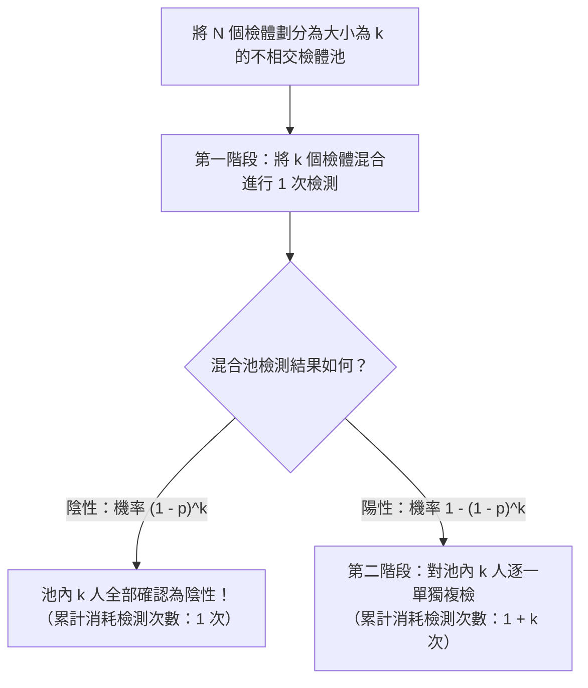
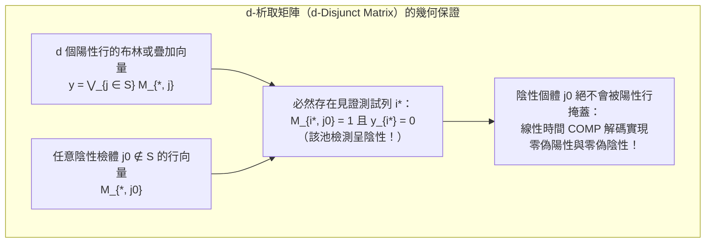

假設在 $1,000$ 人的群體中，恰好隱藏著 $1$ 名某種傳染病的陽性感染者。為了以 $100\%$ 的準確率找出這名陽性個體，至少需要進行多少次檢測？

直覺告訴我們需要逐一檢測全部 $1,000$ 人，即進行 $1,000$ 次檢測。然而，數學與資訊理論給出了截然不同的答案：如果我們允許將多人的生物檢體混合（Pooling）在一起檢測「混合檢體中是否至少含有一名陽性個體」，那麼<strong>採用分步縮小的自適應策略（Adaptive Group Testing）只需區區 $10$ 次檢測</strong>；更令人驚嘆的是，<strong>即便在檢測開始前就完全固定所有混合方案、將全部檢測在同一批次平行完成（非自適應群測試，Non-Adaptive Group Testing），也僅僅需要幾十次檢測</strong>就能一步到位地精準鎖定陽性感染者。

這一看似魔術的方法，正是橫跨數理統計、離散數學、編碼理論與資訊理論的<strong>群測試（Group Testing，又稱分組檢測或池化檢驗）</strong>與<strong>組合搜尋（Combinatorial Search）</strong>理論。本文將從1943年羅伯特·多夫曼（Robert Dorfman）的二戰奠基論文出發，嚴格推導香農資訊理論下界，對比「12枚假幣天平稱重問題」與黃光明（Frank K. Hwang）廣義二分搜尋，剖析考茨與辛格爾頓（Kautz & Singleton）提出的<strong>析取矩陣（Disjunct Matrix / 疊加碼）</strong>與有限體里德-所羅門（Reed-Solomon）多項式設計，並揭示其與現代<strong>壓縮感知（Compressed Sensing）</strong>、多址通訊碰撞消解以及 COVID-19 高通量 P-BEST 核酸混檢之間的深刻數學對偶性。

---

## 1. 1943年的戰時突破：多夫曼二階段池化檢驗法（Dorfman Pooling）

### 1.1 二戰徵兵篩檢與瓦氏血液檢測瓶頸

群測試的數學史始於1943年12月。當時美國統計學家<strong>羅伯特·多夫曼（Robert Dorfman）</strong>在《數理統計年鑑》（*The Annals of Mathematical Statistics*）上發表了一篇僅6頁卻影響深遠的論文——*"The Detection of Defective Members of Large Populations"*（大規模母體中缺陷成員的檢測）。

第二次世界大戰期間，美國陸軍需要對數百萬應徵入伍的新兵進行梅毒（Syphilis）篩檢。當時的標準檢測手段是瓦氏反應血液檢測（Wassermann test），不僅試劑昂貴、操作繁瑣，而且在新兵群體中梅毒的真實盛行率 $p$ 極低（通常在 $p \approx 0.01$ 到 $p \approx 0.001$ 之間）。這意味著如果對每個人單獨驗血，<strong>超過 $99\%$ 的檢測資源都耗費在「確認健康人為陰性」這一重複勞動上</strong>。

多夫曼提出了一個極具洞察力的兩階段方案：不再逐一檢測，而是將 $N$ 名新兵按每組 $k$ 人劃分為若干個不相交的檢體池（Pool），將同組 $k$ 人的血清各取一部分混合在一支試管中進行檢測。

### 1.2 多夫曼二階段演算法流程

假設母體總人數為 $N$，每個個體獨立地以機率 $p$ 呈陽性（$1$），以機率 $q = 1 - p$ 呈陰性（$0$）。多夫曼二階段混檢法對每個大小為 $k$ 的檢體池執行以下兩步：

1. <strong>第一階段（混合池初篩）</strong>：將池內 $k$ 個檢體混合，僅進行 $1$ 次檢測。
   - <strong>若混合池呈陰性（Negative）</strong>（機率為 $(1 - p)^k$）：說明這 $k$ 個人全部為陰性！<strong>僅用 $1$ 次檢測就排除了 $k$ 個人的感染可能，該組檢測直接結束。</strong>
   - <strong>若混合池呈陽性（Positive）</strong>（機率為 $1 - (1 - p)^k$）：說明這 $k$ 人中至少有 $1$ 人為陽性，進入第二階段。
2. <strong>第二階段（個體複核）</strong>：對呈陽性的混合池內的全部 $k$ 個原始留存檢體逐一進行單獨檢測（共消耗 $1 + k$ 次檢測），從而精確定位所有陽性個體。

### 1.3 期望檢測次數推導與最佳池大小 $k^*$ 的解析解

如何選擇每組的人數 $k$ 才能使總期望檢測次數最少？若 $k$ 太小，第一階段的混合池數量過多；若 $k$ 太大，幾乎每個混合池都會包含至少一名陽性感染者而呈陽性，導致幾乎所有人都要進行第二階段複檢。

對於一個大小為 $k$ 的檢體池，其消耗的檢測次數 $T_{\text{pool}}$ 的數學期望值為：

$$\mathbb{E}[T_{\text{pool}}] = 1 \cdot (1 - p)^k + (1 + k)\left[1 - (1 - p)^k\right] = 1 + k\left[1 - (1 - p)^k\right]$$

將其除以池大小 $k$，即得到<strong>人均期望檢測次數 $f(k) = \frac{\mathbb{E}[T]}{N}$</strong>（當 $k \ge 2$ 時）：

$$f(k) = \frac{\mathbb{E}[T]}{N} = \frac{1}{k} + 1 - (1 - p)^k$$

當盛行率 $p \ll 1$（且 $kp \ll 1$）時，利用一階泰勒展開（二項近似）$(1 - p)^k \approx 1 - kp$，上式簡化為：

$$f(k) \approx \frac{1}{k} + k p$$

利用算術幾何平均不等式（AM-GM 不等式）或對 $k$ 求導並令導數為零，立即求得最佳池大小 $k^*$ 與最小人均檢測次數：

$$\frac{d}{dk}\left(\frac{1}{k} + kp\right) = -\frac{1}{k^2} + p = 0 \implies k^* \approx \frac{1}{\sqrt{p}}, \qquad \frac{\mathbb{E}[T]_{\min}}{N} \approx 2\sqrt{p}$$

讓我們代入具體數值感受這一平方根法則的威力：
- <strong>當盛行率 $p = 0.01$（$1\%$ 陽性率）時</strong>：最佳池大小 $k^* \approx \frac{1}{\sqrt{0.01}} = 10$ 人（精確離散最佳解為 $k^* = 11$）。此時人均檢測次數僅為 $\frac{\mathbb{E}[T]}{N} \approx 2\sqrt{0.01} = 0.20$ 次（精確值為 $0.1956$ 次）。這意味著<strong>篩檢 $1,000$ 人只需要約 $200$ 次（精確為 $196$ 次）檢測，直接節省了 $80\%$ 的檢測量</strong>！
- <strong>當盛行率 $p = 0.0001$（萬分之一陽性率）時</strong>：最佳池大小 $k^* \approx \frac{1}{\sqrt{0.0001}} = 100$ 人，人均檢測次數降至 $\frac{\mathbb{E}[T]}{N} \approx 2\sqrt{0.0001} = 0.02$ 次。<strong>篩檢 $10,000$ 人僅需 $200$ 次檢測，消除了整整 $98\%$ 的檢測成本</strong>！

| 盛行率 $p$ | 陽性比例 | 漸近最佳池大小 $1/\sqrt{p}$ | 精確最佳池大小 $k^*$ | 人均期望檢測數 $\mathbb{E}[T]/N$（精確值） | 每 $1,000$ 人期望檢測次數 | 節省檢測比例 |
| :--- | :--- | :--- | :--- | :--- | :--- | :--- |
| $p = 0.10$ | $1/10$ | $3.16$ | $4$ 人 | $0.5939$ | $594$ 次 | 節省 $40.6\%$ |
| $p = 0.05$ | $1/20$ | $4.47$ | $5$ 人 | $0.4262$ | $426$ 次 | 節省 $57.4\%$ |
| $p = 0.01$ | $1/100$ | $10.0$ | $11$ 人 | $0.1956$ | $196$ 次 | <strong>節省 $80.4\%$</strong> |
| $p = 0.001$ | $1/1,000$ | $31.6$ | $32$ 人 | $0.0628$ | $63$ 次 | <strong>節省 $93.7\%$</strong> |
| $p = 0.0001$ | $1/10,000$ | $100.0$ | $101$ 人 | $0.01995$ | $20$ 次 | <strong>節省 $98.0\%$</strong> |

---

## 2. 香農資訊理論下界：檢測次數最少能壓縮到多少？

多夫曼方法將人均檢測數從 $1$ 降到了 $2\sqrt{p}$（當總陽性人數為 $d = Np$ 時，總檢測數為 $2\sqrt{Nd}$）。但如果允許使用任意多階段或任意複雜的組合設計，<strong>物理定律所允許的絕對最少檢測次數是多少？</strong>

1. <strong>組合模型下的計數下界（Counting Bound）</strong>：
   假設 $N$ 個檢體中恰好有 $d$ 個陽性檢體（未知陽性集合 $S \subset [N], |S| = d$）。共有 $\binom{N}{d}$ 種可能的陽性集合。每次二元檢測的輸出僅為 $\{0, 1\}$（陰性或陽性），最多提供 $1$ 位元（bit）的香農資訊量。經過 $T$ 次檢測後，結果向量 $\mathbf{y} \in \{0, 1\}^T$ 最多有 $2^T$ 種可能取值。由鴿籠原理，要唯一區分所有 $\binom{N}{d}$ 種狀態，必須滿足：
   $$2^T \ge \binom{N}{d} \implies T \ge \log_2 \binom{N}{d} \approx d \log_2 \frac{N}{d} + O(d)$$
2. <strong>機率模型下的香農熵下界（Shannon Entropy Bound）</strong>：
   若每個個體獨立以機率 $p$ 呈陽性，則母體狀態向量 $\mathbf{X} \in \{0, 1\}^N$ 的聯合香農熵為 $H(\mathbf{X}) = N H_2(p)$。由於每次檢測最多提取 $1$ 位元資訊，任何無差錯群測試演算法的期望檢測次數必滿足：
   $$\frac{\mathbb{E}[T]}{N} \ge H_2(p) = -p\log_2 p - (1-p)\log_2(1-p)$$

以 $N = 1,000, d = 1$（$p = 0.001$）為例：單獨檢測需 $1,000$ 次，多夫曼二階段法需 $63$ 次，而資訊理論下界僅為 $\lceil \log_2 1000 \rceil = \mathbf{10}$ <strong>次</strong>！

---

## 3. 自適應群測試 vs. 非自適應群測試兩大範式

### 3.1 自適應群測試：黃氏廣義二分搜尋與「12枚假幣問題」

在<strong>自適應群測試（Adaptive Group Testing）</strong>中，每一次檢測都可以根據前一次檢測的結果動態調整檢體池：
- 當 $d = 1$ 時，經典的<strong>二分搜尋（Binary Splitting）</strong>每次將候選集對半切分，每次檢測陽性與陰性機率均為 $1/2$（滿載 $1$ 位元資訊），僅需 $\lceil \log_2 N \rceil$ 次（$1,000$ 人僅需 $10$ 次）即可鎖定陽性者。
- 當 $d > 1$ 時，<strong>黃光明（Frank K. Hwang, 1972）的廣義二分搜尋演算法（Generalized Binary Splitting）</strong>每次從剩餘 $n$ 個檢體中切出大小為 $2^\alpha \approx n/d$ 的子池進行測試（使得該池呈陰性的機率接近 $1/2$）。若呈陰性則一次排除 $2^\alpha$ 人；若呈陽性則在該子池內進行 $\alpha$ 次二分搜尋找出 $1$ 名陽性者。總檢測次數達到 $T = d \log_2(N/d) + O(d)$，完美逼近資訊理論下界！

這一「最大化單次測試資訊熵」的思想在1945年著名的<strong>「12枚假幣天平問題」</strong>中得到了最精彩的展現：12枚硬幣中有1枚假幣（不知偏重還是偏輕，共 $12 \times 2 = 24$ 種可能狀態）。天平每次稱重具有左傾（$-1$）、平衡（$0$）、右傾（$+1$）三種輸出（三元測試，每次最多提供 $\log_2 3 \approx 1.585$ 位元資訊），因此 $3$ 次稱重最多可區分 $3^3 = 27 \ge 24$ 種狀態。若第一次在左右盤各放6枚，天平必然傾斜（不可能平衡），三元測試退化為二元測試（剩12種狀態 $> 3^2 = 9$），導致無解；唯有第一次在<strong>左盤放4枚、右盤放4枚、盤外留4枚</strong>，將24種狀態均勻分割為 $8 : 8 : 8$ 三支，並在第二次稱重時將「疑似偏重」與「疑似偏輕」的硬幣在左右盤之間交叉輪換，才能在3次內100%鎖定假幣及其輕重！

<strong>自適應方法的致命工程瓶頸</strong>：在 RT-PCR 核酸檢測或基因定序中，每一輪 PCR 擴增需要 $2 \sim 3$ 小時。若對 $1,000$ 個檢體執行 $10$ 輪自適應二分搜尋，必須串列等待 $10 \times 3 = 30$ 小時，且反覆開蓋移液極易造成交叉污染。因此，實際高通量篩檢迫切需要將所有測試在<strong>同一輪（單階段）平行完成</strong>！

---

## 4. 非自適應組合群測試（NAGT）與析取矩陣（Disjunct Matrix）

### 4.1 布林測試矩陣 $\mathbf{M}$ 與邏輯或（OR）疊加模型

1964年，<strong>考茨與辛格爾頓（Kautz & Singleton）</strong>創立了<strong>非自適應群測試（NAGT）</strong>與疊加碼（Superimposed Codes）的代數理論。我們將 $T$ 次平行混檢與 $N$ 個檢體的關係表示為一個 $T \times N$ 的二元<strong>測試矩陣 $\mathbf{M} \in \{0, 1\}^{T \times N}$</strong>，其中 $M_{i, j} = 1$ 表示檢體 $j$ 被加入第 $i$ 個混合池。

設未知的個體狀態向量為 $\mathbf{x} \in \{0, 1\}^N$（陽性集合 $S = \{j \mid x_j = 1\}, |S| \le d$），則觀測到的 $T$ 維檢測結果向量 $\mathbf{y} \in \{0, 1\}^T$ 是矩陣 $\mathbf{M}$ 中對應於陽性集合 $S$ 的各行向量（column vectors）的<strong>按位元布林邏輯或（Boolean OR）疊加</strong>：

$$\mathbf{y} = \mathbf{M} \odot \mathbf{x} = \bigvee_{j \in S} \mathbf{M}_{*, j} \quad \left(y_i = \bigvee_{j=1}^N (M_{i, j} \land x_j)\right)$$

### 4.2 $d$-可分矩陣 vs. $d$-析取矩陣（$d$-Disjunct Matrix）與 COMP 解碼

- <strong>$d$-可分矩陣（$d$-Separable Matrix）</strong>：任意兩個不同的大小不超過 $d$ 的行子集 $S_1 \neq S_2$ 的邏輯或疊加結果均不相同。雖然資訊理論上可唯一還原 $S$，但解碼需要遍歷 $\binom{N}{d}$ 種組合，計算複雜度高達 $O(N^d)$。
- <strong>$d$-析取矩陣（$d$-Disjunct Matrix）</strong>：任意一個行 $j_0 \notin S$ 的非零位置集合（支撐集 $\text{supp}(\mathbf{M}_{*, j_0})$），<strong>絕不完全包含於任意其他 $d$ 個行的支撐集之聯集</strong>：
  $$\text{supp}(\mathbf{M}_{*, j_0}) \not\subseteq \bigcup_{j \in S} \text{supp}(\mathbf{M}_{*, j}) \qquad (\forall |S| \le d, \; \forall j_0 \notin S)$$
  這意味著：<strong>對於每一個陰性個體 $j_0 \notin S$，必定至少存在一個「見證測試列 $i^*$」，使得 $j_0$ 參與了測試 $i^*$（$M_{i^*, j_0} = 1$），而所有 $d$ 名陽性個體均未參與測試 $i^*$（從而測試 $i^*$ 的結果必為陰性 $y_{i^*} = 0$）！</strong>

憑藉 $d$-析取性質，我們可以使用極簡的 <strong>COMP（組合正交匹配追蹤）演算法</strong>在 $O(TN)$ 線性時間內完成解碼：<strong>凡是參與過任何一次陰性測試（$y_i = 0$）的檢體全部排除為陰性，剩餘未被排除的檢體即100%為全部真陽性個體！</strong> 組合學定理（D'yachkov-Rykov / Ruszinkó / Füredi）證明了零誤差 $d$-析取矩陣的列數下界為 $T = \Omega\left(\frac{d^2}{\log d} \log N\right)$，而機率構造與顯式構造均可達到 $T = O(d^2 \log N)$。

### 4.3 二維網格混檢的「幽靈陽性」與有限體里德-所羅門多項式設計

在實驗室中，若將 $N = 100$ 個檢體排成 $10 \times 10$ 網格，按 $10$ 橫列與 $10$ 直行分別混合得到 $T = 20$ 個測試池：當只有 $d = 1$ 名陽性（如座標 $(3, 7)$）時，第3列與第7行呈陽性，交點唯一確定陽性者（$1$-析取矩陣）。但若有 $d = 2$ 名陽性位於 $(2, 4)$ 和 $(6, 9)$，則橫列 $R_2, R_6$ 與直行 $C_4, C_9$ 均呈陽性，除了真陽性外，<strong>對角交點 $(2, 9)$ 和 $(6, 4)$ 也會出現「橫列與直行皆為陽性」的假象（幽靈陽性 / 影子陽性）</strong>！

為了徹底消除幽靈陽性，Kautz 與 Singleton 提出了<strong>有限體 $\mathbb{F}_q$ 上的里德-所羅門（Reed-Solomon）多項式混檢設計</strong>：將每個檢體 $j$ 映射為有限體 $\mathbb{F}_q$ 上次數不超過 $k-1$ 的多項式 $P_j(x) \in \mathbb{F}_q[x]$（共可容納 $N = q^k$ 個檢體），並在 $w$ 個不同方向（求值點 $x_1, \dots, x_w \in \mathbb{F}_q$）上按照 $y = P_j(x_m) \pmod q$ 進行分組混檢。因為兩個不同 $(k-1)$ 次多項式至多在 $k-1$ 個點相交，只要選取方向數滿足 $w \ge d(k-1) + 1$（例如 $q=11, k=2$ 時僅取橫列、直行、斜對角線 $w=3$ 個方向共 $T = 33$ 個測試池），就能在單輪測試中無歧義地分離任意 $d=2$ 名陽性者！

---

## 5. 雜訊群測試、壓縮感知與現代工程應用

| 維度 / 特徵 | 自適應群測試（Hwang 二分搜尋） | 非自適應群測試（NAGT / $d$-析取矩陣） | 壓縮感知（Compressed Sensing） |
| :--- | :--- | :--- | :--- |
| <strong>代數運算空間</strong> | 布林邏輯樹 $(\{0, 1\}, \lor, \land)$ | 布林半環矩陣乘法 $\mathbf{y} = \mathbf{M} \odot \mathbf{x}$ | 實數體線性投影 $\mathbf{y} = \mathbf{\Phi}\mathbf{x} + \mathbf{e} \in \mathbb{R}^T$ |
| <strong>矩陣幾何條件</strong> | 動態平衡二分（每步資訊熵 $\approx 1$ bit） | <strong>$d$-析取性（$d$-Disjunctness）</strong> | <strong>有限等距性質（RIP）</strong> / 低互相關 |
| <strong>最少測試次數 $T$</strong> | $d \log_2(N/d) + O(d)$（達到香農下界） | $O(d^2 \log N)$（零誤差）/ $O(d \log N)$（高機率） | $O(d \log(N/d))$ |
| <strong>核心解碼演算法</strong> | 序貫二分搜尋樹 | <strong>COMP / DD / SCOMP / 置信傳播（BP）</strong> | <strong>OMP / 基追蹤（$\ell_1$ 最小化 LASSO）</strong> |

1. <strong>稀釋效應與抗噪群測試（Noisy Group Testing）</strong>：針對混合過多檢體導致病毒濃度稀釋（PCR 的 $\text{Ct}$ 值上升 $\log_2 k$）及偽陰性/偽陽性雜訊，透過構造具有 $2e+1$ 個見證列的容錯析取矩陣並結合 <strong>NCOMP 演算法</strong>、<strong>置信傳播（Belief Propagation）</strong>或<strong>線性規劃解碼（LP Decoding）</strong>，可自動糾正多達 $e$ 次檢測錯誤。
2. <strong>與壓縮感知（Compressed Sensing）的對偶性</strong>：坎德斯（Candès）、陶哲軒（Tao）與多諾霍（Donoho）建立的壓縮感知理論，本質上是將群測試從布林邏輯或（OR）推廣到了實數體上的稀疏線性測量 $\mathbf{y} = \mathbf{\Phi}\mathbf{x}$。當利用 PCR 螢光定量 $\text{Ct}$ 值進行<strong>定量群測試（Quantitative Group Testing）</strong>時，測試次數可突破 $d^2 \log N$ 瓶頸，進一步壓縮至 $O(d \log(N/d))$。
3. <strong>多址通道碰撞消解與 COVID-19 P-BEST 篩檢</strong>：從無線通訊中的樹形碰撞分解協定（Capetanakis, 1979）、高速路由器識別巨量流量的 Count-Min Sketch，到 2020 年以色列團隊發表於 *Science Advances* 的 <strong>P-BEST 新冠核酸混檢方案</strong>（利用 $48 \times 384$ 的 Kautz-Singleton 矩陣，僅用 $48$ 個測試池在單輪 PCR 中同時篩檢 $384$ 人，通量提升 $8$ 倍），群測試與組合搜尋的數學智慧正在現代資訊與生命科學中持續閃耀。
