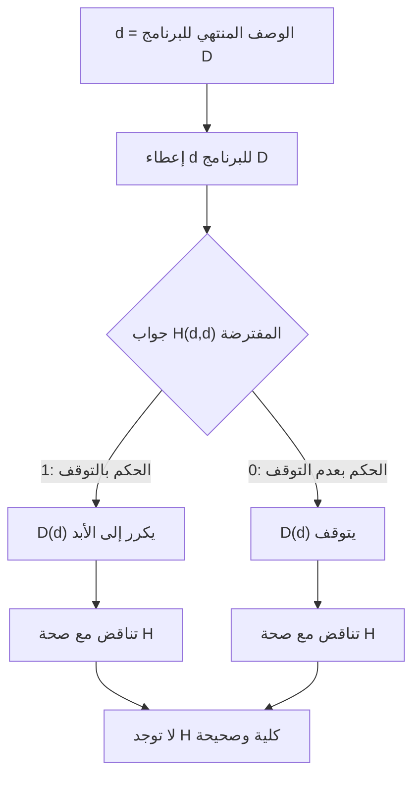

عندما يستمر برنامج في العمل، قد نتساءل هل يمكن معرفة أنه سينتهي قبل تشغيله. يمكن في حالات كثيرة إثبات توقف برامج محددة أو عدم توقفها. لكن لا توجد خوارزمية <strong>تنتهي هي نفسها حتماً وتعطي جواباً صحيحاً لكل برنامج ولكل مدخل</strong>.

هذه هي <strong>عدم قابلية مشكلة التوقف للتقرير خوارزمياً</strong>. إنها نتيجة استحالة مثبتة، وليست حدسية لم تُحل بعد. ولا تعني أننا عاجزون عن تقرير أي شيء بشأن كل برنامج بعينه.

سنعمل في نموذج حساب حتمي تحكمه خوارزمية منتهية الوصف، ويمكن زيادة ذاكرته عند الحاجة. نفاد بطارية جهاز فعلي أو إنهاء عملية قسراً أو نفاد الذاكرة أمور تختلف عن توقف الحساب في النموذج الرياضي.

## 1. يجب تثبيت المدخل أيضاً، لا البرنامج وحده

لنرمز إلى الوصف المنتهي للبرنامج $P$ بالرمز $\langle P\rangle$، وليكن المدخل سلسلة منتهية $x$. يستطيع محاكٍ شامل قراءة الوصف بوصفه بيانات وإعادة تنفيذ حساب $P$ على $x$.

تسأل مشكلة التوقف عن الانتماء إلى المجموعة التالية:

$$
\mathrm{HALT}
=\{\langle P,x\rangle : P(x)\text{ يتوقف في زمن منتهٍ}\}
$$

لو وجدت خوارزمية تقرير كلية $H$، لوجب أن ترجع في زمن منتهٍ، لكل وصف برنامج صالح ومدخل، القيمة التالية:

$$
H(\langle P\rangle,x)=
\begin{cases}
1 & P(x)\text{ يتوقف}\\
0 & P(x)\text{ لا يتوقف}
\end{cases}
$$

نشترط هنا <strong>توقف $H$ دائماً وصحة جوابها دائماً معاً</strong>. ويمكن التعامل بشكل منفصل مع السلاسل التي ليست أوصاف برامج صالحة، بعد فحصها نحوياً.

إذا كان الحساب يتوقف، فسنشاهد نهايته في نهاية المطاف عند مواصلة المحاكاة. بهذا المعنى تكون مجموعة الأزواج المتوقفة قابلة لشبه التقرير. أما حساب لم ينته بعد، فلا يحدد زمن الانتظار وحده ما إذا كان سينتهي في الخطوة التالية أو سيستمر إلى الأبد.

يُسمى عدم التوقف أحياناً «حلقة لانهائية»، لكنه لا يستلزم تكرار الحالة نفسها. فحساب يزيد عدّاداً باستمرار في ذاكرة غير محدودة قد تكون له تهيئة كاملة مختلفة في كل خطوة.

## 2. أمثلة بسيطة وملاحظة محدودة الخطوات

### مثال يمكن تفسير انتهائه

هذا مثال قابل للتنفيذ بلغة Python، ولا يقبل إلا قيماً من نوع الأعداد الصحيحة المدمج.

```python
def double_integer(x):
    if type(x) is not int:
        raise TypeError("x must be a built-in int")
    return x * 2


print(double_integer(3))
```

الناتج:

```text
6
```

تنتهي عملية الضرب الصحيحة في النموذج المثالي في زمن منتهٍ لأي مدخل صحيح منتهٍ. لا يعني ذلك أن الزمن الفعلي أو استهلاك الذاكرة مستقلان عن حجم المدخل. قيّدنا النوع لأن كائنات Python غير المقيدة بهذا النوع قد تعرّف عملية ضرب خاصة بها، ولأن ضرب سلسلة نصية ينتج سلسلة لا عدداً.

على العكس، لا تتوقف <strong>الشيفرة الكاذبة</strong> التالية في نموذج لا يتدخل فيه انقطاع خارجي:

```text
Forever(x):
    repeat forever:
        do nothing
```

سبب عدم التوقف هنا أن مسار التحكم لا يصل إلى مخرج. وغياب خوارزمية تقرير شاملة لا يمنعنا من تقرير حالات محددة كهذه.

### ملاحظة عدد منتهٍ من تكرارات كولاتز

نبدأ بعدد صحيح موجب $n$: إن كان زوجياً قسمناه على اثنين، وإن كان فردياً ضربناه في ثلاثة وأضفنا واحداً، ثم كررنا. تقول حدسية كولاتز إن كل عدد صحيح موجب يصل في النهاية إلى الواحد.

البرنامج التالي أداة للملاحظة ذات حد أقصى لعدد الخطوات. <strong>الوصول إلى حد الخطوات لا يعني أن الحساب بلا هذا الحد لن يتوقف أبداً.</strong>

```python
def collatz_bounded(n, max_steps):
    if type(n) is not int or n < 1:
        raise ValueError("n must be a positive built-in int")
    if type(max_steps) is not int or max_steps < 0:
        raise ValueError("max_steps must be a nonnegative built-in int")

    steps = 0
    while n != 1 and steps < max_steps:
        n = n // 2 if n % 2 == 0 else 3 * n + 1
        steps += 1
    status = "reached_one" if n == 1 else "step_limit"
    return status, steps, n


print(collatz_bounded(6, 8))
print(collatz_bounded(6, 7))
print(collatz_bounded(1, 0))
```

الناتج:

```text
('reached_one', 8, 1)
('step_limit', 7, 2)
('reached_one', 0, 1)
```

ينتهي برنامج الملاحظة نفسه بعد عدد منتهٍ من التكرارات لا يتجاوز الحد المحدد. والسؤال الأصلي هو هل يصل التكرار إلى الواحد إذا أزلنا الحد. عدد منتهٍ من الأمثلة الناجحة ليس برهاناً لجميع الأعداد الصحيحة الموجبة. يتضمن بحث تاو نتيجة جزئية مهمة، لكنه لا يثبت وصول كل مدار إلى الواحد.

إذا رمزنا إلى تحويل التكرار بالرمز $\mathrm{Col}$، فإن صيغة الحدسية هي:

$$
\forall n\ge1\ \exists t\ge0\quad \mathrm{Col}^{t}(n)=1
$$

إعطاء $H$ الافتراضية قيمة معينة لـ $n$ ينتج جواباً عن <strong>ذلك المدخل الواحد</strong>. أما السؤال «هل يتوقف البرنامج لكل $n$؟» فليس مطابقاً مباشرة لسؤال واحد عادي عن التوقف. لذلك لا يصح استنتاج إمكان تقرير أي قضية رياضية بمجرد تقديم برنامج واحد.

## 3. برنامج يعكس جواب خوارزمية التقرير

نفترض وجود خوارزمية $H$ تتوقف دائماً وتجيب إجابة صحيحة لكل وصف برنامج صالح ومدخل.

يمكن إعطاء البرنامج الذي يمثله الوصف $s$ الوصف نفسه $s$ كمدخل. نحن نتعامل مع البرنامج بوصفه بيانات، ولا نحتاج إلى تضمين شيفرة مصدرية لانهائية الطول.

تحت هذا الافتراض نبني $D$ التالية:

```text
D(s):
    if s is not a valid program description:
        halt
    if H(s, s) == 1:
        repeat forever:
            do nothing
    else:
        halt
```

هذه <strong>شيفرة كاذبة للبرهان تستدعي $H$ المفترضة</strong>، وليست مقرراً للتوقف جرى تنفيذه فعلاً. وبافتراض قابلية $H$ للحساب وانتهائها دائماً، يمكن بناء $D$ ذات الوصف المنتهي.

ليكن وصف $D$ هو $d=\langle D\rangle$. ننظر الآن في $D(d)$.

| جواب خوارزمية التقرير | معناه إذا كانت الخوارزمية صحيحة | السلوك وفق تعريف $D(d)$ |
| :--- | :--- | :--- |
| $H(d,d)=1$ | $D(d)$ يتوقف | يكرر إلى الأبد |
| $H(d,d)=0$ | $D(d)$ لا يتوقف | يتوقف فوراً |

كلا الجوابين يناقض شرط الصحة. وباختصار:

$$
D(d)\text{ يتوقف}
\iff H(d,d)=0
\iff D(d)\text{ لا يتوقف}
$$

إذن لا توجد $H$ الكلية والصحيحة التي افترضناها.

ليس الاستنتاج أن كل برنامج يشير إلى نفسه متناقض أو أن المنطق ينهار. ما يرفضه التناقض هو <strong>افتراض وجود مقرر شامل لمشكلة التوقف</strong>.

## 4. الحجة القطرية في رسم



هذا بناء قطري: نعكس جواب المقرر المقترح بواسطة برنامج من البرامج التي يُفترض أنه يغطيها. قد يفيد التشابه الحدسي مع مفارقة الكذاب، لكن أساس البرهان هو ترميز الأوصاف وإمكان بناء البرامج بطريقة فعالة.

## 5. ورقة تورينج الأصلية ونموذج الحساب

أظهرت ورقة [آلان تورينج](/ar/p/turing/) عام 1936 عدم القابلية للتقرير باستخدام آلات الحساب وترميز الأوصاف والآلة الشاملة والحجة القطرية. لكن البرهان الشبيه ببايثون في هذا المقال لا يظهر بهذه الصيغة نفسها في الورقة الأصلية.

تسمي الورقة الأصلية الآلة التي تخرج عدداً لا نهائياً من الأرقام صفر أو واحد circle-free، والآلة التي لا تخرج إلا عدداً منتهياً من تلك الأرقام circular. وتشمل الفئة الثانية آلة تتوقف وأخرى تواصل أعمالاً أخرى دون إخراج مزيد من الأرقام. لذلك لا يصح ترجمة الفئتين ببساطة إلى «لا تتوقف» و«تتوقف». ويناقش القسم 8 أيضاً استحالة تقرير ما إذا كانت آلة ستخرج رمزاً معيناً في وقت ما، في الحالة العامة.

يمكن بناء آلة تحاكي الحساب الأصلي ولا تتوقف إلا عندما يظهر الرمز المحدد. بذلك نربط ظهور الرمز بسؤال التوقف. وقد استخدمنا هنا الصيغة الشائعة اليوم: <strong>توقف برنامج عند مدخل ثابت</strong>.

[آلة تورينج](/ar/p/turing-machine-computability/) نموذج رياضي يتألف من قواعد منتهية وشريط يمكن استخدامه بحسب الحاجة. تقول أطروحة تشيرش–تورينج إن المعنى الحدسي لـ «إجراء فعال يمكن تنفيذه آلياً» يمكن التعبير عنه بهذه القابلية الصورية للحساب. ويجب تمييزها عن مبرهنات تكافؤ نماذج معرفة صورياً. كما أنها ليست ادعاءً مثبتاً بلا شروط عن كل الظواهر الفيزيائية أو الأجهزة الفعلية.

## 6. العلاقة بمبرهنات عدم الاكتمال

ترتبط [مبرهنات غودل لعدم الاكتمال](/ar/p/godels-incompleteness-theorems/) ارتباطاً وثيقاً بحدود القابلية للحساب. لكنها ليست ادعاءات بلا شروط عن أي «نظام بديهي قوي بما يكفي». ففعالية صياغة البديهيات والقدرة على التعبير عن الحساب والاتساق افتراضات مهمة. ويجب أيضاً تمييز الصدق في الأعداد الطبيعية القياسية عن قابلية البرهنة داخل نظرية.

إحدى طرق رؤية العلاقة بالتوقف هي النظر في نظرية يمكن تعداد براهينها بفعالية، ولا تثبت <strong>إلا قضايا صادقة عن التوقف وعدم التوقف</strong>. لو أمكنها إثبات التوقف أو عدمه لكل برنامج ومدخل ثابت، لأمكن البحث عن نوعي البرهان وإرجاع الجواب الذي نجد برهانه أولاً.

وهذا يناقض عدم قابلية مشكلة التوقف للتقرير. لذا حتى هذه النظرية السليمة دلالياً لا تستطيع تقرير كل أسئلة التوقف. يستخدم هذا الشرح افتراض السلامة الدلالية (soundness)، وهو افتراض قوي. وليس عرضاً لأضعف شروط كل مبرهنة لغودل أو برهاناً كاملاً لها.

## 7. مبرهنة رايس والتحليل العملي

### خصائص غير تافهة للمدخلات والمخرجات

تقرر مبرهنة رايس عدم القابلية العامة للتقرير بشأن <strong>الخصائص الامتدادية غير التافهة</strong> للدوال الجزئية التي تحسبها البرامج أو اللغات التي تتعرف عليها.

تعني «امتدادية» أن البرامج التي تمثل سلوك المدخلات والمخرجات نفسه تتفق في صدق الخاصية. وتعني «غير تافهة» وجود كائنات قابلة للحساب تمتلك الخاصية وأخرى لا تمتلكها.

مثلاً، «التوقف عند جميع المدخلات وإرجاع الصفر» خاصية غير تافهة لدالة جزئية. وهي تختلف عن «إذا توقف الحساب فإن ناتجه دائماً صفر». فالشرط الثاني يحققه حتى برنامج لا يتوقف عند أي مدخل. لذلك لا ينبغي ترك عبارة «يرجع الصفر دائماً» غامضة.

يمكن تقرير بعض الأسئلة المتعلقة بالنحو أو التمثيل، مثل عدد الحالات المكتوبة في وصف البرنامج. ولا تنطبق مبرهنة رايس تلقائياً على أحداث أثناء التنفيذ، مثل وصول محدد إلى الذاكرة. لإثبات عدم قابلية مسألة تنفيذ معينة للتقرير، يلزم تحديد النموذج وتقديم اختزال مناسب أو حجة أخرى بصورة مستقلة.

### التمييز بين الضمان والمجهول والمهلة الزمنية

عدم وجود مقرر شامل لا يعني أن جميع أدوات التحليل لا تفعل سوى التخمين.

- <strong>تحليل سليم لكنه غير كامل</strong>: يمنح ضمانات حيث يستطيع البرهنة، ويقول «غير معلوم» في بقية الحالات. وقد يظهر تحذير من تحليل محافظ دون وجود عيب فعلي.
- <strong>لغات أو مجالات مدخلات مقيدة</strong>: يمكن استخدام قواعد تضمن الانتهاء أو بحث شامل ضمن مجال منتهٍ. لكن مجرد عدم الاكتمال وفق تورينج لا يضمن توقف جميع البرامج.
- <strong>الأساليب الاستكشافية والاختبارات</strong>: تبحث عن عيوب محتملة مفيدة أو أمثلة مضادة، لكن ذلك لا يضمن الاكتمال خارج النطاق المفحوص.
- <strong>المهلة الزمنية</strong>: وسيلة لوقف استهلاك الموارد، وليست برهاناً على أن الحساب سيستمر إلى الأبد لو أزيل الحد.

في نظام حتمي مغلق ذي عدد منتهٍ من التهيئات الكاملة، ويمكن التعامل مع تهيئاته وانتقالاته بفعالية، نستطيع تتبع التنفيذ حتى يتوقف أو يعود إلى تهيئة سبق أن رأيناها. هذا يفسر القابلية الرياضية للتقرير، ولا يضمن إمكان البحث الشامل بزمن أو ذاكرة عمليين. ولا يمكن نقل النتيجة مباشرة إلى نظام بمدخلات غير محدودة أو تفاعل خارجي أو ذاكرة قابلة للنمو.

## 8. ما المستحيل وما الذي يظل ممكناً؟

تستبعد نتيجة التوقف خوارزمية عامة تنتهي دائماً وتختار دائماً الجواب الصحيح من جوابين لكل برنامج ومدخل.

تظل براهين انتهاء برامج معينة، والفحوص الكاملة تحت قيود مناسبة، والتحليلات السليمة التي تسمح بجواب «غير معلوم»، والاختبارات المنتهية مفيدة ومتوافقة مع هذه النتيجة. والمهم تمييز ما إذا كان جواب الأداة برهاناً أو ملاحظة أو تخميناً أو إقراراً بعدم المعرفة.

### المراجع

- [Turing: On Computable Numbers, with an Application to the Entscheidungsproblem](https://theory.stanford.edu/~trevisan/cs172-07/turing36.pdf) — نسخة جامعية من الورقة الأصلية. يميز القسم 2 بين الآلات، ويتناول القسم 8 الحجة القطرية وظهور الرموز، ويناقش القسم 9 تفسير الحساب.
- [MIT 6.045J: Mapping reducibility and Rice's theorem](https://ocw.mit.edu/courses/6-045j-automata-computability-and-complexity-spring-2011/7aead2c728dd3d5a737d832811ef97e6_MIT6_045JS11_lec09.pdf) — شروط مبرهنة رايس والتمييز بين خصائص اللغات وخصائص بنية الآلة أو تنفيذها.
- [Sinclair: The Church-Turing Thesis](https://people.eecs.berkeley.edu/~sinclair/cs172/n4.pdf) — الأطروحة التي تربط الإجراءات الفعالة حدسياً بالنموذج الصوري.
- [Tao: Almost all orbits of the Collatz map attain almost bounded values](https://arxiv.org/abs/1909.03562) — نتيجة جزئية عن تكرارات كولاتز، لا برهان لوصول جميع الأعداد الصحيحة الموجبة إلى الواحد.
