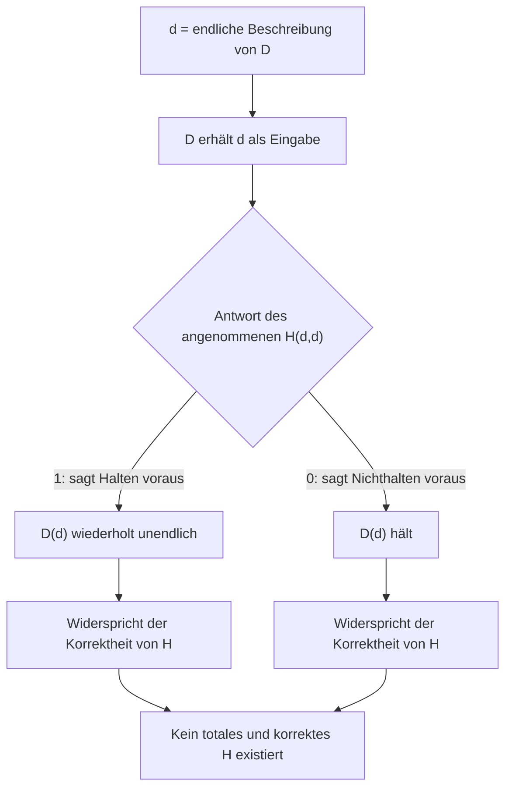

Wenn ein Programm nicht fertig wird, liegt die Frage nahe, ob sich seine Terminierung schon vor der Ausführung feststellen ließe. Für einzelne Programme können wir oft beweisen, dass sie terminieren oder nicht terminieren. Es gibt jedoch keinen Algorithmus, der <strong>für alle Programme und Eingaben selbst terminiert und stets die richtige Antwort liefert</strong>.

Das ist die <strong>Unentscheidbarkeit des Halteproblems</strong>. Sie ist ein bewiesenes Unmöglichkeitsergebnis, keine noch offene Vermutung. Daraus folgt nicht, dass sich kein einziger konkreter Fall entscheiden ließe.

Wir betrachten ein deterministisches Rechenmodell mit einem gewöhnlichen endlichen Algorithmus und einem Speicher, der bei Bedarf wachsen kann. Dass ein reales Gerät wegen eines leeren Akkus, eines erzwungenen Prozessabbruchs oder Speichermangels stoppt, ist vom Halten in diesem mathematischen Modell zu unterscheiden.

## 1. Neben dem Programm muss auch die Eingabe feststehen

Die endliche Beschreibung eines Programms $P$ schreiben wir als $\langle P\rangle$; die Eingabe $x$ ist eine endliche Zeichenfolge. Ein universeller Simulator kann diese Beschreibung als Daten lesen und die Berechnung von $P$ mit $x$ nachvollziehen.

Das Halteproblem fragt nach der Zugehörigkeit zur Menge

$$
\mathrm{HALT}
=\{\langle P,x\rangle : P(x)\text{ hält nach endlich vielen Schritten}\}
$$

Gäbe es einen totalen Entscheidungsalgorithmus $H$, müsste er für jede gültige Programmbeschreibung und jede Eingabe in endlicher Zeit einen der folgenden Werte liefern:

$$
H(\langle P\rangle,x)=
\begin{cases}
1 & P(x)\text{ hält}\\
0 & P(x)\text{ hält nicht}
\end{cases}
$$

Wir verlangen <strong>sowohl, dass $H$ immer terminiert, als auch, dass seine Antwort immer richtig ist</strong>. Zeichenfolgen, die keine gültige Beschreibung darstellen, lassen sich durch eine Syntaxprüfung gesondert behandeln.

Wenn eine Berechnung hält, wird eine fortgesetzte Simulation dieses Ende irgendwann zeigen. Die Menge der haltenden Paare ist in diesem Sinne semientscheidbar. Allein aus der bisherigen Wartezeit folgt aber nicht, ob eine noch laufende Berechnung im nächsten Schritt endet oder unendlich weiterläuft.

Nichtterminierung wird manchmal als „Endlosschleife“ bezeichnet, obwohl dabei nicht zwingend derselbe Zustand wiederkehrt. Eine Berechnung, die in einem unbeschränkten Speicher fortlaufend einen Zähler erhöht, kann bei jedem Schritt eine andere vollständige Konfiguration haben.

## 2. Einfache Beispiele und Beobachtungen mit einer Schrittgrenze

### Ein Beispiel mit erklärbarer Terminierung

Das folgende ausführbare Python-Beispiel akzeptiert nur ganze Zahlen des eingebauten Typs.

```python
def double_integer(x):
    if type(x) is not int:
        raise TypeError("x must be a built-in int")
    return x * 2


print(double_integer(3))
```

Die Ausgabe lautet:

```text
6
```

Für jede endliche ganze Zahl als Eingabe endet die idealisierte Ganzzahloperation in endlicher Zeit. Das bedeutet nicht, dass die tatsächliche Laufzeit oder der Speicherbedarf von der Eingabegröße unabhängig wären. Die Typbeschränkung ist nötig, weil beliebige Python-Objekte ihre Multiplikation selbst definieren können und die Multiplikation einer Zeichenfolge eine Zeichenfolge statt einer Zahl liefert.

Dagegen hält dieser <strong>Pseudocode</strong> in einem Modell ohne äußere Unterbrechung nicht an:

```text
Forever(x):
    repeat forever:
        do nothing
```

Die Nichtterminierung lässt sich erklären, weil der Kontrollfluss keinen Ausgang erreicht. Dass es keinen universellen Entscheider gibt, verhindert also nicht die Entscheidung solcher Einzelfälle.

### Endlich viele Collatz-Schritte beobachten

Ausgehend von einer positiven ganzen Zahl $n$ halbiert man sie, wenn sie gerade ist, oder verdreifacht sie und addiert eins, wenn sie ungerade ist. Dies wird wiederholt. Die Collatz-Vermutung besagt, dass jede positive ganze Zahl irgendwann eins erreicht.

Das folgende Programm beobachtet den Vorgang bis zu einer festgelegten Höchstzahl von Schritten. <strong>Das Erreichen der Schrittgrenze darf nicht als Beweis dafür gelten, dass die unbeschränkte Berechnung niemals hält.</strong>

```python
def collatz_bounded(n, max_steps):
    if type(n) is not int or n < 1:
        raise ValueError("n must be a positive built-in int")
    if type(max_steps) is not int or max_steps < 0:
        raise ValueError("max_steps must be a nonnegative built-in int")

    steps = 0
    while n != 1 and steps < max_steps:
        n = n // 2 if n % 2 == 0 else 3 * n + 1
        steps += 1
    status = "reached_one" if n == 1 else "step_limit"
    return status, steps, n


print(collatz_bounded(6, 8))
print(collatz_bounded(6, 7))
print(collatz_bounded(1, 0))
```

Ausgabe:

```text
('reached_one', 8, 1)
('step_limit', 7, 2)
('reached_one', 0, 1)
```

Dieses Beobachtungsprogramm selbst endet nach höchstens der angegebenen endlichen Zahl von Iterationen. Die eigentliche Frage ist, ob die Iteration ohne Schrittgrenze eins erreicht. Endlich viele erfolgreiche Beispiele beweisen die Aussage nicht für alle positiven ganzen Zahlen. Taos Forschung liefert ein wichtiges Teilergebnis, aber keinen Beweis dafür, dass alle Bahnen eins erreichen.

Schreiben wir $\mathrm{Col}$ für die iterierte Abbildung, hat die Vermutung die Form

$$
\forall n\ge1\ \exists t\ge0\quad \mathrm{Col}^{t}(n)=1
$$

Würde man dem hypothetischen $H$ ein bestimmtes $n$ übergeben, erhielte man eine Antwort für <strong>diese eine Eingabe</strong>. Die Totalitätsfrage „Hält das Programm für alle $n$?“ ist nicht unmittelbar dasselbe wie eine einzige gewöhnliche Halteanfrage. Daraus darf man nicht folgern, dass die Übergabe eines Programms jede beliebige mathematische Aussage entscheiden könnte.

## 3. Ein Programm, das die Antwort umkehrt

Nehmen wir an, es gebe einen Algorithmus $H$, der stets terminiert und für jede gültige Programmbeschreibung und jede Eingabe richtig antwortet.

Ein durch $s$ beschriebenes Programm kann dieselbe Beschreibung $s$ als Eingabe erhalten. Dabei wird ein Programm lediglich als Daten behandelt; ein unendlich langer Quelltext muss nicht eingebettet werden.

Unter dieser Annahme konstruieren wir $D$:

```text
D(s):
    if s is not a valid program description:
        halt
    if H(s, s) == 1:
        repeat forever:
            do nothing
    else:
        halt
```

Dies ist <strong>Beweispseudocode, der das hypothetische $H$ aufruft</strong>, kein bereits implementierter Halteentscheider. Weil wir annehmen, dass $H$ berechenbar ist und stets terminiert, können wir dieses $D$ mit einer endlichen Beschreibung konstruieren.

Sei $d=\langle D\rangle$ die Beschreibung von $D$. Betrachten wir $D(d)$.

| Antwort des Entscheiders | Bedeutung bei einem korrekten Entscheider | Durch die Definition festgelegtes Verhalten von $D(d)$ |
| :--- | :--- | :--- |
| $H(d,d)=1$ | $D(d)$ hält | Unendlich wiederholen |
| $H(d,d)=0$ | $D(d)$ hält nicht | Sofort halten |

Beide Antworten widersprechen der Korrektheit. Kurz geschrieben:

$$
D(d)\text{ hält}
\iff H(d,d)=0
\iff D(d)\text{ hält nicht}
$$

Das angenommene totale und korrekte $H$ existiert daher nicht.

Die Schlussfolgerung lautet weder, dass alle selbstreferenziellen Programme widersprüchlich sind, noch, dass die Logik zerbricht. Widerlegt wird <strong>die Annahme, dass ein universeller Halteentscheider existiert</strong>.

## 4. Das Diagonalargument im Diagramm



Dies ist eine Diagonalkonstruktion: Eines der Programme, die der vorgeschlagene Entscheider erfassen soll, kehrt dessen Antwort um. Die Ähnlichkeit mit dem Lügnerparadoxon kann die Intuition unterstützen. Den Beweis tragen jedoch die Kodierung der Beschreibungen und die effektive Konstruktion von Programmen.

## 5. Turings Originalarbeit und Rechenmodelle

[Alan Turings](/de/p/turing/) Arbeit von 1936 zeigte Unentscheidbarkeit mithilfe von Rechenmaschinen, kodierten Beschreibungen, einer universellen Maschine und Diagonalisierung. Der hier verwendete Beweis in einer Python-ähnlichen Form steht nicht wörtlich so im Original.

Die Originalarbeit nennt eine Maschine circle-free, wenn sie unendlich viele Ziffern, Nullen oder Einsen, ausgibt, und circular, wenn sie nur endlich viele solcher Ziffern ausgibt. Zur zweiten Kategorie gehören sowohl haltende Maschinen als auch Maschinen, die mit anderen Operationen fortfahren, ohne weitere Ziffern auszugeben. Diese Begriffe einfach mit „hält nicht“ und „hält“ zu übersetzen, wäre deshalb falsch. Abschnitt 8 behandelt auch die Unmöglichkeit, allgemein zu entscheiden, ob eine Maschine irgendwann ein bestimmtes Zeichen ausgibt.

Man kann die Zeichenausgabe mit dem Halten verknüpfen, indem man eine Maschine konstruiert, die die Berechnung simuliert und nur dann hält, wenn das Zeichen erscheint. Hier verwenden wir die heute übliche Formulierung: <strong>das Halten eines Programms bei einer festen Eingabe</strong>.

Eine [Turingmaschine](/de/p/turing-machine-computability/) ist ein mathematisches Modell mit endlich vielen Regeln und einem nach Bedarf nutzbaren Band. Die Church–Turing-These besagt, dass der intuitive Begriff eines „mechanisch ausführbaren effektiven Verfahrens“ durch eine solche formale Berechenbarkeit erfasst wird. Sie ist von Äquivalenzsätzen zwischen formal definierten Modellen zu unterscheiden. Sie ist auch keine bedingungslos bewiesene Aussage über sämtliche physikalischen Vorgänge oder realen Geräte.

## 6. Der Zusammenhang mit Unvollständigkeit

[Gödels Unvollständigkeitssätze](/de/p/godels-incompleteness-theorems/) hängen eng mit den Grenzen der Berechenbarkeit zusammen. Sie sind aber keine voraussetzungslosen Aussagen über jedes „hinreichend starke Axiomensystem“. Effektive Axiomatisierung, die Stärke zur Darstellung von Arithmetik, Widerspruchsfreiheit und weitere Annahmen sind wichtig. Wahrheit in den Standardnaturzahlen ist außerdem von Beweisbarkeit innerhalb einer Theorie zu unterscheiden.

Ein Zugang zum Zusammenhang mit dem Halteproblem ist eine Theorie, deren Beweise effektiv aufgezählt werden können und die über Halten und Nichthalten <strong>nur wahre Aussagen beweist</strong>. Könnte sie für jedes Programm und jede feste Eingabe entweder Halten oder Nichthalten beweisen, ließen sich beide Arten von Beweisen suchen und beim ersten gefundenen Beweis die entsprechende Antwort ausgeben.

Das würde der Unentscheidbarkeit des Halteproblems widersprechen. Selbst eine solche korrekte Theorie kann daher nicht alle Haltefragen entscheiden. Diese Erklärung verwendet die starke Voraussetzung semantischer Korrektheit. Sie gibt weder die schwächsten Voraussetzungen der einzelnen Sätze Gödels noch deren vollständige Beweise an.

## 7. Der Satz von Rice und praktische Analyse

### Nichttriviale Eigenschaften des Eingabe-Ausgabe-Verhaltens

Der Satz von Rice liefert ein allgemeines Unentscheidbarkeitsergebnis für <strong>nichttriviale extensionale Eigenschaften</strong> der von einem Programm berechneten partiellen Funktion oder der von ihm erkannten Sprache.

„Extensional“ bedeutet, dass Programme mit demselben Eingabe-Ausgabe-Verhalten hinsichtlich der Eigenschaft übereinstimmen. „Nichttrivial“ bedeutet, dass es sowohl berechenbare Objekte mit dieser Eigenschaft als auch solche ohne sie gibt.

Zum Beispiel ist „hält für jede Eingabe und gibt null zurück“ eine nichttriviale Eigenschaft einer partiellen Funktion. Sie unterscheidet sich von „wenn das Programm hält, ist seine Ausgabe immer null“. Die zweite Bedingung erfüllt auch ein Programm, das bei keiner Eingabe hält. Deshalb sollte „gibt immer null zurück“ nicht mehrdeutig bleiben.

Manche Fragen über Syntax oder Darstellung sind entscheidbar, etwa nach der Anzahl der in einer Programmbeschreibung aufgeführten Zustände. Der Satz von Rice gilt auch nicht automatisch für Eigenschaften von Zwischenschritten der Ausführung, etwa einen bestimmten Speicherzugriff. Um die Unentscheidbarkeit eines Ausführungsproblems zu zeigen, muss man das Modell festlegen und eine geeignete Reduktion oder ein anderes Argument angeben.

### Garantien, unbekannte Antworten und Zeitlimits unterscheiden

Dass kein universeller Entscheider existiert, bedeutet nicht, dass alle Analysewerkzeuge nur Vermutungen anstellen können.

- <strong>Korrekte, aber unvollständige Analyse</strong>: Sie liefert Garantien, wo sie etwas beweisen kann, und antwortet sonst mit „unbekannt“. Eine Warnung einer konservativen Analyse muss keinem tatsächlichen Fehler entsprechen.
- <strong>Eingeschränkte Sprachen oder Eingabebereiche</strong>: Sie können terminierungssichernde Regeln oder vollständige Suche in endlichen Bereichen verwenden. Allein die fehlende Turingvollständigkeit garantiert nicht, dass sämtliche Programme terminieren.
- <strong>Heuristiken und Tests</strong>: Sie finden nützliche Fehlerkandidaten oder Gegenbeispiele, sind aber keine Vollständigkeitsgarantie über den untersuchten Bereich hinaus.
- <strong>Zeitlimits</strong>: Sie begrenzen den Ressourcenverbrauch. Sie beweisen nicht, dass die Berechnung ohne diese Grenze unendlich weiterlaufen würde.

Bei einem geschlossenen deterministischen System mit endlich vielen vollständigen Konfigurationen, die sich einschließlich ihrer Übergänge effektiv behandeln lassen, kann man die Ausführung verfolgen, bis sie hält oder eine bereits besuchte Konfiguration wiederkehrt. Das zeigt mathematische Entscheidbarkeit, garantiert aber keine vollständige Suche mit realistischem Zeit- oder Speicheraufwand. Es lässt sich nicht unverändert auf Systeme mit unbeschränkten Eingaben, äußerer Interaktion oder wachsendem Speicher übertragen.

## 8. Was unmöglich ist und was möglich bleibt

Das Halteproblem schließt einen allgemeinen Algorithmus aus, der für jedes Programm und jede Eingabe stets terminiert und immer die richtige von zwei Antworten gibt.

Terminierungsbeweise für einzelne Programme, vollständige Prüfungen unter geeigneten Einschränkungen, korrekte Analysen mit der Antwort „unbekannt“ und endliche Tests bleiben mit diesem Ergebnis vereinbar und nützlich. Entscheidend ist, ob die Antwort eines Werkzeugs ein Beweis, eine Beobachtung, eine Vermutung oder ein Eingeständnis fehlenden Wissens ist.

### Literatur

- [Turing: On Computable Numbers, with an Application to the Entscheidungsproblem](https://theory.stanford.edu/~trevisan/cs172-07/turing36.pdf) — Universitär bereitgestellte Fassung der Originalarbeit. Abschnitt 2 unterscheidet Maschinenarten; Abschnitt 8 behandelt Diagonalisierung und Zeichenausgabe; Abschnitt 9 interpretiert das Rechnen.
- [MIT 6.045J: Mapping reducibility and Rice's theorem](https://ocw.mit.edu/courses/6-045j-automata-computability-and-complexity-spring-2011/7aead2c728dd3d5a737d832811ef97e6_MIT6_045JS11_lec09.pdf) — Voraussetzungen des Satzes von Rice und die Unterscheidung zwischen Spracheigenschaften und strukturellen oder operationalen Eigenschaften von Maschinen.
- [Sinclair: The Church-Turing Thesis](https://people.eecs.berkeley.edu/~sinclair/cs172/n4.pdf) — Die These als Verbindung zwischen intuitiven effektiven Verfahren und formalen Modellen.
- [Tao: Almost all orbits of the Collatz map attain almost bounded values](https://arxiv.org/abs/1909.03562) — Teilergebnis zur Collatz-Iteration, kein Beweis dafür, dass alle positiven ganzen Zahlen eins erreichen.
