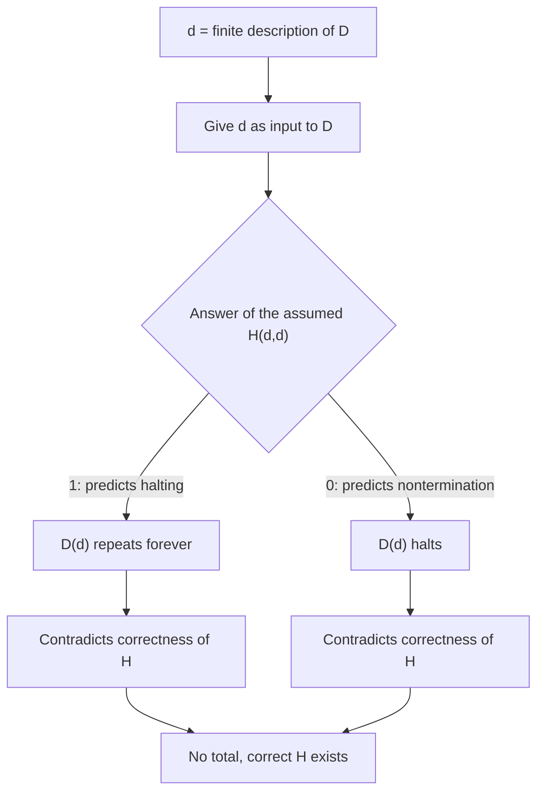

When a program seems to run forever, it is natural to ask whether we could determine in advance that it will finish. We can often prove termination or nontermination for particular programs. However, there is no algorithm that <strong>halts itself and answers correctly for every program and input</strong>.

This is the <strong>undecidability of the halting problem</strong>. It is a proved impossibility result, not an unsolved conjecture. It does not mean that we can never determine anything about any individual program.

Throughout this article, we use a deterministic model of computation governed by an ordinary finite algorithm, with memory that can grow as needed. A real machine stopping because its battery runs out, its process is killed, or it exhausts memory is distinct from halting in this mathematical model.

## 1. Fix the input as well as the program

Write the finite description of a program $P$ as $\langle P\rangle$, and let its input be a finite string $x$. A universal simulator can read that description as data and reproduce the computation of $P$ on $x$.

The halting problem asks about membership in the following set:

$$
\mathrm{HALT}
=\{\langle P,x\rangle : P(x)\text{ halts in finite time}\}
$$

If a total decision algorithm $H$ existed, it would return the following value in finite time for every valid program description and input:

$$
H(\langle P\rangle,x)=
\begin{cases}
1 & P(x)\text{ halts}\\
0 & P(x)\text{ does not halt}
\end{cases}
$$

We require <strong>both that $H$ always halts and that its answer is always correct</strong>. Strings that are not valid descriptions can be handled separately by a syntax check.

For a computation that halts, continued simulation will eventually reveal its termination. In this sense, the set of halting pairs is semidecidable. But elapsed waiting time alone cannot tell us whether a computation that has not yet finished will finish on its next step or continue forever.

Nontermination is sometimes called an “infinite loop,” but it need not involve repeating the same state. A computation that keeps increasing a counter in unbounded memory may have a different complete configuration at every step.

## 2. Simple examples and observations with a step limit

### An example whose termination we can explain

The following executable Python example accepts only built-in integers.

```python
def double_integer(x):
    if type(x) is not int:
        raise TypeError("x must be a built-in int")
    return x * 2


print(double_integer(3))
```

Its output is:

```text
6
```

For any finite integer input, the idealized integer operation finishes in finite time. This does not mean that the actual running time or memory use is independent of the input's size. We restrict the type because arbitrary Python objects can define their own multiplication, and multiplying a string returns a string rather than a number.

In contrast, this <strong>pseudocode</strong> does not halt in a model without external interruption:

```text
Forever(x):
    repeat forever:
        do nothing
```

We can explain its nontermination because control never reaches an exit. The absence of a universal decider does not prevent us from deciding such particular cases.

### Observing finitely many Collatz steps

Starting with a positive integer $n$, repeatedly halve it if it is even, or multiply it by three and add one if it is odd. The Collatz conjecture says that every positive integer eventually reaches one.

The following program observes this process up to a specified number of steps. <strong>Reaching the step limit must not be interpreted as a proof that the unbounded computation will never halt.</strong>

```python
def collatz_bounded(n, max_steps):
    if type(n) is not int or n < 1:
        raise ValueError("n must be a positive built-in int")
    if type(max_steps) is not int or max_steps < 0:
        raise ValueError("max_steps must be a nonnegative built-in int")

    steps = 0
    while n != 1 and steps < max_steps:
        n = n // 2 if n % 2 == 0 else 3 * n + 1
        steps += 1
    status = "reached_one" if n == 1 else "step_limit"
    return status, steps, n


print(collatz_bounded(6, 8))
print(collatz_bounded(6, 7))
print(collatz_bounded(1, 0))
```

Output:

```text
('reached_one', 8, 1)
('step_limit', 7, 2)
('reached_one', 0, 1)
```

This observation program itself finishes after at most the specified finite number of iterations. The underlying question is whether the iteration without a step limit reaches one. Finitely many successful examples do not prove the claim for every positive integer. Tao's research gives a substantial partial result, but it does not establish that every orbit reaches one.

Writing the iteration map as $\mathrm{Col}$, the conjecture has the form

$$
\forall n\ge1\ \exists t\ge0\quad \mathrm{Col}^{t}(n)=1
$$

Passing a particular $n$ to a hypothetical $H$ would answer the question for <strong>that one input</strong>. The totality question “Does it halt for every $n$?” is not simply the same as a single ordinary halting query. We must not conclude that handing over one program would decide an arbitrary mathematical statement.

## 3. A program that reverses the answer

Assume that a halting algorithm $H$ correctly answers every question about a valid program description and an input.

A program described by $s$ can receive that same description $s$ as its input. This is just treating a program as data; it does not require embedding an infinitely long source listing.

Under this assumption, construct $D$:

```text
D(s):
    if s is not a valid program description:
        halt
    if H(s, s) == 1:
        repeat forever:
            do nothing
    else:
        halt
```

This is <strong>proof pseudocode calling the hypothetical $H$</strong>, not an implemented halting decider. The assumption that $H$ is computable and always terminates lets us construct $D$ with a finite description.

Let $d=\langle D\rangle$ be that description and consider $D(d)$.

| Decider's answer | What a correct decider implies | Behavior specified by $D(d)$ |
| :--- | :--- | :--- |
| $H(d,d)=1$ | $D(d)$ halts | Repeat forever |
| $H(d,d)=0$ | $D(d)$ does not halt | Halt immediately |

Either answer contradicts correctness. In compact form,

$$
D(d)\text{ halts}
\iff H(d,d)=0
\iff D(d)\text{ does not halt}
$$

Therefore, the assumed total, correct $H$ does not exist.

The conclusion is not that all self-referential programs are contradictory or that logic breaks down. The contradiction refutes <strong>the assumption that a universal halting decider exists</strong>.

## 4. Following the diagonal argument in a diagram



This is a diagonal argument: one of the very programs covered by the proposed decider reverses its answer. The resemblance to the liar paradox can help intuition, but the proof depends on encoding descriptions and effectively constructing programs.

## 5. Turing's original paper and models of computation

[Alan Turing's](/en/p/turing/) 1936 paper established undecidability through computing machines, encoded descriptions, a universal machine, and diagonalization. The Python-like proof in this article is not a verbatim presentation from that paper.

The original paper calls a machine circle-free if it outputs infinitely many figures, zero or one, and circular if its output of such figures is finite. The latter includes machines that halt as well as machines that continue with operations other than outputting figures. Translating these terms simply as “nonhalting” and “halting” is therefore inaccurate. Section 8 also discusses the impossibility of generally deciding whether a machine ever prints a specified symbol.

We can connect symbol occurrence to halting by constructing a machine that simulates the computation until the symbol appears and halts only when it does. Here we have used the familiar modern formulation in terms of <strong>a program halting on a fixed input</strong>.

A [Turing machine](/en/p/turing-machine-computability/) is a mathematical model with finitely specified rules and a tape that can be used as needed. The Church–Turing thesis says that the intuitive notion of an effectively executable mechanical procedure is captured by such formal computability. This thesis is distinct from a theorem establishing the equivalence of formally defined models. Nor is it an unconditional proved claim about every physical phenomenon or real device.

## 6. The connection to incompleteness

[Gödel's incompleteness theorems](/en/p/godels-incompleteness-theorems/) are closely connected to limits of computability. Their claims are not unconditional statements about any sufficiently powerful axiom system: effective axiomatization, the strength to express arithmetic, consistency, and related assumptions matter. Truth in the standard natural numbers must also be distinguished from provability within a theory.

One way to see the connection is to consider a theory whose proofs can be effectively enumerated and that <strong>proves only true statements</strong> about halting and nonhalting. If it could prove either halting or nonhalting for every program and fixed input, we could search for both proofs and return whichever answer we found.

That would contradict the undecidability of the halting problem. Even such a sound theory cannot settle every halting question. This explanation uses the strong assumption of soundness; it is not a statement of the weakest hypotheses or a complete proof of Gödel's individual theorems.

## 7. Rice's theorem and practical analysis

### Nontrivial properties of input–output behavior

Rice's theorem gives a general undecidability result for <strong>nontrivial extensional properties</strong> of the partial function a program computes, or of the language it recognizes.

“Extensional” means that programs representing the same input–output behavior agree on the property. “Nontrivial” means that some computable objects have the property and others do not.

For example, “halts and returns zero on every input” is a nontrivial property of a partial function. It differs from “every output, when the program halts, is zero.” A program that never halts on any input satisfies the latter condition, too. The phrase “always returns zero” should not be left ambiguous.

Some questions about syntax or representation, such as the number of states written in a program description, are decidable. Rice's theorem also does not automatically apply to properties of intermediate execution, such as a particular memory access. To establish the undecidability of an execution-related problem, we must specify the model and supply an appropriate reduction or other argument.

### Distinguish guarantees, unknown answers, and timeouts

The lack of a universal decider does not mean that every analysis tool can only guess.

- <strong>Sound but incomplete analysis</strong> gives guarantees where it can prove a result and returns “unknown” elsewhere. A warning from a conservative analysis may not correspond to a real defect.
- <strong>Restricted languages or input domains</strong> can use rules that guarantee termination or exhaustive searches over finite domains. Merely being non-Turing-complete does not guarantee that every program halts.
- <strong>Heuristics and testing</strong> find useful candidates for defects or counterexamples; their usefulness should be distinguished from completeness beyond the tested scope.
- <strong>Timeouts</strong> cut off resource use. They do not prove that the computation would run forever without the limit.

For a closed deterministic system with finitely many complete configurations that can be effectively represented and stepped through, we can follow execution until it halts or revisits a configuration. This establishes mathematical decidability, not a guarantee that exhaustive search will fit within practical time or memory limits. It does not transfer directly to systems with unbounded input, external interaction, or growing memory.

## 8. What is impossible, and what remains possible?

The halting result rules out a general algorithm that always finishes and always gives the correct one of two answers for an arbitrary program and input.

Termination proofs for individual programs, complete checks under suitable restrictions, sound analyses that allow unknown answers, and finite tests remain useful and consistent with this result. What matters is distinguishing whether a tool's answer is a proof, an observation, a guess, or an admission that the answer is unknown.

### References

- [Turing: On Computable Numbers, with an Application to the Entscheidungsproblem](https://theory.stanford.edu/~trevisan/cs172-07/turing36.pdf) — A university-hosted copy of the original paper. Section 2 distinguishes kinds of machines; Section 8 treats diagonalization and symbol occurrence; Section 9 discusses the interpretation of computation.
- [MIT 6.045J: Mapping reducibility and Rice's theorem](https://ocw.mit.edu/courses/6-045j-automata-computability-and-complexity-spring-2011/7aead2c728dd3d5a737d832811ef97e6_MIT6_045JS11_lec09.pdf) — Conditions of Rice's theorem and the distinction between language properties and structural or operational properties of machines.
- [Sinclair: The Church-Turing Thesis](https://people.eecs.berkeley.edu/~sinclair/cs172/n4.pdf) — The thesis connecting intuitive effective procedures to formal models.
- [Tao: Almost all orbits of the Collatz map attain almost bounded values](https://arxiv.org/abs/1909.03562) — A partial result about Collatz iteration, not a proof that every positive integer reaches one.
