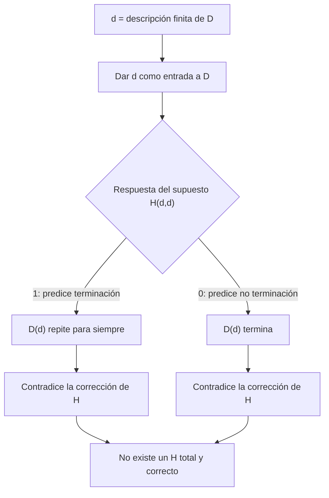

Cuando un programa no acaba, es natural preguntarse si podríamos saber de antemano que terminará. A menudo podemos demostrar la terminación o la no terminación de programas concretos. Sin embargo, no existe un algoritmo que <strong>termine él mismo y responda correctamente para todos los programas y sus entradas</strong>.

Esta es la <strong>indecidibilidad del problema de la parada</strong>. Es un resultado de imposibilidad demostrado, no una conjetura pendiente de resolver. Tampoco significa que no podamos decidir nada acerca de ningún programa concreto.

Trabajaremos con un modelo de cálculo determinista, regido por un algoritmo finito ordinario y con memoria que puede crecer según sea necesario. Que una máquina real se apague por falta de batería, que se fuerce el cierre de un proceso o que se agote la memoria no equivale a la parada en este modelo matemático.

## 1. Hay que fijar la entrada, además del programa

Escribimos $\langle P\rangle$ para la descripción finita del programa $P$, y tomamos como entrada una cadena finita $x$. Un simulador universal puede leer esa descripción como datos y reproducir el cálculo de $P$ sobre $x$.

El problema de la parada pregunta por la pertenencia al siguiente conjunto:

$$
\mathrm{HALT}
=\{\langle P,x\rangle : P(x)\text{ termina en tiempo finito}\}
$$

Si existiera un algoritmo de decisión total $H$, devolvería en tiempo finito uno de estos valores para cada descripción válida de programa y cada entrada:

$$
H(\langle P\rangle,x)=
\begin{cases}
1 & P(x)\text{ termina}\\
0 & P(x)\text{ no termina}
\end{cases}
$$

Exigimos <strong>tanto que $H$ termine siempre como que su respuesta sea siempre correcta</strong>. Las cadenas que no sean descripciones válidas pueden tratarse por separado mediante una comprobación sintáctica.

Si un cálculo termina, la simulación continuada acabará revelando su final. En este sentido, el conjunto de pares que terminan es semidecidible. Pero el tiempo que llevamos esperando no basta para saber si un cálculo aún en curso acabará en el siguiente paso o continuará para siempre.

A veces se llama «bucle infinito» a toda ejecución que no termina, aunque no tiene por qué repetirse el mismo estado. Un cálculo que incrementa continuamente un contador en una memoria sin cota puede tener una configuración completa distinta en cada paso.

## 2. Ejemplos sencillos y observaciones con un límite de pasos

### Un ejemplo cuya terminación podemos explicar

El siguiente ejemplo ejecutable de Python solo acepta enteros del tipo incorporado.

```python
def double_integer(x):
    if type(x) is not int:
        raise TypeError("x must be a built-in int")
    return x * 2


print(double_integer(3))
```

Su salida es:

```text
6
```

Para cualquier entero finito de entrada, la operación aritmética idealizada acaba en tiempo finito. Esto no significa que el tiempo real o el uso de memoria sean independientes del tamaño de la entrada. Restringimos el tipo porque los objetos arbitrarios de Python pueden definir su propia multiplicación, y multiplicar una cadena devuelve una cadena, no un número.

En cambio, este <strong>pseudocódigo</strong> no termina en un modelo sin interrupciones externas:

```text
Forever(x):
    repeat forever:
        do nothing
```

Podemos explicar la no terminación porque el flujo de control nunca alcanza una salida. La ausencia de un decisor universal no impide decidir ejemplos particulares como este.

### Observar un número finito de pasos de Collatz

Partiendo de un entero positivo $n$, se divide por dos si es par y se multiplica por tres y se suma uno si es impar, repitiendo la operación. La conjetura de Collatz afirma que todos los enteros positivos acaban llegando a uno.

El siguiente programa observa ese proceso hasta un número máximo de pasos. <strong>Alcanzar el límite de pasos no debe interpretarse como una prueba de que el cálculo sin límite nunca terminará.</strong>

```python
def collatz_bounded(n, max_steps):
    if type(n) is not int or n < 1:
        raise ValueError("n must be a positive built-in int")
    if type(max_steps) is not int or max_steps < 0:
        raise ValueError("max_steps must be a nonnegative built-in int")

    steps = 0
    while n != 1 and steps < max_steps:
        n = n // 2 if n % 2 == 0 else 3 * n + 1
        steps += 1
    status = "reached_one" if n == 1 else "step_limit"
    return status, steps, n


print(collatz_bounded(6, 8))
print(collatz_bounded(6, 7))
print(collatz_bounded(1, 0))
```

Salida:

```text
('reached_one', 8, 1)
('step_limit', 7, 2)
('reached_one', 0, 1)
```

Este programa de observación termina tras ejecutar, como máximo, el número finito de iteraciones indicado. La cuestión de fondo es si la iteración sin ese límite llega a uno. Un número finito de ejemplos favorables no demuestra la afirmación para todos los enteros positivos. La investigación de Tao aporta un importante resultado parcial, pero no demuestra que todas las órbitas lleguen a uno.

Si llamamos $\mathrm{Col}$ a la aplicación iterada, la conjetura tiene la forma

$$
\forall n\ge1\ \exists t\ge0\quad \mathrm{Col}^{t}(n)=1
$$

Pasar un $n$ concreto al hipotético $H$ daría una respuesta sobre <strong>esa única entrada</strong>. La pregunta de totalidad «¿termina para todos los $n$?» no es directamente la misma que una única consulta ordinaria de parada. No debemos concluir que entregar un programa permitiría decidir cualquier afirmación matemática.

## 3. Un programa que invierte la respuesta

Supongamos que existe un algoritmo $H$ que siempre termina y responde correctamente para toda descripción válida de programa y toda entrada.

Un programa descrito por $s$ puede recibir esa misma descripción $s$ como entrada. Solo estamos tratando un programa como datos; no hace falta insertar un código fuente de longitud infinita.

Bajo esta hipótesis, construimos $D$:

```text
D(s):
    if s is not a valid program description:
        halt
    if H(s, s) == 1:
        repeat forever:
            do nothing
    else:
        halt
```

Se trata de <strong>pseudocódigo para la demostración que llama al hipotético $H$</strong>, no de un decisor de parada ya implementado. La hipótesis de que $H$ es computable y siempre termina permite construir este $D$ con una descripción finita.

Sea $d=\langle D\rangle$ la descripción de $D$, y consideremos $D(d)$.

| Respuesta del decisor | Lo que implicaría si fuera correcto | Comportamiento definido para $D(d)$ |
| :--- | :--- | :--- |
| $H(d,d)=1$ | $D(d)$ termina | Repetir para siempre |
| $H(d,d)=0$ | $D(d)$ no termina | Terminar inmediatamente |

Ambas respuestas contradicen la corrección. En forma abreviada,

$$
D(d)\text{ termina}
\iff H(d,d)=0
\iff D(d)\text{ no termina}
$$

Por tanto, el supuesto $H$ total y correcto no existe.

La conclusión no es que todos los programas autorreferenciales sean contradictorios ni que la lógica colapse. La contradicción refuta <strong>la hipótesis de que existe un decisor universal de parada</strong>.

## 4. Seguir el argumento diagonal en un diagrama



Esta es una construcción diagonal: uno de los propios programas que pretende abarcar el decisor invierte su respuesta. El parecido con la paradoja del mentiroso puede ayudar a la intuición, pero la demostración se apoya en la codificación de las descripciones y en la construcción efectiva de programas.

## 5. El artículo original de Turing y los modelos de cálculo

El artículo de [Alan Turing](/es/p/turing/) de 1936 mostró resultados de indecidibilidad mediante máquinas de cálculo, descripciones codificadas, una máquina universal y diagonalización. La demostración con aspecto de Python de este artículo no aparece literalmente así en el original.

El texto original llama circle-free a una máquina que produce infinitas cifras, ceros o unos, y circular a una que produce solo un número finito de esas cifras. La segunda categoría incluye tanto máquinas que se detienen como máquinas que siguen realizando otras operaciones sin producir más cifras. Por tanto, traducir estos términos simplemente como «no termina» y «termina» sería inexacto. La sección 8 también trata la imposibilidad de decidir en general si una máquina llegará a imprimir un símbolo determinado.

Podemos relacionar la aparición del símbolo con la parada construyendo una máquina que simule el cálculo y termine únicamente cuando aparezca ese símbolo. Aquí usamos la formulación moderna habitual: <strong>la terminación de un programa con una entrada fija</strong>.

Una [máquina de Turing](/es/p/turing-machine-computability/) es un modelo matemático con reglas finitas y una cinta utilizable según sea necesario. La tesis de Church–Turing sostiene que la noción intuitiva de «procedimiento efectivo ejecutable mecánicamente» queda capturada por esta computabilidad formal. Se distingue de los teoremas de equivalencia entre modelos definidos formalmente. Tampoco es una afirmación demostrada sin condiciones sobre cualquier fenómeno físico o dispositivo real.

## 6. La relación con la incompletitud

Los [teoremas de incompletitud de Gödel](/es/p/godels-incompleteness-theorems/) guardan una estrecha relación con los límites de la computabilidad. Sus afirmaciones no se aplican sin condiciones a cualquier sistema axiomático «suficientemente potente»: importan la axiomatización efectiva, la capacidad de expresar aritmética, la consistencia y otras hipótesis. También hay que distinguir la verdad en los números naturales estándar de la demostrabilidad dentro de una teoría.

Una forma de ver la relación con la parada consiste en considerar una teoría cuyas demostraciones se puedan enumerar efectivamente y que <strong>solo demuestre afirmaciones verdaderas</strong> sobre terminación y no terminación. Si pudiera demostrar una de ambas para cada programa y entrada fija, podríamos buscar las dos clases de demostraciones y devolver la respuesta correspondiente a la primera encontrada.

Eso contradiría la indecidibilidad del problema de la parada. Ni siquiera una teoría así de correcta puede resolver todas las preguntas de parada. Aquí usamos la hipótesis fuerte de corrección semántica; esta explicación no enuncia las hipótesis más débiles de cada teorema de Gödel ni constituye una demostración completa de ellos.

## 7. El teorema de Rice y el análisis práctico

### Propiedades no triviales de la entrada y la salida

El teorema de Rice establece un resultado general de indecidibilidad para las <strong>propiedades extensionales no triviales</strong> de la función parcial que calcula un programa o del lenguaje que reconoce.

«Extensional» significa que dos programas que representan el mismo comportamiento de entrada y salida coinciden en si tienen la propiedad. «No trivial» significa que hay objetos computables que la tienen y otros que no.

Por ejemplo, «termina y devuelve cero para todas las entradas» es una propiedad no trivial de una función parcial. No es lo mismo que «si termina, su salida siempre es cero». Un programa que no termina con ninguna entrada también cumple esta última condición. Por eso, no conviene dejar ambigua la expresión «siempre devuelve cero».

Hay ejemplos decidibles si solo se examina la sintaxis o la representación, como el número de estados escritos en una descripción de programa. El teorema de Rice tampoco se aplica automáticamente a propiedades de pasos intermedios de ejecución, como un acceso concreto a memoria. Para demostrar la indecidibilidad de un problema sobre la ejecución hay que precisar el modelo y aportar una reducción apropiada u otro argumento.

### Distinguir garantías, respuestas desconocidas y tiempos límite

Que no exista un decisor universal no significa que todas las herramientas de análisis solo puedan hacer conjeturas.

- <strong>Análisis correcto pero incompleto</strong>: ofrece garantías cuando puede demostrar un resultado y responde «desconocido» en los demás casos. Una advertencia de un análisis conservador puede no corresponder a un defecto real.
- <strong>Lenguajes o dominios de entrada restringidos</strong>: pueden usar reglas que garanticen la terminación o búsquedas exhaustivas en dominios finitos. El mero hecho de que un lenguaje no sea Turing completo no garantiza que todos sus programas terminen.
- <strong>Heurísticas y pruebas</strong>: encuentran posibles defectos o contraejemplos útiles, pero no deben confundirse con una garantía de completitud más allá del ámbito comprobado.
- <strong>Límites de tiempo</strong>: interrumpen el consumo de recursos; no demuestran que el cálculo continuaría para siempre sin ese límite.

En un sistema determinista cerrado con un número finito de configuraciones completas, que puedan representarse y cuyos pasos puedan calcularse efectivamente, podemos seguir la ejecución hasta que termine o repita una configuración. Esto establece decidibilidad matemática, no que la búsqueda exhaustiva quepa en límites prácticos de tiempo o memoria. No se traslada directamente a sistemas con entradas sin cota, interacción externa o memoria que puede crecer.

## 8. Qué es imposible y qué sigue siendo posible

El resultado sobre la parada descarta un algoritmo general que siempre termine y siempre elija la respuesta correcta entre dos opciones para cualquier programa y entrada.

Las demostraciones de terminación de programas particulares, las comprobaciones completas bajo restricciones adecuadas, los análisis correctos que admiten respuestas desconocidas y las pruebas finitas siguen siendo útiles y compatibles con este resultado. Lo esencial es distinguir si la respuesta de una herramienta es una demostración, una observación, una conjetura o el reconocimiento de que no se conoce la respuesta.

### Referencias

- [Turing: On Computable Numbers, with an Application to the Entscheidungsproblem](https://theory.stanford.edu/~trevisan/cs172-07/turing36.pdf) — Copia del artículo original alojada por una universidad. La sección 2 distingue tipos de máquinas; la sección 8 trata la diagonalización y la aparición de símbolos; la sección 9 interpreta el cálculo.
- [MIT 6.045J: Mapping reducibility and Rice's theorem](https://ocw.mit.edu/courses/6-045j-automata-computability-and-complexity-spring-2011/7aead2c728dd3d5a737d832811ef97e6_MIT6_045JS11_lec09.pdf) — Condiciones del teorema de Rice y distinción entre propiedades de lenguajes y propiedades estructurales u operacionales de máquinas.
- [Sinclair: The Church-Turing Thesis](https://people.eecs.berkeley.edu/~sinclair/cs172/n4.pdf) — La tesis que conecta los procedimientos efectivos intuitivos con los modelos formales.
- [Tao: Almost all orbits of the Collatz map attain almost bounded values](https://arxiv.org/abs/1909.03562) — Resultado parcial sobre la iteración de Collatz, no una demostración de que todos los enteros positivos llegan a uno.
