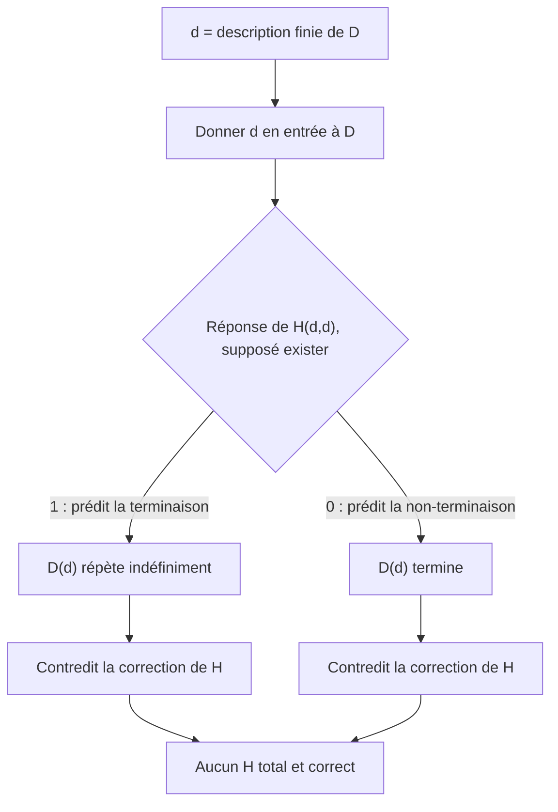

Lorsqu'un programme ne finit pas, on peut se demander s'il serait possible de savoir à l'avance qu'il terminera. On peut souvent démontrer la terminaison ou la non-terminaison de programmes particuliers. Mais il n'existe aucun algorithme qui <strong>termine lui-même et donne une réponse correcte pour tous les programmes et toutes leurs entrées</strong>.

C'est l'<strong>indécidabilité du problème de l'arrêt</strong>. Il s'agit d'un résultat d'impossibilité démontré, et non d'une conjecture encore ouverte. Cela ne signifie pas qu'aucun cas particulier ne puisse être décidé.

Nous considérons un modèle de calcul déterministe, régi par un algorithme fini ordinaire, dont la mémoire peut croître selon les besoins. L'arrêt d'une machine réelle dû à une batterie vide, à l'interruption forcée d'un processus ou à un manque de mémoire se distingue de l'arrêt dans ce modèle mathématique.

## 1. Fixer l'entrée autant que le programme

Notons $\langle P\rangle$ la description finie d'un programme $P$, et prenons pour entrée une chaîne finie $x$. Un simulateur universel peut lire cette description comme une donnée et reproduire le calcul de $P$ sur $x$.

Le problème de l'arrêt porte sur l'appartenance à l'ensemble suivant :

$$
\mathrm{HALT}
=\{\langle P,x\rangle : P(x)\text{ termine en temps fini}\}
$$

S'il existait un algorithme de décision total $H$, il renverrait en temps fini l'une des valeurs suivantes, pour toute description valide de programme et toute entrée :

$$
H(\langle P\rangle,x)=
\begin{cases}
1 & P(x)\text{ termine}\\
0 & P(x)\text{ ne termine pas}
\end{cases}
$$

Nous exigeons <strong>à la fois que $H$ termine toujours et que sa réponse soit toujours correcte</strong>. Les chaînes qui ne sont pas des descriptions valides peuvent être traitées séparément par une vérification syntaxique.

Si un calcul termine, sa simulation finira par révéler son arrêt. L'ensemble des couples qui terminent est donc semi-décidable. Mais le temps déjà passé à attendre ne permet pas de savoir si un calcul toujours en cours finira à l'étape suivante ou continuera indéfiniment.

On parle parfois de « boucle infinie » pour toute exécution qui ne termine pas, sans qu'elle répète nécessairement le même état. Un calcul qui incrémente sans cesse un compteur dans une mémoire non bornée peut avoir une configuration complète différente à chaque étape.

## 2. Des exemples simples et des observations limitées en nombre d'étapes

### Un exemple dont on peut expliquer la terminaison

Voici un exemple Python exécutable qui n'accepte que les entiers du type intégré.

```python
def double_integer(x):
    if type(x) is not int:
        raise TypeError("x must be a built-in int")
    return x * 2


print(double_integer(3))
```

Sa sortie est :

```text
6
```

Pour tout entier fini en entrée, l'opération arithmétique idéalisée s'achève en temps fini. Cela ne signifie pas que le temps réel ou la mémoire utilisée soient indépendants de la taille de l'entrée. Nous limitons le type parce que des objets Python quelconques peuvent définir leur propre multiplication, et que multiplier une chaîne renvoie une chaîne, pas un nombre.

À l'inverse, ce <strong>pseudocode</strong> ne termine pas dans un modèle sans interruption externe :

```text
Forever(x):
    repeat forever:
        do nothing
```

On peut expliquer cette non-terminaison : le flot de contrôle n'atteint jamais de sortie. L'absence de décideur universel n'empêche pas de trancher de tels cas particuliers.

### Observer un nombre fini d'étapes de Collatz

À partir d'un entier strictement positif $n$, on le divise par deux s'il est pair, ou on le multiplie par trois et on ajoute un s'il est impair, puis on répète l'opération. La conjecture de Collatz, aussi appelée conjecture de Syracuse, affirme que tout entier strictement positif finit par atteindre un.

Le programme suivant observe ce processus avec un nombre maximal d'étapes. <strong>Atteindre cette limite ne doit pas être interprété comme une preuve que le calcul sans limite ne terminera jamais.</strong>

```python
def collatz_bounded(n, max_steps):
    if type(n) is not int or n < 1:
        raise ValueError("n must be a positive built-in int")
    if type(max_steps) is not int or max_steps < 0:
        raise ValueError("max_steps must be a nonnegative built-in int")

    steps = 0
    while n != 1 and steps < max_steps:
        n = n // 2 if n % 2 == 0 else 3 * n + 1
        steps += 1
    status = "reached_one" if n == 1 else "step_limit"
    return status, steps, n


print(collatz_bounded(6, 8))
print(collatz_bounded(6, 7))
print(collatz_bounded(1, 0))
```

Sortie :

```text
('reached_one', 8, 1)
('step_limit', 7, 2)
('reached_one', 0, 1)
```

Ce programme d'observation termine lui-même après, au plus, le nombre fini d'itérations indiqué. La question de fond est de savoir si l'itération sans cette limite atteint un. Un nombre fini d'exemples favorables ne prouve pas l'affirmation pour tous les entiers strictement positifs. Les travaux de Tao apportent un résultat partiel important, mais n'établissent pas que toutes les orbites atteignent un.

En notant $\mathrm{Col}$ l'application itérée, la conjecture prend la forme

$$
\forall n\ge1\ \exists t\ge0\quad \mathrm{Col}^{t}(n)=1
$$

Donner un $n$ particulier à l'hypothétique $H$ fournirait une réponse concernant <strong>cette seule entrée</strong>. La question de totalité « termine-t-il pour tous les $n$ ? » ne se confond pas directement avec une unique question ordinaire d'arrêt. On ne peut pas en conclure que soumettre un programme permettrait de décider n'importe quel énoncé mathématique.

## 3. Un programme qui inverse la réponse

Supposons qu'il existe un algorithme $H$ qui termine toujours et répond correctement pour toute description valide de programme et toute entrée.

Un programme décrit par $s$ peut recevoir cette même description $s$ en entrée. Il s'agit simplement de traiter un programme comme une donnée, sans devoir y insérer un code source de longueur infinie.

Sous cette hypothèse, construisons $D$ :

```text
D(s):
    if s is not a valid program description:
        halt
    if H(s, s) == 1:
        repeat forever:
            do nothing
    else:
        halt
```

C'est un <strong>pseudocode de démonstration qui appelle l'hypothétique $H$</strong>, et non un décideur d'arrêt déjà implémenté. L'hypothèse selon laquelle $H$ est calculable et termine toujours permet de construire ce $D$ avec une description finie.

Notons $d=\langle D\rangle$ la description de $D$, et considérons $D(d)$.

| Réponse du décideur | Ce qu'elle impliquerait s'il était correct | Comportement défini pour $D(d)$ |
| :--- | :--- | :--- |
| $H(d,d)=1$ | $D(d)$ termine | Répéter indéfiniment |
| $H(d,d)=0$ | $D(d)$ ne termine pas | Terminer immédiatement |

Les deux réponses contredisent la correction du décideur. En abrégé,

$$
D(d)\text{ termine}
\iff H(d,d)=0
\iff D(d)\text{ ne termine pas}
$$

L'algorithme $H$ supposé total et correct n'existe donc pas.

La conclusion n'est ni que tous les programmes autoréférentiels sont contradictoires, ni que la logique se brise. La contradiction réfute <strong>l'hypothèse de l'existence d'un décideur universel de l'arrêt</strong>.

## 4. Suivre l'argument diagonal dans un schéma



C'est une construction diagonale : l'un des programmes que le décideur proposé prétend couvrir inverse sa réponse. Le rapprochement avec le paradoxe du menteur peut aider l'intuition, mais la démonstration repose sur le codage des descriptions et la construction effective des programmes.

## 5. L'article original de Turing et les modèles de calcul

L'article d'[Alan Turing](/fr/p/turing/) de 1936 établit des résultats d'indécidabilité au moyen de machines de calcul, de descriptions codées, d'une machine universelle et de la diagonalisation. La preuve à la manière de Python donnée ici ne figure pas telle quelle dans l'original.

Le texte original appelle circle-free une machine qui produit une infinité de chiffres, zéros ou uns, et circular une machine qui n'en produit qu'un nombre fini. Cette seconde catégorie comprend aussi bien les machines qui s'arrêtent que celles qui poursuivent d'autres opérations sans produire davantage de chiffres. Traduire ces termes simplement par « ne termine pas » et « termine » serait donc inexact. La section 8 traite aussi de l'impossibilité de décider en général si une machine imprimera un jour un symbole donné.

On peut relier l'apparition du symbole à l'arrêt en construisant une machine qui simule le calcul et ne s'arrête que lorsque ce symbole apparaît. Nous avons employé ici la formulation moderne habituelle : <strong>la terminaison d'un programme sur une entrée fixée</strong>.

Une [machine de Turing](/fr/p/turing-machine-computability/) est un modèle mathématique avec un ensemble fini de règles et un ruban utilisable selon les besoins. La thèse de Church–Turing affirme que la notion intuitive de « procédure effective exécutable mécaniquement » est capturée par cette calculabilité formelle. Elle se distingue des théorèmes d'équivalence entre modèles définis formellement. Ce n'est pas non plus une affirmation démontrée sans conditions sur tous les phénomènes physiques ou appareils réels.

## 6. Le lien avec l'incomplétude

Les [théorèmes d'incomplétude de Gödel](/fr/p/godels-incompleteness-theorems/) sont étroitement liés aux limites de la calculabilité. Leurs énoncés ne s'appliquent pas sans conditions à tout système axiomatique « suffisamment puissant » : l'axiomatisation effective, la capacité d'exprimer l'arithmétique, la cohérence et d'autres hypothèses comptent. Il faut aussi distinguer la vérité dans les entiers naturels standards de la démontrabilité dans une théorie.

Pour voir un lien avec l'arrêt, considérons une théorie dont les preuves peuvent être énumérées effectivement et qui <strong>ne démontre que des énoncés vrais</strong> sur la terminaison et la non-terminaison. Si elle pouvait démontrer l'une ou l'autre pour chaque programme et chaque entrée fixée, on pourrait chercher les deux sortes de preuves et renvoyer la réponse correspondant à la première trouvée.

Cela contredirait l'indécidabilité du problème de l'arrêt. Même une telle théorie correcte ne peut donc pas trancher toutes les questions d'arrêt. Cette explication utilise l'hypothèse forte de correction sémantique ; elle ne donne ni les hypothèses les plus faibles de chaque théorème de Gödel, ni leur démonstration complète.

## 7. Le théorème de Rice et l'analyse pratique

### Des propriétés non triviales des entrées et sorties

Le théorème de Rice établit un résultat général d'indécidabilité pour les <strong>propriétés extensionnelles non triviales</strong> de la fonction partielle calculée par un programme ou du langage qu'il reconnaît.

« Extensionnelle » signifie que des programmes représentant le même comportement d'entrée et de sortie ont la même réponse quant à la propriété. « Non triviale » signifie qu'il existe des objets calculables qui la possèdent et d'autres qui ne la possèdent pas.

Par exemple, « termine et renvoie zéro pour toutes les entrées » est une propriété non triviale d'une fonction partielle. Elle diffère de « s'il termine, sa sortie est toujours zéro ». Un programme qui ne termine sur aucune entrée satisfait aussi cette dernière condition. Il ne faut donc pas laisser ambiguë la formule « renvoie toujours zéro ».

Certaines questions de syntaxe ou de représentation sont décidables, comme le nombre d'états écrits dans la description d'un programme. Le théorème de Rice ne s'applique pas non plus automatiquement à des propriétés d'étapes intermédiaires de l'exécution, par exemple un accès particulier à la mémoire. Pour établir l'indécidabilité d'un problème d'exécution, il faut préciser le modèle et fournir une réduction adaptée ou un autre argument.

### Distinguer garanties, réponses inconnues et délais

L'absence de décideur universel ne signifie pas que tous les outils d'analyse doivent se contenter de deviner.

- <strong>Analyse correcte mais incomplète</strong> : elle apporte des garanties lorsqu'elle peut prouver un résultat, et répond « inconnu » dans les autres cas. Un avertissement d'une analyse conservative peut ne pas correspondre à un défaut réel.
- <strong>Langages ou domaines d'entrée restreints</strong> : ils peuvent employer des règles garantissant la terminaison ou une recherche exhaustive sur un domaine fini. Le simple fait qu'un langage ne soit pas Turing-complet ne garantit pas la terminaison de tous ses programmes.
- <strong>Heuristiques et tests</strong> : ils trouvent des défauts possibles ou des contre-exemples utiles, sans constituer une garantie de complétude au-delà du domaine vérifié.
- <strong>Délais maximaux</strong> : ils interrompent la consommation de ressources ; ils ne prouvent pas que le calcul continuerait indéfiniment en l'absence de limite.

Dans un système déterministe fermé comportant un nombre fini de configurations complètes, représentables et dont les transitions sont calculables effectivement, on peut suivre l'exécution jusqu'à l'arrêt ou à la répétition d'une configuration. Cela établit la décidabilité mathématique, sans garantir une recherche exhaustive réalisable avec un temps ou une mémoire raisonnables. Le raisonnement ne se transpose pas directement à des systèmes avec des entrées non bornées, une interaction externe ou une mémoire croissante.

## 8. Ce qui est impossible et ce qui reste possible

Le résultat sur l'arrêt exclut un algorithme général qui termine toujours et choisit toujours la bonne réponse parmi deux possibilités, pour tout programme et toute entrée. « En temps fini » ne signifie pas ici « avant une borne d'étapes fixée à l'avance » : pour une borne finie donnée, on peut simuler ce nombre d'étapes.

Les preuves de terminaison de programmes particuliers, les vérifications complètes sous des restrictions adaptées, les analyses correctes qui autorisent une réponse inconnue et les tests finis restent utiles et compatibles avec ce résultat. L'essentiel est de distinguer si la réponse d'un outil est une preuve, une observation, une supposition ou l'aveu qu'il ne sait pas.

### Références

- [Turing: On Computable Numbers, with an Application to the Entscheidungsproblem](https://theory.stanford.edu/~trevisan/cs172-07/turing36.pdf) — Copie universitaire de l'article original. La section 2 distingue les types de machines ; la section 8 traite de la diagonalisation et de l'apparition de symboles ; la section 9 interprète le calcul.
- [MIT 6.045J: Mapping reducibility and Rice's theorem](https://ocw.mit.edu/courses/6-045j-automata-computability-and-complexity-spring-2011/7aead2c728dd3d5a737d832811ef97e6_MIT6_045JS11_lec09.pdf) — Conditions du théorème de Rice et distinction entre propriétés des langages et propriétés structurelles ou opérationnelles des machines.
- [Sinclair: The Church-Turing Thesis](https://people.eecs.berkeley.edu/~sinclair/cs172/n4.pdf) — La thèse reliant les procédures effectives intuitives aux modèles formels.
- [Tao: Almost all orbits of the Collatz map attain almost bounded values](https://arxiv.org/abs/1909.03562) — Résultat partiel sur l'itération de Collatz, et non preuve que tous les entiers strictement positifs atteignent un.
