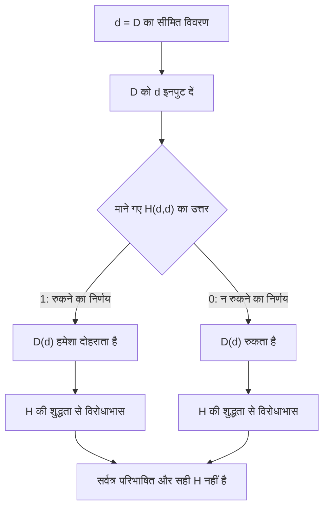

जब कोई प्रोग्राम समाप्त नहीं होता, तो हम सोच सकते हैं कि क्या उसे चलाने से पहले उसके समाप्त होने का पता लगाया जा सकता है। कई विशेष प्रोग्रामों के लिए हम सिद्ध कर सकते हैं कि वे रुकेंगे या नहीं रुकेंगे। लेकिन ऐसा कोई एल्गोरिदम नहीं है जो <strong>हर प्रोग्राम और उसके इनपुट के लिए स्वयं भी अवश्य रुके और हमेशा सही उत्तर दे</strong>।

यही <strong>हाल्टिंग प्रॉब्लम की अनिर्णेयता</strong> है। यह कोई अभी तक अनसुलझी परिकल्पना नहीं, बल्कि सिद्ध असंभवता का परिणाम है। इसका अर्थ यह भी नहीं है कि किसी विशेष प्रोग्राम के बारे में कुछ भी तय नहीं किया जा सकता।

यहाँ हम एक नियतात्मक गणना मॉडल लेते हैं, जो सामान्य सीमित एल्गोरिदम के अनुसार चलता है और आवश्यकता पर स्मृति बढ़ा सकता है। वास्तविक मशीन का बैटरी खत्म होने, प्रक्रिया को जबरन बंद करने या स्मृति की कमी से रुकना इस गणितीय मॉडल के रुकने से अलग है।

## 1. प्रोग्राम के साथ इनपुट भी निश्चित होना चाहिए

प्रोग्राम $P$ के सीमित विवरण को $\langle P\rangle$ लिखें और इनपुट $x$ एक सीमित स्ट्रिंग हो। सार्वभौमिक सिम्युलेटर इस विवरण को डेटा की तरह पढ़कर $x$ पर $P$ की गणना का अनुकरण कर सकता है।

हाल्टिंग प्रॉब्लम निम्न समुच्चय की सदस्यता पूछती है:

$$
\mathrm{HALT}
=\{\langle P,x\rangle : P(x)\text{ सीमित समय में रुकता है}\}
$$

यदि हर वैध इनपुट पर परिभाषित निर्णय एल्गोरिदम $H$ हो, तो उसे प्रत्येक वैध प्रोग्राम-विवरण और इनपुट के लिए सीमित समय में यह मान देना होगा:

$$
H(\langle P\rangle,x)=
\begin{cases}
1 & P(x)\text{ रुकता है}\\
0 & P(x)\text{ नहीं रुकता}
\end{cases}
$$

यहाँ <strong>$H$ का हमेशा रुकना और उसके उत्तर का हमेशा सही होना, दोनों</strong> आवश्यक हैं। जो स्ट्रिंग वैध प्रोग्राम-विवरण नहीं है, उसे वाक्यविन्यास की जाँच से अलग संभाला जा सकता है।

जो गणना रुकती है, उसका अनुकरण जारी रखने पर अंततः उसका समाप्त होना दिख जाएगा। इस अर्थ में रुकने वाले जोड़ों का समुच्चय अर्धनिर्णेय है। लेकिन केवल अब तक प्रतीक्षा में बीते समय से यह नहीं पता चलता कि चलती हुई गणना अगले चरण में समाप्त होगी या हमेशा चलती रहेगी।

न रुकने को कभी-कभी “अनंत लूप” कहा जाता है, पर आवश्यक नहीं कि वही अवस्था दोहराई जाए। असीम स्मृति पर किसी काउंटर को लगातार बढ़ाने वाली गणना का पूरा विन्यास हर चरण में अलग हो सकता है।

## 2. सरल उदाहरण और चरणों की सीमा वाली जाँच

### ऐसा उदाहरण जिसका समाप्त होना समझाया जा सकता है

यह चलाने योग्य Python उदाहरण केवल अंतर्निर्मित पूर्णांक प्रकार स्वीकार करता है।

```python
def double_integer(x):
    if type(x) is not int:
        raise TypeError("x must be a built-in int")
    return x * 2


print(double_integer(3))
```

आउटपुट:

```text
6
```

किसी भी सीमित पूर्णांक इनपुट पर आदर्शीकृत पूर्णांक संक्रिया सीमित समय में समाप्त होती है। इसका अर्थ यह नहीं कि वास्तविक समय या स्मृति का उपयोग इनपुट के आकार से स्वतंत्र है। प्रकार सीमित करने का कारण यह है कि मनमाने Python ऑब्जेक्ट अपना गुणा स्वयं परिभाषित कर सकते हैं, और स्ट्रिंग का गुणा संख्या के बजाय स्ट्रिंग देता है।

इसके विपरीत, बाहरी व्यवधान न होने वाले मॉडल में यह <strong>छद्म-कोड</strong> नहीं रुकता:

```text
Forever(x):
    repeat forever:
        do nothing
```

न रुकने का कारण यह है कि नियंत्रण प्रवाह निकास तक नहीं पहुँचता। सार्वभौमिक निर्णायक न होने पर भी ऐसे विशेष उदाहरण तय किए जा सकते हैं।

### कोलैट्ज़ के सीमित चरण देखना

धनात्मक पूर्णांक $n$ से शुरू करें। सम होने पर दो से भाग दें और विषम होने पर तीन से गुणा करके एक जोड़ें; फिर यह प्रक्रिया दोहराएँ। हर धनात्मक पूर्णांक का अंततः एक तक पहुँचना कोलैट्ज़ परिकल्पना है।

निम्न प्रोग्राम अधिकतम चरणों की संख्या देकर इस प्रक्रिया को देखता है। <strong>चरण-सीमा तक पहुँचने का अर्थ यह नहीं कि बिना सीमा की गणना कभी नहीं रुकेगी।</strong>

```python
def collatz_bounded(n, max_steps):
    if type(n) is not int or n < 1:
        raise ValueError("n must be a positive built-in int")
    if type(max_steps) is not int or max_steps < 0:
        raise ValueError("max_steps must be a nonnegative built-in int")

    steps = 0
    while n != 1 and steps < max_steps:
        n = n // 2 if n % 2 == 0 else 3 * n + 1
        steps += 1
    status = "reached_one" if n == 1 else "step_limit"
    return status, steps, n


print(collatz_bounded(6, 8))
print(collatz_bounded(6, 7))
print(collatz_bounded(1, 0))
```

आउटपुट:

```text
('reached_one', 8, 1)
('step_limit', 7, 2)
('reached_one', 0, 1)
```

यह निरीक्षण प्रोग्राम स्वयं अधिकतम निर्धारित सीमित पुनरावृत्तियों के बाद समाप्त होता है। असली प्रश्न है कि चरण-सीमा हटाने पर प्रक्रिया एक तक पहुँचती है या नहीं। सीमित सफल उदाहरण सभी धनात्मक पूर्णांकों के लिए प्रमाण नहीं हैं। Tao के शोध में महत्वपूर्ण आंशिक परिणाम है, लेकिन उससे यह सिद्ध नहीं होता कि हर कक्षा एक तक पहुँचती है।

पुनरावृत्त मानचित्र को $\mathrm{Col}$ लिखें, तो परिकल्पना का रूप है:

$$
\forall n\ge1\ \exists t\ge0\quad \mathrm{Col}^{t}(n)=1
$$

काल्पनिक $H$ को कोई खास $n$ देने पर <strong>उस एक इनपुट</strong> का उत्तर मिलेगा। “क्या सभी $n$ पर प्रोग्राम रुकता है?” जैसा सभी इनपुटों का प्रश्न सीधे एक सामान्य हाल्टिंग प्रश्न के समान नहीं है। इससे यह निष्कर्ष नहीं निकलता कि केवल एक प्रोग्राम सौंपने से कोई भी गणितीय कथन तय हो जाएगा।

## 3. उत्तर को उलटने वाला प्रोग्राम

मान लें कि एल्गोरिदम $H$ मौजूद है, जो हमेशा रुकता है और हर वैध प्रोग्राम-विवरण तथा इनपुट पर सही उत्तर देता है।

विवरण $s$ से दर्शाए गए प्रोग्राम को उसी विवरण $s$ को इनपुट के रूप में दिया जा सकता है। यहाँ प्रोग्राम को डेटा मान रहे हैं; अनंत लंबा स्रोत कोड डालने की आवश्यकता नहीं है।

इस धारणा के अंतर्गत $D$ बनाएँ:

```text
D(s):
    if s is not a valid program description:
        halt
    if H(s, s) == 1:
        repeat forever:
            do nothing
    else:
        halt
```

यह <strong>काल्पनिक $H$ को बुलाने वाला प्रमाण का छद्म-कोड</strong> है, कोई लागू किया गया हाल्टिंग निर्णायक नहीं। $H$ के संगणनीय और हमेशा समाप्त होने की धारणा से सीमित विवरण वाला $D$ बनाया जा सकता है।

$D$ का विवरण $d=\langle D\rangle$ हो। अब $D(d)$ पर विचार करें।

| निर्णायक का उत्तर | सही निर्णायक होने पर अर्थ | $D(d)$ की परिभाषा के अनुसार व्यवहार |
| :--- | :--- | :--- |
| $H(d,d)=1$ | $D(d)$ रुकता है | हमेशा दोहराना |
| $H(d,d)=0$ | $D(d)$ नहीं रुकता | तुरंत रुकना |

दोनों उत्तर शुद्धता से विरोधाभास पैदा करते हैं। संक्षेप में:

$$
D(d)\text{ रुकता है}
\iff H(d,d)=0
\iff D(d)\text{ नहीं रुकता}
$$

इसलिए माना गया सर्वत्र परिभाषित और सही $H$ मौजूद नहीं है।

निष्कर्ष यह नहीं कि सभी स्व-संदर्भित प्रोग्राम विरोधाभासी हैं या तर्क विफल हो गया है। विरोधाभास से खंडित होती है <strong>सार्वभौमिक हाल्टिंग निर्णायक के अस्तित्व की धारणा</strong>।

## 4. आरेख में विकर्ण तर्क



यह विकर्ण निर्माण है: प्रस्तावित निर्णायक जिन प्रोग्रामों को समेटता है, उन्हीं में से एक उसके उत्तर को उलट देता है। झूठे के विरोधाभास से समानता सहज समझ में सहायक हो सकती है, लेकिन प्रमाण का आधार विवरणों का कूटलेखन और प्रोग्रामों का प्रभावी निर्माण है।

## 5. ट्यूरिंग का मूल शोधपत्र और गणना मॉडल

[एलन ट्यूरिंग](/hi/p/turing/) के 1936 के शोधपत्र ने गणना मशीनों, कूटबद्ध विवरणों, सार्वभौमिक मशीन और विकर्ण तर्क से अनिर्णेयता दिखाई। इस लेख का Python जैसा प्रमाण मूल शोधपत्र में ठीक इसी रूप में नहीं है।

मूल शोधपत्र अनंत संख्या में शून्य या एक अंक निकालने वाली मशीन को circle-free और केवल सीमित संख्या में ऐसे अंक निकालने वाली मशीन को circular कहता है। दूसरे वर्ग में रुकने वाली मशीनें भी हैं और बिना और अंक निकाले अन्य काम करते रहने वाली मशीनें भी। इसलिए इन्हें सीधे “नहीं रुकती” और “रुकती है” कहना सही नहीं है। खंड 8 यह भी बताता है कि मशीन कभी किसी खास चिह्न को निकालेगी या नहीं, इसे सामान्य रूप से तय नहीं किया जा सकता।

ऐसी मशीन बनाई जा सकती है जो मूल गणना का अनुकरण करे और केवल खास चिह्न निकलने पर रुके। इससे चिह्न के आने को हाल्टिंग से जोड़ा जा सकता है। यहाँ हमने आज प्रचलित रूप, <strong>निश्चित इनपुट पर प्रोग्राम का रुकना</strong>, अपनाया है।

[ट्यूरिंग मशीन](/hi/p/turing-machine-computability/) सीमित नियमों और आवश्यकता अनुसार उपयोग की जा सकने वाली टेप आदि का गणितीय मॉडल है। चर्च–ट्यूरिंग थीसिस का दावा है कि सहज अर्थ में “यांत्रिक रूप से चल सकने वाली प्रभावी प्रक्रिया” को ऐसी औपचारिक संगणनीयता व्यक्त करती है। यह औपचारिक रूप से परिभाषित मॉडलों की समतुल्यता के प्रमेय से अलग है। यह सभी भौतिक घटनाओं या वास्तविक उपकरणों के बारे में बिना शर्त सिद्ध दावा भी नहीं है।

## 6. अपूर्णता प्रमेयों से संबंध

[गोडेल के अपूर्णता प्रमेय](/hi/p/godels-incompleteness-theorems/) संगणनीयता की सीमाओं से निकटता से जुड़े हैं। लेकिन ये हर “पर्याप्त शक्तिशाली स्वयंसिद्ध प्रणाली” के बारे में बिना शर्त कथन नहीं हैं। प्रभावी स्वयंसिद्धीकरण, अंकगणित व्यक्त करने की क्षमता, संगति जैसी धारणाएँ महत्वपूर्ण हैं। मानक प्राकृतिक संख्याओं में सत्य और किसी सिद्धांत के भीतर प्रमाणनीयता भी अलग हैं।

हाल्टिंग से संबंध देखने का एक तरीका ऐसे सिद्धांत पर विचार करना है जिसके प्रमाण प्रभावी रूप से गिनाए जा सकें और जो रुकने तथा न रुकने के बारे में <strong>केवल सत्य कथन सिद्ध करे</strong>। यदि वह हर प्रोग्राम और निश्चित इनपुट के लिए रुकना या न रुकना सिद्ध कर सके, तो हम दोनों प्रकार के प्रमाण खोजकर पहले मिले प्रमाण का उत्तर दे सकते हैं।

यह हाल्टिंग प्रॉब्लम की अनिर्णेयता के विरुद्ध होगा। इसलिए ऐसा सत्य-संरक्षक सिद्धांत भी सभी हाल्टिंग प्रश्न तय नहीं कर सकता। इस व्याख्या में सत्य-संरक्षण (soundness) की मजबूत धारणा है। यह गोडेल के हर प्रमेय की सबसे कमजोर शर्तों का कथन या उसका पूरा प्रमाण नहीं है।

## 7. राइस प्रमेय और व्यावहारिक विश्लेषण

### इनपुट-आउटपुट के गैर-तुच्छ गुण

राइस प्रमेय प्रोग्राम द्वारा गणना किए जाने वाले आंशिक फलन या पहचानी जाने वाली भाषा के <strong>गैर-तुच्छ विस्तारात्मक गुणों</strong> की सामान्य अनिर्णेयता बताता है।

“विस्तारात्मक” का अर्थ है कि समान इनपुट-आउटपुट व्यवहार वाले प्रोग्रामों के लिए गुण का सत्य-मूल्य समान हो। “गैर-तुच्छ” का अर्थ है कि कुछ संगणनीय वस्तुओं में वह गुण हो और कुछ में न हो।

उदाहरण के लिए, “हर इनपुट पर रुककर शून्य लौटाना” आंशिक फलन का गैर-तुच्छ गुण है। यह “यदि रुकता है तो आउटपुट हमेशा शून्य है” से अलग है। कोई ऐसा प्रोग्राम जो किसी इनपुट पर नहीं रुकता, दूसरी शर्त भी पूरी करता है। इसलिए “हमेशा शून्य लौटाता है” को अस्पष्ट नहीं छोड़ना चाहिए।

केवल वाक्यविन्यास या निरूपण से जुड़े कुछ प्रश्न निर्णेय हैं, जैसे प्रोग्राम-विवरण में लिखी अवस्थाओं की संख्या। राइस प्रमेय निष्पादन के बीच की किसी घटना, जैसे खास स्मृति पहुँच, पर स्वतः लागू नहीं होता। किसी निष्पादन समस्या की अनिर्णेयता दिखाने के लिए मॉडल तय करना और उपयुक्त न्यूनीकरण या अन्य तर्क देना आवश्यक है।

### गारंटी, अज्ञात उत्तर और समय-सीमा का अंतर

सार्वभौमिक निर्णायक न होने का अर्थ यह नहीं कि सभी विश्लेषण उपकरण केवल अनुमान लगा सकते हैं।

- <strong>सही लेकिन अपूर्ण विश्लेषण</strong>: जहाँ प्रमाण दे सकता है वहाँ गारंटी देता है, और शेष मामलों में “अज्ञात” कहता है। सावधानीपूर्ण विश्लेषण की चेतावनी वास्तविक दोष के बिना भी आ सकती है।
- <strong>सीमित भाषाएँ या इनपुट क्षेत्र</strong>: समाप्ति सुनिश्चित करने वाले नियम या सीमित क्षेत्र की पूरी खोज काम आ सकते हैं। केवल ट्यूरिंग-पूर्ण न होने से सभी प्रोग्रामों का रुकना सुनिश्चित नहीं होता।
- <strong>ह्यूरिस्टिक्स और परीक्षण</strong>: उपयोगी संभावित दोष या प्रतिउदाहरण खोजते हैं, पर जाँचे गए क्षेत्र से बाहर पूर्णता की गारंटी नहीं देते।
- <strong>समय-सीमा</strong>: संसाधनों का उपयोग रोकने का तरीका है, यह प्रमाण नहीं कि सीमा हटाने पर गणना हमेशा चलती रहेगी।

ऐसे बंद नियतात्मक तंत्र में जिसके पूरे विन्यासों की संख्या सीमित हो और जिन विन्यासों तथा संक्रमणों को प्रभावी रूप से संभाला जा सके, निष्पादन का पीछा तब तक कर सकते हैं जब तक वह रुके या पहले देखा गया विन्यास दोहराए। यह गणितीय निर्णेयता है, वास्तविक समय या स्मृति में पूरी खोज संभव होने की गारंटी नहीं। इसे असीम इनपुट, बाहरी संवाद या बढ़ती स्मृति वाले तंत्र पर सीधे लागू नहीं किया जा सकता।

## 8. क्या असंभव है और क्या संभव रहता है

हाल्टिंग का परिणाम ऐसे सामान्य एल्गोरिदम को असंभव बताता है जो हर प्रोग्राम और इनपुट के लिए स्वयं समाप्त हो तथा दो उत्तरों में से हमेशा सही उत्तर दे।

विशेष प्रोग्रामों की समाप्ति के प्रमाण, उचित प्रतिबंधों के अंतर्गत पूरी जाँच, “अज्ञात” उत्तर स्वीकार करने वाला सही विश्लेषण और सीमित परीक्षण इस परिणाम के अनुरूप हैं और उपयोगी रहते हैं। जरूरी है कि उपकरण का उत्तर “प्रमाण”, “निरीक्षण”, “अनुमान” या “अज्ञात” में से क्या है, यह स्पष्ट हो।

### संदर्भ

- [Turing: On Computable Numbers, with an Application to the Entscheidungsproblem](https://theory.stanford.edu/~trevisan/cs172-07/turing36.pdf) — विश्वविद्यालय द्वारा उपलब्ध मूल शोधपत्र की प्रति। खंड 2 में मशीनों का अंतर, खंड 8 में विकर्ण तर्क और चिह्न का आना, खंड 9 में गणना की व्याख्या है।
- [MIT 6.045J: Mapping reducibility and Rice's theorem](https://ocw.mit.edu/courses/6-045j-automata-computability-and-complexity-spring-2011/7aead2c728dd3d5a737d832811ef97e6_MIT6_045JS11_lec09.pdf) — राइस प्रमेय की शर्तें तथा भाषा के गुणों और मशीन की संरचना या निष्पादन के गुणों का अंतर।
- [Sinclair: The Church-Turing Thesis](https://people.eecs.berkeley.edu/~sinclair/cs172/n4.pdf) — सहज प्रभावी प्रक्रियाओं और औपचारिक मॉडल को जोड़ने वाली थीसिस।
- [Tao: Almost all orbits of the Collatz map attain almost bounded values](https://arxiv.org/abs/1909.03562) — कोलैट्ज़ पुनरावृत्ति का आंशिक परिणाम; सभी धनात्मक पूर्णांकों के एक तक पहुँचने का प्रमाण नहीं।
