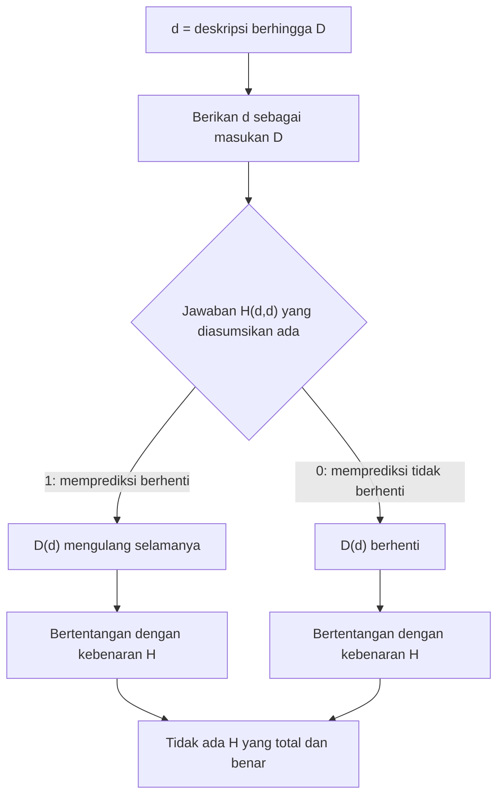

Ketika sebuah program tidak kunjung selesai, kita mungkin bertanya apakah kita dapat mengetahui sebelumnya bahwa program itu akan berakhir. Untuk program tertentu, kita sering dapat membuktikan bahwa program tersebut berhenti atau tidak berhenti. Namun, tidak ada algoritma yang <strong>untuk semua program dan masukannya selalu berhenti sendiri serta memberikan jawaban yang benar</strong>.

Inilah <strong>sifat tak dapat diputuskan dari masalah penghentian</strong>. Artinya, tidak ada algoritma pemutus umum seperti itu. Ini merupakan hasil ketidakmungkinan yang sudah dibuktikan, bukan konjektur yang belum terpecahkan. Hasil ini juga tidak berarti bahwa kita tidak dapat memutuskan satu pun kasus tertentu.

Kita menggunakan model komputasi deterministik yang mengikuti algoritma berhingga biasa, dengan ruang penyimpanan yang dapat bertambah sesuai kebutuhan. Mesin nyata yang berhenti karena baterai habis, proses dihentikan paksa, atau memori habis berbeda dari penghentian dalam model matematika ini.

## 1. Selain program, masukannya juga harus ditetapkan

Tuliskan deskripsi berhingga program $P$ sebagai $\langle P\rangle$, dan ambil masukan berupa string berhingga $x$. Simulator universal dapat membaca deskripsi itu sebagai data dan menirukan komputasi $P$ pada $x$.

Masalah penghentian menanyakan keanggotaan dalam himpunan berikut:

$$
\mathrm{HALT}
=\{\langle P,x\rangle : P(x)\text{ berhenti dalam waktu berhingga}\}
$$

Jika algoritma pemutus total $H$ ada, algoritma itu harus mengembalikan salah satu nilai berikut dalam waktu berhingga untuk setiap deskripsi program yang sah dan setiap masukan:

$$
H(\langle P\rangle,x)=
\begin{cases}
1 & P(x)\text{ berhenti}\\
0 & P(x)\text{ tidak berhenti}
\end{cases}
$$

Kita mensyaratkan <strong>dua hal sekaligus: $H$ selalu berhenti dan jawabannya selalu benar</strong>. String yang bukan deskripsi program sah dapat ditangani secara terpisah melalui pemeriksaan sintaksis.

Jika komputasi berhenti, simulasi yang terus dijalankan pada akhirnya akan menunjukkan penghentiannya. Dalam arti ini, himpunan pasangan yang berhenti dapat dikenali (semidecidable). Akan tetapi, lamanya kita sudah menunggu tidak menentukan apakah komputasi yang masih berjalan akan selesai pada langkah berikutnya atau berlanjut selamanya.

Eksekusi yang tidak berhenti kadang disebut “perulangan tak berhingga”, tetapi tidak harus mengulangi keadaan yang sama. Komputasi yang terus menaikkan pencacah dalam memori tak berbatas dapat memiliki konfigurasi lengkap yang berbeda pada setiap langkah.

## 2. Contoh sederhana dan pengamatan dengan batas langkah

### Contoh yang penghentiannya dapat dijelaskan

Contoh Python yang dapat dijalankan berikut hanya menerima bilangan bulat dari tipe bawaan.

```python
def double_integer(x):
    if type(x) is not int:
        raise TypeError("x must be a built-in int")
    return x * 2


print(double_integer(3))
```

Keluarannya:

```text
6
```

Untuk setiap bilangan bulat berhingga sebagai masukan, operasi bilangan bulat yang diidealkan selesai dalam waktu berhingga. Ini tidak berarti bahwa waktu nyata atau penggunaan memori tidak bergantung pada ukuran masukan. Tipe dibatasi karena objek Python sembarang dapat mendefinisikan perkaliannya sendiri, sedangkan perkalian string menghasilkan string, bukan angka.

Sebaliknya, <strong>pseudokode</strong> berikut tidak berhenti dalam model tanpa interupsi dari luar:

```text
Forever(x):
    repeat forever:
        do nothing
```

Kita dapat menjelaskan mengapa program ini tidak berhenti: alur kendalinya tidak pernah mencapai jalan keluar. Ketiadaan pemutus universal tidak menghalangi kita memutuskan contoh khusus seperti ini.

### Mengamati sejumlah berhingga langkah Collatz

Mulai dari bilangan bulat positif $n$, bagi dua jika genap, atau kalikan tiga lalu tambahkan satu jika ganjil, dan ulangi operasi tersebut. Konjektur Collatz menyatakan bahwa setiap bilangan bulat positif akhirnya mencapai satu.

Program berikut mengamati proses itu sampai jumlah langkah maksimum yang ditentukan. <strong>Mencapai batas langkah tidak boleh ditafsirkan sebagai bukti bahwa komputasi tanpa batas tersebut tidak akan pernah berhenti.</strong>

```python
def collatz_bounded(n, max_steps):
    if type(n) is not int or n < 1:
        raise ValueError("n must be a positive built-in int")
    if type(max_steps) is not int or max_steps < 0:
        raise ValueError("max_steps must be a nonnegative built-in int")

    steps = 0
    while n != 1 and steps < max_steps:
        n = n // 2 if n % 2 == 0 else 3 * n + 1
        steps += 1
    status = "reached_one" if n == 1 else "step_limit"
    return status, steps, n


print(collatz_bounded(6, 8))
print(collatz_bounded(6, 7))
print(collatz_bounded(1, 0))
```

Keluaran:

```text
('reached_one', 8, 1)
('step_limit', 7, 2)
('reached_one', 0, 1)
```

Program pengamatan ini sendiri selesai setelah paling banyak sejumlah berhingga iterasi yang ditentukan. Pertanyaan sebenarnya adalah apakah iterasi tanpa batas langkah mencapai satu. Sejumlah berhingga contoh yang berhasil tidak membuktikan klaim untuk semua bilangan bulat positif. Penelitian Tao memberikan hasil parsial penting, tetapi tidak membuktikan bahwa semua orbit mencapai satu.

Dengan menuliskan pemetaan yang diiterasikan sebagai $\mathrm{Col}$, bentuk konjekturnya adalah

$$
\forall n\ge1\ \exists t\ge0\quad \mathrm{Col}^{t}(n)=1
$$

Memberikan suatu $n$ tertentu kepada $H$ hipotetis akan menghasilkan jawaban mengenai <strong>satu masukan itu</strong>. Pertanyaan totalitas “Apakah program berhenti untuk semua $n$?” tidak langsung sama dengan satu pertanyaan penghentian biasa. Kita tidak boleh menyimpulkan bahwa menyerahkan satu program dapat memutuskan sembarang pernyataan matematika.

## 3. Program yang membalik jawaban

Anggap ada algoritma $H$ yang selalu berhenti dan menjawab dengan benar untuk setiap deskripsi program yang sah dan setiap masukan.

Program yang dideskripsikan oleh $s$ dapat menerima deskripsi yang sama, yaitu $s$, sebagai masukan. Kita hanya memperlakukan program sebagai data, tanpa harus menyisipkan kode sumber yang panjangnya tak berhingga.

Dengan asumsi ini, kita membangun $D$:

```text
D(s):
    if s is not a valid program description:
        halt
    if H(s, s) == 1:
        repeat forever:
            do nothing
    else:
        halt
```

Ini adalah <strong>pseudokode pembuktian yang memanggil $H$ hipotetis</strong>, bukan pemutus penghentian yang sudah diimplementasikan. Asumsi bahwa $H$ dapat dikomputasi dan selalu berakhir memungkinkan kita membangun $D$ dengan deskripsi berhingga.

Misalkan $d=\langle D\rangle$ adalah deskripsi $D$, lalu pertimbangkan $D(d)$.

| Jawaban pemutus | Maknanya jika pemutus benar | Perilaku yang ditentukan oleh definisi $D(d)$ |
| :--- | :--- | :--- |
| $H(d,d)=1$ | $D(d)$ berhenti | Mengulang selamanya |
| $H(d,d)=0$ | $D(d)$ tidak berhenti | Langsung berhenti |

Kedua jawaban bertentangan dengan kebenaran pemutus. Secara ringkas,

$$
D(d)\text{ berhenti}
\iff H(d,d)=0
\iff D(d)\text{ tidak berhenti}
$$

Jadi, $H$ yang diasumsikan total dan benar itu tidak ada.

Kesimpulannya bukan bahwa semua program yang merujuk diri sendiri bersifat kontradiktif, atau bahwa logika runtuh. Yang dibantah oleh kontradiksi adalah <strong>asumsi bahwa pemutus penghentian universal ada</strong>.

## 4. Mengikuti argumen diagonal melalui diagram



Ini merupakan konstruksi diagonal: salah satu program yang seharusnya dicakup oleh pemutus tersebut membalik jawabannya. Kemiripannya dengan paradoks pembohong dapat membantu intuisi, tetapi pembuktian bertumpu pada pengodean deskripsi dan kemampuan membangun program secara efektif.

## 5. Makalah asli Turing dan model komputasi

Makalah [Alan Turing](/id/p/turing/) tahun 1936 menunjukkan sifat tak dapat diputuskan melalui mesin komputasi, deskripsi berkode, mesin universal, dan diagonalisasi. Namun, pembuktian bergaya Python dalam artikel ini tidak tercantum persis seperti itu dalam makalah aslinya.

Makalah asli menyebut mesin yang mengeluarkan tak berhingga banyak digit nol atau satu sebagai circle-free, dan mesin yang hanya mengeluarkan sejumlah berhingga digit tersebut sebagai circular. Kelompok kedua mencakup mesin yang berhenti maupun mesin yang terus melakukan operasi lain tanpa mengeluarkan digit lagi. Karena itu, menerjemahkannya hanya sebagai “tidak berhenti” dan “berhenti” tidak tepat. Bagian 8 juga membahas ketidakmungkinan memutuskan secara umum apakah mesin akan mencetak simbol tertentu pada suatu saat.

Kita dapat menghubungkan kemunculan simbol dengan penghentian dengan membangun mesin yang menyimulasikan komputasi dan berhenti hanya jika simbol itu muncul. Di sini kita menggunakan rumusan modern yang lazim: <strong>penghentian program pada masukan yang tetap</strong>.

[Mesin Turing](/id/p/turing-machine-computability/) adalah model matematika dengan aturan berhingga dan pita yang dapat digunakan sesuai kebutuhan. Tesis Church–Turing menyatakan bahwa gagasan intuitif tentang “prosedur efektif yang dapat dijalankan secara mekanis” dicakup oleh komputabilitas formal semacam ini. Tesis tersebut berbeda dari teorema kesetaraan antara model yang didefinisikan secara formal. Ia juga bukan klaim yang telah dibuktikan tanpa syarat tentang semua fenomena fisik atau perangkat nyata.

## 6. Hubungan dengan ketidaklengkapan

[Teorema ketidaklengkapan Gödel](/id/p/godels-incompleteness-theorems/) berkaitan erat dengan batas komputabilitas. Namun, pernyataannya tidak berlaku tanpa syarat untuk setiap sistem aksioma yang “cukup kuat”. Aksiomatisasi efektif, kemampuan menyatakan aritmetika, konsistensi, dan asumsi lainnya penting. Kebenaran pada bilangan asli standar juga harus dibedakan dari keterbuktian dalam suatu teori.

Salah satu cara melihat kaitannya dengan penghentian adalah mempertimbangkan teori yang bukti-buktinya dapat dienumerasi secara efektif dan yang <strong>hanya membuktikan pernyataan benar</strong> tentang berhenti atau tidak berhenti. Jika teori itu dapat membuktikan salah satunya untuk setiap program dan masukan tetap, kita dapat mencari kedua jenis bukti lalu memberikan jawaban sesuai bukti pertama yang ditemukan.

Hal itu bertentangan dengan sifat tak dapat diputuskan dari masalah penghentian. Jadi, bahkan teori yang benar secara semantik seperti itu tidak dapat menjawab semua pertanyaan penghentian. Penjelasan ini menggunakan asumsi kuat berupa kebenaran semantik (soundness). Ini bukan pernyataan tentang asumsi terlemah setiap teorema Gödel ataupun pembuktian lengkapnya.

## 7. Teorema Rice dan analisis praktis

### Sifat masukan-keluaran yang tidak trivial

Teorema Rice memberikan hasil umum tentang sifat tak dapat diputuskan untuk <strong>sifat ekstensional yang tidak trivial</strong> dari fungsi parsial yang dihitung program atau bahasa yang dikenali program.

“Ekstensional” berarti program yang memiliki perilaku masukan-keluaran sama juga sepakat mengenai sifat tersebut. “Tidak trivial” berarti ada objek yang dapat dikomputasi yang memiliki sifat itu dan ada yang tidak.

Sebagai contoh, “berhenti dan mengembalikan nol untuk semua masukan” adalah sifat tidak trivial dari fungsi parsial. Ini berbeda dari “jika berhenti, keluarannya selalu nol”. Program yang tidak berhenti pada masukan mana pun juga memenuhi kondisi kedua. Karena itu, ungkapan “selalu mengembalikan nol” tidak boleh dibiarkan ambigu.

Ada pertanyaan tentang sintaksis atau representasi yang dapat diputuskan, misalnya jumlah keadaan yang dituliskan dalam deskripsi program. Teorema Rice juga tidak otomatis berlaku pada sifat langkah perantara eksekusi, seperti akses memori tertentu. Untuk membuktikan bahwa suatu masalah eksekusi tidak dapat diputuskan, modelnya harus ditetapkan dan reduksi yang tepat atau argumen lain harus diberikan.

### Membedakan jaminan, jawaban tidak diketahui, dan batas waktu

Tidak adanya pemutus universal bukan berarti semua alat analisis hanya dapat menebak.

- <strong>Analisis yang benar tetapi tidak lengkap</strong>: memberikan jaminan ketika hasil dapat dibuktikan, dan menjawab “tidak diketahui” untuk kasus lainnya. Peringatan dari analisis konservatif belum tentu menunjukkan cacat nyata.
- <strong>Bahasa atau ranah masukan yang dibatasi</strong>: dapat memakai aturan yang menjamin terminasi atau pencarian menyeluruh pada ranah berhingga. Sekadar tidak lengkap secara Turing tidak menjamin bahwa semua program akan berhenti.
- <strong>Heuristik dan pengujian</strong>: mencari dugaan cacat atau contoh penyangkal yang berguna, tetapi tidak menjamin kelengkapan di luar lingkup yang diperiksa.
- <strong>Batas waktu</strong>: menghentikan penggunaan sumber daya, bukan membuktikan bahwa komputasi akan terus berjalan selamanya jika batasnya dihapus.

Dalam sistem deterministik tertutup dengan sejumlah berhingga konfigurasi lengkap yang representasi dan transisinya dapat ditangani secara efektif, kita dapat mengikuti eksekusi sampai berhenti atau mengunjungi konfigurasi yang sudah pernah ditemui. Ini menunjukkan bahwa masalah tersebut dapat diputuskan secara matematis, bukan jaminan bahwa pencarian menyeluruh praktis dilakukan dalam batas waktu atau memori nyata. Argumen itu tidak langsung berlaku untuk sistem dengan masukan tak berbatas, interaksi eksternal, atau memori yang dapat bertambah.

## 8. Apa yang mustahil dan apa yang tetap dapat dilakukan

Hasil tentang penghentian meniadakan algoritma umum yang, untuk sembarang program dan masukan, selalu berakhir dan selalu memilih jawaban yang benar dari dua kemungkinan.

Pembuktian terminasi untuk program tertentu, pemeriksaan lengkap di bawah pembatasan yang sesuai, analisis yang benar tetapi mengizinkan jawaban “tidak diketahui”, dan pengujian berhingga tetap berguna serta tidak bertentangan dengan hasil ini. Yang penting adalah membedakan apakah jawaban alat merupakan “bukti”, “pengamatan”, “dugaan”, atau “tidak diketahui”.

### Referensi

- [Turing: On Computable Numbers, with an Application to the Entscheidungsproblem](https://theory.stanford.edu/~trevisan/cs172-07/turing36.pdf) — Salinan makalah asli yang disediakan universitas. Bagian 2 membedakan jenis mesin; bagian 8 membahas diagonalisasi dan kemunculan simbol; bagian 9 menafsirkan komputasi.
- [MIT 6.045J: Mapping reducibility and Rice's theorem](https://ocw.mit.edu/courses/6-045j-automata-computability-and-complexity-spring-2011/7aead2c728dd3d5a737d832811ef97e6_MIT6_045JS11_lec09.pdf) — Syarat teorema Rice serta perbedaan antara sifat bahasa dan sifat struktural atau operasional mesin.
- [Sinclair: The Church-Turing Thesis](https://people.eecs.berkeley.edu/~sinclair/cs172/n4.pdf) — Tesis yang menghubungkan prosedur efektif intuitif dengan model formal.
- [Tao: Almost all orbits of the Collatz map attain almost bounded values](https://arxiv.org/abs/1909.03562) — Hasil parsial tentang iterasi Collatz, bukan bukti bahwa semua bilangan bulat positif mencapai satu.
