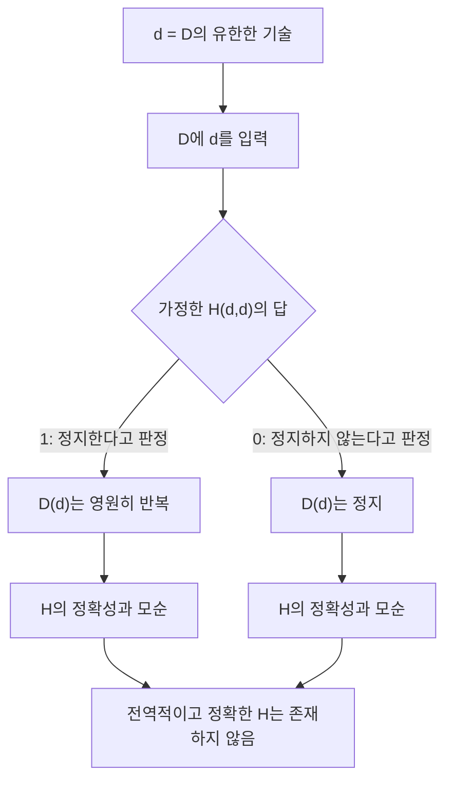

프로그램이 끝나지 않을 때면 “실행하기 전에 반드시 종료하는지 알아낼 수 없을까?”라고 생각하게 됩니다. 개별 프로그램의 종료나 비종료를 증명할 수 있는 경우는 많습니다. 하지만 <strong>모든 프로그램과 입력에 대해 판정기 자신도 반드시 종료하면서 정확한 답을 주는</strong> 알고리즘은 존재하지 않습니다.

이것이 <strong>정지 문제의 결정 불가능성</strong>입니다. 아직 풀리지 않은 추측이 아니라, 불가능하다는 사실이 증명된 결과입니다. 어떤 개별 프로그램에 대해서도 아무것도 판단할 수 없다는 뜻은 아닙니다.

이 글에서는 일반적인 유한 알고리즘에 따라 동작하며 필요에 따라 기억 공간을 늘릴 수 있는 결정적 계산 모델을 다룹니다. 실제 기계의 배터리 방전, 프로세스 강제 종료, 메모리 부족으로 인한 중단은 이 수학적 모델의 정지와 구별합니다.

## 1. 프로그램뿐 아니라 입력도 고정해야 합니다

프로그램 $P$의 유한한 기술을 $\langle P\rangle$로 쓰고, 입력 $x$는 유한 문자열이라고 합시다. 범용 시뮬레이터는 이 기술을 데이터로 읽고 $P$에 $x$를 준 계산을 재현할 수 있습니다.

정지 문제는 다음 집합에 속하는지를 묻습니다.

$$
\mathrm{HALT}
=\{\langle P,x\rangle : P(x)\text{가 유한 시간 안에 정지한다}\}
$$

모든 유효한 입력에서 정의되는 전역적 판정 알고리즘 $H$가 있다면, 유효한 프로그램 기술과 입력의 모든 쌍에 대해 유한 시간 안에 다음 값을 반환해야 합니다.

$$
H(\langle P\rangle,x)=
\begin{cases}
1 & P(x)\text{가 정지한다}\\
0 & P(x)\text{가 정지하지 않는다}
\end{cases}
$$

여기서는 <strong>$H$가 반드시 정지하는 것과 답이 반드시 정확한 것을 모두</strong> 요구합니다. 유효한 프로그램 기술이 아닌 문자열은 구문 검사로 별도 처리하면 됩니다.

정지하는 계산은 계속 시뮬레이션하면 언젠가 종료를 관찰할 수 있습니다. 이런 의미에서 정지하는 쌍의 집합은 반결정 가능합니다. 하지만 지금까지 기다린 시간만으로는 아직 끝나지 않은 계산이 다음 단계에서 끝날지, 영원히 계속될지 알 수 없습니다.

정지하지 않는 실행을 “무한 루프”라고 부르기도 하지만, 반드시 같은 상태를 반복하는 것은 아닙니다. 무한히 사용할 수 있는 기억 공간에서 계수기를 계속 증가시키면 매 단계의 완전한 구성이 달라질 수도 있습니다.

## 2. 간단한 예와 단계 수를 제한한 관찰

### 종료하는 이유를 설명할 수 있는 예

다음은 내장 정수형만 받는 실행 가능한 Python 예입니다.

```python
def double_integer(x):
    if type(x) is not int:
        raise TypeError("x must be a built-in int")
    return x * 2


print(double_integer(3))
```

출력은 다음과 같습니다.

```text
6
```

임의의 유한한 정수 입력에 대해 이상화된 정수 연산은 유한 시간 안에 끝납니다. 실제 처리 시간이나 메모리 사용량이 입력 크기와 무관하다는 뜻은 아닙니다. 형을 제한한 이유는 임의의 Python 객체가 곱셈을 직접 정의할 수 있고, 문자열 곱셈은 수가 아니라 문자열을 반환하기 때문입니다.

반대로 다음 <strong>의사 코드</strong>는 외부에서 중단하지 않는 모델에서는 정지하지 않습니다.

```text
Forever(x):
    repeat forever:
        do nothing
```

제어 흐름이 종료 지점으로 진행하지 않으므로 비종료를 설명할 수 있습니다. 만능 판정기가 없어도 이런 특정한 예는 판단할 수 있습니다.

### 유한한 범위에서 콜라츠 반복 관찰하기

양의 정수 $n$에서 시작하여 짝수이면 2로 나누고, 홀수이면 3을 곱한 뒤 1을 더하는 연산을 반복합니다. 모든 양의 정수가 언젠가 1에 도달한다는 주장이 콜라츠 추측입니다.

다음 코드는 최대 반복 횟수를 지정하는 관찰용 프로그램입니다. <strong>단계 수 제한에 도달했다는 결과를, 제한 없는 계산이 영원히 정지하지 않는다는 답으로 해석하면 안 됩니다.</strong>

```python
def collatz_bounded(n, max_steps):
    if type(n) is not int or n < 1:
        raise ValueError("n must be a positive built-in int")
    if type(max_steps) is not int or max_steps < 0:
        raise ValueError("max_steps must be a nonnegative built-in int")

    steps = 0
    while n != 1 and steps < max_steps:
        n = n // 2 if n % 2 == 0 else 3 * n + 1
        steps += 1
    status = "reached_one" if n == 1 else "step_limit"
    return status, steps, n


print(collatz_bounded(6, 8))
print(collatz_bounded(6, 7))
print(collatz_bounded(1, 0))
```

출력:

```text
('reached_one', 8, 1)
('step_limit', 7, 2)
('reached_one', 0, 1)
```

이 관찰 프로그램 자체는 지정한 유한 횟수 이내의 반복을 마치고 종료합니다. 본래 알고 싶은 것은 횟수 제한을 없앤 반복이 1에 도달하는지입니다. 유한 개의 성공 사례는 모든 양의 정수에 대한 증명이 아닙니다. Tao의 연구에는 중요한 부분적 결과가 있지만, 모든 궤도가 1에 도달한다는 결론은 아닙니다.

반복 사상을 $\mathrm{Col}$로 쓰면 추측의 형태는 다음과 같습니다.

$$
\forall n\ge1\ \exists t\ge0\quad \mathrm{Col}^{t}(n)=1
$$

가상의 $H$에 특정한 $n$을 주어 얻는 것은 <strong>그 하나의 입력</strong>에 대한 답입니다. “모든 $n$에서 정지하는가?”라는 전역성의 질문이 일반적인 정지 판정 한 번과 그대로 같은 것은 아닙니다. 프로그램 하나만 넘기면 임의의 수학 명제를 결정할 수 있다고 결론 내려서는 안 됩니다.

## 3. 판정 결과를 뒤집는 프로그램

유효한 프로그램 기술과 입력의 모든 쌍에 정확하게 답하고 반드시 정지하는 알고리즘 $H$가 있다고 가정합시다.

기술 $s$가 나타내는 프로그램에 바로 그 기술 $s$를 입력으로 줄 수 있습니다. 프로그램을 데이터로 다루는 것일 뿐, 무한히 긴 소스 코드를 집어넣을 필요는 없습니다.

이 가정 아래 다음 $D$를 만듭니다.

```text
D(s):
    if s is not a valid program description:
        halt
    if H(s, s) == 1:
        repeat forever:
            do nothing
    else:
        halt
```

이는 <strong>가정한 $H$를 호출하는 증명용 의사 코드</strong>이며, 구현된 정지 판정기가 아닙니다. $H$가 계산 가능하고 항상 종료한다는 가정 때문에 유한한 기술을 가진 $D$를 구성할 수 있습니다.

$D$의 기술을 $d=\langle D\rangle$라고 하고 $D(d)$를 생각해 봅시다.

| 판정기의 답 | 올바른 판정기라면 뜻하는 내용 | $D(d)$의 정의에 따른 동작 |
| :--- | :--- | :--- |
| $H(d,d)=1$ | $D(d)$가 정지함 | 영원히 반복 |
| $H(d,d)=0$ | $D(d)$가 정지하지 않음 | 즉시 정지 |

어느 답이든 정확성과 모순됩니다. 짧게 쓰면 다음과 같습니다.

$$
D(d)\text{가 정지한다}
\iff H(d,d)=0
\iff D(d)\text{가 정지하지 않는다}
$$

따라서 가정한 전역적이고 정확한 $H$는 존재하지 않습니다.

모든 자기 언급 프로그램이 모순된다는 뜻도, 논리가 무너진다는 뜻도 아닙니다. 모순으로 기각되는 것은 <strong>만능 정지 판정기가 존재한다는 가정</strong>입니다.

## 4. 그림으로 따라가는 대각선 논법



이 구성은 후보 판정기가 다루어야 하는 프로그램 중 하나로 그 판정의 답을 뒤집는 대각선 논법입니다. 거짓말쟁이 역설과의 유사성은 직관에 도움이 되지만, 증명을 뒷받침하는 것은 기술의 부호화와 프로그램을 효과적으로 구성할 수 있다는 사실입니다.

## 5. 튜링의 원논문과 계산 모델

[앨런 튜링](/ko/p/turing/)의 1936년 논문은 계산 기계, 기술의 부호화, 범용 기계와 대각선 논법을 통해 결정 불가능성을 보였습니다. 다만 이 글의 Python 형태 증명이 원논문에 그대로 실려 있는 것은 아닙니다.

원논문은 숫자 0과 1을 무한히 출력하는 기계를 circle-free, 이러한 숫자를 유한 개만 출력하는 기계를 circular라고 부릅니다. 후자에는 정지하는 기계뿐 아니라 숫자 출력 이외의 동작을 계속하는 기계도 포함됩니다. 따라서 두 용어를 단순히 “정지하지 않음”과 “정지함”으로 번역하면 정확하지 않습니다. 8절에서는 지정한 기호를 언젠가 출력하는지도 일반적으로 결정할 수 없다는 사실을 논합니다.

계산을 시뮬레이션하다가 지정한 기호가 나타난 경우에만 정지하는 기계를 만들면 기호의 출현을 정지 문제와 연결할 수 있습니다. 이 글에서는 오늘날 흔히 쓰는 <strong>프로그램과 고정된 입력의 정지</strong>라는 형태로 설명했습니다.

[튜링 머신](/ko/p/turing-machine-computability/)은 유한한 규칙과 필요에 따라 사용할 수 있는 테이프 등으로 구성된 수학적 모델입니다. 처치–튜링 명제는 직관적으로 “기계적으로 실행할 수 있는 효과적 절차”를 이런 형식적 계산 가능성으로 포착할 수 있다는 주장입니다. 이는 형식적으로 정의한 모델 사이의 동등성을 보이는 정리와 구별됩니다. 모든 물리 현상이나 실제 장치에 대해 무조건 증명된 주장도 아닙니다.

## 6. 불완전성 정리와의 관계

[괴델의 불완전성 정리](/ko/p/godels-incompleteness-theorems/) 역시 계산 가능성의 한계와 밀접합니다. 그러나 “충분히 강한 공리계라면 무엇이든”이라는 무조건적인 주장은 아닙니다. 효과적인 공리화, 산술을 표현할 수 있는 강도, 무모순성 등의 가정이 중요합니다. 표준 자연수에서 참인 것과 이론 안에서 증명 가능한 것도 구별해야 합니다.

정지 문제와의 관계를 보는 한 가지 방법은, 증명을 효과적으로 열거할 수 있고 정지와 비정지에 대해 <strong>참인 명제만 증명하는</strong> 이론을 생각하는 것입니다. 그 이론이 모든 프로그램과 고정된 입력에 대해 정지 또는 비정지 중 하나를 증명할 수 있다면, 두 종류의 증명을 찾다가 발견된 쪽의 답을 반환하는 판정기를 만들 수 있습니다.

이는 정지 문제의 결정 불가능성에 어긋납니다. 따라서 이런 건전한 이론도 모든 정지 질문을 해결하지는 못합니다. 이 설명은 건전성이라는 강한 가정을 사용합니다. 괴델의 각 정리에 필요한 가장 약한 가정이나 완전한 증명을 제시한 것은 아닙니다.

## 7. 라이스 정리와 실용적인 분석

### 자명하지 않은 입출력 성질

라이스 정리는 프로그램이 계산하는 부분 함수 또는 인식하는 언어의 <strong>자명하지 않은 외연적 성질</strong>에 대한 일반적인 결정 불가능성 결과입니다.

“외연적”이란 같은 입출력 동작을 나타내는 프로그램이라면 해당 성질의 참과 거짓도 같다는 뜻입니다. “자명하지 않다”는 것은 그 성질을 가진 계산 가능한 대상과 가지지 않은 대상이 모두 존재한다는 뜻입니다.

예를 들어 “모든 입력에서 정지하고 0을 반환한다”는 부분 함수의 자명하지 않은 성질입니다. 하지만 “정지한다면 출력은 항상 0이다”와는 다릅니다. 어떤 입력에서도 정지하지 않는 프로그램도 후자는 만족하므로, “항상 0을 반환한다”라는 표현을 모호하게 사용하지 않아야 합니다.

프로그램 기술에 적힌 상태의 개수처럼 구문이나 표현에 관한 성질만 확인한다면 결정 가능한 예가 있습니다. 또한 특정 메모리 접근처럼 실행 도중의 성질에 라이스 정리를 무조건 적용할 수는 없습니다. 실행에 관한 어떤 문제의 결정 불가능성을 보이려면 모델을 정하고 적절한 환원 등의 논증을 별도로 제시해야 합니다.

### 보장, 미확인, 시간 초과 구별하기

만능 판정기가 없다고 해서 모든 분석 도구가 추측만 할 수 있는 것은 아닙니다.

- <strong>건전하지만 불완전한 분석</strong>: 증명할 수 있는 범위에는 보장을 제공하고, 나머지에는 “알 수 없음”이라고 답합니다. 보수적인 분석의 경고가 실제 결함을 뜻하지 않을 수도 있습니다.
- <strong>제한된 언어나 입력 범위</strong>: 종료를 보장하는 규칙이나 유한 범위의 전수 조사를 사용합니다. 단지 튜링 완전하지 않다는 사실만으로 모든 프로그램의 정지가 보장되지는 않습니다.
- <strong>휴리스틱과 테스트</strong>: 유용한 결함 후보나 반례를 찾지만, 검사한 범위를 넘어선 완전성 보장과는 구별해야 합니다.
- <strong>시간 초과</strong>: 자원 사용을 중단하는 장치이지, 제한을 없앤 계산이 영원히 계속된다는 증명은 아닙니다.

완전한 구성의 수가 유한하고 각 구성과 전이를 효과적으로 다룰 수 있는 결정적이고 닫힌 시스템에서는, 정지하거나 이미 본 구성으로 돌아올 때까지 실행을 추적하는 방법이 있습니다. 이는 수학적 결정 가능성을 설명한 것이며, 현실적인 시간과 메모리로 전수 조사가 가능하다는 보장은 아닙니다. 무제한 입력, 외부와의 상호작용, 늘어나는 기억 공간을 가진 시스템에 그대로 적용할 수도 없습니다.

## 8. 불가능한 것과 가능한 것

정지 문제의 결과가 부정하는 것은 임의의 프로그램과 입력에 대해 반드시 종료하고, 두 가지 답 중 항상 정확한 답을 주는 일반적인 알고리즘입니다.

개별 프로그램의 종료 증명, 적절한 제약 아래의 완전한 검사, “알 수 없음”을 허용하는 건전한 분석과 유한한 테스트는 이 결과와 모순되지 않으며 유용합니다. 중요한 것은 도구의 답이 “증명”, “관찰”, “추측”, “알 수 없음” 중 무엇인지 구별하는 일입니다.

### 참고 문헌

- [Turing: On Computable Numbers, with an Application to the Entscheidungsproblem](https://theory.stanford.edu/~trevisan/cs172-07/turing36.pdf) — 대학에서 공개한 원논문 사본. 2절의 기계 구분, 8절의 대각선 논법과 기호 출현, 9절의 계산 해석을 참고했습니다.
- [MIT 6.045J: Mapping reducibility and Rice's theorem](https://ocw.mit.edu/courses/6-045j-automata-computability-and-complexity-spring-2011/7aead2c728dd3d5a737d832811ef97e6_MIT6_045JS11_lec09.pdf) — 라이스 정리의 조건과 언어의 성질, 기계 구조 및 실행상의 성질 사이의 구별.
- [Sinclair: The Church-Turing Thesis](https://people.eecs.berkeley.edu/~sinclair/cs172/n4.pdf) — 직관적인 효과적 절차와 형식적 모델을 연결하는 명제의 설명.
- [Tao: Almost all orbits of the Collatz map attain almost bounded values](https://arxiv.org/abs/1909.03562) — 콜라츠 반복의 부분적 결과이며, 모든 양의 정수가 1에 도달함을 증명한 것은 아닙니다.
