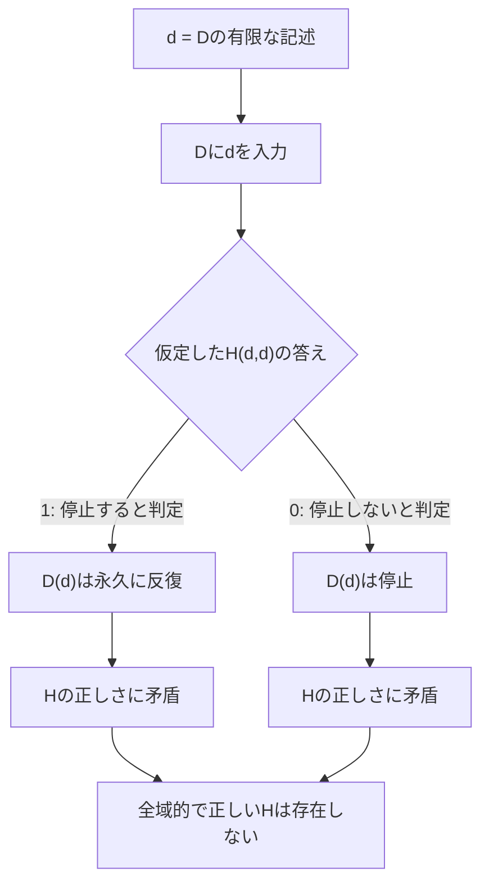

プログラムがいつまでも終わらないとき、「実行する前に、必ず終了するかを調べられないだろうか」と考えることがある。個々のプログラムについて、終了や非終了を証明できる場合は多い。しかし、<strong>あらゆるプログラムと入力に対し、判定器自身も必ず終了して正しい答えを返す</strong>アルゴリズムは存在しない。

これが<strong>停止性問題の決定不能性</strong>である。未解決の予想ではなく、不可能性が証明された結果だ。「どのプログラムについても何も判断できない」という意味ではない。

以下では、通常の有限のアルゴリズムで動作し、必要に応じて記憶領域を増やせる決定的な計算モデルを扱う。現実の機械の電池切れ、強制終了、メモリ不足による停止は、数学的な計算の停止とは区別する。

## 1. プログラムだけでなく、入力も固定する

プログラム $P$ の有限な記述を $\langle P\rangle$、入力を有限列 $x$ とする。普遍的なシミュレータを使えば、その記述をデータとして読み、$P$ に $x$ を与えた計算を再現できる。

停止性問題が尋ねるのは、次の集合への所属である。

$$
\mathrm{HALT}
=\{\langle P,x\rangle : P(x)\text{ が有限時間で停止する}\}
$$

もし全域的な判定アルゴリズム $H$ があれば、全ての有効なプログラム記述と入力に対して、有限時間で次の値を返すはずだ。

$$
H(\langle P\rangle,x)=
\begin{cases}
1 & P(x)\text{ が停止する}\\
0 & P(x)\text{ が停止しない}
\end{cases}
$$

ここで $H$ が<strong>必ず停止することと、答えが必ず正しいことの両方</strong>を要求している。記述として無効な文字列は、構文検査によって別扱いにすればよい。

停止する計算は、シミュレーションを続ければいつかその終了を観測できる。この意味で停止する組の集合は半決定可能である。一方、まだ終わっていない計算が、次の一歩で終わるのか永久に続くのかは、待ち時間だけでは決まらない。

「停止しない」を「無限ループ」と呼ぶこともあるが、必ず同じ状態を巡回するとは限らない。無限に使える記憶上でカウンタを増やし続ける計算では、完全な構成が毎回異なることもある。

## 2. 簡単な例と、回数制限付きの観測

### 終了を説明できる例

次は、組み込みの整数だけを受け付ける実行可能なPython例である。

```python
def double_integer(x):
    if type(x) is not int:
        raise TypeError("x must be a built-in int")
    return x * 2


print(double_integer(3))
```

出力は次の通り。

```text
6
```

任意の有限な整数入力なら、理想化した整数演算は有限時間で終わる。実際の処理時間やメモリの使用量が入力の大きさと無関係という意味ではない。型を限定したのは、Pythonの任意のオブジェクトでは乗算を利用者が定義でき、文字列なら数値ではなく文字列を返すためである。

反対に、次の<strong>擬似コード</strong>は、外部から中断しないモデルでは停止しない。

```text
Forever(x):
    repeat forever:
        do nothing
```

この例の非停止は、制御が終了箇所へ進まないことから説明できる。万能な判定器がなくても、このような特定の例は判断できる。

### コラッツの反復を有限の範囲で観測する

正の整数 $n$ に対して、偶数なら半分、奇数なら3倍して1を加える操作を繰り返す。全ての正の整数がいつか1に到達するというのがコラッツ予想である。

次のコードは、最大反復回数を指定する観測用プログラムだ。<strong>回数制限に達したという結果を、永久に停止しないという答えに読み替えない。</strong>

```python
def collatz_bounded(n, max_steps):
    if type(n) is not int or n < 1:
        raise ValueError("n must be a positive built-in int")
    if type(max_steps) is not int or max_steps < 0:
        raise ValueError("max_steps must be a nonnegative built-in int")

    steps = 0
    while n != 1 and steps < max_steps:
        n = n // 2 if n % 2 == 0 else 3 * n + 1
        steps += 1
    status = "reached_one" if n == 1 else "step_limit"
    return status, steps, n


print(collatz_bounded(6, 8))
print(collatz_bounded(6, 7))
print(collatz_bounded(1, 0))
```

出力：

```text
('reached_one', 8, 1)
('step_limit', 7, 2)
('reached_one', 0, 1)
```

このプログラム自体は、指定した有限回数の反復後に終了する。ここで調べたい本来の問題は、回数制限を外した反復が1に到達するかどうかだ。有限個の成功例は、全ての正整数についての証明にはならない。Taoの研究には大きな部分的結果があるが、それも全ての軌道が1に到達するという結論ではない。

コラッツ予想の形は、反復写像を $\mathrm{Col}$ と書くと、

$$
\forall n\ge1\ \exists t\ge0\quad \mathrm{Col}^{t}(n)=1
$$

である。仮想的な $H$ に特定の $n$ を渡して得られるのは、その<strong>一つの入力</strong>に関する答えだ。「全ての $n$ で停止するか」という全域性の問いが、一回の通常の停止判定とそのまま同じになるわけではない。任意の数学命題をプログラム一つ渡すだけで決められる、と結論してはいけない。

## 3. 判定結果を反転するプログラム

全ての有効なプログラム記述と入力に正答する、停止するアルゴリズム $H$ が存在すると仮定する。

記述 $s$ が表すプログラムに、入力としてその同じ記述 $s$ を与えることは可能だ。プログラムをデータとして扱っているだけで、無限に長いソースコードを埋め込む必要はない。

この仮定のもとで、次の $D$ を作る。

```text
D(s):
    if s is not a valid program description:
        halt
    if H(s, s) == 1:
        repeat forever:
            do nothing
    else:
        halt
```

これは<strong>仮定上の $H$ を呼び出す証明用の擬似コード</strong>であり、実装済みの停止判定器ではない。$H$ が計算可能で必ず終了するという仮定により、この有限な記述を持つ $D$ を構成できる。

$D$ の記述を $d=\langle D\rangle$ とし、$D(d)$ を考える。

| 判定器の答え | 正しい判定器なら意味すること | $D(d)$ の定義による動作 |
| :--- | :--- | :--- |
| $H(d,d)=1$ | $D(d)$ は停止する | 永久に反復する |
| $H(d,d)=0$ | $D(d)$ は停止しない | 直ちに停止する |

どちらの答えも正しさと矛盾する。短く書けば、

$$
D(d)\text{ が停止する}
\iff H(d,d)=0
\iff D(d)\text{ が停止しない}
$$

となる。したがって、仮定した全域的で正しい $H$ は存在しない。

「自己言及する全てのプログラムが矛盾する」「論理が壊れる」という結論ではない。矛盾によって棄却されるのは、<strong>万能な停止判定器が存在するという仮定</strong>である。

## 4. 図で追う対角線論法



この構成は、候補となる判定の答えを、その判定器が対象とするプログラムの一つで反転させる対角線論法である。嘘つきのパラドックスに似た直感は役立つが、証明を支えるのは、記述の符号化とプログラムを有効に構成できることだ。

## 5. チューリングの原論文と計算のモデル

[アラン・チューリング](/p/turing/)の1936年の論文は、計算機械、記述の符号化、普遍機械、対角線論法を通じて決定不能性を示した。ただし、この記事のPython風の証明が原論文にそのまま載っているわけではない。

原論文では、数字0・1を無限に出力する機械をcircle-free、数字の出力が有限個にとどまる機械をcircularと呼ぶ。後者には、停止する場合だけでなく、数字以外の操作を続ける場合も含まれる。したがって、これらを単に「停止しない・停止する」と訳し分けるのは正確ではない。第8節では、指定の記号をいつか出力するかを一般に判定できないことも論じられている。

指定記号を出すまでシミュレーションして、出したときだけ停止する機械を作れば、その記号の出現を停止の問いに結び付けられる。この記事では、現在よく使われる<strong>プログラムと固定入力の停止</strong>という形で説明した。

[チューリングマシン](/p/turing-machine-computability/)は、有限の規則と、必要に応じて使えるテープなどからなる数学的なモデルである。チャーチ＝チューリングのテーゼは、直感的な「機械的に実行できる有効な手続き」を、このような形式的な計算可能性で捉えられるという主張だ。形式的に定義したモデル同士の同等性の定理とは区別する。また、あらゆる物理現象や実在の装置について無条件に証明した主張でもない。

## 6. 不完全性定理との関係

[ゲーデルの不完全性定理](/p/godels-incompleteness-theorems/)も、計算可能性の限界と密接に関係する。ただし「十分に強い公理系なら何でも」という無条件の主張ではなく、実効的な公理化、算術を表す強さ、無矛盾性などの仮定が重要である。「標準的な自然数で真」という表現と、理論内での証明可能性も区別する。

停止性との関係を見る一つの方法は、停止・非停止について<strong>真のことだけを証明する</strong>、証明を有効に列挙できる理論を考えることだ。もしその理論が全てのプログラムと固定入力について停止か非停止のどちらかを証明できれば、両方の証明を探して、見つかった側を返す判定器が作れてしまう。

これは停止性問題の決定不能性に反する。従って、そのような健全な理論でも、全ての停止の問いを決められるわけではない。この説明では健全性という強い仮定を使っている。これはゲーデルの各定理の最弱の仮定や完全な証明を述べたものではない。

## 7. ライスの定理と実用的な解析

### 非自明な入出力の性質

ライスの定理は、プログラムが計算する部分関数、または認識する言語の<strong>非自明な外延的性質</strong>についての一般的な決定不能性を述べる。

「外延的」とは、同じ入出力の振る舞いを表すプログラムなら性質の真偽も同じ、という意味である。「非自明」とは、その性質を持つ計算可能な対象と持たない対象が両方あることだ。

例えば「全ての入力で停止して0を返す」という部分関数の性質は非自明である。一方、「停止した場合の出力は全て0」という性質とは違う。後者はどの入力でも停止しないプログラムでも満たすので、自然言語の「常に0を返す」を曖昧なまま使わない。

プログラムに記載された状態の数など、構文や表現の性質を調べるだけなら決定できる例がある。また、特定のメモリアクセスなど実行途中の性質にライスの定理を無条件で適用できるわけではない。ある実行上の問題の決定不能性を示すには、モデルを定め、適切な還元などを別途示す必要がある。

### 保証、未知、タイムアウトを区別する

万能な判定器がないことは、全ての解析ツールが推測しかできないことを意味しない。

- <strong>健全だが不完全な解析</strong>：証明できた範囲では保証を与え、残りは「不明」とする。保守的な解析では警告が実際の不具合を意味しない場合もある。
- <strong>制限した言語や入力領域</strong>：停止性を保証する規則や、有限の範囲の全探索を使う。ただし「チューリング完全ではない」ことだけで、全プログラムの停止は保証されない。
- <strong>ヒューリスティクスやテスト</strong>：有用な不具合候補や反例を探すが、対象範囲を超える完全性とは区別する。
- <strong>タイムアウト</strong>：資源使用を打ち切る仕組みであり、制限を外した計算が永久に続くという証明ではない。

完全な構成の数が有限で、その構成と遷移を有効に扱える決定的な閉じた系なら、停止するか、既に見た構成へ戻るまで追跡する方法がある。これは数学上の決定可能性の説明で、現実的な時間やメモリで全探索できるという保証ではない。無制限の入力、外部との対話、増大可能な記憶を持つ系へ、そのまま転用もしない。

## 8. 何が不可能で、何ができるのか

停止性問題が否定するのは、任意のプログラムと入力について、必ず終了して必ず正しい二択の答えを返す一般的なアルゴリズムである。

個別のプログラムの終了証明、適切な制限のもとでの完全な検査、未知を許す健全な解析、有限のテストは、この結果と矛盾せず役に立つ。大切なのは、ツールの答えが「証明」「観測」「推測」「不明」のどれなのかを区別することだ。

### 参考文献

- [Turing: On Computable Numbers, with an Application to the Entscheidungsproblem](https://theory.stanford.edu/~trevisan/cs172-07/turing36.pdf) — 原論文の大学公開版。第2節の機械の区別、第8節の対角線論法と記号の出現、第9節の計算の解釈。
- [MIT 6.045J: Mapping reducibility and Rice's theorem](https://ocw.mit.edu/courses/6-045j-automata-computability-and-complexity-spring-2011/7aead2c728dd3d5a737d832811ef97e6_MIT6_045JS11_lec09.pdf) — ライスの定理の条件、言語の性質と機械の構造・実行上の性質の区別。
- [Sinclair: The Church-Turing Thesis](https://people.eecs.berkeley.edu/~sinclair/cs172/n4.pdf) — 直感的な有効手続きと形式的モデルを結ぶテーゼの説明。
- [Tao: Almost all orbits of the Collatz map attain almost bounded values](https://arxiv.org/abs/1909.03562) — コラッツ反復についての部分的結果。全ての正整数が1に到達することを証明したものではない。
