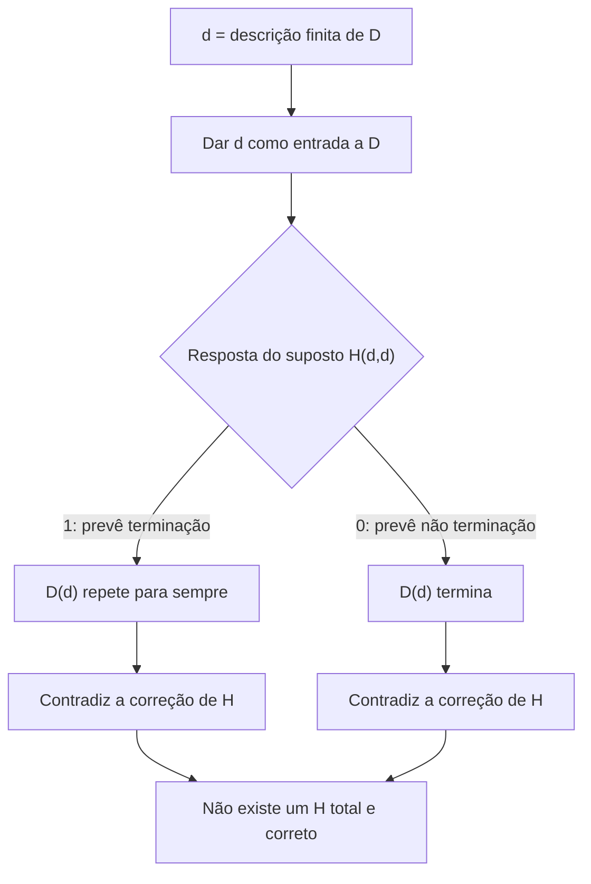

Quando um programa não acaba, é natural perguntar se seria possível saber de antemão que vai terminar. Muitas vezes conseguimos demonstrar a terminação ou a não terminação de programas concretos. Porém, não existe um algoritmo que <strong>termine ele próprio e responda corretamente para todos os programas e respetivas entradas</strong>.

É esta a <strong>indecidibilidade do problema da paragem</strong>. Trata-se de um resultado de impossibilidade demonstrado, não de uma conjetura ainda por resolver. Também não significa que seja impossível decidir qualquer caso concreto.

Neste artigo, usamos um modelo de cálculo determinista, regido por um algoritmo finito comum, com memória que pode crescer conforme necessário. Uma máquina real parar por falta de bateria, encerramento forçado de um processo ou esgotamento da memória é diferente da paragem neste modelo matemático.

## 1. É preciso fixar a entrada, além do programa

Escrevemos $\langle P\rangle$ para a descrição finita do programa $P$ e tomamos como entrada uma cadeia finita $x$. Um simulador universal pode ler essa descrição como dados e reproduzir o cálculo de $P$ com $x$.

O problema da paragem pergunta se um par codificado pertence ao conjunto

$$
\mathrm{HALT}
=\{\langle P,x\rangle : P(x)\text{ termina em tempo finito}\}
$$

Se existisse um algoritmo de decisão total $H$, devolveria um dos seguintes valores em tempo finito, para cada descrição válida de programa e cada entrada:

$$
H(\langle P\rangle,x)=
\begin{cases}
1 & P(x)\text{ termina}\\
0 & P(x)\text{ não termina}
\end{cases}
$$

Exigimos <strong>tanto que $H$ termine sempre como que a resposta seja sempre correta</strong>. As cadeias que não constituam descrições válidas podem ser tratadas separadamente por uma verificação sintática.

Se um cálculo termina, a simulação continuada acabará por revelar esse fim. Neste sentido, o conjunto dos pares que terminam é semidecidível. Mas o tempo já decorrido não basta para saber se um cálculo ainda em curso terminará no passo seguinte ou continuará para sempre.

Por vezes chama-se «ciclo infinito» a qualquer execução que não termina, embora não tenha de se repetir o mesmo estado. Um cálculo que aumenta continuamente um contador numa memória sem limite pode ter uma configuração completa diferente a cada passo.

## 2. Exemplos simples e observações com um limite de passos

### Um exemplo cuja terminação podemos explicar

O seguinte exemplo executável de Python aceita apenas inteiros do tipo incorporado.

```python
def double_integer(x):
    if type(x) is not int:
        raise TypeError("x must be a built-in int")
    return x * 2


print(double_integer(3))
```

A saída é:

```text
6
```

Para qualquer inteiro finito de entrada, a operação aritmética idealizada acaba em tempo finito. Isto não significa que o tempo real ou o consumo de memória sejam independentes do tamanho da entrada. Limitamos o tipo porque objetos arbitrários de Python podem definir a sua própria multiplicação, e multiplicar uma cadeia devolve uma cadeia, não um número.

Em contrapartida, este <strong>pseudocódigo</strong> não termina num modelo sem interrupção externa:

```text
Forever(x):
    repeat forever:
        do nothing
```

Podemos explicar a não terminação porque o fluxo de controlo nunca chega a uma saída. A inexistência de um decisor universal não impede a decisão de casos particulares como este.

### Observar um número finito de passos de Collatz

Começando num inteiro positivo $n$, divide-se por dois se for par; se for ímpar, multiplica-se por três e soma-se um. Repete-se a operação. A conjetura de Collatz afirma que todos os inteiros positivos acabam por chegar a um.

O programa seguinte observa o processo até um número máximo de passos. <strong>Atingir o limite de passos não deve ser interpretado como prova de que o cálculo sem limite nunca termina.</strong>

```python
def collatz_bounded(n, max_steps):
    if type(n) is not int or n < 1:
        raise ValueError("n must be a positive built-in int")
    if type(max_steps) is not int or max_steps < 0:
        raise ValueError("max_steps must be a nonnegative built-in int")

    steps = 0
    while n != 1 and steps < max_steps:
        n = n // 2 if n % 2 == 0 else 3 * n + 1
        steps += 1
    status = "reached_one" if n == 1 else "step_limit"
    return status, steps, n


print(collatz_bounded(6, 8))
print(collatz_bounded(6, 7))
print(collatz_bounded(1, 0))
```

Saída:

```text
('reached_one', 8, 1)
('step_limit', 7, 2)
('reached_one', 0, 1)
```

Este programa de observação termina após, no máximo, o número finito de iterações indicado. A pergunta de fundo é se a iteração sem esse limite chega a um. Um número finito de exemplos favoráveis não demonstra a afirmação para todos os inteiros positivos. A investigação de Tao fornece um importante resultado parcial, mas não demonstra que todas as órbitas chegam a um.

Se escrevermos $\mathrm{Col}$ para a aplicação iterada, a conjetura tem a forma

$$
\forall n\ge1\ \exists t\ge0\quad \mathrm{Col}^{t}(n)=1
$$

Passar um $n$ específico ao hipotético $H$ daria uma resposta acerca <strong>dessa única entrada</strong>. A pergunta de totalidade «termina para todos os $n$?» não é simplesmente a mesma que uma única consulta comum de paragem. Não podemos concluir que entregar um programa permitiria decidir qualquer afirmação matemática.

## 3. Um programa que inverte a resposta

Suponhamos que existe um algoritmo $H$ que termina sempre e responde corretamente para toda a descrição válida de programa e toda a entrada.

Um programa descrito por $s$ pode receber essa mesma descrição $s$ como entrada. Estamos apenas a tratar um programa como dados; não é necessário inserir código-fonte de comprimento infinito.

Sob esta hipótese, construímos $D$:

```text
D(s):
    if s is not a valid program description:
        halt
    if H(s, s) == 1:
        repeat forever:
            do nothing
    else:
        halt
```

Este é <strong>pseudocódigo para a demonstração que chama o hipotético $H$</strong>, não um decisor de paragem já implementado. A hipótese de que $H$ é computável e termina sempre permite construir este $D$ com uma descrição finita.

Seja $d=\langle D\rangle$ a descrição de $D$, e consideremos $D(d)$.

| Resposta do decisor | O que implicaria se fosse correto | Comportamento definido para $D(d)$ |
| :--- | :--- | :--- |
| $H(d,d)=1$ | $D(d)$ termina | Repetir para sempre |
| $H(d,d)=0$ | $D(d)$ não termina | Terminar imediatamente |

Ambas as respostas contradizem a correção. De forma abreviada,

$$
D(d)\text{ termina}
\iff H(d,d)=0
\iff D(d)\text{ não termina}
$$

Logo, o suposto $H$ total e correto não existe.

A conclusão não é que todos os programas autorreferenciais sejam contraditórios, nem que a lógica entre em colapso. A contradição refuta <strong>a hipótese de existir um decisor universal de paragem</strong>.

## 4. Acompanhar o argumento diagonal num diagrama



Esta é uma construção diagonal: um dos próprios programas abrangidos pelo decisor proposto inverte a sua resposta. A semelhança com o paradoxo do mentiroso pode ajudar a intuição, mas a demonstração assenta na codificação das descrições e na construção efetiva de programas.

## 5. O artigo original de Turing e os modelos de cálculo

O artigo de [Alan Turing](/pt/p/turing/) de 1936 mostrou resultados de indecidibilidade por meio de máquinas de cálculo, descrições codificadas, uma máquina universal e diagonalização. A demonstração com aspeto de Python deste artigo não aparece literalmente assim no original.

O texto original chama circle-free a uma máquina que produz infinitos algarismos, zeros ou uns, e circular a uma que produz apenas um número finito desses algarismos. A segunda categoria inclui máquinas que param e máquinas que continuam a realizar outras operações sem produzir mais algarismos. Traduzir estes termos simplesmente como «não termina» e «termina» seria, portanto, inexato. A secção 8 também discute a impossibilidade de decidir, em geral, se uma máquina chegará a imprimir um símbolo específico.

Podemos relacionar o aparecimento do símbolo com a paragem construindo uma máquina que simula o cálculo e termina apenas quando esse símbolo aparece. Aqui usamos a formulação moderna habitual: <strong>a terminação de um programa com uma entrada fixa</strong>.

Uma [máquina de Turing](/pt/p/turing-machine-computability/) é um modelo matemático com regras finitas e uma fita utilizável conforme necessário. A tese de Church–Turing afirma que a noção intuitiva de «procedimento efetivo executável mecanicamente» é captada por esta computabilidade formal. Distingue-se dos teoremas de equivalência entre modelos formalmente definidos. Também não é uma afirmação demonstrada sem condições acerca de todos os fenómenos físicos ou dispositivos reais.

## 6. A relação com a incompletude

Os [teoremas da incompletude de Gödel](/pt/p/godels-incompleteness-theorems/) estão intimamente ligados aos limites da computabilidade. As suas afirmações não se aplicam sem condições a qualquer sistema axiomático «suficientemente forte»: importam a axiomatização efetiva, a capacidade de expressar aritmética, a consistência e outras hipóteses. Também é necessário distinguir a verdade nos números naturais padrão da demonstrabilidade dentro de uma teoria.

Uma forma de ver a ligação à paragem é considerar uma teoria cujas demonstrações podem ser enumeradas efetivamente e que <strong>só demonstra afirmações verdadeiras</strong> acerca de terminação e não terminação. Se pudesse demonstrar uma das duas para cada programa e entrada fixa, poderíamos procurar ambas as demonstrações e devolver a resposta correspondente à primeira encontrada.

Isso contrariaria a indecidibilidade do problema da paragem. Nem uma teoria assim correta consegue resolver todas as perguntas de paragem. Esta explicação usa a hipótese forte de correção semântica; não enuncia as hipóteses mais fracas de cada teorema de Gödel nem apresenta a sua demonstração completa.

## 7. O teorema de Rice e a análise prática

### Propriedades não triviais da entrada e da saída

O teorema de Rice estabelece um resultado geral de indecidibilidade para <strong>propriedades extensionais não triviais</strong> da função parcial que um programa calcula, ou da linguagem que reconhece.

«Extensional» significa que programas com o mesmo comportamento de entrada e saída concordam quanto à propriedade. «Não trivial» significa que existem objetos computáveis com a propriedade e outros sem ela.

Por exemplo, «termina e devolve zero para todas as entradas» é uma propriedade não trivial de uma função parcial. É diferente de «se termina, a saída é sempre zero». Um programa que nunca termina com nenhuma entrada também satisfaz a segunda condição. Por isso, não devemos deixar ambígua a expressão «devolve sempre zero».

Há exemplos decidíveis quando só se examina a sintaxe ou a representação, como o número de estados escritos na descrição de um programa. O teorema de Rice também não se aplica automaticamente a propriedades de passos intermédios da execução, como um acesso específico à memória. Para demonstrar a indecidibilidade de um problema sobre execução, é necessário precisar o modelo e apresentar uma redução adequada ou outro argumento.

### Distinguir garantias, respostas desconhecidas e limites de tempo

A inexistência de um decisor universal não significa que todas as ferramentas de análise se limitem a fazer suposições.

- <strong>Análise correta mas incompleta</strong>: fornece garantias quando consegue demonstrar um resultado e responde «desconhecido» nos outros casos. Um aviso de uma análise conservadora pode não corresponder a um defeito real.
- <strong>Linguagens ou domínios de entrada restritos</strong>: podem usar regras que garantem a terminação ou pesquisas exaustivas em domínios finitos. O simples facto de uma linguagem não ser Turing completa não garante que todos os seus programas terminem.
- <strong>Heurísticas e testes</strong>: encontram possíveis defeitos ou contraexemplos úteis, mas não devem ser confundidos com uma garantia de completude para além do âmbito verificado.
- <strong>Limites de tempo</strong>: interrompem o consumo de recursos; não provam que o cálculo continuaria para sempre sem esse limite.

Num sistema determinista fechado com um número finito de configurações completas, que possam ser representadas e cujas transições possam ser calculadas efetivamente, podemos acompanhar a execução até terminar ou repetir uma configuração. Isto estabelece decidibilidade matemática, não que a pesquisa exaustiva seja viável com tempo ou memória realistas. O argumento não se transfere diretamente para sistemas com entradas sem limite, interação externa ou memória que pode crescer.

## 8. O que é impossível e o que continua a ser possível

O resultado sobre a paragem exclui um algoritmo geral que termine sempre e escolha sempre a resposta correta entre duas opções, para qualquer programa e entrada.

As provas de terminação de programas particulares, as verificações completas sob restrições adequadas, as análises corretas que admitem respostas desconhecidas e os testes finitos continuam a ser úteis e compatíveis com este resultado. O essencial é distinguir se a resposta de uma ferramenta é uma demonstração, uma observação, uma suposição ou o reconhecimento de que não se conhece a resposta.

### Referências

- [Turing: On Computable Numbers, with an Application to the Entscheidungsproblem](https://theory.stanford.edu/~trevisan/cs172-07/turing36.pdf) — Cópia do artigo original alojada por uma universidade. A secção 2 distingue tipos de máquinas; a secção 8 aborda a diagonalização e o aparecimento de símbolos; a secção 9 interpreta o cálculo.
- [MIT 6.045J: Mapping reducibility and Rice's theorem](https://ocw.mit.edu/courses/6-045j-automata-computability-and-complexity-spring-2011/7aead2c728dd3d5a737d832811ef97e6_MIT6_045JS11_lec09.pdf) — Condições do teorema de Rice e distinção entre propriedades de linguagens e propriedades estruturais ou operacionais de máquinas.
- [Sinclair: The Church-Turing Thesis](https://people.eecs.berkeley.edu/~sinclair/cs172/n4.pdf) — A tese que liga os procedimentos efetivos intuitivos aos modelos formais.
- [Tao: Almost all orbits of the Collatz map attain almost bounded values](https://arxiv.org/abs/1909.03562) — Resultado parcial sobre a iteração de Collatz, não uma prova de que todos os inteiros positivos chegam a um.
