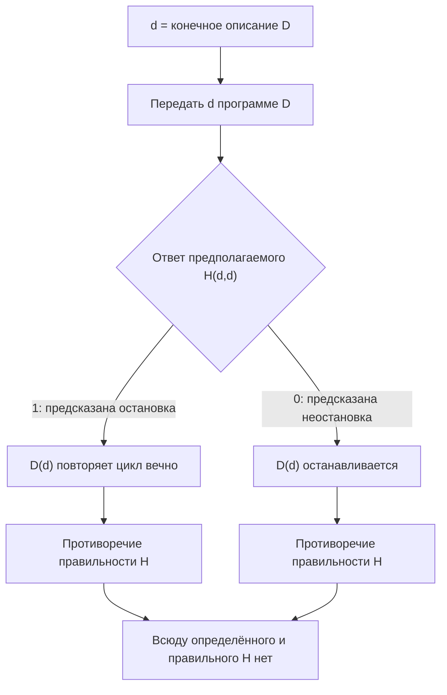

Когда программа долго не завершается, хочется заранее узнать, остановится ли она. Для многих конкретных программ можно доказать завершение или незавершение. Однако не существует алгоритма, который <strong>для любой программы и любого входа сам обязательно завершается и всегда выдаёт правильный ответ</strong>.

Это и есть <strong>алгоритмическая неразрешимость проблемы остановки</strong>. Речь не о пока не решённой гипотезе, а о доказанном результате о невозможности. Он не означает, что о каждой отдельной программе нельзя ничего установить.

Далее рассматривается детерминированная модель вычислений с конечным алгоритмом и памятью, которую можно расширять по мере необходимости. Отключение питания, принудительное завершение процесса и нехватка памяти на реальной машине отличаются от остановки в этой математической модели.

## 1. Нужно зафиксировать не только программу, но и вход

Обозначим конечное описание программы $P$ через $\langle P\rangle$, а вход — конечной строкой $x$. Универсальный симулятор может прочитать описание как данные и воспроизвести вычисление $P$ на входе $x$.

Проблема остановки спрашивает о принадлежности следующему множеству:

$$
\mathrm{HALT}
=\{\langle P,x\rangle : P(x)\text{ останавливается за конечное время}\}
$$

Если бы существовал всюду определённый решающий алгоритм $H$, то для любого допустимого описания программы и входа он за конечное время возвращал бы:

$$
H(\langle P\rangle,x)=
\begin{cases}
1 & P(x)\text{ останавливается}\\
0 & P(x)\text{ не останавливается}
\end{cases}
$$

Требуются <strong>и обязательная остановка $H$, и правильность каждого ответа</strong>. Строки, не являющиеся допустимыми описаниями программ, можно отдельно обработать после синтаксической проверки.

Если вычисление останавливается, продолжая моделирование, мы рано или поздно увидим его завершение. В этом смысле множество останавливающихся пар полуразрешимо. Но по одному лишь прошедшему времени нельзя определить, завершится ли ещё работающая программа на следующем шаге или будет работать вечно.

Неостановку иногда называют бесконечным циклом, но повторение одного и того же состояния не обязательно. Вычисление, постоянно увеличивающее счётчик в неограниченной памяти, может иметь новую полную конфигурацию на каждом шаге.

## 2. Простые примеры и наблюдение с ограничением числа шагов

### Пример, завершение которого можно объяснить

Этот исполняемый пример на Python принимает только значения встроенного целочисленного типа.

```python
def double_integer(x):
    if type(x) is not int:
        raise TypeError("x must be a built-in int")
    return x * 2


print(double_integer(3))
```

Вывод:

```text
6
```

Для любого конечного целого входного значения идеализированная операция умножения завершается за конечное время. Это не означает независимости реальных затрат времени и памяти от размера входа. Тип ограничен потому, что произвольные объекты Python могут определять собственное умножение, а умножение строки возвращает строку, а не число.

Напротив, следующий <strong>псевдокод</strong> не останавливается в модели без внешних прерываний:

```text
Forever(x):
    repeat forever:
        do nothing
```

Причина неостановки здесь в том, что управление не достигает выхода. Отсутствие универсального решающего алгоритма не мешает разбирать такие конкретные случаи.

### Конечное наблюдение за итерациями Коллатца

Начнём с положительного целого $n$: чётное число делим пополам, нечётное умножаем на три и прибавляем единицу, затем повторяем. Гипотеза Коллатца утверждает, что любое положительное целое в конце концов достигает единицы.

Следующая программа наблюдает за процессом, ограничивая число итераций. <strong>Достижение лимита шагов нельзя трактовать как доказательство того, что неограниченное вычисление никогда не остановится.</strong>

```python
def collatz_bounded(n, max_steps):
    if type(n) is not int or n < 1:
        raise ValueError("n must be a positive built-in int")
    if type(max_steps) is not int or max_steps < 0:
        raise ValueError("max_steps must be a nonnegative built-in int")

    steps = 0
    while n != 1 and steps < max_steps:
        n = n // 2 if n % 2 == 0 else 3 * n + 1
        steps += 1
    status = "reached_one" if n == 1 else "step_limit"
    return status, steps, n


print(collatz_bounded(6, 8))
print(collatz_bounded(6, 7))
print(collatz_bounded(1, 0))
```

Вывод:

```text
('reached_one', 8, 1)
('step_limit', 7, 2)
('reached_one', 0, 1)
```

Сама эта программа завершается после не более чем заданного конечного числа итераций. Исходный вопрос состоит в том, достигнет ли процесс единицы без ограничения числа шагов. Конечное число успешных примеров не доказывает утверждение для всех положительных целых. Работа Тао даёт важный частичный результат, но не доказывает, что каждая орбита достигает единицы.

Если обозначить отображение одной итерации через $\mathrm{Col}$, гипотеза имеет вид:

$$
\forall n\ge1\ \exists t\ge0\quad \mathrm{Col}^{t}(n)=1
$$

Передав гипотетическому $H$ конкретное $n$, мы получили бы ответ об <strong>этом одном входе</strong>. Вопрос «останавливается ли программа для всех $n$?» не тождествен одному обычному вопросу об остановке. Нельзя заключать, что любое математическое утверждение решается простым предъявлением одной программы.

## 3. Программа, обращающая ответ решающего алгоритма

Предположим, что существует алгоритм $H$, который всегда останавливается и правильно отвечает для всех допустимых описаний программ и входов.

Программе, представленной описанием $s$, можно передать в качестве входа то же описание $s$. Мы лишь рассматриваем программу как данные; встраивать бесконечно длинный исходный код не нужно.

При этом предположении построим $D$:

```text
D(s):
    if s is not a valid program description:
        halt
    if H(s, s) == 1:
        repeat forever:
            do nothing
    else:
        halt
```

Это <strong>псевдокод доказательства, вызывающий предполагаемый $H$</strong>, а не реализованный решатель проблемы остановки. Предположение о вычислимости и обязательном завершении $H$ позволяет построить $D$ с конечным описанием.

Пусть описание $D$ есть $d=\langle D\rangle$. Рассмотрим $D(d)$.

| Ответ решающего алгоритма | Что он означает при правильном решателе | Поведение по определению $D(d)$ |
| :--- | :--- | :--- |
| $H(d,d)=1$ | $D(d)$ останавливается | Повторение навсегда |
| $H(d,d)=0$ | $D(d)$ не останавливается | Немедленная остановка |

Каждый ответ противоречит требованию правильности. Кратко:

$$
D(d)\text{ останавливается}
\iff H(d,d)=0
\iff D(d)\text{ не останавливается}
$$

Следовательно, предполагаемого всюду определённого и правильного $H$ не существует.

Вывод не в том, что все программы с самоприменением противоречивы или что логика рушится. Противоречие опровергает <strong>предположение о существовании универсального решателя проблемы остановки</strong>.

## 4. Диагональный аргумент на схеме



Это диагональная конструкция: одна из программ, на которые распространяется предполагаемый решатель, обращает его ответ. Сходство с парадоксом лжеца помогает интуиции, но доказательство опирается на кодирование описаний и возможность эффективно строить программы.

## 5. Оригинальная статья Тьюринга и модель вычислений

В статье 1936 года [Алан Тьюринг](/ru/p/turing/) показал неразрешимость с помощью вычислительных машин, кодирования описаний, универсальной машины и диагонального аргумента. Однако приведённого здесь доказательства в стиле Python в оригинале в таком виде нет.

В оригинале машина, выводящая бесконечно много цифр ноль или один, называется circle-free, а машина, выводящая лишь конечное число таких цифр, — circular. Последняя может как остановиться, так и продолжать другие действия, больше не выводя цифр. Поэтому переводить эти два класса просто как «не останавливается» и «останавливается» неточно. В разделе 8 также обсуждается невозможность в общем случае определить, выведет ли машина когда-либо заданный символ.

Можно построить машину, моделирующую исходное вычисление и останавливающуюся только при появлении заданного символа. Так вопрос о появлении символа связывается с остановкой. Здесь мы использовали распространённую сегодня формулировку: <strong>остановка программы на фиксированном входе</strong>.

[Машина Тьюринга](/ru/p/turing-machine-computability/) — математическая модель с конечными правилами и лентой, используемой по мере необходимости. Тезис Чёрча — Тьюринга утверждает, что интуитивное понятие «эффективная процедура, которую можно выполнять механически» охватывается такой формальной вычислимостью. Его следует отличать от теорем об эквивалентности формально определённых моделей. Это также не безусловно доказанное утверждение обо всех физических явлениях и реальных устройствах.

## 6. Связь с теоремами о неполноте

[Теоремы Гёделя о неполноте](/ru/p/godels-incompleteness-theorems/) тесно связаны с пределами вычислимости. Но они не являются безусловными утверждениями о любой «достаточно сильной аксиоматической системе». Существенны эффективная аксиоматизация, возможность выразить арифметику, непротиворечивость и другие предпосылки. Истинность в стандартных натуральных числах также нужно отличать от доказуемости внутри теории.

Один способ увидеть связь с остановкой — рассмотреть теорию с эффективно перечислимыми доказательствами, которая доказывает <strong>только истинные утверждения об остановке и неостановке</strong>. Если бы для каждой программы и фиксированного входа она доказывала остановку либо неостановку, можно было бы искать оба вида доказательств и возвращать ответ по первому найденному.

Это противоречило бы неразрешимости проблемы остановки. Поэтому даже такая семантически корректная теория не решает все вопросы об остановке. В этом объяснении используется сильное предположение о семантической корректности (soundness). Это не изложение самых слабых условий каждой теоремы Гёделя и не их полное доказательство.

## 7. Теорема Райса и практический анализ

### Нетривиальные свойства входов и выходов

Теорема Райса утверждает общую неразрешимость <strong>нетривиальных экстенсиональных свойств</strong> частичных функций, вычисляемых программами, или распознаваемых ими языков.

«Экстенсиональность» означает, что для программ с одинаковым поведением на входах и выходах истинность свойства одинакова. «Нетривиальность» означает, что есть вычислимые объекты как обладающие этим свойством, так и не обладающие им.

Например, «останавливаться на всех входах и возвращать ноль» — нетривиальное свойство частичной функции. Оно отличается от условия «если вычисление останавливается, его результат всегда ноль». Последнее выполняется даже для программы, не останавливающейся ни на одном входе. Поэтому выражение «всегда возвращает ноль» нельзя оставлять неоднозначным.

Некоторые вопросы о синтаксисе или представлении разрешимы, например о количестве состояний, записанных в описании программы. Теорема Райса не применяется автоматически к событиям во время выполнения, таким как определённый доступ к памяти. Чтобы показать неразрешимость конкретной задачи о выполнении, нужно определить модель и отдельно привести подходящее сведение или другой аргумент.

### Гарантии, неизвестность и тайм-аут — разные вещи

Отсутствие универсального решателя не означает, что все средства анализа способны лишь гадать.

- <strong>Корректный, но неполный анализ</strong>: даёт гарантии там, где может доказать результат, и отвечает «неизвестно» в остальных случаях. Предупреждение консервативного анализатора не обязательно означает реальный дефект.
- <strong>Ограниченные языки или области входов</strong>: используют правила, гарантирующие завершение, либо полный перебор конечной области. Одна лишь неполнота по Тьюрингу не гарантирует остановку всех программ.
- <strong>Эвристики и тесты</strong>: находят полезные кандидаты на ошибки или контрпримеры, но не гарантируют полноту за пределами проверенной области.
- <strong>Тайм-аут</strong>: ограничивает расход ресурсов, а не доказывает, что вычисление без ограничения продолжалось бы вечно.

В замкнутой детерминированной системе с конечным числом полных конфигураций, где конфигурации и переходы можно эффективно обрабатывать, можно прослеживать выполнение до остановки или повторения уже встреченной конфигурации. Это объясняет математическую разрешимость, но не гарантирует возможность полного перебора за приемлемое время и с доступной памятью. Такой вывод нельзя напрямую переносить на системы с неограниченными входами, внешним взаимодействием или растущей памятью.

## 8. Что невозможно и что остаётся возможным

Результат об остановке исключает общий алгоритм, который для любой программы и входа обязательно завершается и всегда выдаёт правильный ответ из двух вариантов.

Доказательства завершения отдельных программ, полные проверки при подходящих ограничениях, корректный анализ с ответом «неизвестно» и конечные тесты остаются полезными и не противоречат этому результату. Важно различать, является ли ответ инструмента доказательством, наблюдением, предположением или признанием неизвестности.

### Источники

- [Turing: On Computable Numbers, with an Application to the Entscheidungsproblem](https://theory.stanford.edu/~trevisan/cs172-07/turing36.pdf) — оригинальная статья, доступная на сайте университета. Раздел 2 различает классы машин, раздел 8 содержит диагональный аргумент и вопрос о появлении символа, раздел 9 обсуждает интерпретацию вычислений.
- [MIT 6.045J: Mapping reducibility and Rice's theorem](https://ocw.mit.edu/courses/6-045j-automata-computability-and-complexity-spring-2011/7aead2c728dd3d5a737d832811ef97e6_MIT6_045JS11_lec09.pdf) — условия теоремы Райса и различие между свойствами языков и свойствами структуры или выполнения машин.
- [Sinclair: The Church-Turing Thesis](https://people.eecs.berkeley.edu/~sinclair/cs172/n4.pdf) — тезис, связывающий интуитивные эффективные процедуры с формальной моделью.
- [Tao: Almost all orbits of the Collatz map attain almost bounded values](https://arxiv.org/abs/1909.03562) — частичный результат об итерациях Коллатца, не доказательство достижения единицы для всех положительных целых.
