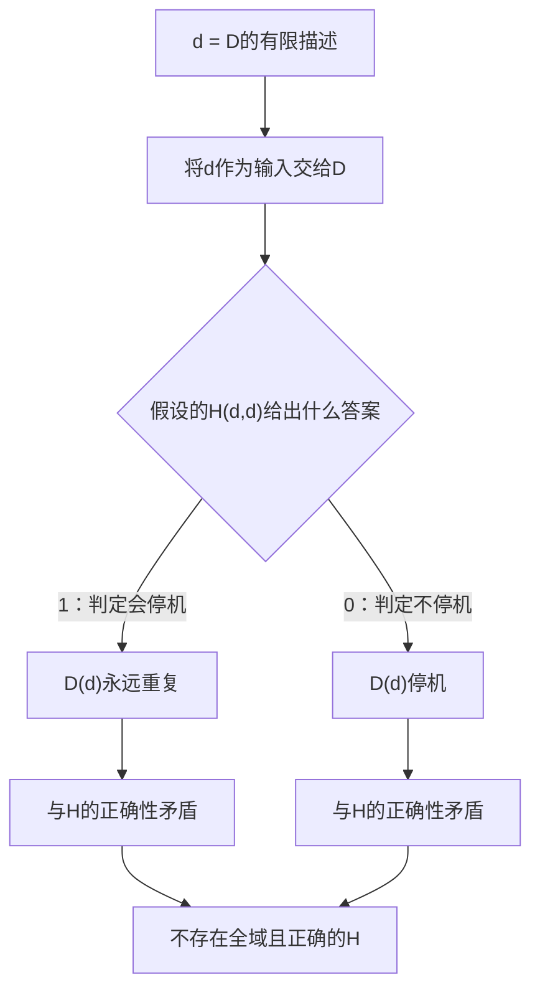

当程序迟迟不结束时，我们可能会想：“能不能在运行之前就知道它是否一定会结束？”对于具体程序，我们常常可以证明它会终止或不会终止。但是，不存在一种算法，能够<strong>对所有程序及其输入都保证自身终止，并且给出正确答案</strong>。

这就是<strong>停机问题的不可判定性</strong>。它不是尚未解决的猜想，而是已经证明的不可能性结论。这也不意味着我们无法判断任何一个具体程序。

下文采用确定性的计算模型：计算遵循普通的有限算法，存储空间可以按需增长。现实机器因电池耗尽、进程被强制结束或内存不足而停止，与这个数学模型中的停机不是一回事。

## 1. 不仅要给出程序，还要固定输入

用 $\langle P\rangle$ 表示程序 $P$ 的有限描述，输入 $x$ 是一个有限字符串。通用模拟器可以把这份描述当作数据读取，并模拟 $P$ 在输入 $x$ 上的计算。

停机问题询问的是，一个程序与输入的编码对是否属于下面的集合：

$$
\mathrm{HALT}
=\{\langle P,x\rangle : P(x)\text{ 在有限时间内停机}\}
$$

如果存在全域的判定算法 $H$，那么对于每一个有效的程序描述与输入，它都应该在有限时间内返回：

$$
H(\langle P\rangle,x)=
\begin{cases}
1 & P(x)\text{ 停机}\\
0 & P(x)\text{ 不停机}
\end{cases}
$$

这里同时要求<strong>$H$ 必定停机，而且答案必定正确</strong>。不构成有效描述的字符串，可以通过语法检查另行处理。

对于会停机的计算，只要不断模拟，最终就能观察到它结束。因此，会停机的程序与输入对组成的集合是半可判定的。但仅凭已经等待的时间，无法确定一个尚未结束的计算是下一步就结束，还是永远继续下去。

人们有时把不停机称为“无限循环”，但它不一定重复同一个状态。例如，在无界存储上持续递增计数器的计算，每一步的完整配置都可能不同。

## 2. 简单例子与带步数上限的观察

### 可以解释为什么会终止的例子

下面是一个可运行的 Python 示例，只接受内置整数类型。

```python
def double_integer(x):
    if type(x) is not int:
        raise TypeError("x must be a built-in int")
    return x * 2


print(double_integer(3))
```

输出为：

```text
6
```

对于任意有限的整数输入，理想化的整数运算都在有限时间内完成。这并不意味着实际耗时或内存用量与输入大小无关。之所以限制类型，是因为任意 Python 对象可能自行定义乘法，而字符串乘法返回的是字符串，不是数值。

相反，在没有外部中断的模型中，下面这段<strong>伪代码</strong>不会停机：

```text
Forever(x):
    repeat forever:
        do nothing
```

控制流程不会到达退出位置，因此我们可以解释它为什么不停机。不存在万能判定器，并不妨碍我们判断这样的具体例子。

### 在有限范围内观察考拉兹迭代

从正整数 $n$ 出发，如果它是偶数就除以二，如果是奇数就乘以三再加一，反复执行。考拉兹猜想认为，每个正整数最终都会到达一。

下面的程序用于观察这一过程，并允许指定最大迭代步数。<strong>达到步数上限，不能被解读为无上限的计算永远不会停机。</strong>

```python
def collatz_bounded(n, max_steps):
    if type(n) is not int or n < 1:
        raise ValueError("n must be a positive built-in int")
    if type(max_steps) is not int or max_steps < 0:
        raise ValueError("max_steps must be a nonnegative built-in int")

    steps = 0
    while n != 1 and steps < max_steps:
        n = n // 2 if n % 2 == 0 else 3 * n + 1
        steps += 1
    status = "reached_one" if n == 1 else "step_limit"
    return status, steps, n


print(collatz_bounded(6, 8))
print(collatz_bounded(6, 7))
print(collatz_bounded(1, 0))
```

输出：

```text
('reached_one', 8, 1)
('step_limit', 7, 2)
('reached_one', 0, 1)
```

这个观察程序本身至多执行指定的有限步数，就会结束。真正想研究的是，去掉步数限制后，迭代是否会到达一。有限多个成功例子不能证明对所有正整数都成立。Tao 的研究取得了重要的部分结果，但也没有证明每条轨道都到达一。

把迭代映射记为 $\mathrm{Col}$，猜想的形式是：

$$
\forall n\ge1\ \exists t\ge0\quad \mathrm{Col}^{t}(n)=1
$$

向假想的 $H$ 传入某个具体的 $n$，得到的是关于<strong>这一个输入</strong>的答案。“是否对所有 $n$ 都停机”这个全域性问题，并不直接等同于一次普通的停机判定。不能由此推断，只要交给它一个程序，就能决定任意数学命题。

## 3. 将判定答案反过来的程序

假设存在算法 $H$，它总会停机，并能对所有有效的程序描述与输入给出正确答案。

如果字符串 $s$ 描述了一个程序，就可以把同一个 $s$ 作为输入交给这个程序。这只是把程序当作数据，并不需要嵌入无限长的源代码。

在这个假设下，构造 $D$：

```text
D(s):
    if s is not a valid program description:
        halt
    if H(s, s) == 1:
        repeat forever:
            do nothing
    else:
        halt
```

这是<strong>调用假想 $H$ 的证明用伪代码</strong>，不是已经实现的停机判定器。正因为假设 $H$ 可计算且总会终止，我们才可以构造出具有有限描述的 $D$。

令 $d=\langle D\rangle$ 为 $D$ 的描述，考虑 $D(d)$。

| 判定器的答案 | 若判定器正确，就意味着 | 按照定义，$D(d)$ 的行为 |
| :--- | :--- | :--- |
| $H(d,d)=1$ | $D(d)$ 停机 | 永远重复 |
| $H(d,d)=0$ | $D(d)$ 不停机 | 立即停机 |

无论给出哪个答案，都会与正确性矛盾。简写为：

$$
D(d)\text{ 停机}
\iff H(d,d)=0
\iff D(d)\text{ 不停机}
$$

因此，假设中的全域且正确的 $H$ 不存在。

结论不是“所有自指程序都会产生矛盾”，也不是“逻辑崩溃了”。被矛盾推翻的是<strong>存在万能停机判定器这一假设</strong>。

## 4. 用图解追踪对角线论证



这是一种对角线论证：在候选判定器所覆盖的程序中，构造一个反转其答案的程序。与说谎者悖论的相似性可以帮助理解，但真正支撑证明的是描述的编码，以及程序可以被有效构造出来。

## 5. 图灵原论文与计算模型

[阿兰·图灵](/zh-cn/p/turing/)在 1936 年的论文中，通过计算机器、描述编码、通用机器和对角线论证展示了不可判定性。不过，本文这种 Python 风格的证明并不是原论文的原样呈现。

原论文把会输出无限多个数字零或一的机器称为 circle-free，把只输出有限多个这类数字的机器称为 circular。后者既包括停机的机器，也包括一直进行其他操作、不再输出数字的机器。因此，简单把它们分别译成“不停机”和“停机”是不准确的。第八节还讨论了无法一般地判定机器是否会在某个时刻输出指定符号。

我们可以构造一台机器，持续模拟原计算，并且仅当指定符号出现时才停机，从而把符号是否出现的问题联系到停机问题。本文采用的是现代常见的<strong>程序在固定输入上是否停机</strong>这一表述。

[图灵机](/zh-cn/p/turing-machine-computability/)是由有限规则以及可按需使用的纸带等组成的数学模型。丘奇—图灵论题认为，直观上“能够机械执行的有效过程”可以由这样的形式化可计算性来刻画。这与证明两个形式化计算模型等价的定理有所区别，也不是对一切物理现象或现实装置无条件成立的已证明主张。

## 6. 与不完备定理的联系

[哥德尔不完备定理](/zh-cn/p/godels-incompleteness-theorems/)与可计算性的局限密切相关。不过，它不是对任意“足够强的公理系统”都无条件成立的断言：有效公理化、表达算术的能力、相容性等假设都很重要。还需要区分“在标准自然数中为真”与“在理论内部可证明”。

理解其与停机问题联系的一种方法，是考虑一个证明可以被有效枚举、并且关于停机与不停机<strong>只证明真命题</strong>的理论。如果该理论能对每个程序和固定输入证明它会停机或不会停机，那么我们就可以同时寻找这两种证明，并在找到其中一种时返回相应答案。

这会与停机问题的不可判定性矛盾。因此，即使是这样的可靠理论，也不能解决所有停机问题。这里采用了可靠性这一较强的假设，并不是在陈述哥德尔各定理的最弱假设，也不是给出它们的完整证明。

## 7. 莱斯定理与实用分析

### 非平凡的输入输出性质

莱斯定理给出了一个一般的不可判定性结论，涉及程序所计算的部分函数或所识别语言的<strong>非平凡外延性质</strong>。

“外延”意味着：只要两个程序表示相同的输入输出行为，它们就对该性质给出相同的真假结果。“非平凡”意味着：既存在具有该性质的可计算对象，也存在不具有该性质的对象。

例如，“对所有输入都停机并返回零”是部分函数的一种非平凡性质。但它不同于“只要停机，输出就一定是零”。一个对任何输入都不停机的程序也满足后一个条件，因此不应含糊地使用“总是返回零”这句话。

如果只检查语法或表示形式，例如程序描述中写明的状态数，就有可判定的例子。莱斯定理也不能无条件套用于执行过程中的性质，例如某次特定的内存访问。要证明某种运行行为问题不可判定，需要明确模型，并另行给出适当的归约等论证。

### 区分保证、未知与超时

不存在万能判定器，并不意味着所有分析工具都只能猜测。

- <strong>可靠但不完备的分析</strong>：在能够证明的范围内给出保证，其余情况返回“未知”。保守分析的警告也可能不对应真实缺陷。
- <strong>受限的语言或输入范围</strong>：使用保证终止的规则，或对有限范围进行穷举。但仅仅“不是图灵完备的”，并不能保证所有程序都会停机。
- <strong>启发式方法与测试</strong>：寻找有用的缺陷候选或反例，但不能把这些成果当成超出所检查范围的完备性保证。
- <strong>超时</strong>：它是一种中止资源使用的机制，不是去掉限制后计算将永远继续的证明。

对于确定性的封闭系统，如果完整配置的数量有限，而且这些配置及其转移可以被有效处理，就可以逐步跟踪，直到停机或回到曾经出现过的配置。这是在说明数学上的可判定性，并不保证穷举在现实的时间或内存限制下可行。也不能把它直接套用于具有无界输入、外部交互或可增长存储的系统。

## 8. 什么不可能，什么仍然可行

停机问题否定的是一种通用算法：它对任意程序和输入都必定结束，并且总能在两个答案中给出正确的一个。

证明具体程序终止、在适当限制下进行完备检查、允许返回未知的可靠分析，以及有限测试，都与这一结论相容，也仍然有用。关键是分清工具给出的究竟是“证明”“观察”“推测”，还是“未知”。

### 参考文献

- [Turing: On Computable Numbers, with an Application to the Entscheidungsproblem](https://theory.stanford.edu/~trevisan/cs172-07/turing36.pdf) — 大学公开的原论文版本。第二节区分机器类型，第八节讨论对角线论证和符号的出现，第九节讨论计算的解释。
- [MIT 6.045J: Mapping reducibility and Rice's theorem](https://ocw.mit.edu/courses/6-045j-automata-computability-and-complexity-spring-2011/7aead2c728dd3d5a737d832811ef97e6_MIT6_045JS11_lec09.pdf) — 莱斯定理的条件，以及语言性质与机器结构、运行性质的区别。
- [Sinclair: The Church-Turing Thesis](https://people.eecs.berkeley.edu/~sinclair/cs172/n4.pdf) — 连接直观有效过程与形式模型的论题。
- [Tao: Almost all orbits of the Collatz map attain almost bounded values](https://arxiv.org/abs/1909.03562) — 考拉兹迭代的部分结果，并未证明所有正整数都会到达一。
