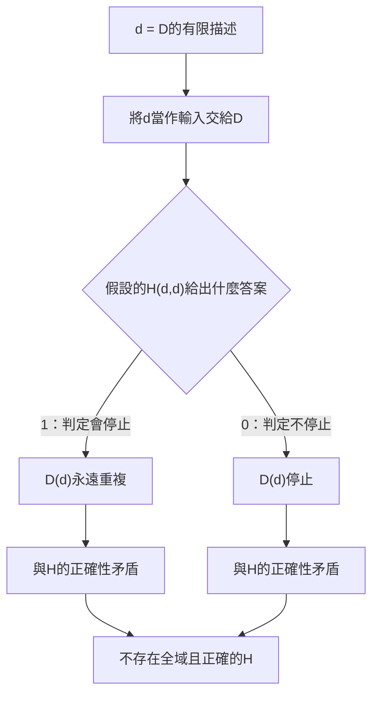

當程式遲遲沒有結束時，我們可能會想：「能不能在執行之前，就知道它是否一定會結束？」對於個別程式，我們常能證明它會終止或不會終止。不過，不存在一種演算法，能夠<strong>對所有程式及其輸入，都保證自身終止並給出正確答案</strong>。

這就是<strong>停止性問題的不可判定性</strong>。它不是尚未解決的猜想，而是已經證明的不可能性結果。這也不表示我們無法判斷任何一個具體程式。

以下採用確定性的計算模型：計算依循一般的有限演算法，儲存空間可依需要增加。現實機器因電池耗盡、行程被強制結束或記憶體不足而停止，與這個數學模型中的停止不同。

## 1. 不只指定程式，也要固定輸入

以 $\langle P\rangle$ 表示程式 $P$ 的有限描述，輸入 $x$ 是一個有限字串。通用模擬器可以將這份描述當成資料讀取，模擬 $P$ 在輸入 $x$ 下的計算。

停止性問題詢問的是，程式與輸入的編碼對是否屬於下列集合：

$$
\mathrm{HALT}
=\{\langle P,x\rangle : P(x)\text{ 在有限時間內停止}\}
$$

如果存在全域的判定演算法 $H$，那麼對每個有效的程式描述與輸入，它都應該在有限時間內回傳：

$$
H(\langle P\rangle,x)=
\begin{cases}
1 & P(x)\text{ 停止}\\
0 & P(x)\text{ 不停止}
\end{cases}
$$

這裡同時要求<strong>$H$ 必定停止，而且答案必定正確</strong>。不構成有效描述的字串，可以透過語法檢查另行處理。

對於會停止的計算，只要持續模擬，最終就能觀察到它結束。因此，會停止的程式與輸入對所形成的集合是半可判定的。但是，單憑已經等待的時間，無法確定一個尚未結束的計算，是下一步就結束，還是會永遠繼續。

人們有時將不停止稱為「無窮迴圈」，但它不一定重複相同狀態。例如，在無界儲存空間中持續遞增計數器的計算，每一步的完整組態都可能不同。

## 2. 簡單範例與有步數上限的觀察

### 可以說明為何會終止的範例

以下是可執行的 Python 範例，只接受內建整數型別。

```python
def double_integer(x):
    if type(x) is not int:
        raise TypeError("x must be a built-in int")
    return x * 2


print(double_integer(3))
```

輸出為：

```text
6
```

對任意有限的整數輸入，理想化的整數運算都會在有限時間內完成。這不表示實際耗時或記憶體用量與輸入大小無關。限制型別的原因是，任意 Python 物件可能自行定義乘法，而字串乘法回傳的是字串，不是數值。

相反地，在沒有外部中斷的模型中，下列<strong>虛擬碼</strong>不會停止：

```text
Forever(x):
    repeat forever:
        do nothing
```

控制流程不會到達退出位置，因此可以說明它為何不停止。不存在萬能判定器，並不妨礙我們判斷這類具體範例。

### 在有限範圍內觀察考拉茲迭代

從正整數 $n$ 出發，如果它是偶數就除以二，如果是奇數就乘以三再加一，反覆操作。考拉茲猜想認為，每個正整數最終都會到達一。

下列程式用來觀察這個過程，並可指定最大迭代步數。<strong>達到步數上限，不能被解讀成沒有上限的計算永遠不會停止。</strong>

```python
def collatz_bounded(n, max_steps):
    if type(n) is not int or n < 1:
        raise ValueError("n must be a positive built-in int")
    if type(max_steps) is not int or max_steps < 0:
        raise ValueError("max_steps must be a nonnegative built-in int")

    steps = 0
    while n != 1 and steps < max_steps:
        n = n // 2 if n % 2 == 0 else 3 * n + 1
        steps += 1
    status = "reached_one" if n == 1 else "step_limit"
    return status, steps, n


print(collatz_bounded(6, 8))
print(collatz_bounded(6, 7))
print(collatz_bounded(1, 0))
```

輸出：

```text
('reached_one', 8, 1)
('step_limit', 7, 2)
('reached_one', 0, 1)
```

這個觀察程式本身最多執行指定的有限步數，就會結束。真正想研究的是，取消步數限制之後，迭代是否會到達一。有限多個成功範例，不能證明所有正整數都符合這個主張。Tao 的研究取得了重要的部分結果，但也沒有證明每條軌道都會到達一。

將迭代映射記為 $\mathrm{Col}$，猜想的形式是：

$$
\forall n\ge1\ \exists t\ge0\quad \mathrm{Col}^{t}(n)=1
$$

向假想的 $H$ 傳入某個具體的 $n$，得到的是關於<strong>這一個輸入</strong>的答案。「是否對所有 $n$ 都會停止」這個全域性問題，並不直接等同於一次普通的停止判定。不能因此推論，只要交給它一個程式，就能判定任意數學命題。

## 3. 將判定答案反轉的程式

假設存在演算法 $H$，它總會停止，而且能對所有有效的程式描述與輸入給出正確答案。

如果字串 $s$ 描述了一個程式，就可以將同一個 $s$ 當作輸入交給該程式。這只是把程式當成資料處理，不需要嵌入無限長的原始碼。

在這個假設下，建構 $D$：

```text
D(s):
    if s is not a valid program description:
        halt
    if H(s, s) == 1:
        repeat forever:
            do nothing
    else:
        halt
```

這是<strong>呼叫假想 $H$ 的證明用虛擬碼</strong>，不是已經實作的停止判定器。正因為假設 $H$ 可計算且必定終止，才可以建構出具有有限描述的 $D$。

令 $d=\langle D\rangle$ 為 $D$ 的描述，考慮 $D(d)$。

| 判定器的答案 | 若判定器正確，代表的意義 | 依照定義，$D(d)$ 的行為 |
| :--- | :--- | :--- |
| $H(d,d)=1$ | $D(d)$ 會停止 | 永遠重複 |
| $H(d,d)=0$ | $D(d)$ 不會停止 | 立即停止 |

無論給出哪個答案，都會與正確性矛盾。簡寫為：

$$
D(d)\text{ 停止}
\iff H(d,d)=0
\iff D(d)\text{ 不停止}
$$

因此，假設中的全域且正確的 $H$ 不存在。

結論不是「所有自我指涉的程式都有矛盾」，也不是「邏輯崩潰了」。被矛盾推翻的是<strong>存在萬能停止判定器的假設</strong>。

## 4. 用圖解追蹤對角線論證



這是一種對角線論證：在候選判定器涵蓋的程式中，建構一個反轉其答案的程式。與說謊者悖論的相似性有助於直觀理解，但證明的基礎是描述的編碼，以及程式可以被有效建構。

## 5. 圖靈的原論文與計算模型

[艾倫·圖靈](/zh-tw/p/turing/)在 1936 年的論文中，透過計算機器、描述編碼、通用機器與對角線論證，展示了不可判定性。不過，本文這種 Python 風格的證明，並不是原論文的原樣呈現。

原論文將會輸出無限多個數字零或一的機器稱為 circle-free，將只輸出有限多個這類數字的機器稱為 circular。後者包含會停止的機器，也包含持續進行其他操作、不再輸出數字的機器。因此，單純將兩者分別翻成「不停止」與「停止」並不正確。第八節也討論了無法一般地判定機器是否會在某個時刻輸出指定符號。

可以建構一台機器，持續模擬原計算，而且只有在指定符號出現時才停止，藉此將符號是否出現的問題連結到停止問題。本文採用現代常見的<strong>程式在固定輸入下是否停止</strong>這種表述。

[圖靈機](/zh-tw/p/turing-machine-computability/)是由有限規則，以及可以按需使用的紙帶等構成的數學模型。邱奇—圖靈論題主張，直觀上「能以機械方式執行的有效程序」可以由這類形式化可計算性來刻畫。它不同於證明兩個形式化模型等價的定理，也不是對所有物理現象或實際裝置無條件成立的已證明主張。

## 6. 與不完備定理的關係

[哥德爾不完備定理](/zh-tw/p/godels-incompleteness-theorems/)與可計算性的限制密切相關。不過，它不是對任意「足夠強的公理系統」都無條件成立的斷言：有效公理化、表達算術的能力、相容性等假設都很重要。此外，也要區分「在標準自然數中為真」與「在理論內部可證明」。

理解它與停止性問題關係的一種方法，是考慮一個證明可以被有效列舉，而且針對停止與不停止<strong>只證明真命題</strong>的理論。如果它能對每個程式與固定輸入，證明會停止或不會停止，就可以同時尋找兩種證明，並在找到其中一種時回傳相應答案。

這會違反停止性問題的不可判定性。因此，即使是這樣的可靠理論，也無法解決所有停止問題。這裡使用了可靠性這項較強的假設，並不是在陳述哥德爾各定理的最弱假設，也不是給出完整證明。

## 7. 萊斯定理與實用分析

### 非平凡的輸入輸出性質

萊斯定理提出一般性的不可判定性結果，對象是程式計算的部分函數，或所辨識語言的<strong>非平凡外延性質</strong>。

「外延」的意思是：只要程式表示相同的輸入輸出行為，該性質的真假就相同。「非平凡」則表示：既有符合這項性質的可計算對象，也有不符合的對象。

例如，「對所有輸入都停止並回傳零」是部分函數的一項非平凡性質。但它不同於「只要停止，輸出一定是零」。一個對任何輸入都不停止的程式，也符合後一項條件，所以不能含糊地使用「總是回傳零」這句話。

如果只檢查語法或表示方式，例如程式描述中寫明的狀態數，就有可判定的例子。萊斯定理也不能無條件套用到執行過程中的性質，例如某次特定的記憶體存取。要證明某種執行行為問題不可判定，需要明確指定模型，並另外給出適當的歸約等論證。

### 區分保證、未知與逾時

沒有萬能判定器，不表示所有分析工具都只能猜測。

- <strong>可靠但不完備的分析</strong>：在能證明的範圍內提供保證，其餘情況回覆「未知」。保守分析的警告，也可能不對應真實缺陷。
- <strong>受限的語言或輸入範圍</strong>：採用保證終止的規則，或對有限範圍進行窮舉。但光是「非圖靈完備」，並不能保證所有程式都會停止。
- <strong>啟發式方法與測試</strong>：尋找有用的缺陷候選或反例，但不能將成果當成超出檢查範圍的完備性保證。
- <strong>逾時</strong>：這是中止資源使用的機制，不是取消限制之後計算會永遠繼續的證明。

對於確定性的封閉系統，如果完整組態的數量有限，而且可以有效處理這些組態及其轉移，就能逐步追蹤，直到停止或回到曾經出現的組態。這說明了數學上的可判定性，並不保證窮舉在實際時間或記憶體限制下可行。也不能直接套用到具有無界輸入、外部互動或可增加儲存空間的系統。

## 8. 什麼不可能，什麼仍然可行

停止性問題否定的是一種通用演算法：它對任意程式與輸入都必定結束，而且總能在兩個答案中給出正確的一個。

個別程式的終止證明、適當限制下的完備檢查、允許回覆未知的可靠分析，以及有限測試，都與這個結果相容，也仍然有用。關鍵在於分清楚工具的答案究竟是「證明」「觀察」「推測」，還是「未知」。

### 參考文獻

- [Turing: On Computable Numbers, with an Application to the Entscheidungsproblem](https://theory.stanford.edu/~trevisan/cs172-07/turing36.pdf) — 大學公開的原論文版本。第二節區分機器類型，第八節討論對角線論證與符號的出現，第九節討論計算的解釋。
- [MIT 6.045J: Mapping reducibility and Rice's theorem](https://ocw.mit.edu/courses/6-045j-automata-computability-and-complexity-spring-2011/7aead2c728dd3d5a737d832811ef97e6_MIT6_045JS11_lec09.pdf) — 萊斯定理的條件，以及語言性質與機器結構、執行性質的區別。
- [Sinclair: The Church-Turing Thesis](https://people.eecs.berkeley.edu/~sinclair/cs172/n4.pdf) — 連結直觀有效程序與形式模型的論題。
- [Tao: Almost all orbits of the Collatz map attain almost bounded values](https://arxiv.org/abs/1909.03562) — 考拉茲迭代的部分結果，並未證明所有正整數都會到達一。
