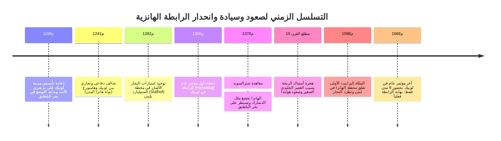

قبل قرون من ترسيخ أسس الدولة القومية الحديثة، شهد بحرا الشمال والبلطيق بين القرنين الثالث عشر والخامس عشر الميلاديين ولادة إمبراطورية تجارية بحرية فريدة من نوعها: **إمبراطورية بلا ملك متوج، وبلا حدود جغرافية ثابتة، وبلا جيش نظامي دائم**. تلك هي **الرابطة الهانزية (Hanseatic League / Deutsche Hanse)** بزعامة مدينة **لوبيك** الألمانية الحرة.

وفي أوج ازدهارها، ضمّت الرابطة أكثر من 200 مدينة ذاتية الحكم، محتكرة المسارات التجارية الممتدة لآلاف الكيلومترات من ضفاف نهر التايمز في لندن إلى غابات نوفغورود في قلب روسيا. وبفضل منظومة قانونية موحدة (**قانون لوبيك**)، وسفينة الشحن الثورية **الكوغ (Kogge)**، والمؤتمرات الدبلوماسية المنتظمة (*الهانزيتاغ*)، أحدث تجار الهانزا ثورة في النقل البحري للبضائع الضخمة. وحينما تجرأت ممالك أوروبا الإقطاعية على المساس بمصالحهم، جهز التجار أساطيل حربية هزمت مملكة الدنمارك وفرضت حق الفيتو على تولي العرش الدنماركي.

---

## 1. التطور المؤسسي: من نقابة التجار إلى اتحاد المدن وقانون لوبيك

كلمة *Hanse* في اللغة الألمانية القديمة كانت تعني "فرقة مسلحة" أو "جماعة من التجار المتعاونين في بلاد الغربة". وتطورت الرابطة من جمعيات حماية متبادلة للتجار المتنقلين إلى كونفدرالية سياسية وعسكرية بين مجالس المدن المستقلة.

### 1.1 قانون لوبيك (Lübisches Recht)
وفّر موقع لوبيك القريب من هامبورغ طريقاً برياً يربط البلطيق ببحر الشمال متفادياً مضيق الإلبه الدنماركي الوعر.
وقد أرسى **قانون لوبيك**:
- الاستقلال البلدي التام لمجالس المدن عن سلطة النبلاء ورجال الدين.
- تقنين المعاملات البحرية، والإفلاس، والمشاركات التجارية، وتسوية الديون.
- اعتماده من قبل أكثر من 100 مدينة على شواطئ البلطيق (دانتسيغ، ريغا، تالين) مع جعل محكمة لوبيك العليا (*Oberhof*) مرجعاً نهائياً للاستئناف القضائي.

### 1.2 المحطات التجارية الأربع الكبرى (Kontore)
أقامت الهانزا أربع قلاع تجارية كبرى متمتعة بالحصانة خارج ألمانيا:
1. **الستيليارد في لندن**: حظي تجاره بإعفاءات جمركية تفوق ما كان يحصل عليه التجار الإنجليز أنفسهم.
2. **محطة بروج (فلاندرز)**: المحور المالي الذي يتبادل فيه التجار مواد الشمال الخام بالحرير والتوابل والمنسوجات الفاخرة.
3. **بريغن في بيرغن (النرويج)**: احتكار سمك القد المجفف (*Stockfish*)، الغذاء البروتيني الأساسي للمسيحيين في أيام الصوم الكبير.
4. **بيترهوف في نوفغورود (روسيا)**: مجمع محصن لشراء شمع العسل النقي لإضاءة كنائس أوروبا والفراء الثمين (السمور، القاقم).

---

## 2. الهندسة البحرية: سفينة الكوغ (Kogge) ونقل الحمولات الضخمة

قبل سفينة الكوغ، كانت سفن الشمال مجرد قوارب فايكنغ تسع 20–40 طناً فقط. وجاءت **سفينة الكوغ الهانزية** لتحدث ثورة لوجستية:
- **دفة المؤخرة المحورية (Sternpost rudder)**: ثُبتت بمفصلات حديدية في منتصف المؤخرة، فظلت غاطسة وثابتة في الأمواج العاتية مانحة السفينة تحكماً مسارياً فائقاً.
- **حمولة 100 إلى 200 طن بطاقم لا يتجاوز 10–15 بحاراً**: بفضل شراعها المربع الضخم، انخفضت تكلفة الشحن بأكثر من 80 %، مما أتاح نقل بضائع رخيصة وضخمة كالحبوب وأخشاب السفن والملح والرنجة المملحة.

---

## 3. المجد العسكري: صلح شترالسوند (1370م)

عندما نهب ملك الدنمارك فالديمار الرابع مركز فيسبي التجاري عام 1361م، شكلت 57 مدينة هانزية **تحالف كولونيا** عام 1367م، وفرضت ضريبة حربية بحرية مجهزة أسطولاً ضخماً.
حاصرت القوات كopenهاغن وأغلقت المضائق، وفرضت على الدنمارك **معاهدة شترالسوند عام 1370م**:
- إدارة قلاع المضيق الدنماركي لمدة 15 عاماً واقتسام ثلثي رسوم المرور.
- إعفاء ضريبي شامل في بحر البلطيق.
- **اشتراط موافقة الرابطة الهانزية المسبقة لتتويج أي ملك جديد على عرش الدنمارك**.

---

## 4. الانهيار أمام القوى الحديثة

في القرن السادس عشر، انهارت الهانزا أمام ثلاث ضربات قاصمة:
1. **هجرة أسماك الرنجة**: تبريد مياه البلطيق جراء العصر الجليدي الصغير نقل مناطق التكاثر إلى بحر الشمال، فاستحوذ الصيادون الهولنديون على التجارة.
2. **سفن الفلوت الهولندية (Fluitschip)**: سفن بتصميم مبتكر تقلل الرسوم الدنماركية وتبحر بنصف طاقم الكوغ، فاستحوذت على 70 % من شحن البلطيق.
3. **الدول القومية المركزية المطلقة**: ألغت إنجلترا (بقيادة إليزابيث الأولى عام 1598م) وروسيا (إيفان الثالث عام 1494م) امتيازات الهانزا وطردت تجارها.
4. **حرب الثلاثين عاماً** دمرت ألمانيا، وأسدل الستار على الرابطة في مؤتمر 1669م.
