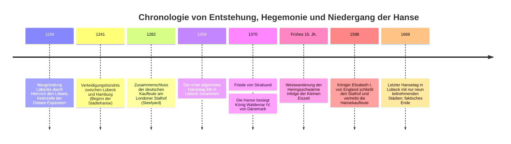
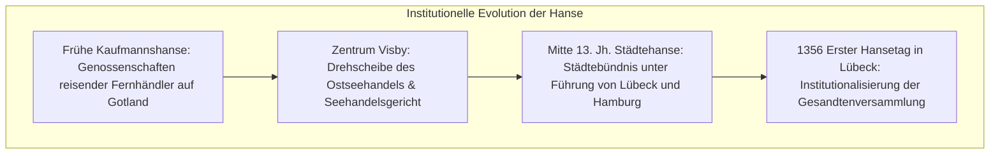
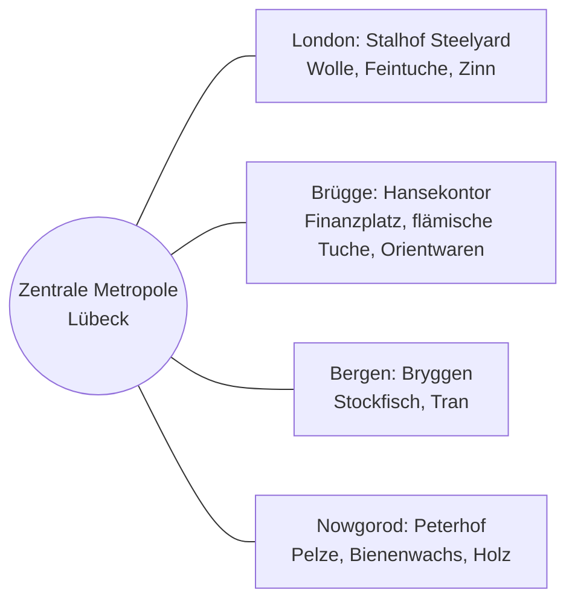
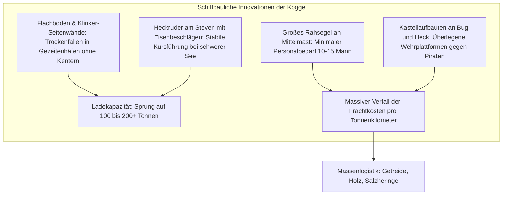

Lange vor der Entstehung des modernen souveränen Nationalstaates existierte vom 13. bis zum 15. Jahrhundert im Nord- und Ostseeraum ein einzigartiges wirtschaftliches Phänomen: **ein maritimes Handelsreich ohne Kaiser, ohne fest umrissene Staatsgrenzen und ohne stehendes Heer**. Es war die **Deutsche Hanse**, angeführt von der „Königin der Hanse“, der freien Reichsstadt **Lübeck**.

In ihrer Blütezeit vereinte die Hanse über 200 Städte und beherrschte die Handelskorridore über Tausende von Kilometern von der Themsemündung in London bis in die Nadelwälder von Nowgorod im fernen Russland. Verbunden durch das **Lübische Recht**, getragen von der schiffbaulichen Meisterleistung der **Hansekogge** und gesteuert durch die Verhandlungsdiplomatie der **Hansetage**, revolutionierten die hanseatischen Fernkaufleute den europäischen Massengütertransport. Wenn auswärtige Monarchen ihre Handelsprivilegien bedrohten, rüsteten die verbündeten Städte eigene Kriegsflotten aus, brachten Könige militärisch auf die Knie und diktierten königliche Thronfolgen.

Warum konnte ein loses Netzwerk selbstverwalteter Städte für zwei Jahrhunderte die ökonomische Vormachtstellung in Nordeuropa erringen? Und warum zerbrach dieser übernationale Verbund mit dem Anbruch der Neuzeit? Diese Abhandlung analysiert das System der Hanse aus den Blickwinkeln der Marinetechnik, der Institutionenökonomik, der Klimageschichte und der Staatenbildung.

---

## 1. Von der Kaufmannshanse zur Städtehanse: Das Lübische Recht und die Kontore

Das mittelniederdeutsche Wort *Hanse* bedeutete ursprünglich „Schar“, „Gefolge“ oder „Kaufmannsgenossenschaft zum gegenseitigen Schutz in der Fremde“. Die historische Genese der Hanse vollzog sich in zwei aufeinanderfolgenden Phasen: dem Übergang von der individuellen Schutzgilde reisender Kaufleute (**Kaufmannshanse**) zum institutionalisierten Städtebündnis autonomer Stadtstaaten (**Städtehanse**).

### 1.1 Lübecks Geostrategie und das Lübische Recht
Nach der Neugründung durch Heinrich den Löwen im Jahr 1159 avancierte **Lübeck** rasch zum Schlüsselhafen an der Ostsee. Um die zeitraubende und von dänischen Abgaben beherrschte Seepassage durch den Öresund zu umgehen, schufen die Kaufleute eine direkte Land- und Flussverbindung über die Trave und die Alster zur Elbmetropole Hamburg.

Das juristische Fundament dieser Expansion bildete das **Lübische Recht (Ius Lubicense)**:
- **Autonomie vom Feudaladel**: Der Stadtrat (*Rat*), besetzt mit vermögenden Patriziern und Fernhändlern, übte die volle Judikative und Exekutive ohne Einmischung landesherrlicher Fürsten oder Bischöfe aus.
- **Rationales Wirtschaftsrecht**: Kodifizierung von Gesellschaftsrecht (*Weda*), Havariebestimmungen, Seerecht, Schuldenhaftung und Erbrecht.
- **Rechtsexport an über 100 Städte**: Wismar, Rostock, Stralsund, Greifswald, Danzig, Elbing, Königsberg, Riga und Reval (Tallinn) übernahmen das Lübische Recht. Bei Rechtsunsicherheiten wandten sich die Tochterstädte an den **Oberhof in Lübeck**, wodurch ein homogener Rechts- und Wirtschaftsraum entstand.

### 1.2 Die vier Kontore: Extraterritoriale Stützpunkte
Außerhalb des Reichsgebietes etablierte die Hanse vier befestigte Hauptniederlassungen mit weitgehender Extraterritorialität:

1. **Der Stalhof in London (Steelyard)**: Ein festungsartiges Areal am Nordufer der Themse, dessen Kaufleute dank kaiserlicher und königlicher Privilegien geringere Zölle zahlten als einheimische englische Händler.
2. **Das Kontor in Brügge (Flandern)**: Das finanzielle Nervenzentrum Nordwesteuropas, wo hanseatische Massengüter gegen englische Tuche, italienische Seide und Gewürze getauscht wurden.
3. **Bryggen in Bergen (Norwegen)**: Vollständiges Monopol auf den Export von getrocknetem Kabeljau (**Stockfisch**), der für das katholische Europa als unverzichtbare Fastenspeise diente.
4. **Der Peterhof in Nowgorod (Russland)**: Ein palisadenbewehrtes Quartier um die Petrikirche zur Monopolisierung von **Bienenwachs** (für Altarkerzen) und kostbaren **Pelzen** (Zobel, Hermelin).

Im Inneren der Kontore herrschte eine klösterlich-militärische Zucht: Den Hansekaufleuten und Gesellen war die Heirat mit Einheimischen bei Strafe verboten, um den Abfluss von Firmenkapital und Handelsinterna zu verhindern.

---

## 2. Schiffbau-Revolution: Die Hansekogge und die Massengutlogistik

Bis ins 12. Jahrhundert dominierten im Ostseeraum schlanke, offene Knorr-Schiffe wikingerzeitlichen Ursprungs, die kaum mehr als 20 bis 40 Tonnen Fracht fassen konnten. Die Entwicklung der **Hansekogge** revolutionierte den maritimen Transport.

- **Das Stevenheckruder**: Der Übergang vom traditionellen seitlichen Steuerriemen zum eisernen Scharnierruder am senkrechten Achtersteven war der wichtigste schiffbauliche Durchbruch des Hochmittelalters. Das Ruder blieb auch bei starker Krängung voll im Wasser wirksam und erlaubte es einem einzelnen Rudergänger, ein 200-Tonnen-Schiff auf Kurs zu halten.
- **Vom Luxusgut zum Massengut**: Statt hochpreisiger Luxuswaren transportierte die Kogge erstmals gewaltige Frachtmengen geringwertiger Massengüter: Roggen, Holz, Pech, Teer, Salz und Fisch.

---

## 3. Der Friede von Stralsund (1370): Kaufleute besiegen Könige

Als der dänische König Waldemar IV. Atterdag 1361 Gotland überfiel, Visby brandschatzte und die dänischen Sundzölle eigenmächtig erhöhte, demonstrierte die Hanse ihre militärische Macht. 

Auf dem Kölner Hansetag 1367 schlossen 57 Städte die **Kölner Konföderation**:
- Einführung des *Pfundzolls* auf alle Seeschiffe zur Finanzierung von Kriegskoggen und Söldnerheeren.
- Nach der Eroberung Kopenhagens und der Blockade des Öresunds kapitulierte Dänemark 1370 im **Frieden von Stralsund**:
  1. Abtretung der dänischen Reichsfestungen am Öresund für 15 Jahre an die Hanse.
  2. Umfassende Zollfreiheit im gesamten dänischen Herrschaftsgebiet.
  3. **Kein neuer dänischer König durfte gekrönt werden ohne die ausdrückliche Zustimmung der Hanse**.

---

## 4. Niedergang und Epochenwende

Im 16. Jahrhundert erlag die Hanse strukturellen Umbrüchen:
1. **Klima & Ökologie**: Die Kleine Eiszeit kühlte die Ostsee ab; die gewaltigen Heringsschwärme verlegten ihre Laichplätze aus dem Schonen-Gebiet in die offene Nordsee. Die Niederländer übernahmen das Fischereimonopol.
2. **Holländische Fleute (Fluitschip)**: Die Holländer bauten bauchige Frachtschiffe mit winzigem Oberdeck, die die dänischen Sundzölle (berechnet nach Deckfläche) umgingen und mit halber Mannschaft doppelt so viel Getreide wie eine Kogge transportierten. Die Hanse verlor 70 % des Ostseefrachtgeschäfts.
3. **Aufstieg der Nationalstaaten**: Absolute Monarchen in England (Elisabeth I. schloss 1598 den Stalhof), Russland (Iwan III. zerstörte 1494 den Peterhof) und Schweden duldeten keine ausländischen Sonderrechte mehr.
4. **Dreißigjähriger Krieg (1618–1648)**: Verheerung Norddeutschlands und Verarmung der Hansestädte. 1669 fand der letzte Hansetag statt.

### Vermächtnis
Die Hanse bewies, dass ein staatenloses Netzwerk auf Basis von Rechtssicherheit, Standardisierung und technologischer Innovation einen europäischen Binnenmarkt schaffen konnte. Städte wie Hamburg und Bremen tragen den Ehrentitel „Freie und Hansestadt“ bis heute mit Stolz.
