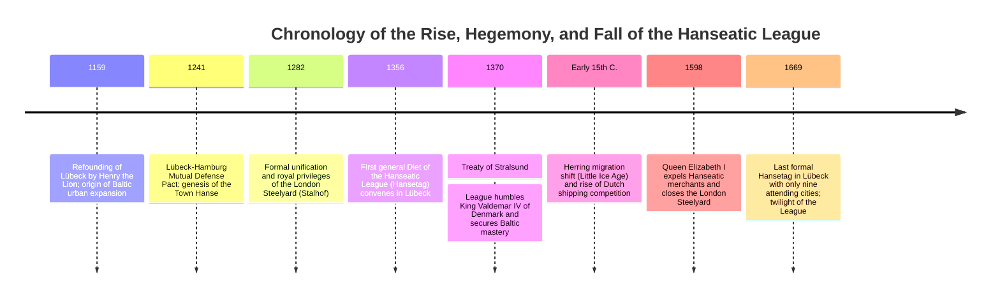
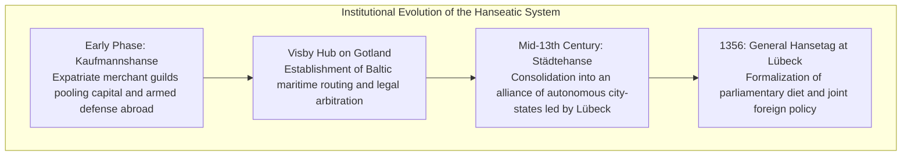
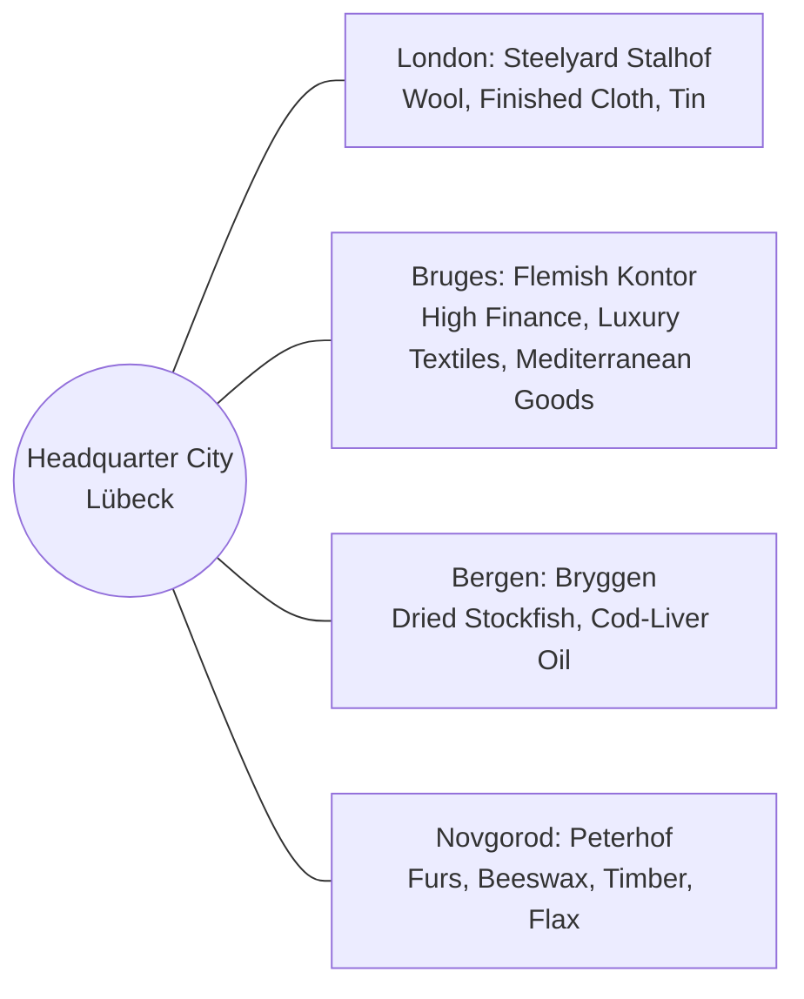
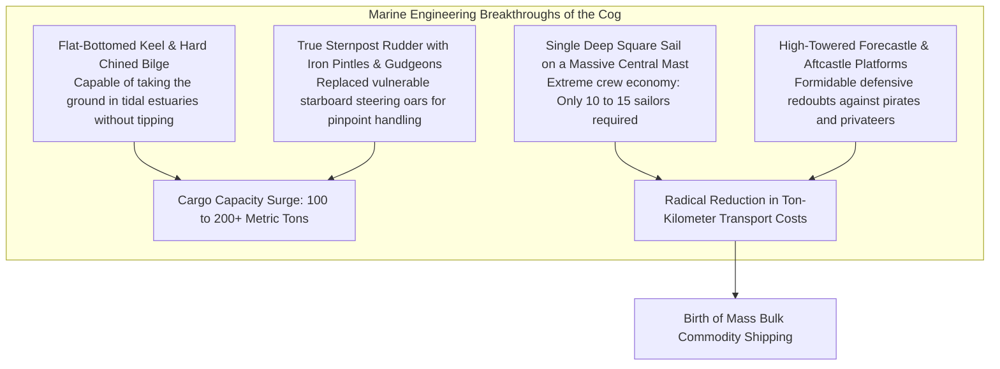
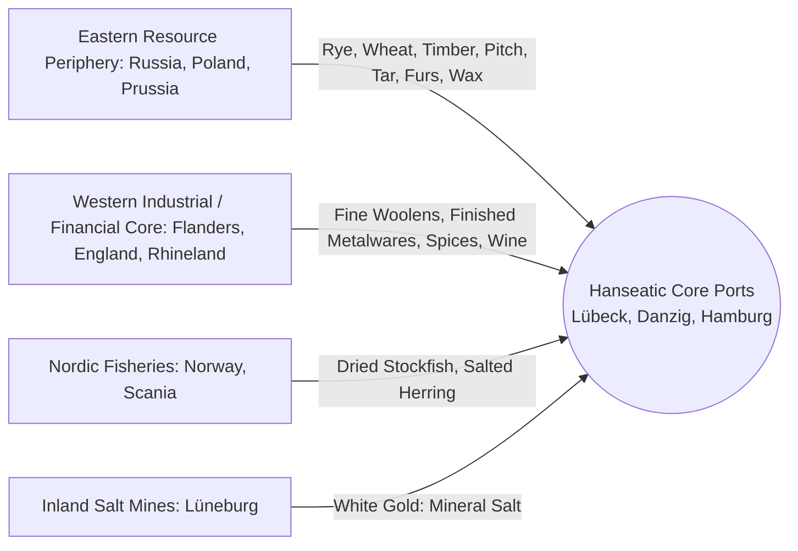
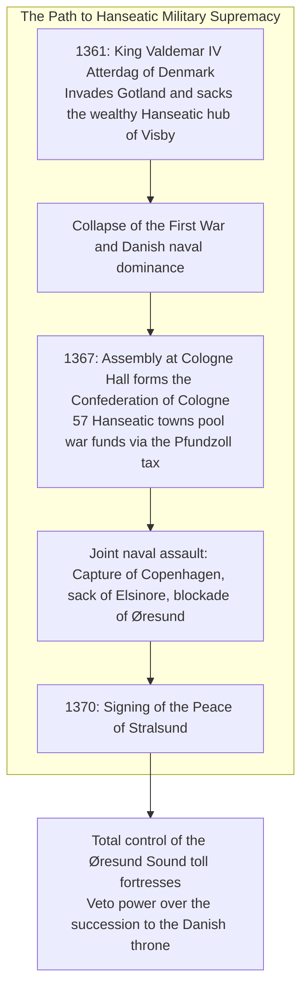
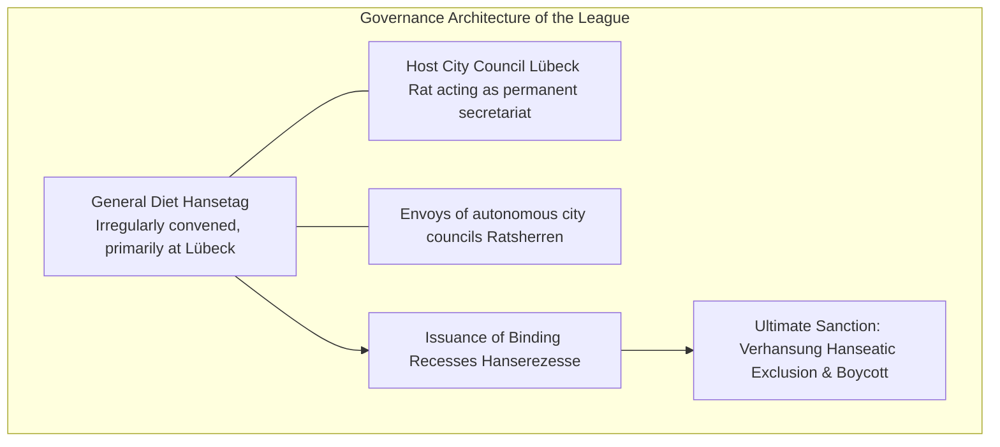
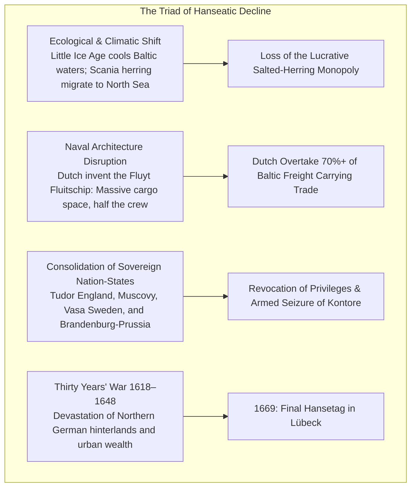

Long before the consolidation of modern nation-states, a unique maritime economic superpower dominated the Baltic and North Seas from the thirteenth to the fifteenth centuries: **a commercial empire without an emperor, without a standing army, and without fixed territorial borders**. This was the **Hanseatic League (Deutsche Hanse)**, centered upon the north German merchant metropolis of **Lübeck**.

At its zenith, the League united more than 200 cities, monopolizing trade routes across thousands of kilometers from the Thames River in London to the forests of Novgorod in Russia. Bound together by a shared legal architecture (**Lübeck Law**), powered by the naval engineering breakthrough of the **Hanseatic Cog (*Kogge*)**, and governed by periodic assemblies of municipal burghers (*Hansetage*), the Hanseatic merchants transformed European bulk commerce. When provoked, this loose federation of city-republics mobilized privateer navies capable of crushing the Kingdom of Denmark and dictating royal succession.

How did a borderless network of self-governing merchants establish such uncontested hegemony over northern European trade? And why did this formidable commercial leviathan ultimately dissolve in the face of the emerging early modern world-system? This monograph delivers an exhaustive, multi-disciplinary analysis spanning naval architecture, institutional economics, environmental shifts, and geopolitical state-building.

---

## 1. Institutional Genesis: From Merchant Guild to Town League

The Old High German term *Hanse* originally denoted a band of travelers, a military troop, or a cooperative mutual-defense fellowship of traveling merchants. The structural evolution of the Hanseatic League occurred in two distinct historical phases: the initial **Merchant Hanse (*Kaufmannshanse*)** of the twelfth and early thirteenth centuries, followed by the institutionalized **Town Hanse (*Städtehanse*)** of the mid-fourteenth century onward.

### 1.1 Lübeck's Strategic Nexus and the Spread of Lübeck Law
Refounded in 1159 by Henry the Lion, Duke of Saxony, **Lübeck** occupied an unprecedented geostrategic bottleneck at the base of the Jutland peninsula. The traditional maritime route connecting the North Sea and the Baltic required navigating the treacherous, shallow, and pirate-infested straits of the Danish Sound (Øresund). By establishing a short overland transit corridor between Hamburg on the Elbe River and Lübeck on the Trave River, merchants could bypass Denmark entirely, slashing transit times and cargo risks.

Lübeck's commercial ascendancy was cemented by its progressive legal code—**Lübeck Law (*Lübisches Recht*)**:
- **Corporate Municipal Autonomy**: Civic government was vested in an oligarchic city council (*Rat*) composed of wealthy merchant patricians, entirely free from the feudal jurisdiction of local bishops or landed nobility.
- **Commercial Standardization**: Clear, predictable statutes governed contracts, bankruptcy, maritime freight, bill-of-exchange clearing, inheritance, and partnerships (*Weda*).
- **Urban Legal Franchising**: Over one hundred newly founded German and Baltic cities adopted Lübeck Law verbatim, including Rostock, Wismar, Stralsund, Danzig (Gdańsk), Elbing, Riga, and Reval (Tallinn).
When novel legal disputes arose, daughter cities submitted their cases on appeal to Lübeck's supreme court (*Oberhof*). This legal isomorphism unified a sprawling geographical arc of independent ports into a seamless, low-friction commercial commonwealth.

### 1.2 The Extraterritorial Kontore: Four Pillars of Hegemony
Beyond the borders of the Holy Roman Empire, the League established four primary fortified overseas commercial enclaves known as **Kontore** (singular: *Kontor*). These settlements operated under sweeping grants of extraterritoriality:

1. **The Steelyard (*Stalhof*) in London**: Positioned on the north bank of the Thames, this walled citadel enjoyed royal tax exemptions so vast that Hanseatic merchants paid lower export duties on English wool and cloth than native English merchants.
2. **The Bruges Kontor (Flanders)**: Located in the preeminent banking capital of northwestern Europe, the Bruges outpost served as the grand clearinghouse where Hanseatic raw materials were exchanged for English broadcloth, Italian silks, Flemish tapestries, and Levantine spices brought by Venetian galleys.
3. **Bryggen in Bergen (Norway)**: Controlling the harbor of Bergen, Hanseatic merchants established a total monopsony over the Arctic cod fisheries of northern Norway. Dried stockfish (*Stockfisch*) was the indispensable, non-perishable protein source required by Catholic Europe during Lent.
4. **The Peterhof in Novgorod (Russia)**: A palisaded fortress containing the Church of St. Peter, where merchants bartered Western silver, wine, salt, and cloth for astronomical quantities of high-grade furs (sable, ermine, marten) and forest beeswax, which illuminated every cathedral altar in Christendom.

Life within the Kontore was monastic and militaristic. Apprentices and journeymen were forbidden to marry native women or socialize outside the gates. Strict celibacy, communal dining, and draconian internal discipline prevented the leakage of mercantile secrets and institutional capital into host societies.

---

## 2. Naval Architecture: The Engineering of the Hanseatic Cog

The physical catalyst of Hanseatic economic supremacy was a revolutionary achievement in marine engineering: the **Hanseatic Cog (*Kogge*)**. Prior to the late twelfth century, northern waters were traversed by clinker-built vessels derived from Norse longships—slender, open, flexible craft optimized for beach landings and coastal raiding, but possessing severely limited cargo capacities.

### 2.1 Archaeological Evidence and Structural Anatomy
The discovery of the remarkably preserved **Bremen Cog of 1380** in the Weser River in 1962 enabled naval historians to rigorously calculate the hydrodynamic and structural parameters of these medieval workhorses:

| Engineering Parameter | Hanseatic Cog (c. 1250–1400) | Norse Trading Knarr (c. 900–1150) |
| :--- | :--- | :--- |
| **Length overall (LOA) & Beam** | Length ~23.5 m, Beam ~7.5 m (Length-to-beam ratio ~3.1:1) | Length ~16 m, Beam ~4.5 m (Length-to-beam ratio ~4.5:1) |
| **Deadweight Cargo Capacity** | **100 to 200+ metric tons (60–100 Lasten)** | 20 to 40 metric tons maximum |
| **Hull Construction** | Flush-laid (carvel-like) bottom planks; clinker lapstrake topsides | Entirely clinker-built (flexible, prone to leaking under heavy load) |
| **Steering Mechanism** | **Centerline Sternpost Rudder (*Heckruder*)** | Starboard side-rudder steering oar |
| **Rigging & Crew Complement** | One massive square sail (~200 $\text{m}^2$); **10 to 15 crewmen** | Square sail and auxiliary rowing; **20 to 30 crewmen** |
| **Defensive Architecture** | Elevated, crenelated bow and stern fighting platforms | Unprotected open decks |

### 2.2 The Centerline Sternpost Rudder
The transition from the traditional starboard steering oar to the **iron-hinged centerline sternpost rudder** was arguably the single most important advancement in European navigation between antiquity and the Age of Discovery. 
1. **Immunity to Heeling**: A starboard steering oar frequently lifted out of the water when the vessel heeled sharply to port in heavy seas, causing an immediate loss of directional control. The sternpost rudder remained deeply submerged regardless of heel angle.
2. **Hydrodynamic Efficiency**: Mounted directly in the centerline wake behind the sternpost, the rudder generated substantial turning moment with minimal drag, allowing deep-draft cogs to hold a steady course against punishing Baltic crosswinds.
3. **Mechanical Advantage**: Leveraged by a massive wooden tiller, a single helmsman could control a 200-ton vessel that previously would have required several exhausted oarsmen.

### 2.3 The Genesis of Bulk Logistics
While Mediterranean maritime commerce in Venice and Genoa focused primarily on ultra-high-value, low-volume luxuries (spices, silks, perfumes, and jewels), the Hanseatic Cog unlocked the economics of **low-value, high-volume bulk commodities**:
- Grains (rye, wheat, barley)
- Raw forestry products (oak timbers, pitch, tar, potash, hemp)
- Bulk minerals (salt, copper, iron ore)
- Preserved protein (barrels of salted herring, dried cod)

A single Hanseatic Cog could transport a payload equivalent to a caravan of several hundred horse-drawn wagons, reducing overland transport freight rates by over 80%.

---

## 3. The Artery of Northern Commerce: The Commodity Matrix

The Hanseatic trading system was an integrated trans-European ecological circuit, systematically channeling raw natural endowments from the eastern frontier to fuel urban industrial manufacture in the West.

### 3.1 The Herring-Salt Complex: Lüneburg and Scania
The financial lifeblood of the League was anchored in the symbiotic relationship between **Lüneburg salt** and **Scanian herring**:
- **The Scania Market (*Skånemarket*)**: Every autumn, millions of migrating herring passed through the narrow straits off the Falsterbo peninsula in southern Sweden. Contemporary chroniclers remarked that the schools were so dense that boats could scarcely be rowed.
- **The Lüneburg Brine Springs**: Freshly caught herring spoils within hours unless salted immediately. The inland salterns of Lüneburg produced hundreds of thousands of tons of high-purity mineral salt. The League constructed the **Stecknitz Canal** (completed in 1398, one of the earliest summit-level pound-lock canals in Europe) to barge this salt directly to Lübeck.
- Packed into standardized wooden barrels bearing the official Hanseatic brand, salted herring was exported to feed the fasting populations of England, France, Germany, and Poland during Catholic Lent.

### 3.2 The Comprehensive Trade Commodity Matrix

| Geographical Sector | Primary Commodities Exported | Macroeconomic Role in the System |
| :--- | :--- | :--- |
| **Novgorod & Muscovy** | Ermine, sable, squirrel furs; virgin beeswax; flax; hemp | Luxury winter prestige apparel for nobility; liturgical church illumination |
| **Prussia & Poland (Danzig, Thorn)** | Rye, wheat, ship-mast oaks, pitch, tar, ashes | Breadbasket feeding industrial Flanders; naval stores for western dockyards |
| **Sweden (Bergslagen)** | Copper ore, malleable Osomund iron, timber | Strategic raw materials for armaments, church bells, tools, and construction |
| **Norway (Bergen)** | Dried Atlantic cod (Stockfish), train oil | Inexpensive, non-perishable daily sustenance for peasants and urban laborers |
| **England (London, Hull)** | Raw wool, coarse undyed broadcloths, tin, lead | Unrefined industrial inputs for continental textile spinning and weaving |
| **Flanders (Bruges, Ghent)** | Luxury finished textiles, dyed woolens, tapestries | High-value manufactured consumer goods shipped back eastward |
| **Rhineland & France** | Rhenish wines, French bay salt, manufactured ironwares | Luxury beverages and alternative coarse preserving salts |

---

## 4. Gunpowder, Ships, and Sovereignty: The Peace of Stralsund (1370)

The Hanseatic League was not merely an association of peaceful shopkeepers; when its trading privileges were threatened, it acted as a terrifying maritime war machine. The zenith of its geopolitical power arrived during the **Hanseatic-Danish War of 1361–1370**.

### 4.1 The Confederation of Cologne (1367)
In 1361, the ambitious Danish monarch **Valdemar IV Atterdag** attempted to break Hanseatic control of the Baltic. He seized the strategic island of Gotland, extorted astronomical ransoms from the burghers of Visby, and threatened the Scanian herring fairs.

Realizing that individual city resistance was futile, representatives from fifty-seven towns gathered at the town hall of Cologne in November 1367, creating the **Confederation of Cologne (*Kölner Konföderation*)**:
- Imposed the *Pfundzoll*—a mandatory tonnage surcharge levied across all member ports to build a unified war treasury.
- Mandated standardized ship and troop levies: each burgh supplied fully armed cogs carrying crossbowmen, archers, and armored mercenaries.
- Formed tactical military alliances with Albert of Mecklenburg, King of Sweden, and disaffected Danish nobles.

### 4.2 The Terms of the 1370 Treaty of Stralsund
The unified Hanseatic naval armada blockaded Danish shipping, recaptured Visby, laid siege to Copenhagen, and razed the fortifications at Elsinore. Totally crushed, Denmark signed the **Peace of Stralsund** on September 1, 1370:
1. **Fortress Occupation**: The League was granted direct military custody of the four key royal fortresses flanking the Øresund (including Helsingborg and Malmö) for fifteen years, accompanied by two-thirds of all sound toll revenues.
2. **Complete Customs Exemption**: Hanseatic merchants secured unhindered, duty-free commercial transit throughout the Baltic.
3. **The Royal Succession Veto**: Most humiliatingly, the treaty dictated that **no successor could assume the Danish throne without the prior formal consent and approval of the Hanseatic League**.

For the next century, the League reigned as the undisputed master of northern European geopolitics—a syndicate of merchants holding the sovereignty of a crowned monarchy in their hands.

---

## 5. Political Governance: Consensus Without a Central State

The League's governance structure remains an enigma in political theory. It possessed:
- No written constitution
- No permanent executive head or president
- No permanent standing army
- No permanent common treasury
- No permanent civil service or bureaucracy

### 5.1 The Hansetag and the Hanserezesse
The sovereign organ of the League was the **Hansetag (Hanseatic Diet)**, an assembly of council delegates (*Ratsherren*) representing member municipalities.
- Meetings were convened irregularly by the city council of Lübeck, which acted as the *de facto* executive secretariat.
- Debate operated on the principle of consensus (*Einhelligkeit*). The League abhorred formal majority voting, preferring exhaustive debate until a negotiated collective agreement could be reached.
- The enacted decisions were codified into written instruments known as **Recesses (*Hanserezesse*)**, which were dispatched to municipal town halls for local legislative implementation.

### 5.2 The Weapon of Exclusion: Verhansung
Because the League lacked a federal judiciary or standing police force, it enforced compliance through a devastating economic sanction: **Verhansung (Hanseatic Exclusion / Commercial Ostracism)**.
- A city struck with *Verhansung* lost all privileges across all member ports and foreign Kontore. Its vessels were barred from entering Hanseatic harbors, and any Hanseatic merchant caught trading with its citizens was heavily fined.
- In 1358, when the city of Bremen refused to support a collective boycott of Flanders, the League placed Bremen under *Verhansung*. Within months, Bremen's maritime commerce vanished, its docks sat idle, and its tax revenues collapsed. The chastened city council was forced to send humble delegations to Lübeck, pay crushing indemnities, and swear unconditional future obedience to obtain reinstatement.

---

## 6. Structural Decline: The Environmental, Technological, and Political Collapse

The demise of the Hanseatic League in the sixteenth century was neither sudden nor accidental. It was the inevitable outcome of three structural revolutions that rendered the medieval city-league model obsolete.

### 6.1 The Ecological Shift: The Great Herring Migration
During the early fifteenth century, water temperatures and salinity levels in the Baltic Sea declined as the Little Ice Age intensified. The massive shoals of Atlantic herring ceased their annual spawning migration into the Scanian shallows, redirecting their migratory corridors to the open waters of the North Sea and the English Channel.
- The Scanian fairs collapsed into financial insignificance.
- The Dutch maritime sector seized immediate advantage. Developing the specialized herring buss (*Haringbuis*)—which allowed fishermen to gut, salt, and barrel fish immediately on the high seas—the Dutch displaced the Hanseatic monopoly over the Catholic dietary market.

### 6.2 Technological Disruption: The Dutch Fluyt (*Fluitschip*)
By the late 1500s, shipwrights in Hoorn in the northern Netherlands introduced the ultimate cargo-carrying vessel of the pre-industrial world: the **Fluyt (*Fluitschip*)**:
- **Hull Geometry Exploitation**: The Danish Crown assessed sound transit dues based on the square area of a ship's main deck. The Dutch engineered a pear-shaped hull with a very narrow top deck and an enormous, bulbous submerged hold, **evading the tax while maximizing deadweight cargo space**.
- **Extreme Mechanization**: Employing block-and-tackle gear, winches, and centralized halyards, a 300-ton fluyt required a crew of only 9 to 12 men—half that of a comparable Hanseatic vessel.

By 1600, Dutch shipping accounted for more than 70% of all ship passages through the Danish Sound. The Hanseatic merchants were systematically undercut and priced out of their own domestic sea.

### 6.3 The Rise of the Sovereign Leviathan
The decentralized Hanseatic model could only thrive in a fractured feudal world of weak monarchies. The rise of centralized early modern nation-states equipped with professional standing armies and mercantilist doctrines marked the death sentence of merchant extraterritoriality:
1. **Muscovy**: In 1494, Tsar Ivan III annexed Novgorod, raided the Hanseatic Peterhof, chained forty-nine German merchants in irons, and confiscated all goods, terminating four centuries of Baltic-Russian trade autonomy.
2. **Tudor England**: Dedicated to fostering native merchant companies (the Merchant Adventurers), Queen Elizabeth I revoked the League's ancient tax immunities in 1579. In 1598, royal authorities seized the Steelyard, expelled all German factors, and turned the complex over to the British Royal Navy.
3. **The Cataclysm of the Thirty Years' War (1618–1648)**: Northern Germany became the catastrophic battleground of Europe. Swedish, Imperial, and mercenary armies plundered Hanseatic hinterlands, burnt satellite towns, and annihilated municipal capital.

In 1669, the final Hansetag met in the historic town hall of Lübeck. Only six municipal envoys representing nine exhausted cities attended. The assembly concluded without enacting a single resolution, quietly closing the book on an empire of merchants that had endured for half a millennium.

---

## 7. Comparative Lessons for the Twenty-First Century

The rise and fall of the Hanseatic League offers profound theoretical and practical parallels for the contemporary globalized world:

| Hanseatic Historical Mechanism | Contemporary Modern Equivalent | Strategic Takeaway |
| :--- | :--- | :--- |
| **Lübeck Law Harmonization** | European Union Single Market, Uniform Commercial Code, ISO Standards | Cross-border economic transaction costs plummet when legal rules and contract enforcement are harmonized across independent jurisdictions. |
| **Consensus Governance (Hansetag)** | Decentralized Autonomous Organizations (DAOs), Internet Standards Bodies (W3C/IETF) | Decentralized networks function brilliantly while participants share commercial incentives, but experience catastrophic paralysis when structural conflicts arise. |
| **Extraterritorial Kontore** | Special Economic Zones (SEZs), Multinational Corporate Campuses, Tech Hubs | Privileged commercial outposts provoke severe nationalist political backlash when domestic economic sovereignty asserts itself. |
| **Dutch Fluyt Disruption** | The Container Shipping Revolution (Malcom McLean), Digital Platform Aggregators | Incumbents who rely on legacy cartel agreements and fail to match the productivity of capital-efficient technology are swiftly wiped out. |
| **Clash with Monarchical Sovereignty** | Regulatory Clash: Sovereign Governments vs. Global Big Tech (Antitrust, AI Governance, Data Sovereignty) | Borderless economic federations cannot permanently resist territorial sovereign states capable of mobilizing taxation, law, and legitimate violence. |

### Conclusion
The Hanseatic League demonstrated that trade, legal integration, and maritime innovation could assemble a continent-spanning civilization without the iron hand of an imperial throne. While its physical ships and timbered warehouses have passed into archaeology, the Hanseatic legacy endures in the proud constitutional title still borne today by Hamburg and Bremen—*Freie und Hansestadt*—and in the foundational architecture of open European trade that continues to define our world.
