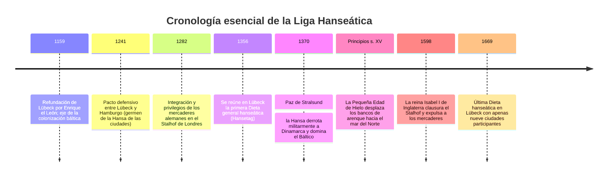

Mucho antes de que se consolidaran los modernos Estados soberanos, el mar del Norte y el mar Báltico estuvieron regidos entre los siglos XIII y XV por un insólito imperio mercantil: **una confederación comercial sin monarca, sin fronteras delimitadas y sin ejército regular**. Esta entidad fue la **Liga Hanseática (Deutsche Hanse)**, con epicentro en la ciudad libre de **Lübeck**.

En su época dorada, la Hansa agrupó a más de 200 urbes autónomas y monopolizó las arterias de tráfico que iban desde Londres hasta los confines rusos de Nóvgorod. Cohesionadas por un marco normativo común (**el Derecho de Lübeck**), impulsadas por la revolución náutica de **la coca (*Kogge*)** y gobernadas por las asambleas de burgueses (*Hansetage*), las ciudades hanseáticas crearon el transporte marítimo de mercancías a granel. Fueron capaces de derrotar por la fuerza de las armas a la monarquía de Dinamarca e imponer su derecho de veto sobre el trono danés.

---

## 1. De la Hansa de los mercaderes a la Hansa de las ciudades

El término *Hanse* designaba en origen una partida armada o una hermandad de comerciantes para defenderse mutuamente en comarcas foráneas. Con el tiempo, este mutualismo dio paso a una alianza interestatal de repúblicas patricias gobernadas por sus concejos (*Ratsherren*).

### 1.1 El Derecho de Lübeck
La conexión directa de Lübeck con Hamburgo evitaba la peligrosa circunnavegación de Dinamarca. El **Derecho de Lübeck (*Lübisches Recht*)** garantizaba:
- Soberanía municipal plena frente a la nobleza y los obispos.
- Normas claras de fletamento, quiebras, hipotecas navales y arbitraje mercantil.
- Más de un centenar de ciudades costeras (Danzig, Riga, Tallin) adoptaron sus leyes y recurrían al Tribunal Superior de Lübeck (*Oberhof*).

### 1.2 Los cuatro grandes consulados (Kontore)
Fuera del territorio alemán, la Liga mantenía cuatro enclaves fortificados con derechos de extraterritorialidad:
1. **El Stalhof (Steelyard) en Londres**: Gozaba de aranceles de exportación de lana y tejidos más reducidos que los de los propios comerciantes británicos.
2. **Brujas (Flandes)**: El gran emporio financiero donde las materias primas del Báltico se permutaban por paños finos flamencos y lujos mediterráneos.
3. **Bryggen en Bergen (Noruega)**: Monopolio absoluto del bacalao desecado (*Stockfisch*), el alimento proteínico por excelencia en la Cuaresma europea.
4. **El Peterhof en Nóvgorod (Rusia)**: Centro neurálgico para acaparar cera de abejas litúrgica y pieles finas de marta cibelina y armiño.

---

## 2. La nao coca (Kogge) y el transporte a granel

Frente a las esbeltas naves vikingas de apenas 30 toneladas, la **coca hanseática** supuso un salto colosal:
- **Timón de codaste central**: Sujetado con bisagras metálicas en el centro de la popa, ofrecía un control de gobierno prodigioso en tempestades y no se salía del agua con el balanceo.
- **Bodega de 100 a 200 toneladas de carga**: Movida por una sola vela cuadra y tripulada por solo 10–15 marineros, redujo el flete marítimo en más de un 80 %. Permitió transportar por mar cargas voluminosas de bajo valor relativo: grano, madera de construcción naval, arenques y salazón.

---

## 3. Victoria sobre la Corona: La Paz de Stralsund (1370)

Tras el saqueo danés de Visby, 57 urbes hanseáticas fundaron la **Confederación de Colonia** en 1367. Armaron buques de guerra, capturaron Copenhague y bloquearon el estrecho del Sund.
La **Paz de Stralsund de 1370** consagró la hegemonía hanseática:
- Cesión temporal de las fortalezas clave de los estrechos daneses y dos tercios de sus aranceles.
- Exención impositiva en todo el Báltico.
- **La Corona danesa no podía proclamar ningún nuevo monarca sin el consentimiento expreso de la Hansa**.

---

## 4. Ocaso ante los Países Bajos y los Estados absolutistas

La Liga declinó por causas económicas, técnicas y políticas:
1. **La migración del arenque**: El enfriamiento del mar por la Pequeña Edad de Hielo trasladó las frezas al mar del Norte, donde los pescadores holandeses se adueñaron del negocio.
2. **El filibote holandés (*Fluitschip*)**: Buque holandés de gran manga y cubierta estrecha que burlaba los impuestos aduaneros daneses y requería menos marineros, absorbiendo el 70 % de los fletes del Báltico.
3. **El Estado monárquico absolutista**: Zares rusos (Iván III arrasó Nóvgorod en 1494), zares suecos y monarcas ingleses (Isabel I expulsó a la Hansa en 1598) nacionalizaron el comercio y anularon las inmunidades foráneas.
4. **La Guerra de los Treinta Años** devastó el norte germánico, precipitando el fin de la Liga en 1669.
