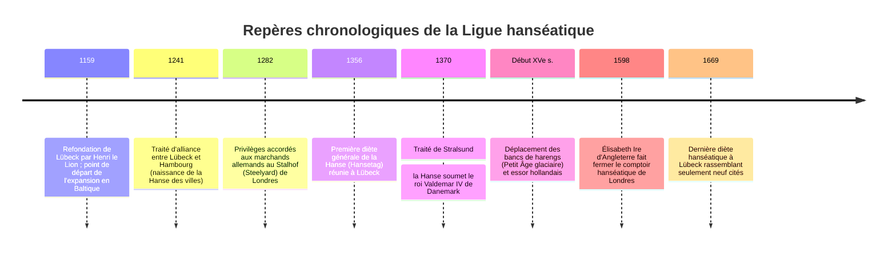
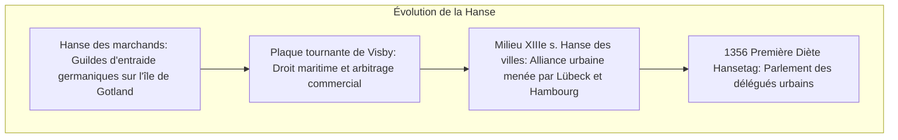

Bien avant la cristallisation des États-nations modernes, la mer du Nord et la mer Baltique furent dominées du XIIIe au XVe siècle par un empire d'une nature inédite : **une thalassocratie marchande sans monarque, sans armée permanente et sans frontières territoriales fixes**. Cet empire portait le nom de **Ligue hanséatique (Hanse teutonique)**, dont la métropole souveraine était **Lübeck**.

À son apogée, la Hanse regroupait plus de deux cents cités autonomes et exerçait un monopole commercial incontesté s'étendant de la Tamise à Londres jusqu'aux confins de Novgorod en Russie. Unie par une matrice juridique commune (**le droit de Lübeck**), portée par la formidable innovation navale de **la cogue (*Kogge*)** et administrée par les diètes hanséatiques (*Hansetage*), la Hanse inventa le transport maritime moderne des marchandises de vrac. Capable d'armer de redoutables flottes de guerre pour terrasser le royaume de Danemark, elle allait jusqu'à imposer son droit de veto sur la succession des trônes scandinaves.

Pourquoi cette fédération marchande acéphale a-t-elle régné sur l'Europe septentrionale ? Et pourquoi a-t-elle sombré avec l'avènement des Temps modernes ? Cette étude en propose une analyse globale.

---

## 1. La genèse institutionnelle : Le droit de Lübeck et les quatre comptoirs

En vieux haut-allemand, le mot *Hansa* désignait une troupe armée ou une guilde de marchands réunis pour assurer leur protection mutuelle en terre étrangère. L'organisation évolua de la **Hanse des marchands** vers une **Hanse des villes** coalisées.

### 1.1 Le droit de Lübeck
La situation géographique de Lübeck permettait de relier directement la mer Baltique à Hambourg sans contourner le Danemark par le détroit de l'Øresund.
Le **droit de Lübeck (*Lübisches Recht*)** offrait :
- L'autonomie politique totale des conseils échevinaux face aux seigneurs féodaux.
- Une rationalisation moderne du droit maritime, des faillites et des sociétés de capitaux.
- Plus de cent villes baltes (Danzig, Riga, Tallinn, Stralsund) adoptèrent ce droit et dépendaient du tribunal supérieur d'appel de Lübeck (*Oberhof*).

### 1.2 Les quatre comptoirs extraterritoriaux (Kontore)
La Hanse gouvernait quatre comptoirs fortifiés hors d'Allemagne :
- **Le Stalhof (Steelyard) à Londres** : Bénéficiant de tarifs douaniers plus avantageux que ceux des marchands anglais eux-mêmes.
- **Le comptoir de Bruges** : Plaque tournante financière connectant les produits nordiques aux soieries et épices méditerranéennes.
- **Bryggen à Bergen** : Monopole absolu sur le stockfisch (morue séchée) indispensable aux jeûnes du carême catholique.
- **Le Peterhof à Novgorod** : Monopole sur la cire d'abeille des monastères et les fourrures précieuses de Russie.

---

## 2. La révolution navale : La cogue (Kogge) et le fret de vrac

Avant le XIIIe siècle, les navires scandinaves (knarr) n'emportaient que 20 à 40 tonnes de charge. La **cogue hanséatique (*Kogge*)** bouleversa le transport maritime :
- **Fond plat et bordé à clins** : Capacité d'échouage sur les bancs de sable à marée basse sans chavirer.
- **Gouvernail d'étambot axial (Sternpost rudder)** : Remplaçant la rame de gouverne latérale, il offrait une tenue de cap parfaite par gros temps sans sortir de l'eau à la gîte.
- **Capacité de 100 à 200 tonnes** : Manœuvrée par seulement 10 à 15 marins grâce à son unique grande voile carrée, elle fit chuter les coûts de transport de plus de 80 %, inaugurant l'ère du transport de masse (blé, bois, hareng salé).

---

## 3. L'apogée militaire : Le traité de Stralsund (1370)

En 1361, le roi de Danemark Valdemar IV pilla Visby. En représailles, 57 cités hanséatiques formèrent la **Confédération de Cologne** (1367), levèrent une taxe sur les navires et armèrent une immense flotte.
Après la prise de Copenhague et le blocus du détroit, le Danemark capitula au **traité de Stralsund (1370)** :
1. La Hanse reçut l'administration des forteresses de l'Øresund et les deux tiers des revenus des péages maritimes.
2. Tout nouveau roi de Danemark devait obligatoirement obtenir **l'accord préalable de la Hanse pour monter sur le trône**.

---

## 4. Le déclin et la disparition

Au XVIe siècle, la Hanse s'effondra face à trois bouleversements :
1. **Mutation écologique** : Avec le Petit Âge glaciaire, les harengs quittèrent la Baltique pour la mer du Nord, permettant aux Hollandais de ravir l'industrie halieutique.
2. **La flûte hollandaise (Fluitschip)** : Navire hollandais à coque renflée et pont étroit, échappant aux taxes danoises et manœuvré avec moitié moins d'hommes, capturant 70 % du trafic de la Baltique.
3. **L'émergence des États souverains** : Les monarchies absolues d'Angleterre (expulsion par Élisabeth Ire en 1598) et de Russie (fermeture de Novgorod par Ivan III en 1494) détruisirent les privilèges extraterritoriaux étrangers.
4. **La guerre de Trente Ans** ruina définitivement les cités allemandes. La Hanse s'éteignit en 1669.
