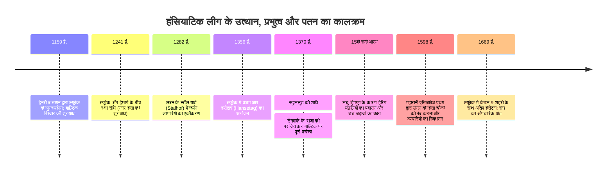

आधुनिक संप्रभु राष्ट्र-राज्यों के उदय से सदियों पहले, 13वीं से 15वीं शताब्दी के दौरान उत्तरी और बाल्टिक सागर पर एक अनोखा समुद्री आर्थिक साम्राज्य कायम था: **एक ऐसा व्यापारिक संघ जिसका कोई राजा नहीं था, कोई निश्चित क्षेत्रीय सीमाएं नहीं थीं और न ही कोई स्थायी सेना थी**। इसे **हंसियाटिक लीग (Hanseatic League / Deutsche Hanse)** के नाम से जाना जाता था, जिसका नेतृत्व उत्तरी जर्मन शहर **ल्यूबेक (Lübeck)** करता था।

अपने चरम पर, इस लीग में 200 से अधिक स्वायत्त शहर शामिल थे, जिन्होंने लंदन की टेम्स नदी से लेकर रूस के नोवगोरोड तक के हजारों किलोमीटर के व्यापारिक मार्गों पर एकाधिकार कर रखा था। एक साझा कानूनी व्यवस्था (**ल्यूबेक कानून**), **हंसियाटिक कॉग (Kogge)** जहाजों की उन्नत नौसेना इंजीनियरिंग और नगर परिषदों के सम्मेलनों (*हंसेटाग*) के दम पर उन्होंने भारी थोक सामग्रियों के समुद्री परिवहन में क्रांति ला दी। जब विदेशी राजाओं ने उनके व्यापार पर अंकुश लगाने का प्रयास किया, तो शहरों के इस संघ ने नौसैनिक युद्ध छेड़कर डेनमार्क के शक्तिशाली साम्राज्य को घुटने टेकने पर मजबूर कर दिया और उसके सिंहासन के उत्तराधिकार पर वीटो का अधिकार हासिल कर लिया।

---

## 1. संस्थागत विकास: व्यापारी हंसा से नगर संघ और ल्यूबेक कानून

प्राचीन जर्मन भाषा में *Hanse* का मूल अर्थ 'सशस्त्र जत्था', 'सैन्य टुकड़ी' या 'परदेस में व्यापारियों की सुरक्षा समिति' था। यह व्यवस्था व्यक्तिगत व्यापारियों के संघों से विकसित होकर स्वायत्त नगर-राज्यों के राजनीतिक-सैन्य महासंघ में बदल गई।

### 1.1 ल्यूबेक कानून (Lübisches Recht)
ल्यूबेक और हैम्बर्ग के बीच जमीनी मार्ग ने डेनमार्क के खतरनाक समुद्री जलडमरूमध्य को पार किए बिना बाल्टिक और उत्तरी सागर को जोड़ दिया।
**ल्यूबेक कानून** ने व्यापारियों को निम्नलिखित सुरक्षा प्रदान की:
- सामंती प्रभुओं और चर्च के नियंत्रण से नगर परिषदों (*Rat*) की पूर्ण स्वायत्तता।
- समुद्री माल ढुलाई, दिवालियापन, अनुबंध और साझेदारी से जुड़े प्रगतिशील कानून।
- बाल्टिक तट के 100 से अधिक शहरों (डांत्सिग, रीगा, तेलिन) ने इस कानून को अपनाया और किसी भी विवाद के निपटारे के लिए ल्यूबेक की शीर्ष अदालत (*Oberhof*) में अपील की जाती थी।

### 1.2 चार प्रमुख विदेशी व्यापारिक चौकियां (Kontore)
हंसियाटिक लीग ने गैर-जर्मन क्षेत्रों में चार स्वायत्त किलेनुमा चौकियां बनाईं:
1. **लंदन का स्टील यार्ड (Steelyard)**: टेम्स नदी के किनारे स्थित, जहां जर्मन व्यापारियों को स्थानीय अंग्रेज व्यापारियों से भी कम सीमा शुल्क देना पड़ता था।
2. **ब्रुग्स (फ्लेमिश कंटोर)**: अंतरराष्ट्रीय वित्त का केंद्र, जहां उत्तर का कच्चा माल दक्षिण के रेशम और मसालों से बदला जाता था।
3. **बर्गन का ब्रिगैन (नॉर्वे)**: सूखी कॉड मछली (*Stockfish*) का एकाधिकार, जो कैथोलिक यूरोप में उपवास के दिनों का मुख्य भोजन था।
4. **नोवगोरोड का पीटरहॉफ (रूस)**: रूसी चर्चों की मोमबत्तियों के लिए शुद्ध मोम और बहुमूल्य फर (सेबल, गिलहरी) का विशाल संग्रह केंद्र।

इन चौकियों में रहने वाले कर्मचारियों को स्थानीय महिलाओं से विवाह करने की सख्त मनाही थी ताकि व्यापारिक रहस्य बाहर न जाएं।

---

## 2. नौसेना इंजीनियरिंग: कॉग जहाज (Cog) और थोक माल ढुलाई

पारंपरिक वाइकिंग जहाजों की भार क्षमता केवल 20 से 40 टन थी। **हंसियाटिक कॉग (Kogge)** ने समुद्री माल ढुलाई को पूरी तरह बदल दिया:
- **मध्यवर्ती पतवार (Sternpost Rudder)**: जहाज के पिछले हिस्से के केंद्र में लोहे के कब्जों से जुड़ी यह पतवार भीषण तूफानों में भी पानी के भीतर रहकर सटीक दिशा नियंत्रण प्रदान करती थी।
- **100 से 200 टन भार क्षमता और केवल 10–15 नाविक**: एक विशाल चौकोर पाल के कारण संचालन लागत 80 % तक घट गई, जिससे पहली बार भारी और सस्ते मालों (अनाज, लकड़ी, नमक, हेरिंग मछली) का बड़े पैमाने पर व्यापार संभव हुआ।

---

## 3. सैन्य विजय: स्ट्रालसुंड की संधि (1370 ई.)

1361 में जब डेनमार्क के राजा वाल्डेमार चतुर्थ ने विस्बी को लूटा, तो 57 हंसा शहरों ने 1367 में **कोलोन परिसंघ** का गठन किया। जहाजों पर युद्ध कर लगाकर एक विशाल संयुक्त नौसेना बनाई गई।
कोपेनहेगन पर विजय और समुद्री नाकेबंदी के बाद डेनमार्क ने 1370 में **स्ट्रालसुंड की अपमानजनक संधि** पर हस्ताक्षर किए:
- महत्वपूर्ण डेनिश किलों पर 15 वर्षों के लिए हंसा का कब्जा और टोल टैक्स का दो-तिहाई हिस्सा।
- पूरे बाल्टिक में पूर्ण कर-मुक्त व्यापार।
- **डेनमार्क के नए राजा का राज्याभिषेक हंसा नगर परिषदों की पूर्व अनुमति के बिना नहीं हो सकता था**।

---

## 4. पतन के ऐतिहासिक कारण

16वीं शताब्दी में यह महासंघ तीन प्रमुख कारणों से ढह गया:
1. **पारिस्थितिक बदलाव**: लघु हिमयुग के कारण हेरिंग मछलियां बाल्टिक सागर छोड़कर उत्तरी सागर चली गईं, जिससे डच मछुआरों ने मत्स्य व्यापार पर कब्जा कर लिया।
2. **डच फ्लूट जहाज (Fluitschip)**: संकरे डेक और विशाल पेट वाले इन डच जहाजों ने डेनिश टैक्स बचाए और आधे नाविकों के साथ बाल्टिक के 70% माल ढुलाई पर कब्जा कर लिया।
3. **केंद्रीकृत संप्रभु राष्ट्र-राज्यों का उदय**: इंग्लैंड की महारानी एलिजाबेथ प्रथम (1598 में लंदन चौकी बंद) और रूस के ज़ार इवान तृतीय (1494 में नोवगोरोड चौकी बंद) ने विदेशी विशेषाधिकारों को पूरी तरह समाप्त कर दिया।
4. **तीस वर्षीय युद्ध (1618–1648)** ने उत्तरी जर्मनी को तबाह कर दिया, और 1669 में अंतिम सम्मेलन के बाद लीग इतिहास के पन्नों में विलीन हो गई।
