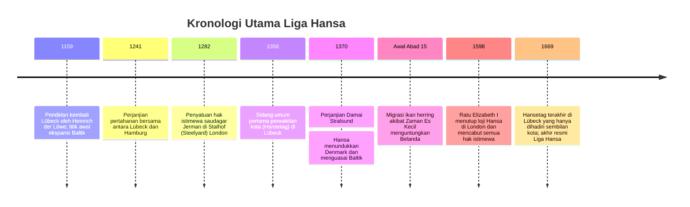

Jauh sebelum lahirnya negara-bangsa modern, kawasan Laut Utara dan Laut Baltik pada abad ke-13 hingga ke-15 dikuasai oleh imperium niaga maritim yang unik: **sebuah konfederasi dagang tanpa raja, tanpa batas teritorial yang pasti, dan tanpa tentara reguler tetap**. Inilah **Liga Hansa (Hanseatic League / Deutsche Hanse)**, dengan kota pelopor utamanya, **Lübeck**.

Pada masa kejayaannya, Liga Hansa menghimpun lebih dari 200 kota otonom, memonopoli rute perdagangan ribuan kilometer dari London hingga Novgorod di Rusia. Disatukan oleh sistem hukum seragam (**Hukum Lübeck**), ditopang oleh kecanggihan kapal niaga **Kogge**, dan dipimpin oleh dewan perwakilan kota (*Hansetag*), kaum saudagar Hansa memelopori pengangkutan komoditas curah dalam jumlah masif. Saat terancam oleh monarki feodal, federasi kota ini sanggup memobilisasi armada tempur laut untuk menundukkan Kerajaan Denmark dan mendikte suksesi takhta kerajaan.

---

## 1. Evolusi Kelembagaan: Dari Paguyuban Saudagar ke Konfederasi Kota

Istilah *Hanse* dalam bahasa Jerman Kuno awalnya merujuk pada rombongan saudagar keliling yang bersatu demi perlindungan keamanan bersama. Lembaga ini berevolusi dari serikat dagang perorangan (*Kaufmannshanse*) menjadi aliansi politik-militer antar-pemerintah kota merdeka (*Städtehanse*).

### 1.1 Hukum Lübeck (*Lübisches Recht*)
Jalur darat pendek antara Lübeck dan Hamburg memungkinkan kapal menghindari selat sempit Denmark yang rawan badai dan pajak.
**Hukum Lübeck** menyediakan:
- Otonomi dewan kota (*Rat*) yang independen dari kaum bangsawan feodal dan gereja.
- Standarisasi hukum dagang: hukum maritim, kepailitan, perkongsian modal, dan arbitrase niaga.
- Lebih dari 100 kota pelabuhan Baltik (Danzig, Riga, Tallinn, Stralsund) mengadopsi hukum ini dengan pengadilan banding tertinggi di Lübeck (*Oberhof*).

### 1.2 Empat Loji Ekstrateritorial (Kontore)
Di luar wilayah Jerman, Hansa membangun empat loji benteng dagang otonom:
1. **Stalhof (Steelyard) di London**: Menikmati tarif bea cukai wol yang lebih murah daripada pedagang pribumi Inggris.
2. **Loji Brugge (Flandria)**: Pusat kliring finansial internasional yang menukar bahan mentah utara dengan kain mewah dan rempah selatan.
3. **Bryggen di Bergen (Norwegia)**: Memonopoli pasokan ikan kod kering (*Stockfish*) untuk kebutuhan puasa umat Katolik Eropa.
4. **Peterhof di Novgorod (Rusia)**: Menguasai pasokan lilin lebah murni untuk katedral dan kulit bulu musang berharga tinggi.

---

## 2. Revolusi Kapal Kogge dan Angkutan Curah Masif

Kapal tradisional Viking sebelumnya hanya mampu mengangkut 20–40 ton kargo. Kehadiran **Kapal Kogge Hansa** merombak total ekonomi maritim:
- **Kemudi Belakang Tengah (Sternpost Rudder)**: Dipasang dengan engsel besi di linggi buritan, bilah kemudi tetap terendam sempurna saat kapal oleng dan memberikan kendali arah yang presisi di tengah badai.
- **Kapasitas 100–200 Ton dengan 10–15 Awak Saja**: Berkat satu layar kotak raksasa, biaya angkut turun lebih dari 80 %, memungkinkan pengangkutan komoditas berharga murah namun bervolume raksasa seperti gandum gandum hitam, kayu perkapalan, garam, dan ikan asin.

---

## 3. Puncak Kekuatan Militer: Perdamaian Stralsund (1370)

Ketika Raja Denmark Valdemar IV menjarah pangkalan Visby pada tahun 1361, 57 kota Hansa membentuk **Konfederasi Cologne** pada tahun 1367. Mereka menghimpun pajak perang, merebut Kopenhagen, dan memblokade selat Denmark.
Melalui **Perjanjian Stralsund 1370**, Denmark menyerah tanpa syarat:
- Hansa menduduki benteng strategis selat Øresund dan mengantongi dua pertiga pendapatan pajaknya.
- Bebas pajak penuh di seluruh perairan Denmark.
- **Raja baru Denmark tidak boleh dinobatkan tanpa persetujuan tertulis dari dewan kota Hansa**.

---

## 4. Kemunduran dan Kehancuran

Pada abad ke-16, hegemoni Hansa tumbang akibat tiga pukulan telak:
1. **Perubahan Ekologis**: Pendinginan laut akibat Zaman Es Kecil mengalihkan jalur ikan herring dari Baltik ke Laut Utara, yang segera direbut oleh armada nelayan Belanda.
2. **Kapal Fluyt Belanda**: Kapal Belanda bergeladak sempit mampu memangkas pajak selat Denmark dan mengangkut kargo dengan separuh awak kapal Hansa, menguasai 70 % lalu lintas Baltik.
3. **Negara Monarki Absolut Modern**: Raja-raja Inggris (Elizabeth I mengusir Hansa tahun 1598) dan Tsar Rusia (Ivan III menghancurkan loji Novgorod tahun 1494) menasionalisasi perdagangan dan menolak hak istimewa asing.
4. **Perang Tiga Puluh Tahun (1618–1648)** meluluhlantakkan daratan Jerman, hingga Liga Hansa berakhir dalam keheningan pada tahun 1669.
