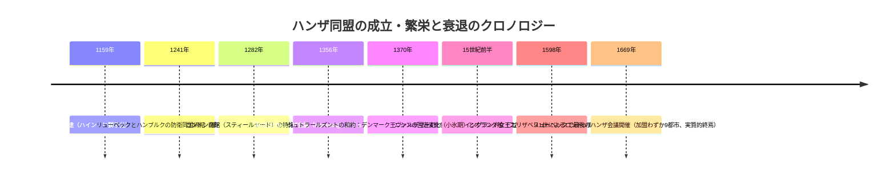
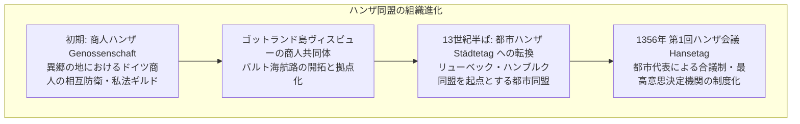
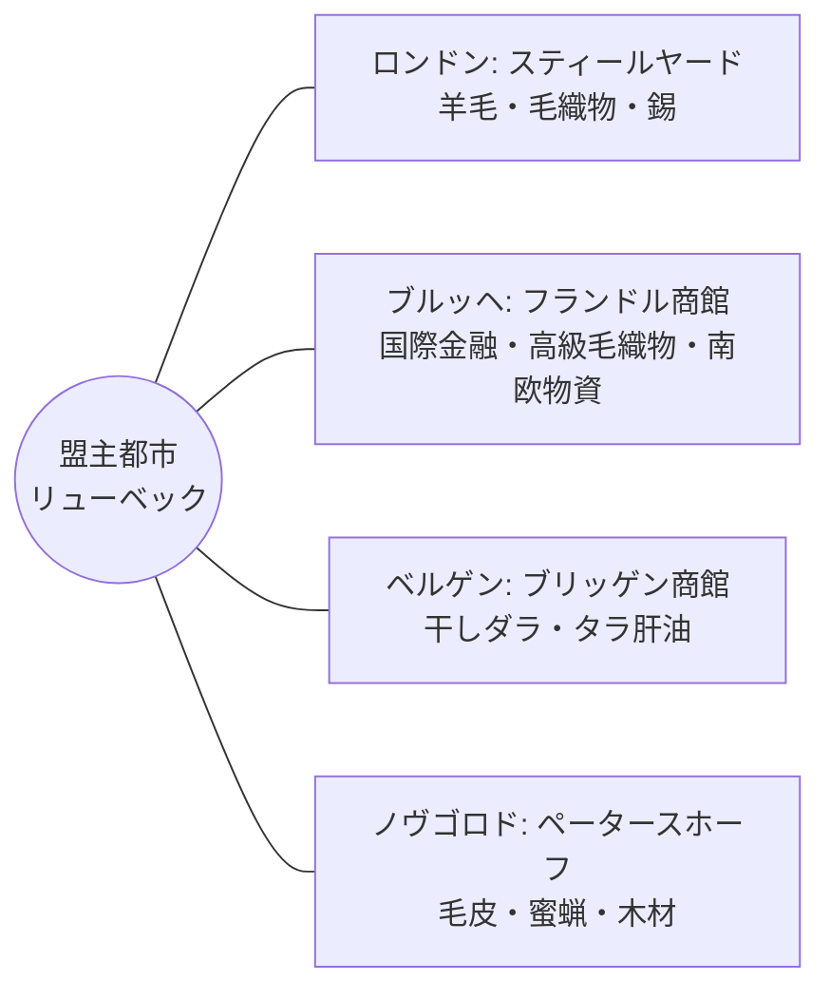
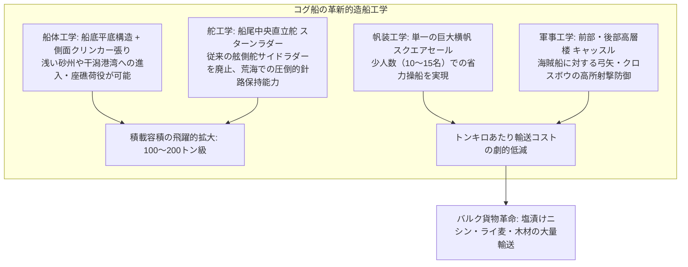
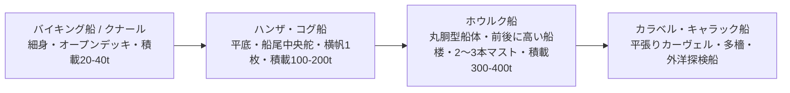
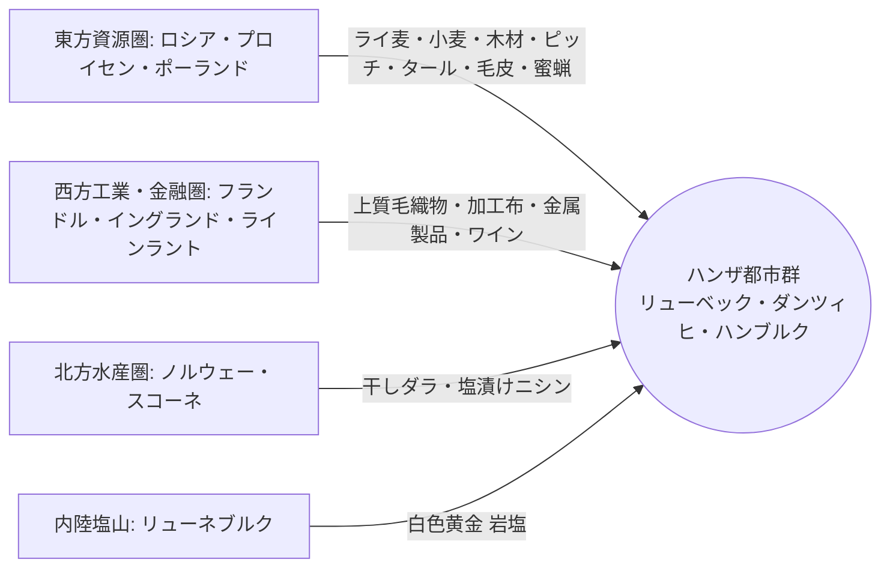
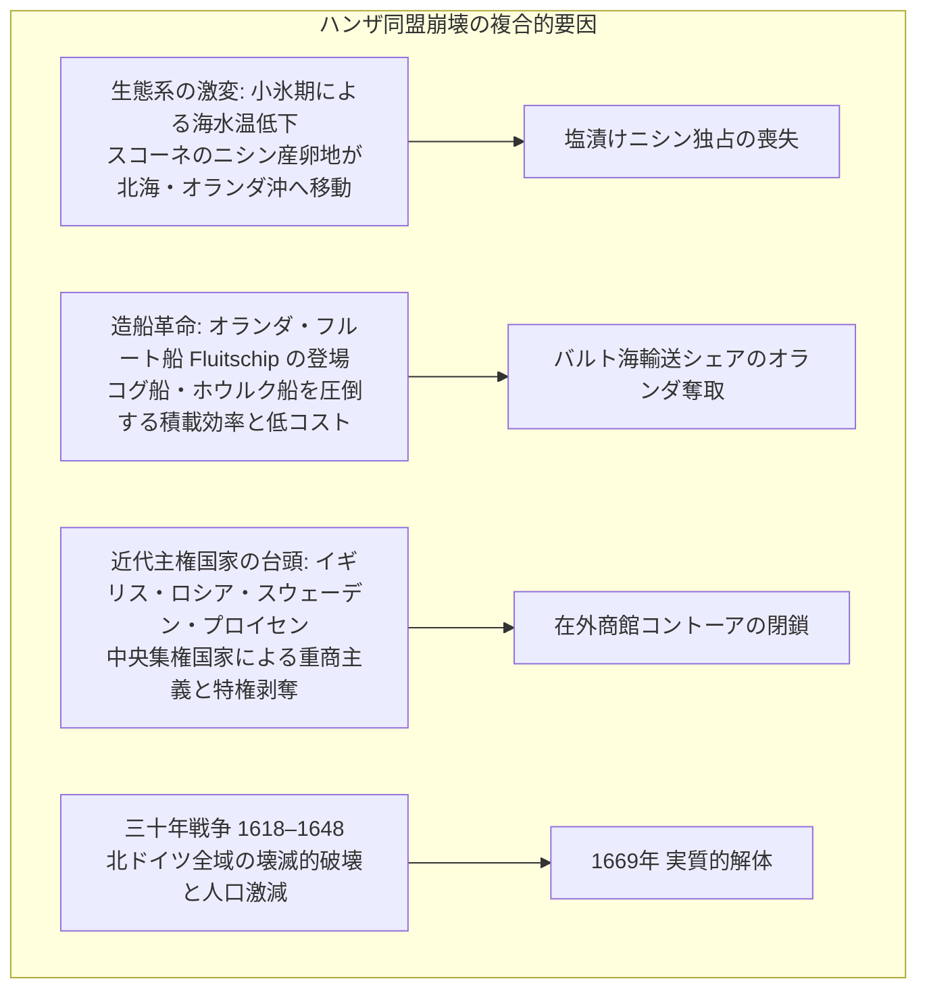

近代的な主権国家が成立する遥か前、13世紀から15世紀にかけての北海とバルト海には、**「皇帝も国王も持たず、領土の境界線も持たない海洋商業帝国」**が存在していました。ドイツ北部の商人都市リューベックを盟主とする**ハンザ同盟（Hanseatic League / ドイツ語: Deutsche Hanse）**です。

ハンザ同盟は、最盛期には200以上の都市が加盟し、ロンドンからロシアのノヴゴロドに至る数千キロの交易路を独占しました。彼らは独自の法体系（リューベック法）を共有し、最新の海洋工学を結集した**「コグ船（Kogge）」**によってバルク物資の大量海上輸送を実現。一握りの都市商人の連合体でありながら、海軍を組織して北欧の覇者デンマーク王国を軍事的に屈服させ、国際条約を結ぶほどの軍事・政治的実力を行使しました。

なぜ国家を持たない商人のネットワークが、中世ヨーロッパ最強の経済覇権を握ることができたのか。そして、なぜ彼らは近代の幕開けとともに主権国家群に敗れ去ったのか。本稿では、造船工学、法制度、地政学、気候・生態系の変動、そして国際関係論の視点から、ハンザ同盟の全貌を徹底的に解き明かします。



---

## 1. 商人ハンザから都市ハンザへ：リューベック法と自治都市ネットワーク

「ハンザ（Hanse）」という古高地ドイツ語は、元々は「一団」「軍勢」「商人の互助組合」を意味していました。同盟の発展史は、個人商人の安全保障ギルド（商人ハンザ）から、自治都市間の政治・軍事同盟（都市ハンザ）への移行プロセスでした。



### 1.1 リューベックの地政学的位置と「リューベック法」
1159年、ザクセン公ハインリヒ獅子公によって建設された**リューベック（Lübeck）**は、ユトランド半島（デンマーク）の付け根に位置していました。当時、北海とバルト海を結ぶ海路（エーレスンド海峡）はデンマーク王国が支配し、航海上の難所でもありました。リューベックは、ハンブルク（北海側）とエルベ川・陸路（トラヴェ川）を介して結ばれることで、ユトランド半島を迂回する最短ショートカット交易路の中継拠点として急成長しました。

リューベックの急拡大を支えたのが、商人自治を法制化した**「リューベック法（Lübisches Recht）」**です：
- **領主権からの自由**: 都市参事会（Rat）が貴族や教会領主から独立した行政権・裁判権を掌握。
- **商取引の合理化**: 契約法、海商法、破産法、手形取引、遺言状作成など、商業資本主義に必要な法規則を体系化。
- **法のフランチャイズ展開**: ロストック、ヴィスマール、シュトラールズント、グライフスヴァルト、さらにはプロイセンのダンツィヒ（グダニスク）、エルビンク、リガ、レヴァル（タリン）に至るバルト海沿岸の100以上の植民都市がリューベック法を丸ごと採用しました。
紛争が生じた際、各地の地方都市参事会はリューベックの上級裁判所（Oberhof）に照会して判決を仰ぎました。これにより、数千キロ離れた都市群が、同一の法言語と商習慣で結ばれる単一市場圏が創出されたのです。

### 1.2 四大商館（コントーア / Kontor）の治外法権システム
ハンザ同盟は、非ドイツ地域の最重要拠点に**「コントーア（Kontor）」**と呼ばれる在外商館を設立しました。コントーアは単なる交易所ではなく、高い防壁と独自の法規範を持つ**治外法権的な自治要塞**でした。



1. **ロンドン商館（スティールヤード / Steelyard / ドイツ語: Stalhof）**: テムズ川の河畔に広大な居留地を持ち、イングランド王室への巨額融資の見返りとして、一般のイギリス商人よりも低い関税で羊毛や毛織物を輸出できる破格の特権を享受しました。
2. **ブルッヘ商館（フランドル）**: 当時の中世西ヨーロッパ最大の金融・商業ハブであり、イタリア（ジェノヴァ・ヴェネツィア）商人がもたらす地中海・東方物資（絹織物、スパイス）とハンザの北方バルク物資が交換される結節点でした。
3. **ベルゲン商館（ブリッゲン / Bryggen / ノルウェー）**: ノルウェー北極海沿岸で獲れる「干しダラ（Stockfish）」の集散地。中世カトリックの四旬節（肉食が禁じられる期間）における全ヨーロッパのタンパク質需要を一手に担いました。現在も世界遺産として木造建築群が残っています。
4. **ノヴゴロド商館（ペータースホーフ / Peterhof / ロシア）**: 聖ペテロ教会を中心に木製防壁で囲まれた商館。ロシア内陸部から集まる最高級のクロテン・リス・キツネの毛皮、および教会の蝋燭需要を満たす大量の「蜜蝋」を独占調達しました。

コントーアに滞在するハンザ商人の徒弟や番頭たちは、現地人との婚姻が禁止され、厳格な規律と独身生活を義務付けられていました。これにより機密情報や資本が現地社会へ流出することを防ぎ、強固な同族・連帯ネットワークを維持したのです。

---


### 1.3 商館（コントーア）の過酷な徒弟制度と「ベルゲンの通過儀礼」
各コントーアで生活する商人の卵たちには、外界から隔絶された厳格な規律が課されていました。特にノルウェーのベルゲン商館（ブリッゲン）で行われていた**見習い商人への通過儀礼（Spiele / 試練）**は、現代の基準からは想像を絶する過酷さで知られていました。

- **煙の試練（Rauchspiel）**: 新入りの少年は縄で縛られて巨大な煙突の真上に吊るし上げられ、下で馬糞や獣の毛皮、硫黄、濡れた藁を燃やした有毒な猛煙の中に長時間燻されました。激しい咳と呼吸困難の中で、商館の規律を守る宣誓を暗唱させられました。
- **水の試練（Wasserspiel）**: 極寒の北極海に近いベルゲン湾の海中に裸で何度も投げ込まれ、棒で打たれながら海水を飲まされる儀礼。
- **鞭打ちの試練（Peitschenspiel）**: 迷路のような商館の中を走らされ、先輩商人たちから白樺の枝や鞭で血まみれになるまで叩かれました。

これらの過酷極まる儀礼を耐え抜いた者だけが「一人前のハンザ商人（Geselle）」として認められ、商館の絶対的秘密を共有する共同体の一員となりました。現地ノルウェー社会と同化せず、いかなる拷問や誘惑にも同盟の機密を漏らさない鉄の連帯感は、こうした暴力的なイニシエーションによって叩き込まれていたのです。

### 1.4 バックシュタイン・ゴシック建築と都市景観の統一
ハンザ同盟の繁栄は、バルト海沿岸都市の景観そのものを均一に塗り替えました。それが**「バックシュタイン・ゴシック（Backsteingotik / 赤レンガ・ゴシック建築）」**です。
北ドイツからバルト海沿岸にかけての平野部は石材に乏しく、良質な粘土が豊富でした。ハンザ都市の商人たちは、粘土を窯で焼き上げた強固な赤レンガを用いて、壮大な聖母マリア教会（マリエンキルヒェ）や市庁舎、そして階段状破風（Stufengiebel）を持つ巨大な商人屋敷兼倉庫を建設しました。
リューベック、ロストック、シュトラールズント、グダンスク、トルン、リガに至るまで、どの港町に上陸しても全く同じ赤レンガのゴシック建築が立ち並んでいたことは、旅する商人に対して「ここもリューベック法とハンザの規律が支配する安全な文明圏である」という心理的安心感を与えるブランド・アイデンティティとして機能しました。


---

## 2. 海洋工学の革命：コグ船（Kogge）の構造とバルク物流革命

中世初期の北欧海上輸送は、バイキング船（ロングシップやクナール）に代表される細身で喫水の浅い船が主流でした。しかし12世紀末、ハンザ商人は造船技術に劇的なブレイクスルーをもたらしました。それが**「ハンザ・コグ船（Hanseatic Cog / ドイツ語: Hansekogge）」**です。



### 2.1 コグ船の主要スペックと構造的特徴
1962年にブレーメンのヴェーザー川河口でほぼ完全な形で発掘された「ブレーメン・コグ（1380年建造）」の復元・分析により、コグ船の卓越したエンジニアリングが判明しています：

| 設計要素 | コグ船（Hanseatic Cog）の仕様 | 従来のバイキング型商船（Knarr）との比較 |
| :--- | :--- | :--- |
| **全長・全幅** | 全長約23.5m、全幅約7.5m（縦横比 約3:1） | 縦横比 約4:1〜5:1（細身で容積が小さい） |
| **排水量・積載量** | 最大積載量 **約100〜200トン（約80〜100ラスト）** | 積載量 約20〜40トン（コグの1/4〜1/5以下） |
| **船底・船体構造** | 船底は平滑なカーヴェル風（平張り）、舷側は堅牢なクリンカー（鎧張り） | 全体がクリンカー張り、波浪で歪みやすい |
| **舵（Rudder）** | **船尾中央直立舵（Sternpost rudder / 船尾舵）** | 舷側舵（Side rudder / 右舷ステアリングボード） |
| **帆装と乗組員** | 1本マストに巨大な四角帆1枚、乗組員わずか10〜15名 | 多数の漕ぎ手や乗組員が必要（人件費大） |
| **防御構造** | 船首楼（Forecastle）および船尾楼（Aftcastle）を常設 | 防御甲板なし（接舷戦闘で容易に制圧される） |

### 2.2 船尾舵（スターンラダー）の物理的優位性
コグ船の最大の技術革新は、**船尾中央舵（Sternpost rudder）**の実用化でした。
従来の船は船尾の右舷（Starboard = Steering Board）に舵櫂を取り付けていましたが、強風下や荒波の中では船体が傾くと舵が水面から浮き上がり、操舵不能に陥る危険がありました。
船尾材の中央に鉄製ヒンジ（ピントルとガジョン）で直立舵を取り付けたことで：
1. 船体が左右どちらに傾斜（ヒール）しても舵板が常に水中に深く没し、強い揚力を発生できる。
2. 荒れる北海やバルト海の強風下でも、風下へのドリフトを抑えて安定した直進性を維持できる。
3. 舵角の操作が容易になり、船体が大型化しても少人数で舵輪（ティラー）を操作可能になった。

### 2.3 高付加価値品から「日常バルク物資」への物流パラダイムシフト
地中海貿易（ヴェネツィア・ジェノヴァ）が香辛料、絹、宝石といった「容積が小さく超高価格な奢侈品」を主としていたのに対し、ハンザ同盟は歴史上初めて**「重く容積が嵩むが、単価の安い基礎生活物資・産業原料」の大規模海上輸送**を成立させました。
コグ船1隻で、馬車数百台分に相当する穀物や木材を一度に運ぶことが可能になったため、ヨーロッパ北方の経済構造そのものが根底から塗り替えられたのです。

---


### 2.4 造船技術の進化系譜：コグ船からホウルク船（Hulk）へ
14世紀後半から15世紀にかけて、コグ船の成功をベースにさらなる大型化の要求に応えて登場したのが**「ホウルク船（Hulk / ドイツ語: Holk）」**です。



- **船体容積の倍増**: ホウルク船は、コグ船の平底構造からバナナのように丸みを帯びた大型船体へと進化し、積載量は300トンから400トンに達しました。
- **多檣化（2〜3本マスト）**: 1本マストの限界を超え、主マストに加えて船尾にミズンマスト（ラテンセイル＝大三角帆）を備えることで、風上への間切り性能（風に逆らって進む能力）が向上しました。
- **船体強度と流体力学の課題**: しかし、クリンカー（鎧張り）構造でこれ以上の巨大船を建造すると、波浪の屈曲応力によって板の継ぎ目から漏水しやすくなるという物理的限界に直面しました。この構造的限界を打破したのが、後にオランダ人が完成させる「カーヴェル張り（平張り）」のフルート船だったのです。


---

## 3. バルト海・北海の大動脈と貿易品目マトリックス

ハンザ同盟の強さは、東方の「未開発の資源供給地」と、西方の「高度に都市化・産業化した消費市場」を、東西軸の海路で完全に結合した点にありました。



### 3.1 「白色の黄金」リューネブルクの塩とスコーネのニシン
ハンザの富の最大の源泉の一つが、**「塩漬けニシン（Salted Herring）」**の完全独占でした。
- **スコーネ市場（Falsterbo / 現スウェーデン南部）**: 毎年秋、バルト海の出入口であるスコーネ沖に無数のニシンの大群が押し寄せました。中世の記録では「海に櫂を差し込むと魚の群れに当たって直立する」と言われるほどでした。
- **リューネブルクの岩塩**: ニシンは水揚げ後すぐに塩漬けにしなければ腐敗します。リューベックの南西約50kmに位置するリューネブルク（Lüneburg）には、北欧随一の高純度岩塩鉱山（製塩所）がありました。ハンザ商人はシュテックニッツ運河（1398年開通、ヨーロッパ最古の閘門式運河の一つ）を建設して塩をリューベックへ運び、スコーネでニシンを塩漬けにして木樽に密封しました。
- この「ハンザ規格のニシン樽」は、カトリック教会によって年間約150日以上定められた断食日（肉食禁止日）の必須タンパク源として、全ヨーロッパへ数百万樽規模で輸出され、莫大な利益を生み出し続けました。

### 3.2 東西交易品目マトリックス
ハンザ同盟の物流循環は、以下の完全な補完関係によって成り立っていました：

| 貿易地域 | 主要輸出品目 | ハンザ同盟における経済的・戦略的意義 |
| :--- | :--- | :--- |
| **ロシア（ノヴゴロド）** | クロテン・キツネ毛皮、蜜蝋、麻 | 毛皮は欧州貴族の冬期防寒・威信財、蜜蝋は教会儀礼用蝋燭に不可欠 |
| **プロイセン・ポーランド（ダンツィヒ）** | ライ麦、小麦、造船用オーク材、ピッチ、タール | フランドルやロンドンの都市人口を養う穀物庫。西欧の造船原料を独占 |
| **ノルウェー（ベルゲン）** | 乾燥タラ（ストックフィッシュ）、タラ肝油 | 長期保存が効く安価な庶民用海洋タンパク源 |
| **スウェーデン（ダーラナ）** | 銅、高品質スウェーデン鉄 | 武器、甲冑、鐘、日用品の金属加工原材料 |
| **イングランド（ロンドン）** | 未加工羊毛、原反毛織物、錫 | 大陸フランドルの毛織物工場への一次原料供給 |
| **フランドル（ブルッヘ・ヘント）** | 高級染色毛織物、タペストリー | 中世最高品質の繊維製品。東欧・ロシアへ高値で逆輸出 |
| **南ドイツ・ラインラント** | ラインワイン、銀、金属工芸品 | 北方貴族・教会への奢侈品輸出 |

---


### 3.3 海の無法者との死闘：海賊「活力兄弟団」とクラウス・シュテルテベカー
ハンザ同盟の海上支配は、常に平穏無事だったわけではありません。14世紀末のバルト海を恐怖に陥れたのが、中世最大の海賊集団**「活力兄弟団（ヴィクティアル兄弟団 / Vitalienbrüder）」**、のちの「平等分配団（Likedeelers）」です。

1. **誕生の背景**: 1390年代のデンマークとスウェーデンの王位継承戦争において、メクレンブルク家がデンマークの補給路を断つために雇った私掠船団が発祥でした。彼らは包囲されたストックホルムへ食糧（糧食＝ヴィクティアル）を運び込んだことからその名がつきました。
2. **海賊化とバルト海の麻痺**: 戦争終結後、職を失った船員たちはそのまま海賊化し、ゴットランド島ヴィスビューを根拠地としてハンザ商船を無差別に襲撃しました。バルト海の通商は完全に麻痺し、魚や塩の輸送が停止してヨーロッパ全土で物価が高騰しました。
3. **ハンザ海軍の総反撃とヘルゴラント沖海戦（1401年）**: 事態を重く見たハンザ同盟は、ハンブルク市を中心とする連合艦隊を編成。伝説の海賊首領**クラウス・シュテルテベカー（Klaus Störtebeker）**が指揮する巨大海賊船「狂乱の雌牛（Tolle Kuh）」を北海の孤島ヘルゴラント島沖で捕捉し、激戦の末に拿捕しました。
4. **ハンブルクでの処刑劇**: 1401年、シュテルテベカーと数十名の部下はハンブルクのエルベ川中州（グラスブローク）で公開斬首されました。「斬首された後、首なしの体で歩いた距離の部下を助命してほしい」と叫び、首を落とされてなお数歩歩いたという伝説は、今なおハンブルクの歴史ロマンとして語り継がれています。

この海賊討伐作戦の成功によって、ハンザ同盟は「自力で北方の制海権と治安を維持できる唯一の警察・軍事組織」としての国際的信用を確立したのです。


---

## 4. 王権を屈服させた商人軍隊：シュトラールズントの和約（1370年）

ハンザ同盟は単なる商工会議所ではありませんでした。彼らは自らの自由通商権と独占益を守るためならば、主権国家の王権に対して軍事制裁を科す「超国家軍事同盟」として機能しました。その頂点が、デンマーク国王ヴァルデマー4世（アッテルダーク）との**ハンザ・デンマーク戦争（1361–1370年）**です。

```mermaid
flowchart TD
    subgraph ハンザ・デンマーク戦争の推移
        Atterdag[1361年 デンマーク王ヴァルデマー4世<br/>ゴットランド島ヴィスビューを侵略・略奪] --> War1[第1次戦争: ハンザ連合艦隊の敗北と休戦]
        War1 --> Confederation[1367年 ケルン同盟の結成<br/>57のハンザ都市が加盟、共同戦費税（プフェニヒ税）を創設]
        Confederation --> Blockade[大規模反攻: 陸海からのコペンハーゲン包囲とエーレスンド封鎖]
        Blockade --> Treaty[1370年 シュトラールズントの和約締結]
    end
    Treaty --> Dominance[バルト海・エーレスンド海峡通航税の独占<br/>デンマーク王位継承に対する拒否権（拒否権を行使する商人）]
```

### 4.1 ケルン同盟（1367年）と総力戦体制
1361年、デンマーク王ヴァルデマー4世はハンザの重要中継地であったゴットランド島のヴィスビューを電撃占領し、都市を劫掠しました。これに対し、危機感を募らせたハンザ都市群は1367年、ケルンの市庁舎に集結し**「ケルン同盟（Kölner Konföderation）」**を結成しました。
57の都市が参加したこの軍事協定では：
- 全商船に課される出港税（プフェニヒ税）を新設して莫大な軍事基金を造成。
- 各都市の規模に応じて武装コグ船、兵員、クロスボウ射手の供出義務を割り当て。
- スウェーデン王メクレンブルク家や北ドイツ諸侯と同盟を締結。

### 4.2 1370年「シュトラールズントの和約」の屈辱的条件
ハンザ海軍はコペンハーゲンやヘルシンゲルを徹底的に砲撃・破壊し、エーレスンド海峡を完全封鎖しました。財政的・軍事的に破綻したデンマーク王室は屈服し、1370年に**シュトラールズントの和約（Peace of Stralsund）**に調印しました：
1. **要塞の割譲**: エーレスンド海峡の両岸にあるデンマークの4大主要要塞（ヘルシンボリ、マルメ等）が15年間にわたりハンザ同盟の管理下に置かれ、通行税の3分の2をハンザが徴収。
2. **通商特権の完全復活**: バルト海全域におけるハンザ商人の免税特権が再確認される。
3. **王位継承への介入権**: **デンマークの次期国王は、ハンザ同盟都市参事会の事前の同意（承認）なしには即位できない**という、主権国家に対する前代未聞の拒否権を獲得。

商人の連合体が、一国の王権を武力で打ち破り、その王位継承権まで掌握したこの瞬間、ハンザ同盟の国際的威信は絶頂に達しました。

---


### 4.3 地域的四極構造（フィアテル）と内部の利害対立
ハンザ同盟は一枚岩の組織ではなく、地理的・経済的利害の異なる4つの地域区分（フィアテル / Viertel）に分かれており、これが同盟の後期における足並みの乱れを生み出しました：

```mermaid
flowchart TD
    subgraph ハンザ同盟の4大地域区分（フィアテル）
        V1[ヴェンド諸都市 Wendisches Quartier<br/>盟主リューベック、ハンブルク、ヴィスマール、ロストック<br/>バルト海・北海の中継貿易・海軍の中核]
        V2[ヴェストファーレン・ライン地域 Sächsisch-Westfälisches Quartier<br/>ケルン、ミュンスター、ドルトムント<br/>イングランド・フランドルとの陸上・内陸河川通商]
        V3[ザクセン・テューリンゲン地域 Sächsisches Quartier<br/>ブラウンシュヴァイク、マクデブルク<br/>内陸農業・鉱山・手工業]
        V4[プロイセン・リヴォニア諸都市 Preußisch-Livländisches Quartier<br/>ダンツィヒ、エルビンク、ケーニヒスベルク、リガ、レヴァル<br/>東方穀物・木材の産地、ドイツ騎士団領]
    end
```

- **西のケルン vs 東のリューベック**: ライン川流域の経済首都であったケルンは、古くからイングランド王室と密接な関係を築いており、リューベックがデンマークやイングランドと戦争を起こして通商封鎖を行おうとするたびに、同盟の方針に激しく反発・サボタージュしました。
- **産地ダンツィヒの自立**: バルト海東岸の穀物・木材の巨大積出港となったダンツィヒ（グダニスク）は、自らの港でオランダ商人やイギリス商人と直接取引したほうが儲かると考え、リューベックによる中継貿易独占を煙たがるようになりました。
このように、近代が近づくにつれて各都市の個別利益が同盟全体の結束を上回るようになり、同盟の集団安全保障機能は形骸化していったのです。


---

## 5. ハンザ同盟の統治機構：中央政府なき「緩やかな連帯」

ハンザ同盟が近代国家と決定的に異なっていたのは、**「恒久的な憲法も、恒久的な中央政府も、常備軍も、共通の財政金庫も持たなかった」**という点です。

```mermaid
flowchart TD
    subgraph ハンザ会議（Hansetag）の合議制モデル
        HT[全体ハンザ会議 Hansetag<br/>リューベックで不定期開催]
        HT --- Q1[議長都市: リューベック参事会]
        HT --- Q2[加盟都市の代表団（参事会員・市長）]
        HT --> Resolve[議決録（レツェス Rezess）の作成]
        Resolve --> Enforcement[強制手段: ハンザ追放（Verhansung）と商業ボイコット]
    end
```

### 5.1 ハンザ会議（Hansetag）と議決録（レツェス）
同盟の最高意思決定機関は、各都市の参事会代表が集う**ハンザ会議（Hansetag）**でした。
- 会議は通常、盟主であるリューベックで不定期に召集されました。
- 議事は多数決ではなく、全会一致（コンセンサス）を目指す徹底した討議が行われました。
- 決定事項は**「レツェス（Rezess / 議決録）」**として文書化され、各都市参事会に通達されました。

### 5.2 究極の制裁：ハンザ追放（Verhansung）
同盟のルールに違反した都市（協定外の抜け駆け貿易を行った都市や、海軍供出を拒否した都市）に対しては、**「ハンザ追放（Verhansung）」**と呼ばれる破門宣告が下されました。
- 追放された都市の商人は、全ハンザ都市および在外商館（コントーア）での商取引が一切禁止され、船舶は拿捕の対象となりました。
- たとえば、同盟のボイコット命令を無視して独断でフランドルと通商を継続したブラウンシュヴァイク（1374年）やブレーメン（1358年）は、激しい商業封鎖に遭って経済が麻痺し、最終的にリューベックに平身低頭して多額の罰金を支払い、復帰を乞わなければなりませんでした。

---

## 6. 構造的衰退と近代主権国家への敗北

15世紀後半から16世紀にかけて、ハンザ同盟は抗うことのできない「気候・生態系の激変」「海洋工学の世代交代」、そして「近代主権国家の誕生」という三重苦に直面し、急速に没落へと向かいました。



### 6.1 生態系シフト：ニシンの大回遊と小氷期
15世紀初頭、地球規模の気候変動（いわゆる「小氷期 / Little Ice Age」）の初期兆候として、バルト海の海水温と塩分濃度が低下しました。
この結果、スコーネ沿岸に押し寄せていたニシンの大群が、産卵場所を北海およびドッガーバンク沖へと移動させてしまったのです。
- バルト海のニシン漁は壊滅し、スコーネ市場は閑古鳥が鳴くようになりました。
- 代わって北海のニシン漁を制覇したのが、新鋭船「ヘリング・ビュス（Haringbuis）」を開発し、洋上で内臓摘出と塩漬けを一貫処理する技術を確立した**オランダ商人**でした。ハンザは富の最大の柱を喪失しました。

### 6.2 造船技術の世代交代：オランダ「フルート船（Fluitschip）」の衝撃
16世紀末、オランダ（ホラント州）はコグ船の末裔であるハンザのホウルク船やカラベル船を過去のものにする究極の商船**「フルート船（Fluitschip）」**を開発しました：
- **洋梨型の断面形状**: 当時、デンマークが徴収していたエーレスンド海峡通行税は「甲板の幅」を基準に計算されていました。オランダ人は甲板を極端に狭くし、船腹（ホールド）を丸く大きく膨らませることで、**脱税しながら超巨大な積載容積を確保**しました。
- **徹底した自動化・省力化**: 滑車とキャプスタンを多用した索具（リギング）により、同サイズのハンザ船の半分の乗組員で運航可能となり、運賃コストでハンザ船を完全に圧倒しました。
16世紀末には、バルト海を出入りする船舶の70〜80%がオランダ船で占められるようになり、ハンザは自らの「庭」であったバルト海の運送シェアを完全に奪われたのです。

### 6.3 主権国家の台頭と特権の強制剥奪
ハンザ同盟のような「国家なき都市ネットワーク」が機能したのは、中世封建制において王権が弱体で、領域支配が未完成だった時代に限られていました。16世紀、強力な軍隊と徴税機構を備えた**近代主権国家（Absolute Monarchy / 絶対王政）**が成立すると、外国商人であるハンザの治外法権的特権は排除の標的となりました。

1. **ロシア（イヴァン3世）**: 1494年、モスクワ大公イヴァン3世がノヴゴロドを併合。ハンザ商館ペータースホーフを急襲して商人49名を投獄し、商品を全品没収して商館を閉鎖しました。
2. **イングランド（エリザベス1世）**: 国民経済と自国商人の育成（マーチャント・アドベンチャラーズ会社）を掲げたエリザベス女王は、1579年にハンザの免税特権を停止。1598年にはロンドン商館（スティールヤード）を武力接収して全ハンザ商人を国外追放しました。
3. **三十年戦争（1618–1648）**: 北ドイツを主戦場としたこの宗教戦争により、マクデブルクやロストックなどのハンザ都市は略奪され、人口が激減。商圏は完全に寸断されました。

1669年、リューベックで開かれた最後のハンザ会議には、わずか9都市の代表しか出席せず、同盟の再建策を講じることもできずに散会しました。ハンザ同盟は公式に解散宣言を出すこともなく、静かに歴史の表舞台から姿を消したのです。

---

## 7. 現代への遺産と教訓：自律分散型ネットワークの先駆者

ハンザ同盟の歩みは、21世紀のグローバル社会やデジタル経済を生きる私たちに極めて示唆に富む教訓を与えてくれます。

| 中世ハンザ同盟の制度設計 | 現代の対応事例・概念 | 歴史的教訓と示唆 |
| :--- | :--- | :--- |
| **リューベック法の広域共有** | EU法（アキ・コミュノテール）、国際私法、ISO標準 | 法制度と商慣習の標準化が、国境を越えた取引コストを最小化する |
| **中央政府なき合議制（Hansetag）** | 分散型自律組織（DAO）、オープンソース・コミュニティ | 共通のインセンティブがある間は強力だが、利害が分裂した際に強制執行力が麻痺する |
| **コントーア（在外商館）の治外法権** | 経済特区（SEZ）、オフショア金融センター、大使館 | ホスト国の主権意識が高まった時、排他的特権は地政学的リスクに転じる |
| **フルート船によるディスラプション** | コンテナ船革命、プラットフォーム・ビジネスによる既存産業破壊 | 既存の独占体制に安住し技術革新（造船・省力化）を怠ると、一瞬で市場を追われる |
| **主権国家（リヴァイアサン）との衝突** | ビッグテック（GAFAM）に対する各国の反トラスト規制・データ主権法 | 国境を越える経済ネットワークは、最終的に主権国家の課税権・軍事力と衝突する |

### 結論
ハンザ同盟は、主権国家という近代の枠組みが普遍化する前に、**「都市と商人、そして共通の法規範」**だけで全ヨーロッパ規模の共通市場を築き上げた壮大な実験でした。彼らが遺した「自由都市（Freie und Hansestadt）」の称号は、今もハンブルクやブレーメンの正式名称として誇り高く受け継がれており、その精神はEU統合や国境なきデジタル通商ネットワークの原型として、今なお力強く息づいています。
