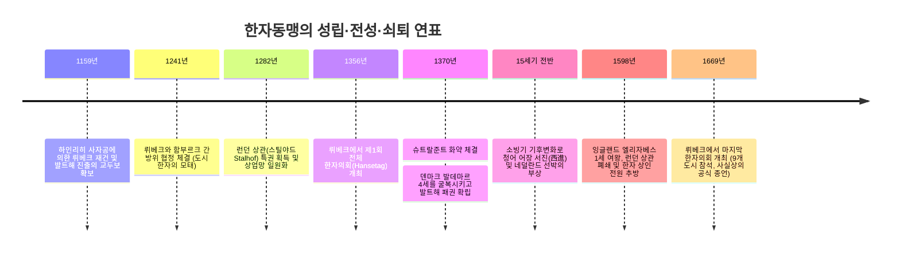
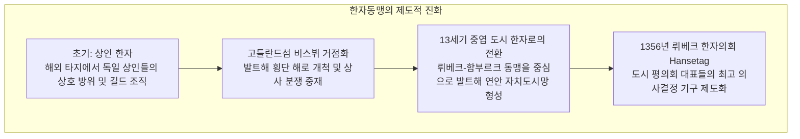
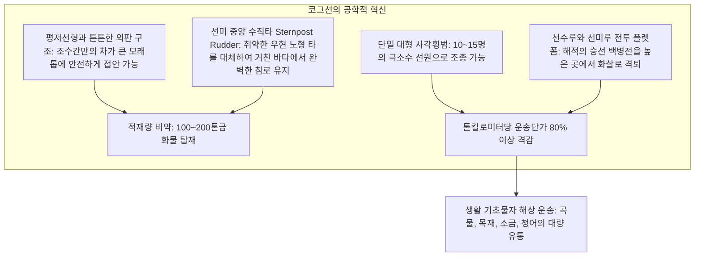

근대 주권국가가 탄생하기 훨씬 전인 13세기부터 15세기까지 북해와 발트해에는 **'군주도, 영토의 국경선도, 상비군도 없었던 초국가 해양 상업 제국'**이 군림했습니다. 북독일 도시 뤼베크를 맹주로 삼았던 **한자동맹(Hanseatic League / 독일어: Deutsche Hanse)**입니다.

전성기 한자동맹은 200개가 넘는 자치도시가 가입하여 런던 템스강에서 러시아 노브고로드 삼림에 이르는 수천 킬로미터의 교역로를 완벽하게 장악했습니다. 그들은 공유된 법체계인 **뤼베크법(Lübisches Recht)**을 통해 통합 시장을 열었고, 혁신적인 해양공학의 결정체인 **코그선(Cog)**을 건조하여 곡물, 목재, 소금에 절인 청어 등 대규모 벌크 화물 운송 혁명을 달성했습니다. 외세의 군주가 상권을 위협하면 연합 함대를 결성하여 북유럽의 강자 덴마크 왕국을 군사적으로 굴복시키고 왕위 계승권까지 좌우할 정도의 막강한 실력을 행사했습니다.

왜 국가 없는 상인 네트워크가 중세 최강의 경제 패권을 쥘 수 있었으며, 왜 근대의 여명과 함께 주권국가들의 공세 앞에 무너져 내렸을까요? 본 고에서는 조선공학, 제도경제학, 생태 기후학, 국제관계학의 시각에서 한자동맹의 모든 면모를 입체적으로 분석합니다.

---

## 1. 상인 한자에서 도시 한자로: 뤼베크법과 자치도시 네트워크

고대 고지독일어에서 '한자(Hanse)'는 '무리', '군대', 혹은 '타지에서 결성된 상인 상조회'를 뜻했습니다. 이 조직은 개인 상인들의 자위적 조합(상인 한자)에서 출발하여 자치도시 간의 집단안보 및 경제연맹(도시 한자)으로 진화했습니다.

### 1.1 뤼베크의 지정학과 뤼베크법의 프랜차이즈
뤼베크는 덴마크 유틀란트 반도의 기부에 위치했습니다. 당시 덴마크 왕국이 지배하는 외레순 해협을 우회하여 엘베강 하구의 함부르크와 육로 및 하천으로 연결됨으로써, 북해와 발트해를 가장 빠르게 잇는 지름길의 중심지가 되었습니다.

뤼베크 성장의 핵심 엔진은 **《뤼베크법(Lübisches Recht)》**이었습니다:
- **영주의 봉건적 지배 배제**: 부유한 상인들로 구성된 시 참사회(Rat)가 독점적인 사법·행정권을 행사.
- **상법 체계화**: 해상화물 운송, 파산, 파트너십 지분 청산, 어음 결제 규범을 합리적으로 정비.
- **도시법 프랜차이즈 확산**: 로스토크, 슈트랄준트, 단치히(그단스크), 엘빙, 리가, 레발(탈린) 등 100개 이상의 발트해 연안 도시가 뤼베크법을 채택하였고, 판결 분쟁 시 뤼베크 상급법원(Oberhof)에 상고하여 사법 일관성을 확보했습니다.

### 1.2 4대 재외 상관(콘토르 / Kontor)의 치외법권 체제
한자동맹은 비독일계 핵심 요충지에 **콘토르(Kontor)**라는 요새화된 상관을 설치했습니다:
1. **런던 스틸야드(Steelyard / Stalhof)**: 템스강변에 위치하며, 잉글랜드 국왕에게 막대한 융자를 제공한 대가로 현지 영국 상인보다 더 낮은 관세로 양모와 모직물을 수출하는 특권을 누렸습니다.
2. **브뤼허 상관(플랑드르)**: 서유럽 금융의 중심지로, 남유럽의 비단·향신료와 한자의 북방 원자재가 맞교환되는 결절점이었습니다.
3. **베르겐 브뤼겐(Bryggen / 노르웨이)**: 북극해 대구 건어물(Stockfish)을 독점 집하하여 유럽 전역 가톨릭 사순절 식단을 지배했습니다.
4. **노브고로드 페테르호프(Peterhof / 러시아)**: 성 베드로 교회를 중심으로 목책을 둘러친 상관으로, 러시아 내륙의 최상급 모피와 교회 예배용 밀랍을 독점 수매했습니다.

콘토르 내부의 상인 견습생들은 현지인과의 통혼이 엄격히 금지되었고 독신과 엄격한 단체생활을 강요받아 동맹의 자본과 기밀 유출을 철저히 막았습니다.

---

## 2. 조선공학의 일대 도약: 코그선(Cog)과 벌크 물류 혁명

중세 전기 북유럽 해상을 누비던 바이킹형 선박(Knarr)은 날렵하지만 적재량이 20~40톤에 불과했습니다. 12세기 후반 한자 상인들이 실용화한 **코그선(Hanseatic Cog / 독일어: Hansekogge)**은 근대적 벌크선 해운의 시초였습니다.

- **선미 중앙타(Sternpost rudder)의 물리적 우월성**: 배의 중심선에 철제 경첩으로 부착된 중앙타는 배가 파도에 크게 기울어져도(Heel) 항상 수중에 잠겨 강력한 양력을 발휘하며, 거친 북해의 역풍 속에서도 침로를 흔들림 없이 유지했습니다.
- **사치품에서 일상 벌크 자원으로의 물류 전환**: 지중해 상업이 향신료나 비단 같은 고부가가치 소형 사치품에 의존한 반면, 코그선은 수백 대의 마차에 맞먹는 곡물, 목재, 청어, 소금을 일시에 운반하여 유럽 북방의 거시경제를 완전히 재편했습니다.

---

## 3. 왕권을 굴복시킨 상인 군대: 슈트랄준트 화약(1370년)

1361년 덴마크 왕 발데마르 4세가 한자의 거점 비스뷔를 약탈하자, 57개 한자 도시는 1367년 **쾰른 동맹(Kölner Konföderation)**을 결성했습니다.
- 전 상선에 전쟁세(푼트촐)를 부과하여 군비를 마련하고 연합 해군을 편성.
- 코펜하겐을 함락시키고 외레순 해협을 봉쇄하여 1370년 **《슈트랄준트 화약》**을 쟁취했습니다:
  1. 해협 양안의 덴마크 핵심 요새를 15년간 점령하고 통행세 수입의 3분의 2를 징수.
  2. 발트해 전역에서의 완전 면세 특권 재확인.
  3. **차기 덴마크 국왕의 즉위는 반드시 한자동맹 시 참사회의 사전 동의를 얻어야 한다는 거부권 명시**.

상인 집단이 왕국의 주권과 왕위 계승권마저 틀어쥔 역사상 유례없는 사건이었습니다.

---

## 4. 구조적 쇠퇴와 근대 주권국가에의 패배

15~16세기 한자동맹은 세 가지 파괴적 충격 앞에 무너졌습니다:
1. **소빙기 기후변화와 청어의 대이동**: 발트해 수온 저하로 청어 어장이 북해로 이동하자, 선상 염장 기술을 갖춘 네덜란드 선단이 수산업 패권을 장악했습니다.
2. **네덜란드 플루트선(Fluitschip)의 기술적 파괴**: 갑판 면적 기준 관세를 회피하기 위해 호리병 모양으로 설계되고 소수 인원으로 조종 가능한 네덜란드 플루트선이 등장하여 발트해 해운 점유율의 70% 이상을 빼앗겼습니다.
3. **근대 주권국가의 탄생**: 강력한 상비군과 관료제를 갖춘 잉글랜드 튜더 왕조(엘리자베스 1세의 상관 몰수), 러시아 차르국(이반 3세의 노브고로드 상관 폐쇄), 스웨덴 제국이 외국 상인의 치외법권적 특권을 강제로 박탈했습니다.
4. **30년 전쟁(1618–1648)**으로 북독일 도시들이 초토화된 후, 1669년 마지막 한자의회를 끝으로 동맹은 조용히 역사의 뒤안길로 사라졌습니다.

### 현대적 교훈
한자동맹은 근대 국민국가가 정립되기 전, **'자치도시, 통일 상법, 분산형 상업 네트워크'**만으로 거대한 단일 경제권을 구축한 위대한 실험이었습니다. 오늘날 함부르크와 브레멘이 간직한 '자유 한자도시'라는 명칭과 유럽연합(EU)의 국경 없는 단일 시장 모델 속에 그 유산은 여전히 살아 숨 쉬고 있습니다.
