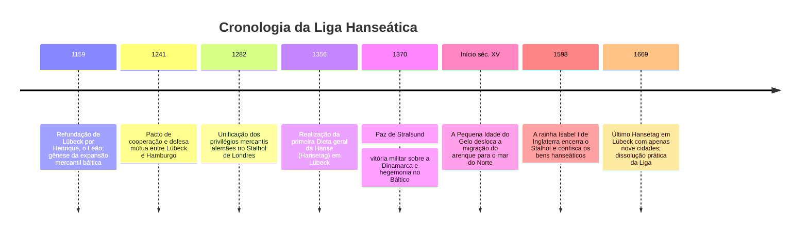

Muito antes da institucionalização dos modernos Estados-nação, os mares do Norte e Báltico foram liderados entre os séculos XIII e XV por um império singular: **uma confederação marítima e comercial desprovida de rei, de fronteiras territoriais rígidas e de exército permanente**. Foi a **Liga Hanseática (Deutsche Hanse)**, capitaneada pela cidade livre de **Lübeck**.

No seu apogeu, a Hansa reuniu mais de 200 cidades autónomas, monopolizando vias mercantis que iam desde Londres até à floresta russa de Novgorod. Interligadas pelo **Direito de Lübeck**, impulsionadas pela revolução naval da **coca (*Kogge*)** e geridas pelas assembleias burguesas dos *Hansetage*, as cidades hanseáticas forjaram a logística moderna de granéis. Quando ameaçadas por coroas feudais, mobilizaram armadas que derrotaram o reino da Dinamarca e conquistaram o direito de veto na sucessão dinástica escandinava.

---

## 1. Da Hansa dos mercadores à Hansa das cidades

O vocábulo *Hanse* identificava originalmente uma companhia armada de viajantes ou guilda protetora de comerciantes alemães no estrangeiro. A organização converteu-se gradualmente numa confederação de cidades autónomas administradas pelo patriciado mercantil.

### 1.1 O Direito de Lübeck
A proximidade entre Lübeck e Hamburgo proporcionava um atalho terrestre que contornava a perigosa navegação do estreito de Øresund.
O **Direito de Lübeck (*Lübisches Recht*)** estabeleceu:
- Autonomia cívica e judiciária plena dos conselhos municipais (*Rat*) face a bispos e condes.
- Normas inovadoras para seguros, avarias marítimas, falências e direito societário.
- Mais de 100 urbes do Báltico adotaram o código, submetendo recursos ao tribunal superior de Lübeck (*Oberhof*).

### 1.2 Os quatro grandes feitorias (Kontore)
A Hansa implantou quatro grandes feitorias com direitos de extraterritorialidade:
1. **O Stalhof (Steelyard) em Londres**: Taxas aduaneiras de exportação mais baixas do que as concedidas aos próprios mercadores ingleses.
2. **Bruges (Flandres)**: Centro financeiro e comercial onde os cereais e madeira do leste se trocavam por tecidos flamengos e especiarias.
3. **Bryggen em Bergen (Noruega)**: Monopólio da exportação do bacalhau seco (*Stockfish*), pilar dietético da Quaresma católica.
4. **O Peterhof em Novgorod (Rússia)**: Entreposto fortificado de cera virgem de abelha e peles nobres de zibelina e arminho.

---

## 2. A engenharia da coca (Kogge) e o transporte de granéis

Substituindo os barcos vikings de reduzida capacidade, a **coca hanseática** transformou a náutica comercial:
- **Leme de cadaste central**: Montado com gonzos de ferro na popa, garantia estabilidade diretiva em tempestades e nunca saía da água com o balanço do casco.
- **Capacidade de 100 a 200 toneladas**: Manobrada por apenas 10 a 15 marinheiros sob uma imensa vela redonda, derrubou os custos de frete em mais de 80 %, viabilizando a circulação em grande escala de centeio, trigo, madeira, arenque salgado e minérios.

---

## 3. Hegemonia militar: A Paz de Stralsund (1370)

Perante os ataques dinamarqueses a Visby, 57 urbes constituíram a **Confederação de Colónia** em 1367. Criaram uma taxa naval obrigatória, armaram naus de guerra e bloquearam a Dinamarca.
A **Paz de Stralsund de 1370** marcou o cume do poderio hanseático:
- Ocupação militar dos fortes estratégicos de Øresund e cobrança de dois terços das portagens marítimas.
- Isenção fiscal integral em todo o mar Báltico.
- **Exigência vinculativa de aprovação prévia da Liga para a coroação de qualquer novo rei dinamarquês**.

---

## 4. O declínio estrutural

No século XVI, a Liga colapsou sob o impacto de três forças:
1. **Mudança climática**: O arrefecimento do Báltico fez os cardumes de arenque desovarem no mar do Norte, sendo o negócio capturado pelas frotas holandesas.
2. **O filibote holandês (*Fluitschip*)**: Navio mercante holandês de grande bojo e convés estreito que reduzia taxas e dispensava metade da tripulação, dominando 70 % do tráfego báltico.
3. **A afirmação dos Estados monárquicos soberanos**: Inglaterra (expulsão por Isabel I em 1598) e Rússia (fecho de Novgorod por Ivan III em 1494) aniquilaram as imunidades jurídicas da Hansa.
4. **A Guerra dos Trinta Anos** esgotou as cidades alemãs. Em 1669, a reunião final em Lübeck selou o ocaso silencioso da Liga.
