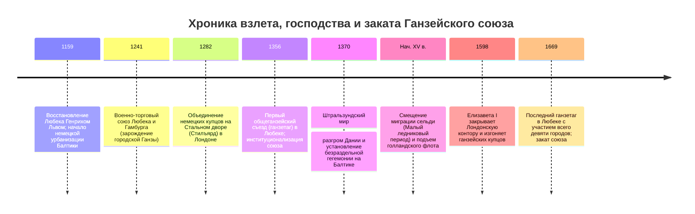
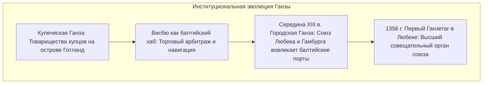

Задолго до появления современных национальных государств, с XIII по XV век, на просторах Северного и Балтийского морей господствовала невиданная морская торговая держава: **купеческая империя без монарха, без четких территориальных границ и без регулярной постоянной армии**. Это был **Ганзейский союз (Deutsche Hanse)**, неформальной столицей которого являлся вольный имперский город **Любек**.

В зените своего могущества Ганза объединяла более 200 самоуправляющихся городов, монополизировав торговые артерии на тысячи километров — от берегов Темзы в Лондоне до лесов Великого Новгорода. Связанные единым **Любекским правом**, опираясь на инженерный прорыв **ганзейских коггов (Kogge)** и руководствуясь решениями съездов городских депутатов (*ганзетагов*), ганзейские купцы создали современную логистику массовых насыпных грузов. Когда же чужеземные короли посягали на их привилегии, этот союз городов снаряжал флоты, сокрушал Датское королевство и диктовал условия наследования престолов.

---

## 1. От купеческой гильдии к союзу городов: Любекское право и четыре конторы

Слово *Hanse* на средненижненемецком языке первоначально означало «дружину», «отряд» или «купеческое товарищество для взаимовыручки на чужбине». Эволюция Ганзы представляла собой переход от союзов странствующих купцов (**купеческая Ганза**) к политической конфедерации патрицианских городов-республик (**городская Ганза**).

### 1.1 Любекское право (Lübisches Recht)
Любек, расположенный у основания Ютландии, соединялся сухопутным путем с Гамбургом на Эльбе, позволяя судам избегать опасного и облагаемого датскими пошлинами пролива Эресунн.
Город внедрил революционное **Любекское право**:
- Полное освобождение городского совета (*Rat*) от феодальной юрисдикции епископов и дворян.
- Четкие нормы морского права, банкротства, долевого участия в судах и безналичных расчетов.
- Право приняли более 100 балтийских городов (Данциг, Рига, Ревель, Штральзунд), а высшей апелляционной инстанцией служил суд Любека (*Oberhof*).

### 1.2 Четыре экстерриториальные конторы (Kontore)
За пределами Германии Ганза держала четыре укрепленные фактории с экстерриториальным статусом:
1. **Стальной двор (Стилъярд / Stalhof) в Лондоне**: Имел налоговые привилегии, превосходившие права английских купцов.
2. **Контора в Брюгге (Фландрия)**: Европейский финансовый центр, связывавший сырье Балтики с товарами Средиземноморья.
3. **Брюгген в Бергене (Норвегия)**: Монополия на сушеную треску (*стокфиск*), кормившую католическую Европу в дни Великого поста.
4. **Немецкий двор (Петергоф) в Новгороде**: Укрепленный квартал вокруг церкви Св. Петра, монопольно скупавший русский воск и ценную пушнину (соболь, горностай).

Внутри контор царил суровый устав: приказчикам и ученикам под страхом изгнания запрещалось жениться на местных женщинах, что предотвращало утечку капиталов и тайн.

---

## 2. Судостроительная революция: Когг и балкерные перевозки

До XII века на севере плавали парусно-гребные кнорры с грузоподъемностью всего 20–40 тонн. Появление **ганзейского когга (Hansekogge)** перевернуло логистику:
- **Ахтерштевневый руль (Sternpost rudder)**: Руль на железных петлях по центру кормы не выходил из воды при крене и удерживал 200-тонное судно на курсе в сильнейшие балтийские штормы.
- **Вместимость до 200 тонн при экипаже всего 10–15 человек**: Эксплуатационные расходы упали более чем на 80 %, открыв эру морской транспортировки дешевых массовых грузов (рожь, корабельный лес, смола, соль, бочки с сельдью).

---

## 3. Военный триумф: Штральзундский мир (1370)

Когда датский король Вальдемар IV Аттердаг в 1361 году захватил Висбю, 57 ганзейских городов заключили в 1367 году **Кёльнскую конфедерацию**, ввели корабельный военный налог и снарядили объединенный флот.
Ганза взяла Копенгаген, блокировала датские проливы и в 1370 году продиктовала **Штральзундский мир**:
- Получила во владение на 15 лет ключевые датские крепости на Эресунне и две трети таможенных сборов.
- Беспошлинную торговлю по всей Балтике.
- **Право вето на избрание нового датского монарха** (король не мог взойти на трон без согласия Ганзы).

---

## 4. Закат и гибель купеческого союза

В XVI веке Ганза пала под ударами трех факторов:
1. **Климатический сдвиг**: Похолодание вод Балтики заставило сельдь уйти на нерест в Северное море, передав рыбную монополию голландцам.
2. **Голландский флейт (Fluitschip)**: Голландские суда с узкой палубой обходили датские пошлины, перевозя больше груза с вдвое меньшим экипажем, и захватили 70 % перевозок на Балтике.
3. **Абсолютистские монархии**: Иван III ликвидировал Новгородскую контору в 1494 году, а Елизавета I изгнала Ганзу из Лондона в 1598 году.
4. **Тридцатилетняя война** разорила Германию, и в 1669 году союз фактически прекратил существование.
