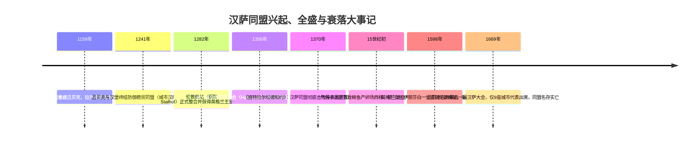
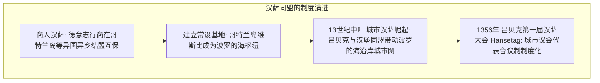
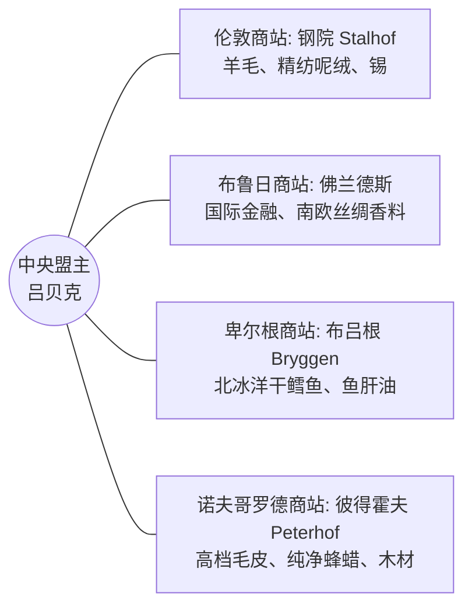
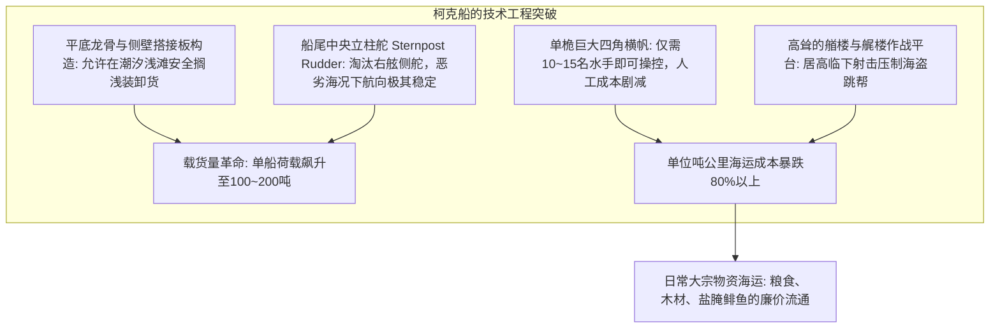
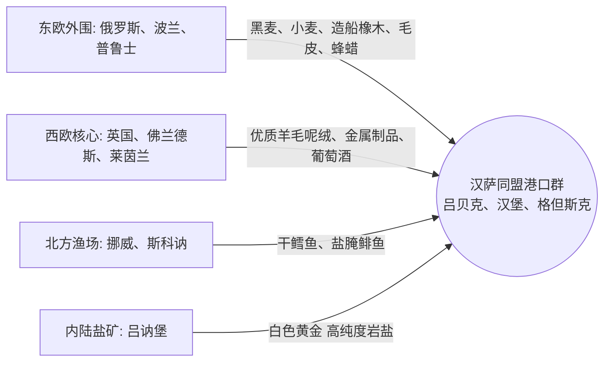

在近代主权国家诞生之前，13至15世纪的北海与波罗的海上存在着一个奇特的商业帝国：**它既没有皇帝国王，也没有确定的领土边界，更没有常备军队**。这就是以北德意志城市吕贝克为盟主的**汉萨同盟（Hanseatic League / 德语: Deutsche Hanse）**。

在鼎盛时期，汉萨同盟汇聚了超过200座自治城市，垄断了从伦敦泰晤士河畔一直延伸到俄罗斯诺夫哥罗德原始森林的数千公里商道。他们凭借先进的**柯克船（Cog）**造船工程掀起了散装大宗商品的海运革命，依托**《吕贝克法》**构建起高度一体化的跨国自治法制圈，并建立起享誉欧洲的四大商站（Kontore）。在遭受外来王权侵犯时，这个城市商人联合体甚至能迅速动员海陆大军，打垮北欧霸主丹麦王国并决定其王位继承人。

然而，为何这样一个掌控中世纪北欧经济命脉的超国家商业联盟，最终在近代破晓时分轰然瓦解？本篇专题将从造船工程学、制度经济学、生态气候演变以及地缘政治学的综合视角，全景解构汉萨同盟的兴衰史诗。

---

## 1. 从商人汉萨到城市同盟：《吕贝克法》与跨域网络

在古高地德语中，“Hanse”原意是指“结伴而行的旅人团伙”、“军队”或“海外互助商帮”。同盟的制度演化，经历了一个从个别商人的防御性行会（商人汉萨）向自治城市间政治军事实体（城市汉萨）的飞跃。

### 1.1 吕贝克的地缘优势与《吕贝克法》的特许加盟
吕贝克扼守日德兰半岛根部。当时环绕丹麦的厄勒海峡航道险阻重重，吕贝克通过陆路与易北河畔的汉堡相连，形成横跨北海与波罗的海的最短陆海联运通道。

吕贝克迅速崛起的制度密码在于其高度理性化的自治商法体系——**《吕贝克法》（Lübisches Recht）**：
- **摆脱封建领主桎梏**：市议会（Rat）由富商阶层掌控，完全享有行政、立法与独立司法权。
- **商法契约革命**：规范海损赔偿、合伙制股权清算、破产法与票据兑付规则。
- **跨区域法律输出**：罗斯托克、施特拉尔松德、格但斯克（但泽）、里加、塔林等波罗的海沿岸上百座新兴港口全盘引入《吕贝克法》，遇到疑难案件统一上诉至吕贝克高级法院（Oberhof）。法律的一体化为跨国贸易消除了制度壁垒。

### 1.2 四大海外商站（Kontore）的治外法权堡垒
汉萨同盟在非德意志地区设立了四个享有完全治外法权的军事化商业据点：

1. **伦敦钢院（Steelyard / Stalhof）**：坐落于泰晤士河北岸，享有低于英格兰本土商人的超低关税特权。
2. **布鲁日商站**：欧洲西北部的金融心脏，南欧地中海奢侈品与汉萨北方大宗货物的结算中心。
3. **卑尔根布吕根（Bryggen）**：控制挪威北极圈鳕鱼干贸易，垄断天主教大斋期全欧蛋白质供应。
4. **诺夫哥罗德彼得霍夫（Peterhof）**：设有严密防御木墙的独立街区，独占全欧修道院教堂照明所需的纯净蜂蜡与沙皇贵族毛皮。

商站内部推行军事化与苦行僧般的独身禁欲纪律，严禁与当地妇女通婚，以防商业情报和资本外流。

---

## 2. 船舶工程学革命：柯克船（Cog）与大宗散货海运

在中世纪早期，北欧海面航行的主要是维京长船与克纳尔船（Knarr），这些船体细长、吃水浅、依赖人力划桨，货运能力极为微薄。12世纪下半叶，汉萨同盟建造的**柯克船（Hanseatic Cog / 德语: Hansekogge）**彻底改写了世界海洋运输史。

- **船尾中央舵（Sternpost rudder）的力学奇迹**：传统侧舵在船只倾斜时容易露出水面失控，柯克船通过铸铁铰链将垂直舵板深置于船尾中线，即便在汹涌的波罗的海风暴中依然能够稳定航向。
- **从奢侈品到基础大宗民生物资**：柯克船使粮食、木材、沥青和盐腌鲱鱼的大规模海运在经济上成为可能。一艘柯克船的运力相当于几百辆陆路马车，奠定了北方大宗商品市场的物资基础。

---

## 3. 贸易网络商品矩阵与商业霸权

汉萨同盟的经济脉搏建立在**“东部原料外围”**与**“西部工业消费核心”**的互补循环之上：

- **“白色黄金”吕讷堡盐与斯科讷鲱鱼**：每年秋天数以亿计的鲱鱼涌入斯科讷海峡，汉萨商人开凿欧洲最早的运河之一（施特克尼茨运河），将吕讷堡优质岩盐运往波罗的海，将成百万桶盐腌鲱鱼销往全欧，成为天主教全年中150天斋戒日无可替代的蛋白质支柱。

---

## 4. 迫使王权称臣的商人同盟：《施特拉尔松德和约》（1370年）

当丹麦国王瓦尔德马四世于1361年洗劫汉萨商贸中心维斯比并企图霸占海峡关税时，汉萨各城市于1367年结成**科隆同盟（Confederation of Cologne）**：
- 开征全海域商船吨位战争税（普芬尼税），组建跨城联合武装舰队。
- 1370年，汉萨大军攻破哥本哈根并封锁厄勒海峡，迫使丹麦签订极度屈辱的**《施特拉尔松德和约》**：
  1. 割让厄勒海峡沿岸四大要塞控制权达15年，收取海峡过境税的三分之二。
  2. 享有波罗的海全境完全免税自由通商特权。
  3. **丹麦新国王的即位必须事先获得汉萨同盟市议会的审查与批准**。

一介商人联盟以武力战胜世袭君主国并控制其王位继承权，标志着城市同盟霸权的极盛。

---

## 5. 解体与败亡：主权国家利维坦与技术变迁

16世纪开始，同盟在三重打击下不可逆转地走向崩溃：
1. **小冰期与鲱鱼西移**：气候转冷导致波罗的海水温及盐度下降，鲱鱼产卵场西迁至北海，荷兰人凭借新型渔船与海上腌渍技术彻底夺走了鲱鱼产业霸权。
2. **荷兰福禄特船（Fluitschip）的技术颠覆**：荷兰人发明了甲板极其狭窄、腹部极其圆鼓的福禄特船，不仅避开了丹麦按甲板面积计征的海峡税，更以少一半的人工成本打跨了汉萨老式柯克船，霸占了波罗的海70%以上的海运份额。
3. **近代主权集权国家的铁拳**：英国都铎王朝（伊丽莎白一世）、俄罗斯沙皇国（伊凡三世）和瑞典帝国等近代专制国家崛起，不再容忍外国商人的治外法权特权，纷纷武力没收商站资产并予以驱逐。
4. **三十年战争（1618–1648）**：北德意志沦为废墟，汉萨诸城人口锐减、资本耗尽。1669年最后一次汉萨大会惨淡收场。

### 结语与当代启示
汉萨同盟是人类在近代主权国家模式定型之前，进行的一场宏大的**“法治、自由城市与去中心化商业网络”**的一体化实验。它所开创的商法标准、航运体系及市政自治精神，至今依然深刻影响着欧盟单一体制与全球化数字经济的运作逻辑。
