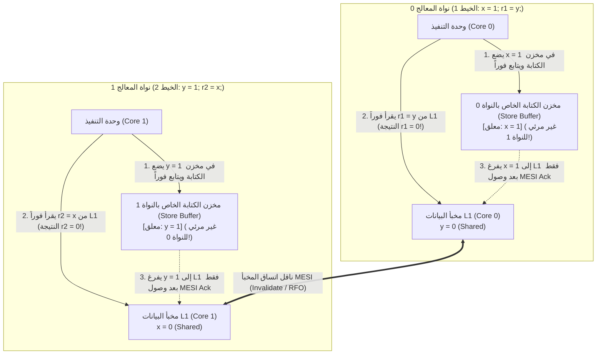
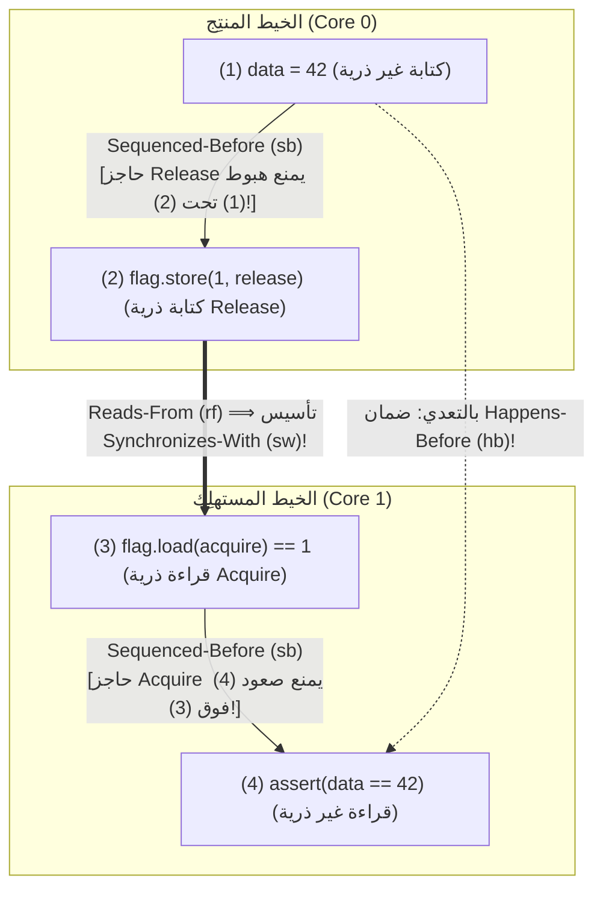

## مقدمة: أربعة أسطر برمجية تتحدى البداهة البشرية ── اختبار Store Buffering (`SB`)

تأمل برنامج C المتزامن التالي المكون من أربع تعليمات فقط. متغيران صحيحان مشتركان `x` و `y` قيمتهما الابتدائية `0`. خيطان (Threads) يعملان على نواتي معالج منفصلتين ينفذ كل منهما عملية كتابة (Store) تليها عملية قراءة (Load):

```c
// Initial state in shared memory:
int x = 0, y = 0;
int r1 = 0, r2 = 0;

// Thread 1 (Core 0)          // Thread 2 (Core 1)
void thread1(void) {          void thread2(void) {
    x = 1;      // (S1)           y = 1;      // (S2)
    r1 = y;     // (L1)           r2 = x;     // (L2)
}                             }
```

ما هي القيم النهائية الممكنة للزوج `(r1, r2)` بعد انتهاء الخيطين؟
بحسب المنطق البشري:
- إذا سبق الخيط 1 الخيط 2، نحصل على `r1 = 0, r2 = 1`.
- إذا سبق الخيط 2 الخيط 1، نحصل على `r1 = 1, r2 = 0`.
- إذا نفذ كلاهما السطر الأول (`x = 1` و `y = 1`) قبل السطر الثاني، نحصل على `r1 = 1, r2 = 1`.

في جميع الحالات الممكنة، لا بد أن تسبق إحدى عمليتي الكتابة عملية القراءة في الخيط الآخر؛ ومن ثم فإن <strong>النتيجة `r1 == 0 && r2 == 0` تبدو مستحيلة رياضياً</strong>. ومع ذلك، إذا شغّلت هذا الكود على أي معالج حديث من نوع Intel/AMD x86-64 أو Apple Silicon (ARMv8) أو باستخدام مترجم C/C++/Rust مع تفعيل التحسين (`-O2`)، <strong>فإن النتيجة «المستحيلة» `r1 == 0 && r2 == 0` تحدث آلاف المرات في الثانية الواحدة!</strong> ليس هذا خللاً مصنعياً، بل هو نتيجة إعادة ترتيب التعليمات (Instruction Reordering) وفق <strong>قاعدة «كما لو» (As-If Rule) للخيط المنفرد</strong>.

---

## الفصل الأول: وهم الاتساق التسلسلي (Sequential Consistency)

في عام 1979، صاغ الحائز على جائزة تورينغ <strong>ليزلي لامبورت (Leslie Lamport)</strong> النموذج الذهني البديهي للمبرمجين تحت اسم <strong>الاتساق التسلسلي (Sequential Consistency, SC)</strong>: تكون نتيجة أي تنفيذ مماثلة لما لو أن عمليات جميع المعالجات نُفذت وفق ترتيب كلي شامل واحد ($\prec_m$)، مع ظهور عمليات كل معالج داخل هذا التسلسل بنفس <strong>ترتيب البرنامج (Program Order, $\prec_p$)</strong> المكتوب في الكود المصدري.

في ظل الاتساق التسلسلي، يمكن إثبات استحالة `r1 == 0 && r2 == 0` في ثلاثة أسطر:

$$\text{Program Order: } S_1 \prec_p L_1 \quad \land \quad S_2 \prec_p L_2$$

$$\text{Assume } r_1 = 0 \land r_2 = 0 \implies L_1 \prec_m S_2 \quad \land \quad L_2 \prec_m S_1$$

$$\implies S_1 \prec_p L_1 \prec_m S_2 \prec_p L_2 \prec_m S_1 \implies S_1 \prec S_1 \quad (\text{Contradiction!})$$

لكي يتحقق $r_1 = 0$، يجب أن تسبق القراءة $L_1$ الكتابة $S_2$ ($L_1 \prec_m S_2$)، ولكي يتحقق $r_2 = 0$ يجب أن يتحقق $L_2 \prec_m S_1$. وبدمج ذلك مع ترتيب البرنامج $S_1 \prec_p L_1$ و $S_2 \prec_p L_2$ نحصل على <strong>دورة زمنية متناقضة</strong> $S_1 \prec L_1 \prec S_2 \prec L_2 \prec S_1$! غير أن `x` و `y` عنوانان مختلفان لا توجد بينهما تبعية بيانات داخل الخيط الواحد، ولذلك يكسر العتاد والمترجم هذا الترتيب الشامل لإخفاء زمن استجابة الذاكرة.

---

## الفصل الثاني: نماذج الذاكرة العتادية ── مخازن الكتابة (Store Buffers) وبروتوكول MESI وطوابير الإبطال

### 2.1 اتساق المخبأ MESI وإعادة الترتيب Store-Load بسبب Store Buffer

في معالج حديث بتردد 4 GHz، يستغرق الوصول إلى المسجل $0.25\text{ ns}$ (دورة واحدة) ومخبأ L1 نحو $1\text{ ns}$، بينما تستغرق مزامنة المخابئ بين النوى أو الوصول إلى ذاكرة DRAM ما بين $50\text{ و }100\text{ ns}$ (حتى 300 دورة). تحافظ النوى على اتساق خطوط المخبأ عبر <strong>بروتوكول MESI (Modified, Exclusive, Shared, Invalid)</strong>. عندما تريد النواة 0 تعديل المتغير `x` الموجود في حالة `Shared`، يتعين عليها بث رسالة <strong>إبطال (Invalidate / RFO)</strong> إلى بقية النوى وانتظار إشعار التأكيد (Ack).

ولتجنب تجميد النواة لعشرات الدورات عند كل عملية كتابة، تضع جميع المعالجات الحديثة (بما فيها x86-64!) طابوراً خاصاً بكل نواة يُسمى <strong>مخزن الكتابة المؤقت (Store Buffer)</strong> بين وحدة التنفيذ ومخبأ L1:



تضع النواة 0 القيمة `x = 1` في مخزن الكتابة الخاص بها (وهو غير مرئي للنواة 1) وتقرأ على الفور `r1 = y` (`0`) من مخبأ L1 لديها. وفي اللحظة ذاتها تضع النواة 1 القيمة `y = 1` في مخزن الكتابة الخاص بها وتقرأ `r2 = x` (`0`) من مخبأ L1 لديها. هكذا تتجاوز عملية القراءة (Load) عملية الكتابة السابقة (Store) في الرؤية الشاملة، وهو ما يُعرف بـ <strong>إعادة الترتيب Store-Load</strong>! (أما إذا قرأت النواة 0 المتغير `x` الذي كتبته للتو، فإن آلية <strong>Store Buffer Forwarding</strong> تزودها بالقيمة `1` مباشرة من مخزنها المحلي حفاظاً على سلامة الخيط المنفرد).

### 2.2 نموذج x86-TSO القوي مقابل المعماريات ضعيفة الترتيب (ARMv8, RISC-V, PowerPC)

تعتمد معمارية <strong>x86-TSO (Total Store Order)</strong> من Intel و AMD مخزن كتابة FIFO صارماً؛ فهي لا تعيد ترتيب `Load-Load` أو `Load-Store` أو `Store-Store` أبداً، <strong>وتسمح فقط بإعادة ترتيب `Store -> Load`</strong>. في المقابل، تتبنى معماريات <strong>ARMv8-A (AArch64 / Apple Silicon) و RISC-V (RVWMO) و IBM PowerPC</strong> <strong>نماذج ذاكرة ضعيفة الترتيب (Weakly Ordered)</strong>؛ وبسبب دمج الكتابة غير المتسلسل، والقراءة التخمينية خارج الترتيب، و<strong>طوابير الإبطال (Invalidate Queues)</strong>، <strong>يمكن للعتاد إعادة ترتيب جميع التركيبات الأربع (`Load-Load`, `Load-Store`, `Store-Store`, `Store-Load`)</strong>!

| نموذج الذاكرة العتادي | `Load -> Load` | `Load -> Store` | `Store -> Store` | `Store -> Load` | ذرية النسخ المتعددة (MCA) |
| :--- | :---: | :---: | :---: | :---: | :--- |
| <strong>الاتساق التسلسلي (SC)</strong> | لا | لا | لا | لا | MCA كاملة |
| <strong>x86 / x64 (TSO)</strong> | لا | لا | لا | <strong>نعم (Store Buffer)</strong> | Other-MCA |
| <strong>ARMv8-A (AArch64)</strong> | <strong>نعم</strong> | <strong>نعم</strong> | <strong>نعم</strong> | <strong>نعم</strong> | Other-MCA |
| <strong>RISC-V (RVWMO)</strong> | <strong>نعم</strong> | <strong>نعم</strong> | <strong>نعم</strong> | <strong>نعم</strong> | Other-MCA |
| <strong>IBM PowerPC</strong> | <strong>نعم</strong> | <strong>نعم</strong> | <strong>نعم</strong> | <strong>نعم</strong> | <strong>غير ذرية (Non-MCA)</strong> |

---

## الفصل الثالث: إعادة ترتيب المترجم ومبرهنة DRF-SC ── لماذا يُعد سباق البيانات سلوكاً غير معرّف (UB)

حتى على معالجات x86، فإن تمرير الرسائل بدون مزامنة `data = 42; ready = 1;` يفشل لأن <strong>المترجم المحسِّن (`gcc`, `clang`, `rustc`) يعيد ترتيب جميع أنواع الوصول الأربعة للذاكرة</strong> قبل توليد تعليمات الآلة. والأخطر من ذلك أنه عبر <strong>الترقية إلى المسجلات (Register Promotion) وإخراج الكود الثابت من الحلقة (LICM)</strong> يحوّل حلقة الانتظار `while (!ready)` إلى قراءة وحيدة متبوعة <strong>بحلقة لا نهائية</strong>! كما أن الكلمة المفتاحية `volatile` في C/C++ مخصصة فقط لمسجلات العتاد (MMIO) ولا تُصدر أي حواجز ذاكرة للمعالج.

في عام 1990، أثبتت <strong>ساريتا أدفي ومارك هيل</strong> مبرهنة <strong>DRF-SC (Data-Race-Free Sequential Consistency)</strong>:
- <strong>سباق البيانات (Data Race)</strong>: وصول خيطين في آن واحد إلى نفس موقع الذاكرة، أحدهما على الأقل يكتب، وأحدهما على الأقل غير ذري، ولا تربطهما علاقة <strong>Happens-Before ($\xrightarrow{hb}$)</strong>.
- <strong>عقد DRF-SC</strong>: إذا كان البرنامج <strong>خالياً من سباق البيانات (DRF)</strong>، يضمن المترجم والمعالج أن يتطابق كل تنفيذ مع <strong>الاتساق التسلسلي الكامل (SC)</strong>. أما وجود سباق بيانات واحد في C/C++ أو Unsafe Rust فيؤدي فوراً إلى <strong>سلوك غير معرّف (Undefined Behavior, UB)</strong>.

---

## الفصل الرابع: علاقة Happens-Before ($\xrightarrow{hb}$) ومزامنة Acquire-Release

في نموذج الذاكرة الصوري للغات C++11 / C11 / Rust، عندما ينفذ الخيط 1 كتابة ذرية بوسم <strong>Release</strong> $W_{\text{rel}}(x, v)$ وينفذ الخيط 2 قراءة ذرية بوسم <strong>Acquire</strong> $R_{\text{acq}}(x, v)$ تقرأ تلك القيمة ($W_{\text{rel}} \xrightarrow{rf} R_{\text{acq}}$)، ينشأ جسر تزامن بين الخيطين يُسمى <strong>Synchronizes-With ($\xrightarrow{sw}$)</strong>. الإغلاق المتعدي لترتيب الخيط الداخلي (<strong>Sequenced-Before, $\xrightarrow{sb}$</strong>) وعلاقة $\xrightarrow{sw}$ يُعرّف علاقة <strong>Happens-Before ($\xrightarrow{hb}$)</strong>:

$$W_{\text{rel}}(x, v) \xrightarrow{rf} R_{\text{acq}}(x, v) \implies W_{\text{rel}}(x, v) \xrightarrow{sw} R_{\text{acq}}(x, v)$$

$$\xrightarrow{hb} \;\; \triangleq \;\; \left( \xrightarrow{sb} \;\cup\; \xrightarrow{sw} \right)^+$$

وباستخدام `memory_order_release` و `memory_order_acquire` يصبح تمرير الرسائل مضمون الصحة رياضياً:

```cpp
#include <atomic>
#include <cassert>

int data = 0;                        // Non-atomic payload
std::atomic<int> flag{0};            // Atomic synchronization variable

void producer_thread() {
    data = 42;                                           // (1) Sequenced-before (2)
    flag.store(1, std::memory_order_release);            // (2) Release store
}

void consumer_thread() {
    while (flag.load(std::memory_order_acquire) == 0) {  // (3) Acquire load
        // spin until flag == 1
    }
    assert(data == 42);                                  // (4) Guaranteed never to fail!
}
```



البرهان الرياضي:

$$W(\text{data}=42) \xrightarrow{sb} W_{\text{rel}}(\text{flag}=1) \xrightarrow{sw} R_{\text{acq}}(\text{flag}=1) \xrightarrow{sb} R(\text{data})$$

$$\implies W(\text{data}=42) \xrightarrow{hb} R(\text{data}) \implies R(\text{data}) = 42$$

---

## الفصل الخامس: طيف ترتيبات الذاكرة وترجمتها إلى تعليمات المعالج (`MFENCE`, `DMB`, `LDAR`/`STLR`)

توفر C++ و Rust ثلاثة مستويات رئيسية لترتيب الذاكرة:
1. <strong>`Relaxed`</strong>: يضمن فقط الذرية وترتيب التعديل ($\xrightarrow{mo}$) لمتغير واحد دون مزامنة $\xrightarrow{sw}$ (مناسب للعدادات البسيطة).
2. <strong>`Acquire` / `Release` / `AcqRel`</strong>: حواجز أحادية الاتجاه (دلالات *Roach Motel*) تنشئ علاقة $\xrightarrow{sw}$، لكنها <strong>لا تمنع إعادة الترتيب `Store -> Load`</strong> عندما تسبق عملية `store(release)` عملية `load(acquire)`.
3. <strong>`SeqCst` (الافتراضي)</strong>: يفرض بالإضافة إلى ذلك <strong>ترتيباً كلياً شاملاً واحداً $\xrightarrow{S}$</strong> على جميع عمليات `SeqCst` ويمنع إعادة الترتيب `Store -> Load` (الحل الوحيد لمنع `r1 == 0 && r2 == 0` في اختبار `SB`).

| العملية الذرية (C++ / Rust) | تعليمات x86-64 (TSO) | تعليمات ARMv8-A (AArch64) | تعليمات RISC-V (RVWMO) |
| :--- | :--- | :--- | :--- |
| <strong>`load(relaxed)`</strong> | `mov eax, [rdi]` | `ldr w0, [x0]` | `lw a0, 0(a0)` |
| <strong>`load(acquire)`</strong> | <strong>`mov eax, [rdi]`</strong> *(بلا تكلفة حاجز عتادي!)* | <strong>`ldar w0, [x0]`</strong> *(Load-Acquire)* | `lw a0, 0(a0)` + `fence r, rw` |
| <strong>`store(release, v)`</strong> | <strong>`mov [rdi], esi`</strong> *(بلا تكلفة حاجز عتادي!)* | <strong>`stlr w1, [x0]`</strong> *(Store-Release)* | `fence rw, w` + `sw a1, 0(a0)` |
| <strong>`store(seq_cst, v)`</strong> | <strong>`xchg [rdi], esi`</strong> *(أو `mov` + `mfence`)* | <strong>`stlr w1, [x0]`</strong> *(مرتبة مع `ldar`)* | `fence rw, rw` + `sw` + `fence rw, rw` |
| <strong>حاجز شامل `fence(seq_cst)`</strong> | <strong>`mfence`</strong> *(أو `lock or [rsp], 0`)* | <strong>`dmb ish`</strong> *(Data Memory Barrier)* | <strong>`fence rw, rw`</strong> |

في معمارية x86-64، تُترجم `Acquire` و `Release` إلى تعليمات `mov` عادية بتكلفة عتادية صفرية، بينما تستخدم `store(seq_cst)` تعليمة `xchg` (ذات البادئة الضمنية `LOCK`) أو `mfence` لتفريغ مخزن الكتابة المؤقت. أما في ARMv8-A، فإن التعليمات المخصصة `LDAR` و `STLR` تحقق دلالات Acquire-Release و SeqCst بكفاءة عالية دون الحاجة إلى حاجز شامل ثقيل من نوع `DMB ISH`.
