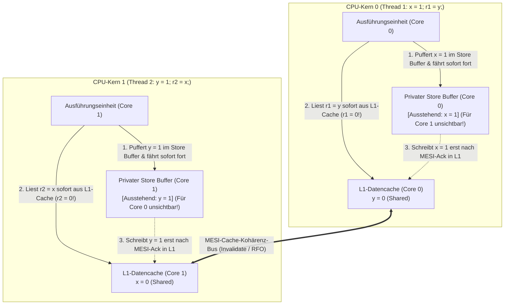
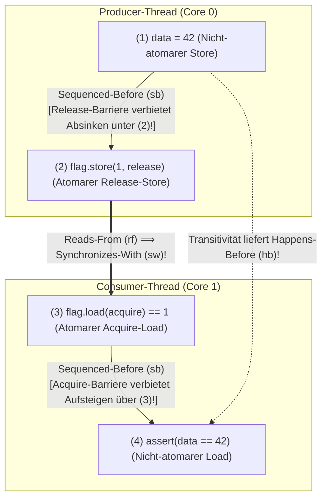

## Einleitung: Vier Zeilen Code gegen die menschliche Intuition ── Der Store-Buffering-Litmustest (`SB`)

Betrachten wir das folgende nebenläufige C-Programm aus nur vier Anweisungen. Zwei globale Variablen `x` und `y` im gemeinsamen Hauptspeicher sind mit `0` initialisiert. Zwei Threads auf zwei verschiedenen CPU-Kernen führen jeweils einen Schreibzugriff (Store) und einen Lesezugriff (Load) aus:

```c
// Initial state in shared memory:
int x = 0, y = 0;
int r1 = 0, r2 = 0;

// Thread 1 (Core 0)          // Thread 2 (Core 1)
void thread1(void) {          void thread2(void) {
    x = 1;      // (S1)           y = 1;      // (S2)
    r1 = y;     // (L1)           r2 = x;     // (L2)
}                             }
```

Welche Endwerte für `(r1, r2)` sind möglich, nachdem beide Threads terminiert sind?
Nach gesundem Menschenverstand muss mindestens einer der beiden Schreibvorgänge (`x = 1` oder `y = 1`) zuerst stattfinden:
- Läuft Thread 1 vor Thread 2, ergibt sich `r1 = 0, r2 = 1`.
- Läuft Thread 2 vor Thread 1, ergibt sich `r1 = 1, r2 = 0`.
- Führen beide zuerst ihre Schreibanweisung aus, ergibt sich `r1 = 1, r2 = 1`.

Das Ergebnis <strong>`r1 == 0 && r2 == 0` scheint mathematisch vollkommen unmöglich zu sein</strong>. Führt man diesen Code jedoch auf einem modernen Intel/AMD x86-64-Prozessor, einem Apple-Silicon-Chip (ARMv8) oder mit einem optimierenden C/C++/Rust-Compiler (`-O2`) in einer Schleife aus, <strong>tritt das „unmögliche“ Ergebnis `r1 == 0 && r2 == 0` tausende Male pro Sekunde auf</strong>! Weder die CPU noch der Compiler sind defekt – vielmehr ordnen moderne Prozessoren und Compiler Speicherzugriffe unter der <strong>Single-Threaded „As-If“-Regel</strong> systematisch um (Instruction Reordering).

---

## Kapitel 1: Die Illusion der Sequentiellen Konsistenz (Sequential Consistency)

1979 formalisierte Turing-Preisträger <strong>Leslie Lamport</strong> das intuitive Denkmodell von Programmierern als <strong>Sequentielle Konsistenz (Sequential Consistency, SC)</strong>: Ein Multiprozessorsystem ist sequentiell konsistent, wenn das Ergebnis jeder Ausführung identisch ist mit einer Ausführung, bei der alle Operationen aller Prozessoren in einer einzigen globalen Totalordnung ($\prec_m$) ausgeführt werden und die Operationen jedes einzelnen Prozessors darin exakt in der durch sein Programm festgelegten <strong>Programmordnung (Program Order, $\prec_p$)</strong> erscheinen.

Unter Sequentieller Konsistenz lässt sich in drei Zeilen streng beweisen, dass `r1 == 0 && r2 == 0` unmöglich ist:

$$\text{Program Order: } S_1 \prec_p L_1 \quad \land \quad S_2 \prec_p L_2$$

$$\text{Assume } r_1 = 0 \land r_2 = 0 \implies L_1 \prec_m S_2 \quad \land \quad L_2 \prec_m S_1$$

$$\implies S_1 \prec_p L_1 \prec_m S_2 \prec_p L_2 \prec_m S_1 \implies S_1 \prec S_1 \quad (\text{Contradiction!})$$

Damit $r_1 = 0$ gilt, muss der Lesezugriff $L_1$ vor dem Schreibzugriff $S_2$ erfolgen ($L_1 \prec_m S_2$). Analog erfordert $r_2 = 0$, dass $L_2 \prec_m S_1$ gilt. Zusammen mit der Programmordnung $S_1 \prec_p L_1$ und $S_2 \prec_p L_2$ entsteht ein <strong>zyklischer Widerspruch in der Zeitordnung</strong> ($S_1 \prec L_1 \prec S_2 \prec L_2 \prec S_1$)! Da jedoch `x` und `y` verschiedene Speicheradressen sind, erkennt ein einzelner Thread keinerlei Datenabhängigkeit zwischen `x = 1` und `r1 = y` – und genau das nutzen Hardware und Compiler gnadenlos aus.

---

## Kapitel 2: Hardware-Speichermodelle ── Store Buffer, MESI-Protokoll und Invalidate Queues

### 2.1 MESI-Cache-Kohärenz und Store-Load-Reordering durch Store Buffer

Ein Registerzugriff dauert auf einer modernen 4-GHz-CPU nur ca. $0{,}25\text{ ns}$ (1 Taktzyklus), ein L1-Cache-Treffer ca. $1\text{ ns}$, während ein Cache-Kohärenz-Handshake über den Interconnect oder ein DRAM-Zugriff $50\text{ bis }100\text{ ns}$ (bis zu 300 Taktzyklen) benötigt. Um Caches über Kerne hinweg konsistent zu halten, nutzen CPUs das <strong>MESI-Protokoll (Modified, Exclusive, Shared, Invalid)</strong>. Will Kern 0 in eine Cache-Line `x` schreiben, die im Zustand `Shared` vorliegt, muss er zuerst eine <strong>Invalidate-Nachricht (Read-For-Ownership, RFO)</strong> an alle anderen Kerne senden und auf deren Bestätigung (Invalidate Acknowledge) warten.

Würde die CPU bei jedem Schreibbefehl dutzende Takte lang stillstehen, würde die Rechenleistung kollabieren. Deshalb besitzt jeder moderne Prozessorkern (auch x86-64!) zwischen Ausführungseinheit und L1-Cache einen privaten Zwischenspeicher: den <strong>Store Buffer (Write Buffer)</strong>.



Kern 0 legt `x = 1` lediglich in seinem privaten Store Buffer ab (für Kern 1 noch völlig unsichtbar!) und führt im nächsten Takt sofort `r1 = y` aus seinem L1-Cache aus (`r1 = 0`). Gleichzeitig legt Kern 1 `y = 1` in seinem Store Buffer ab und liest `r2 = x` (`0`) aus seinem L1-Cache. Dadurch überholt der spätere Lesezugriff (Load) in der globalen Sichtbarkeit den früheren Schreibzugriff (Store) – das klassische <strong>Store-Load-Reordering</strong>! (Liest derselbe Kern seine eigene Variable `x` wieder ein, liefert <strong>Store Buffer Forwarding</strong> direkt den neuen Wert aus dem eigenen Puffer, sodass Single-Threaded-Code nichts bemerkt.)

### 2.2 Starkes x86-TSO vs. Schwach geordnete Architekturen (ARMv8, RISC-V, PowerPC)

Intel und AMD implementieren <strong>x86-TSO (Total Store Order)</strong>: Der Store Buffer arbeitet als strikte FIFO-Warteschlange, sodass `Load-Load`, `Load-Store` und `Store-Store` niemals umgeordnet werden; <strong>einzig `Store -> Load` zu unterschiedlichen Adressen wird umgeordnet</strong>. Hingegen nutzen <strong>ARMv8-A (AArch64 / Apple Silicon), RISC-V (RVWMO) und IBM PowerPC</strong> schwach geordnete Speichermodelle (<strong>Weakly Ordered Memory Models</strong>). Durch nicht-FIFO Store-Zusammenführung, spekulative Out-of-Order-Loads und <strong>Invalidate Queues</strong> (Warteschlangen für eingehende Invalidate-Nachrichten) können dort <strong>alle vier Kombinationen (`Load-Load`, `Load-Store`, `Store-Store`, `Store-Load`) umgeordnet werden</strong>!

| Hardware-Speichermodell | `Load -> Load` | `Load -> Store` | `Store -> Store` | `Store -> Load` | Multi-Copy Atomicity (MCA) |
| :--- | :---: | :---: | :---: | :---: | :--- |
| <strong>Sequentielle Konsistenz (SC)</strong> | Nein | Nein | Nein | Nein | Vollständig MCA |
| <strong>x86 / x64 (TSO)</strong> | Nein | Nein | Nein | <strong>Ja (Store Buffer)</strong> | Other-MCA |
| <strong>ARMv8-A (AArch64)</strong> | <strong>Ja</strong> | <strong>Ja</strong> | <strong>Ja</strong> | <strong>Ja</strong> | Other-MCA |
| <strong>RISC-V (RVWMO)</strong> | <strong>Ja</strong> | <strong>Ja</strong> | <strong>Ja</strong> | <strong>Ja</strong> | Other-MCA |
| <strong>IBM PowerPC</strong> | <strong>Ja</strong> | <strong>Ja</strong> | <strong>Ja</strong> | <strong>Ja</strong> | <strong>Nicht-MCA (Non-Multi-Copy Atomic)</strong> |

---

## Kapitel 3: Compiler-Umordnung und das DRF-SC-Theorem ── Warum Data Races Undefined Behavior sind

Selbst auf einer x86-CPU ist unsynchronisiertes Message Passing (`data = 42; ready = 1;`) fehlerhaft, weil <strong>optimierende Compiler (`gcc`, `clang`, `rustc`) bereits zur Übersetzungszeit alle vier Arten von Speicherzugriffen umordnen</strong>. Noch schlimmer: Durch <strong>Register Promotion und Loop-Invariant Code Motion (LICM)</strong> lädt der Compiler in einer Warteschleife `while (!ready)` die Variable `ready` nur ein einziges Mal vor der Schleife in ein CPU-Register und verwandelt die Schleife in eine <strong>Endlosschleife</strong>! Zudem ist `volatile` in C/C++ ausschließlich für Memory-Mapped I/O gedacht und erzeugt keinerlei Hardware-Speicherbarrieren.

1990 bewiesen <strong>Sarita Adve und Mark Hill</strong> das fundamentale <strong>DRF-SC-Theorem (Data-Race-Free Sequential Consistency)</strong>:
- <strong>Data Race (Datenwettlauf)</strong>: Zwei Threads greifen gleichzeitig auf dieselbe Speicheradresse zu, mindestens einer schreibt, mindestens einer ist nicht-atomar, und zwischen beiden besteht keine <strong>Happens-Before-Ordnung ($\xrightarrow{hb}$)</strong>.
- <strong>Der Vertrag (DRF $\implies$ SC)</strong>: Ist ein Programm vollständig frei von Data Races (<strong>DRF</strong>), garantieren Compiler und Hardware mathematisch, dass sich jede Ausführung exakt wie auf einer <strong>sequentiell konsistenten (SC)</strong> Maschine verhält. Enthält ein C/C++- oder Unsafe-Rust-Programm hingegen ein Data Race, ist das gesamte Programmverhalten <strong>Undefined Behavior (UB)</strong>.

---

## Kapitel 4: Happens-Before ($\xrightarrow{hb}$) und Acquire-Release-Synchronisation

Im formalen C++11/C11/Rust-Speichermodell entsteht eine Thread-übergreifende <strong>Synchronizes-With-Relation ($\xrightarrow{sw}$)</strong> genau dann, wenn Thread 1 ein atomares <strong>Release-Store</strong> $W_{\text{rel}}(x, v)$ ausführt und Thread 2 bei einem atomaren <strong>Acquire-Load</strong> $R_{\text{acq}}(x, v)$ diesen geschriebenen Wert liest ($W_{\text{rel}} \xrightarrow{rf} R_{\text{acq}}$). Die transitive Hülle aus der Thread-internen Programmordnung (<strong>Sequenced-Before, $\xrightarrow{sb}$</strong>) und $\xrightarrow{sw}$ bildet die <strong>Happens-Before-Relation ($\xrightarrow{hb}$)</strong>:

$$W_{\text{rel}}(x, v) \xrightarrow{rf} R_{\text{acq}}(x, v) \implies W_{\text{rel}}(x, v) \xrightarrow{sw} R_{\text{acq}}(x, v)$$

$$\xrightarrow{hb} \;\; \triangleq \;\; \left( \xrightarrow{sb} \;\cup\; \xrightarrow{sw} \right)^+$$

Damit lässt sich das Message-Passing-Muster vollkommen plattformunabhängig und beweisbar korrekt formulieren:

```cpp
#include <atomic>
#include <cassert>

int data = 0;                        // Non-atomic payload
std::atomic<int> flag{0};            // Atomic synchronization variable

void producer_thread() {
    data = 42;                                           // (1) Sequenced-before (2)
    flag.store(1, std::memory_order_release);            // (2) Release store
}

void consumer_thread() {
    while (flag.load(std::memory_order_acquire) == 0) {  // (3) Acquire load
        // spin until flag == 1
    }
    assert(data == 42);                                  // (4) Guaranteed never to fail!
}
```



Der formale Korrektheitsbeweis lautet:

$$W(\text{data}=42) \xrightarrow{sb} W_{\text{rel}}(\text{flag}=1) \xrightarrow{sw} R_{\text{acq}}(\text{flag}=1) \xrightarrow{sb} R(\text{data})$$

$$\implies W(\text{data}=42) \xrightarrow{hb} R(\text{data}) \implies R(\text{data}) = 42$$

---

## Kapitel 5: Das Spektrum der Memory Orderings und CPU-Befehls-Mapping (`MFENCE`, `DMB`, `LDAR`/`STLR`)

C++ und Rust bieten drei zentrale Ordnungsstufen:
1. <strong>`Relaxed`</strong>:Sichert nur Unteilbarkeit und Kohärenz einer einzelnen atomaren Variable ($\xrightarrow{mo}$), ohne $\xrightarrow{sw}$-Synchronisation (ideal für einfache Zähler).
2. <strong>`Acquire` / `Release` / `AcqRel`</strong>: Einseitige Barrieren (Roach-Motel-Semantik) für paarweise Synchronisation ($\xrightarrow{sw}$); <strong>verhindert jedoch NICHT das `Store -> Load`-Reordering</strong>, wenn ein `Release`-Store vor einem `Acquire`-Load steht!
3. <strong>`SeqCst` (Standard)</strong>: Erzwingt zusätzlich eine <strong>einzige globale Totalordnung $\xrightarrow{S}$</strong> über alle `SeqCst`-Operationen aller Threads und unterbindet auch `Store -> Load`-Reordering (löst das `SB`-Litmus-Problem `r1 == 0 && r2 == 0`).

| Atomare Operation (C++ / Rust) | x86-64 (TSO) Assemblercode | ARMv8-A (AArch64) Assemblercode | RISC-V (RVWMO) Assemblercode |
| :--- | :--- | :--- | :--- |
| <strong>`load(relaxed)`</strong> | `mov eax, [rdi]` | `ldr w0, [x0]` | `lw a0, 0(a0)` |
| <strong>`load(acquire)`</strong> | <strong>`mov eax, [rdi]`</strong> *(Null Hardware-Fence-Kosten!)* | <strong>`ldar w0, [x0]`</strong> *(Load-Acquire)* | `lw a0, 0(a0)` + `fence r, rw` |
| <strong>`store(release, v)`</strong> | <strong>`mov [rdi], esi`</strong> *(Null Hardware-Fence-Kosten!)* | <strong>`stlr w1, [x0]`</strong> *(Store-Release)* | `fence rw, w` + `sw a1, 0(a0)` |
| <strong>`store(seq_cst, v)`</strong> | <strong>`xchg [rdi], esi`</strong> *(oder `mov` + `mfence`)* | <strong>`stlr w1, [x0]`</strong> *(geordnet mit `ldar`)* | `fence rw, rw` + `sw` + `fence rw, rw` |
| <strong>Full Fence `fence(seq_cst)`</strong> | <strong>`mfence`</strong> *(oder `lock or [rsp], 0`)* | <strong>`dmb ish`</strong> *(Data Memory Barrier)* | <strong>`fence rw, rw`</strong> |

Auf x86-64 sind `Acquire` und `Release` in Hardware kostenlos (normale `mov`-Befehle, nur Compiler-Barrieren), während `store(seq_cst)` mittels `xchg` (implizites `LOCK`-Präfix) oder `mfence` den Store Buffer flusht. ARMv8-A nutzt hingegen die maßgeschneiderten `LDAR`- und `STLR`-Instruktionen, um ohne teure globale `DMB ISH`-Barrieren sowohl Acquire-Release als auch SeqCst hocheffizient umzusetzen.
