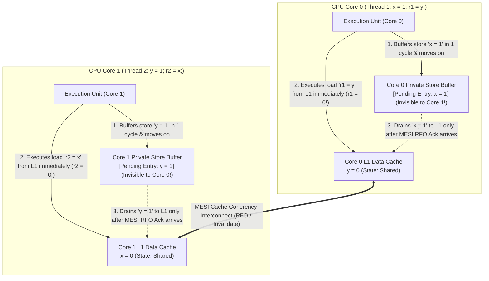
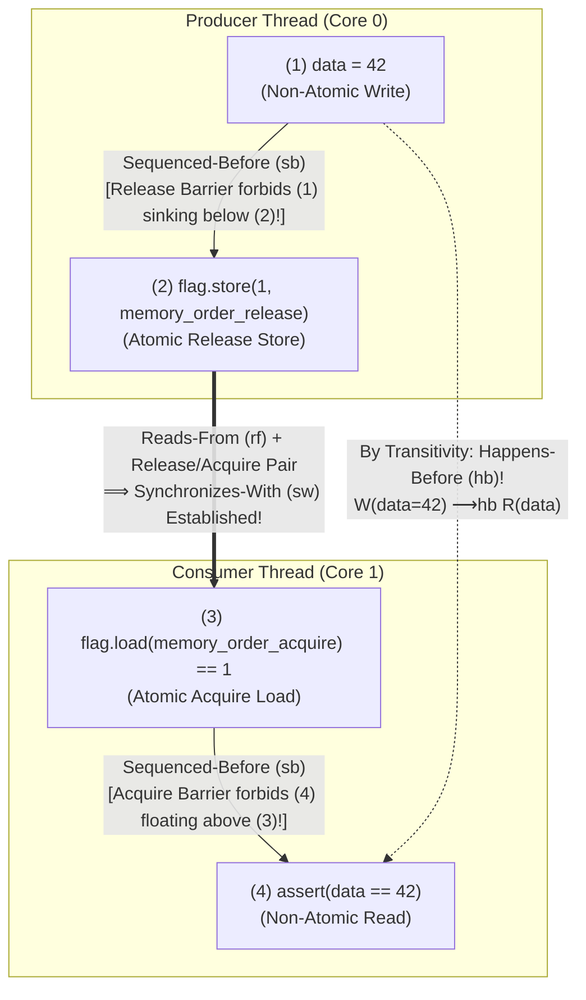

Examine the following four-line concurrent program. Two shared integer variables, `x` and `y`, are initialized to `0` in main memory. Two threads running on two separate CPU cores execute two instructions each—one store and one load:

```c
// Initial state in shared memory:
int x = 0;
int y = 0;
int r1 = 0, r2 = 0;

// Thread 1 (Core 0)          // Thread 2 (Core 1)
void thread1(void) {          void thread2(void) {
    x = 1;      // (S1)           y = 1;      // (S2)
    r1 = y;     // (L1)           r2 = x;     // (L2)
}                             }
```

Thread 1 writes `1` to `x` and then reads `y` into `r1`. Thread 2 writes `1` to `y` and then reads `x` into `r2`. When both threads finish executing, what final values of `(r1, r2)` are possible?

Let us trace every conceivable timing scenario using common sense:
- If Thread 1 runs slightly ahead of Thread 2, Thread 1 sets `x = 1` and reads `r1 = 0`, after which Thread 2 sets `y = 1` and reads `r2 = 1`. Result: `(r1 = 0, r2 = 1)`.
- If Thread 2 runs slightly ahead of Thread 1, Thread 2 sets `y = 1` and reads `r2 = 0`, after which Thread 1 sets `x = 1` and reads `r1 = 1`. Result: `(r1 = 1, r2 = 0)`.
- If both threads execute their first line (`x = 1` and `y = 1`) before either executes its second line, both threads read `1`. Result: `(r1 = 1, r2 = 1)`.

Whichever thread goes first—or even if they run at the exact same nanosecond—at least one store (`x = 1` or `y = 1`) must happen before the other thread's final load. By elementary logic, the outcome <strong>`r1 == 0 && r2 == 0` is mathematically impossible</strong>.

Yet if you compile this exact code today and run it in a tight loop on your Intel Core or AMD Ryzen laptop (x86-64), your Apple Silicon MacBook or smartphone (ARMv8), a RISC-V server, or an IBM Power machine—or compile it with an optimizing C/C++/Rust compiler (`-O2` or `-O3`)—<strong>the "mathematically impossible" outcome `r1 == 0 && r2 == 0` occurs thousands of times per second!</strong>

Your processor is not defective, nor is your compiler broken. Rather, the mental model that almost every programmer carries in their head—that instructions execute in the order written in the source code and that memory writes become instantaneously visible to all CPU cores—is an illusion.

Why do both modern microprocessors and optimizing compilers routinely scramble the order of memory operations? How can we write correct lock-free or concurrent code if `x = 1; r1 = y;` can execute backwards? In this article, we dismantle the illusion of program order from silicon up to programming language theory: <strong>Leslie Lamport's Sequential Consistency (SC)</strong> and why it fails on the <strong>Store Buffering (`SB`) Litmus Test</strong>, the microarchitectural reality of <strong>Store Buffers, MESI Cache Coherency, and Invalidate Queues</strong> across x86-TSO vs. ARMv8/RISC-V/PowerPC, compiler transformations and the <strong>DRF-SC Theorem (Data-Race-Free Sequential Consistency, Adve & Hill 1990)</strong>, the formal mathematics of <strong>Happens-Before ($\xrightarrow{hb}$) and Synchronizes-With ($\xrightarrow{sw}$)</strong>, the spectrum of atomic memory orderings (`Relaxed`, `Acquire-Release`, `SeqCst`), and the exact machine-instruction mappings (`MOV`, `XCHG`, `MFENCE`, `DMB ISH`, `LDAR`/`STLR`).

---

## Chapter 1: The Illusion of Program Order — Litmus Tests and Sequential Consistency

### 1.1 Leslie Lamport's Sequential Consistency (1979)

In 1979, computer scientist <strong>Leslie Lamport</strong> formulated the exact mathematical property that human programmers intuitively assume when reasoning about multi-threaded programs, naming it <strong>Sequential Consistency (SC)</strong>:

> <strong>Definition — Sequential Consistency (Lamport, 1979)</strong>:
> "A multiprocessor system is sequentially consistent if the result of any execution is the same as if the operations of all the processors were executed in some sequential order, and the operations of each individual processor appear in this sequence in the order specified by its program."

Sequential Consistency requires two simultaneous invariants:
1. <strong>Preservation of Program Order ($\prec_p$)</strong>: Within any single thread, instructions take effect in the exact order specified by the source code.
2. <strong>Single Global Memory Order ($\prec_m$ / Atomicity of Visibility)</strong>: All memory reads and writes across all cores behave as if a single global switch connects one core at a time to a single shared RAM module; every write becomes visible to all cores simultaneously at a single point in the global timeline.

In concurrency verification, small 4- to 6-instruction concurrent programs designed to expose deviations from Sequential Consistency are called <strong>Litmus Tests</strong>. Our opening example—originating at the heart of Edsger Dijkstra's and Theodorus Dekker's 1965 mutual exclusion algorithm—is the canonical <strong>Store Buffering (`SB`) Litmus Test</strong>.

Let $S_1\ (x=1)$ and $L_1\ (r_1=y)$ denote the store and load of Thread 1, and let $S_2\ (y=1)$ and $L_2\ (r_2=x)$ denote the store and load of Thread 2. Preserving each thread's internal program order ($S_1 \prec_p L_1$ and $S_2 \prec_p L_2$), there are exactly $\binom{4}{2} = \frac{4!}{2!2!} = 6$ valid ways to interleave these four operations into a single sequential timeline:

| Interleaving # | Global Execution Sequence | Resulting Registers `(r1, r2)` |
| :--- | :--- | :--- |
| Interleaving 1 | $S_1(x=1) \to L_1(r_1=y) \to S_2(y=1) \to L_2(r_2=x)$ | `r1 = 0, r2 = 1` |
| Interleaving 2 | $S_1(x=1) \to S_2(y=1) \to L_1(r_1=y) \to L_2(r_2=x)$ | `r1 = 1, r2 = 1` |
| Interleaving 3 | $S_1(x=1) \to S_2(y=1) \to L_2(r_2=x) \to L_1(r_1=y)$ | `r1 = 1, r2 = 1` |
| Interleaving 4 | $S_2(y=1) \to L_2(r_2=x) \to S_1(x=1) \to L_1(r_1=y)$ | `r1 = 1, r2 = 0` |
| Interleaving 5 | $S_2(y=1) \to S_1(x=1) \to L_2(r_2=x) \to L_1(r_1=y)$ | `r1 = 1, r2 = 1` |
| Interleaving 6 | $S_2(y=1) \to S_1(x=1) \to L_1(r_1=y) \to L_2(r_2=x)$ | `r1 = 1, r2 = 1` |

We can prove algebraically in three lines why `r1 == 0 && r2 == 0` is impossible under Sequential Consistency:

$$\text{Program Order: } S_1 \prec_p L_1 \quad \land \quad S_2 \prec_p L_2$$

$$\text{Assume } r_1 = 0 \land r_2 = 0 \implies L_1 \prec_m S_2 \quad \land \quad L_2 \prec_m S_1$$

$$\implies S_1 \prec_p L_1 \prec_m S_2 \prec_p L_2 \prec_m S_1 \implies S_1 \prec S_1 \quad (\text{Contradiction: Cycle in Total Order!})$$

For `r1 == 0` to occur, the load $L_1(r_1=y)$ must execute in the global memory order strictly before the store $S_2(y=1)$, so $L_1 \prec_m S_2$. Symmetrically, for `r2 == 0` to occur, the load $L_2(r_2=x)$ must execute strictly before the store $S_1(x=1)$, so $L_2 \prec_m S_1$. Chaining these with program order $S_1 \prec_p L_1$ and $S_2 \prec_p L_2$ yields a strict cycle $S_1 \prec L_1 \prec S_2 \prec L_2 \prec S_1$, contradicting the irreflexivity of a total order!

### 1.2 The Single-Threaded "As-If Rule"

Why, then, do both CPUs and compilers violate Sequential Consistency? Because enforcing Sequential Consistency across every ordinary memory read and write would make modern computers roughly <strong>an order of magnitude slower</strong>.

Instead, hardware architects and compiler writers optimize aggressively under the <strong>Single-Threaded "As-If Rule"</strong>: a CPU core or compiler may reorder, coalesce, buffer, or eliminate any instructions <em>as long as the observable behavior of a single isolated thread executing that code remains identical</em>.

Look at Thread 1 in isolation: `x = 1; r1 = y;`. Because `x` and `y` are distinct memory addresses (`&x != &y`), writing to `x` has zero effect on the value read from `y` within Thread 1. From Thread 1's solitary perspective, executing `r1 = y;` first and committing `x = 1;` second produces the exact same single-threaded state! Only when a second thread concurrently observes `x` and `y` does the reordering become externally visible.

---

## Chapter 2: Hardware Memory Models & Microarchitecture — Store Buffers, MESI, and Invalidate Queues

### 2.1 The Memory Wall and MESI Cache Coherency Latency

To understand why hardware reorders memory accesses, consider the physical latencies inside a modern 4 GHz microprocessor:
- <strong>CPU Register / ALU operation</strong>: $\sim 0.25\text{ ns}$ ($1$ clock cycle)
- <strong>L1 Data Cache hit (32–64 KB per core)</strong>: $\sim 1\text{ ns}$ ($3\text{–}4$ cycles)
- <strong>L2 Cache hit (512 KB–1 MB per core)</strong>: $\sim 3.5\text{ ns}$ ($12\text{–}14$ cycles)
- <strong>L3 Shared Cache / Cross-Core Coherency Handshake</strong>: $\sim 15\text{–}50\text{ ns}$ ($60\text{–}200$ cycles)
- <strong>Main DRAM Access</strong>: $\sim 80\text{–}100\text{ ns}$ ($300\text{–}400$ cycles)

Because each core caches 64-byte cache lines in its private L1/L2 caches, hardware maintains cache coherence across cores using variants of the <strong>MESI Protocol</strong> (<strong>M</strong>odified, <strong>E</strong>xclusive, <strong>S</strong>hared, <strong>I</strong>nvalid). Under MESI, multiple cores may simultaneously hold clean read-only copies of a cache line in the <strong>Shared (`S`)</strong> state. However, before Core 0 is permitted to modify a cache line (`x = 1`), Core 0 must acquire exclusive ownership (transitioning the line to <strong>Modified (`M`)</strong>) by broadcasting an <strong>Invalidate / Read-For-Ownership (RFO)</strong> message across the on-chip interconnect to every other core holding `x`, and waiting until every other core purges its copy of `x` and replies with an <strong>Invalidate Acknowledge</strong>.

### 2.2 Store Buffers and Store-Load Reordering on x86/x64 (Total Store Order)

Suppose Core 0 executes `x = 1;` when `x` is currently cached in the `Shared` state (or not in Core 0's L1 cache at all). Waiting 50 to 200 clock cycles for the cross-chip MESI Invalidate handshake to complete before moving to the next instruction would leave the CPU's execution pipelines sitting idle most of the time!

To hide store latency, every modern CPU places a hardware FIFO queue called a <strong>Store Buffer (Write Buffer)</strong> between each CPU core's execution units and its L1 Data Cache.



Now trace our Store Buffering (`SB`) Litmus Test cycle by cycle through the diagram above:

1. Initially, both `x = 0` and `y = 0` reside in both Core 0's and Core 1's L1 caches in the `Shared` (`S`) state.
2. Core 0 executes `x = 1` ($S_1$). Instead of stalling for the MESI Invalidate handshake, Core 0 writes `x = 1` into <strong>Core 0's private Store Buffer</strong>, initiates an asynchronous RFO request on the bus, and <strong>immediately advances to the next instruction</strong>! Crucially, `x = 1` is still sitting inside Core 0's private Store Buffer—it has not yet reached the coherent L1 cache and is <strong>completely invisible to Core 1</strong>.
3. Simultaneously, Core 1 executes `y = 1` ($S_2$), writing `y = 1` into <strong>Core 1's private Store Buffer</strong> (invisible to Core 0) and immediately advancing.
4. Core 0 executes `r1 = y` ($L_1$). Core 0 checks its own Store Buffer for `y` (not present) and then reads `y` from its L1 Data Cache. Because `y` is in the `Shared` state in Core 0's L1 cache with value `0`, the load hits in L1 immediately and sets <strong>`r1 = 0`</strong>!
5. Simultaneously, Core 1 executes `r2 = x` ($L_2$), hits on `x = 0` (`Shared`) in Core 1's L1 Data Cache, and sets <strong>`r2 = 0`</strong>!
6. Dozens of cycles later, the MESI Invalidate handshakes finish and both Store Buffers drain `x = 1` and `y = 1` into the L1 caches—too late to change `r1` and `r2`.

Thus, the simple presence of a per-core Store Buffer causes the load $L_1$ to take effect in the global memory hierarchy <em>before</em> the earlier store $S_1$ becomes visible to other cores! This is <strong>Store-Load Reordering</strong>, and it occurs on <strong>every x86/x64 processor</strong>.

What if Core 0 executes `x = 1; r1 = x;` (reading back the exact same variable it just wrote)? If Core 0 read stale `x = 0` from its L1 cache while `x = 1` sat in its Store Buffer, single-threaded programs would break! To preserve the single-threaded As-If Rule, hardware implements <strong>Store Buffer Forwarding (Store-to-Load Forwarding)</strong>: every load first snoops the core's own Store Buffer; if a pending store to the same address exists in the local Store Buffer, the core forwards that value directly to the load register without waiting for L1.

Intel and AMD formalize this behavior as the <strong>x86 Total Store Order (x86-TSO)</strong> memory model (Owens, Sarkar, & Sewell, 2009):
- Each core's Store Buffer is a strict FIFO queue: stores leave the Store Buffer and enter the coherent cache hierarchy in the exact order they were issued (<strong>no Store-Store reordering</strong>).
- Loads are never reordered with other loads (<strong>no Load-Load reordering</strong>), nor are stores pushed ahead of earlier loads (<strong>no Load-Store reordering</strong>).
- Once a store drains from a Store Buffer into the L1 cache, it becomes visible to all other cores simultaneously (<strong>Other-Multi-Copy Atomicity</strong>).
- <strong>Only `Store -> Load` to different addresses is reordered</strong> (because a load can bypass an older store to a different address sitting in the local Store Buffer).

### 2.3 Invalidate Queues and Weakly Ordered Architectures (ARMv8, RISC-V, PowerPC)

While x86-TSO only permits `Store -> Load` reordering, mobile, embedded, and modern cloud processors—including <strong>ARMv8-A (AArch64 / Apple M-series / AWS Graviton)</strong>, <strong>RISC-V (RVWMO)</strong>, and <strong>IBM PowerPC</strong>—adopt <strong>Weakly Ordered Memory Models</strong> that permit <strong>all four combinations of memory reordering</strong> (`Store-Load`, `Store-Store`, `Load-Load`, and `Load-Store`) between independent addresses!

Why? Two microarchitectural mechanisms explain how `Store-Store` and `Load-Load` reorderings happen on weakly ordered chips:
1. <strong>Non-FIFO Store Buffers & Cache Bank Parallelism</strong>: If Core 0 executes `data = 42; flag = 1;`, and the cache line for `flag` is <em>already</em> in the `Modified`/`Exclusive` state in Core 0's L1 cache while `data` misses in L1, a weakly ordered core does not force `flag = 1` to wait behind `data = 42`—it commits `flag = 1` to L1 immediately while `data = 42` is still waiting for its cache line!
2. <strong>Invalidate Queues and Speculative Out-of-Order Loads</strong>: Under high store traffic, processing incoming MESI Invalidate messages immediately against the L1 cache tags can bottleneck the cache port. Weakly ordered CPUs therefore place incoming Invalidate requests into a hardware <strong>Invalidate Queue</strong> and <em>immediately send back an `Invalidate Ack` to the writing core</em> before actually invalidating the local L1 cache line! Furthermore, out-of-order execution pipelines speculatively execute later loads (`r2 = data`) dozens of cycles before earlier loads (`r1 = flag`) retire.

Consider the classic <strong>Message Passing (`MP`) Litmus Test</strong>:
- <strong>Thread 1 (Core 0)</strong>: Writes `data = 42;` then writes `flag = 1;`.
- <strong>Thread 2 (Core 1)</strong>: Waits until it reads `r1 = flag` as `1`, and then reads `r2 = data`.

On ARMv8, RISC-V, or PowerPC without memory barriers, <strong>Thread 2 can observe `r1 == 1` (the flag is set!) and yet read `r2 == 0` (stale uninitialized data!)</strong>—either because Core 0 committed `flag = 1` before `data = 42` (`Store-Store` reordering), or because Core 1 speculatively read `data = 0` from its L1 cache (or hadn't processed the queued invalidation for `data` in its Invalidate Queue yet) before reading `flag = 1` (`Load-Load` reordering)!

| Hardware Memory Model | `Load -> Load` Reordering | `Load -> Store` Reordering | `Store -> Store` Reordering | `Store -> Load` Reordering | Multi-Copy Atomicity (MCA) |
| :--- | :---: | :---: | :---: | :---: | :--- |
| <strong>Sequential Consistency (SC)</strong> | No | No | No | No | Full Multi-Copy Atomic |
| <strong>x86 / x64 (Intel / AMD TSO)</strong>, SPARC TSO | No | No | No | <strong>Yes (Store Buffer)</strong> | Other-Multi-Copy Atomic |
| <strong>ARMv8-A (AArch64 / Apple Silicon)</strong> | <strong>Yes</strong> | <strong>Yes</strong> | <strong>Yes</strong> | <strong>Yes</strong> | Other-Multi-Copy Atomic (since ARMv8.0) |
| <strong>RISC-V (RVWMO)</strong> | <strong>Yes</strong> | <strong>Yes</strong> | <strong>Yes</strong> | <strong>Yes</strong> | Other-Multi-Copy Atomic |
| <strong>IBM Power / PowerPC</strong> | <strong>Yes</strong> | <strong>Yes</strong> | <strong>Yes</strong> | <strong>Yes</strong> | <strong>Non-Multi-Copy Atomic (Non-MCA)</strong> |
| <strong>DEC Alpha (Historical Extreme)</strong> | <strong>Yes (Even dependent loads `p->x`!)</strong> | <strong>Yes</strong> | <strong>Yes</strong> | <strong>Yes</strong> | Non-Multi-Copy Atomic |

*(Note: IBM PowerPC is even <strong>Non-Multi-Copy Atomic</strong>—because pairs of cores share L2 caches before reaching the global interconnect, a write by Core 0 can become visible to Core 1 before becoming visible to Core 2, allowing the <strong>Independent Reads of Independent Writes (`IRIW`)</strong> litmus test to observe two stores in opposite orders on two reader cores! And the legendary 1992 <strong>DEC Alpha</strong> had partitioned cache banks that could reorder even <strong>data-dependent loads</strong> like `p = global_ptr; r1 = p->field;`, reading stale uninitialized `p->field` after reading the newly published pointer `p`!)*

---

## Chapter 3: Compiler Reordering and the DRF-SC Theorem — Why Data Races Are Undefined Behavior

### 3.1 Why Even an x86 CPU Cannot Save Unsynchronized Code

Programmers who work exclusively on x86-64 servers often fall into a dangerous trap: "Since x86-TSO hardware only reorders `Store -> Load`, my message-passing code `data = 42; flag = 1;` is safe without atomics on x86, right?"

<strong>Wrong!</strong> Long before your program's machine instructions ever reach an x86 CPU core, the <strong>optimizing compiler (`gcc`, `clang`, `rustc`, `javac`) analyzes your source code under the single-threaded As-If Rule and freely reorders, caches, or deletes memory accesses across all four categories (`Load-Load`, `Load-Store`, `Store-Store`, `Store-Load`)!</strong>

Consider three routine compiler optimizations that shatter unsynchronized multi-threaded code:

1. <strong>Instruction Scheduling & Store-Store / Load-Load Reordering</strong>:
   In `data = 42; flag = 1;`, `data` and `flag` are distinct non-aliasing variables. If `data` requires computing a complex expression or spills to the stack, the compiler's instruction scheduler is completely free to emit the store to `flag = 1` <em>before</em> the store to `data = 42`, breaking Message Passing even on x86!
2. <strong>Register Promotion & Loop-Invariant Code Motion (LICM)</strong>:
   Suppose Thread 2 waits for a flag using a plain `int flag = 0;` variable:
   ```c
   while (flag == 0) {
       // wait for Thread 1 to set flag = 1
   }
   ```
   When compiling at `-O2`, the compiler inspects the body of the `while` loop, sees that nothing inside the loop ever modifies `flag`, and applies <strong>Loop-Invariant Code Motion (LICM)</strong>—hoisting the memory load of `flag` out of the loop into a CPU register once and for all:
   ```c
   // What gcc/clang -O2 actually emits in assembly:
   int reg_eax = flag;   // Load from RAM only ONCE!
   if (reg_eax == 0) {
       while (true) {    // Infinite loop! Never reads 'flag' from RAM again!
       }
   }
   ```
   If Thread 2 enters `while (flag == 0)` before Thread 1 sets `flag = 1`, Thread 2 locks up in an <strong>infinite loop forever</strong>!
3. <strong>Non-Atomic Load/Store Tearing & Speculative Invented Writes</strong>:
   An optimizing compiler may split a 64-bit write into two 32-bit writes (causing another thread to read a half-written "torn" value), or even use a shared global variable as temporary scratch storage inside a loop before writing the final value!

> [!CAUTION] <strong>Why C/C++ `volatile` Is NOT for Multi-Threading!</strong>
> In C and C++, marking a variable `volatile` only tells the compiler not to optimize away or reorder accesses to *that specific `volatile` variable* relative to other `volatile` variables—a mechanism designed strictly for <strong>Memory-Mapped I/O (MMIO) hardware registers</strong> and `sig_atomic_t` signal handlers. C/C++ `volatile` <strong>emits zero CPU hardware memory fences</strong> (so the x86 Store Buffer and ARM Invalidate Queue still reorder it!) and <strong>does NOT prevent the compiler from reordering normal non-`volatile` accesses (`data = 42`) across a `volatile` access (`flag = 1`)</strong>! (By contrast, in Java and C#, the `volatile` keyword *does* carry full Acquire-Release / Sequential Consistency synchronization semantics.)

### 3.2 The DRF-SC Theorem (Adve & Hill, 1990) and Data Races as Undefined Behavior

How can programming languages allow compilers and CPUs to optimize at full speed without forcing application programmers to reason about Store Buffers, Invalidate Queues, and LICM on every line of code?

In 1990, computer architects <strong>Sarita V. Adve</strong> and <strong>Mark D. Hill</strong> proved the foundational theorem of modern memory models: the <strong>DRF-SC Theorem (Data-Race-Free Sequential Consistency)</strong>, later adapted by Hans Boehm and Sarita Adve (PLDI 2008) to form the bedrock of the C++11, C11, and Rust memory models.

First, let us state the formal definition of a <strong>Data Race</strong>:
> <strong>Definition — Data Race</strong>:
> An execution contains a <strong>Data Race</strong> if two different threads access the <strong>same memory location</strong> concurrently, <strong>at least one of these accesses is a write (store)</strong>, at least one is a non-atomic operation, and neither access <strong>Happens-Before ($\xrightarrow{hb}$)</strong> the other.

The <strong>DRF-SC Theorem</strong> establishes an ironclad contract between the programmer and the implementation (compiler + CPU):

1. <strong>The Guarantee (DRF $\implies$ SC)</strong>: If a program is <strong>Data-Race-Free (DRF)</strong>—meaning every pair of conflicting accesses to shared data is properly ordered by synchronization primitives (mutexes or atomic operations)—then <strong>every execution of the program is mathematically guaranteed to be indistinguishable from a Sequentially Consistent (SC) execution</strong>! Between synchronization points, the compiler and CPU can reorder instructions and buffer stores as aggressively as they wish, and no thread will ever be able to tell the difference.
2. <strong>The Penalty (Data Race $\implies$ Undefined Behavior)</strong>: If a C, C++, or Unsafe Rust program contains a <strong>Data Race</strong> on ordinary variables, the language standard declares the entire execution to be <strong>Undefined Behavior (UB)</strong>—because compiler optimizations like register promotion, dead-store elimination, and switch jump-table bounds elision are only sound under the assumption that non-atomic variables do not spontaneously mutate mid-expression from another thread.

---

## Chapter 4: Formalizing Happens-Before ($\xrightarrow{hb}$), Synchronizes-With ($\xrightarrow{sw}$), and Atomic Memory Orderings

To eliminate data races and selectively constrain hardware and compiler reordering without always paying the cost of heavy locks, C++11 (`std::atomic<T>`), C11 (`_Atomic`), and Rust (`std::sync::atomic`) define a formal axiomatic memory model (formalized mathematically by Mark Batty et al., POPL 2011, and refined in `RC11` by Ori Lahav et al., PLDI 2017).

### 4.1 The Relational Graph: $\xrightarrow{sb}$, $\xrightarrow{rf}$, $\xrightarrow{sw}$, and $\xrightarrow{hb}$

Every candidate execution of a program is modeled as a directed graph whose vertices are memory events—Reads $R(x, v)$, Writes $W(x, v)$, Read-Modify-Writes $RMW(x, v_{\text{old}}, v_{\text{new}})$, and Fences $F$—connected by four fundamental relations:

1. <strong>Sequenced-Before ($\xrightarrow{sb}$)</strong>: The intra-thread program order. If statement $A$ precedes statement $B$ in the control flow of a single thread $T_i$, then $A \xrightarrow{sb} B$.
2. <strong>Modification Order ($\xrightarrow{mo}$)</strong>: For each individual atomic variable $x$, all writes to $x$ across all threads occur in a single total order $\xrightarrow{mo}_x$ agreed upon by all threads (Cache Coherence per variable).
3. <strong>Reads-From ($\xrightarrow{rf}$)</strong>: Connects a write event $W(x, v)$ to the read event $R(x, v)$ that takes its value from that specific write: $W(x, v) \xrightarrow{rf} R(x, v)$.
4. <strong>Synchronizes-With ($\xrightarrow{sw}$)</strong>: The crucial <strong>inter-thread bridge</strong>! Whenever Thread 1 performs an atomic store to $x$ tagged with `release` ordering ($W_{\text{rel}}(x, v)$) and Thread 2 performs an atomic load from $x$ tagged with `acquire` ordering ($R_{\text{acq}}(x, v)$) that reads the value written by $W_{\text{rel}}$ (or a later write in a release sequence), the runtime observation $W_{\text{rel}}(x, v) \xrightarrow{rf} R_{\text{acq}}(x, v)$ establishes a <strong>Synchronizes-With</strong> edge across threads:
   $$W_{\text{rel}}(x, v) \xrightarrow{sw} R_{\text{acq}}(x, v)$$
   (Unlocking a `std::mutex` also synchronizes-with the subsequent `lock()` of that same mutex.)
5. <strong>Happens-Before ($\xrightarrow{hb}$)</strong>: Ignoring legacy `consume` ordering, <strong>Happens-Before</strong> is simply the transitive closure of intra-thread Sequenced-Before ($\xrightarrow{sb}$) and inter-thread Synchronizes-With ($\xrightarrow{sw}$):

$$W_{\text{rel}}(x, v) \xrightarrow{rf} R_{\text{acq}}(x, v) \implies W_{\text{rel}}(x, v) \xrightarrow{sw} R_{\text{acq}}(x, v)$$

$$\xrightarrow{hb} \;\; \triangleq \;\; \left( \xrightarrow{sb} \;\cup\; \xrightarrow{sw} \right)^+$$

<strong>The Fundamental Visibility Axiom of $\xrightarrow{hb}$</strong>:
- For any non-atomic variable $d$, a read $R(d)$ is guaranteed to read the value written by $W(d, v)$ if $W(d, v) \xrightarrow{hb} R(d)$ and there is no intervening write $W'(d, v')$ such that $W(d, v) \xrightarrow{hb} W'(d, v') \xrightarrow{hb} R(d)$.
- Furthermore, because $W(d, v) \xrightarrow{hb} R(d)$, the two accesses are ordered by Happens-Before—so <strong>there is no Data Race!</strong>

### 4.2 Proving Message Passing Correct with `Acquire-Release` Synchronization

Let us apply this axiomatic machinery to fix the broken Message Passing (`MP`) pattern using `std::memory_order_release` and `std::memory_order_acquire`:

```cpp
#include <atomic>
#include <cassert>

int data = 0;                        // Non-atomic payload
std::atomic<int> flag{0};            // Atomic synchronization variable

void producer_thread() {
    data = 42;                                           // (1) Sequenced-before (2)
    flag.store(1, std::memory_order_release);            // (2) Release store
}

void consumer_thread() {
    while (flag.load(std::memory_order_acquire) == 0) {  // (3) Acquire load
        // spin until flag == 1
    }
    assert(data == 42);                                  // (4) Guaranteed never to fail!
}
```

Why is `assert(data == 42)` at `(4)` mathematically guaranteed never to fail on any CPU or compiler? Trace the directed graph of relations:



$$W(\text{data}=42) \xrightarrow{sb} W_{\text{rel}}(\text{flag}=1) \xrightarrow{sw} R_{\text{acq}}(\text{flag}=1) \xrightarrow{sb} R(\text{data})$$

$$\implies W(\text{data}=42) \xrightarrow{hb} R(\text{data}) \implies R(\text{data}) = 42 \quad (\text{Guaranteed!})$$

Notice the asymmetric, one-way nature of `Release` and `Acquire` barriers—often called <strong>Roach Motel Semantics</strong> ("instructions can check in, but they can't check out"):
- <strong>`memory_order_release` on Store `(2)`</strong> acts as a <strong>downward one-way barrier</strong>: no memory read or write sequenced *before* `(2)` (such as `data = 42`) is allowed by the compiler or CPU to be reordered *after* `(2)`.
- <strong>`memory_order_acquire` on Load `(3)`</strong> acts as an <strong>upward one-way barrier</strong>: no memory read or write sequenced *after* `(3)` (such as reading `data`) is allowed by the compiler or CPU to be reordered *before* `(3)`.

### 4.3 The Spectrum of Atomic Orderings: `Relaxed`, `Acquire-Release`, and `SeqCst`

Let us compare the three primary ordering levels available in C++, C, and Rust:

| Memory Ordering (C++ / Rust) | Guarantees Provided | Establishes $\xrightarrow{sw}$? | Reordering Permitted Around Operation | Canonical Use Cases |
| :--- | :--- | :---: | :--- | :--- |
| <strong>`memory_order_relaxed`</strong><br>(`Ordering::Relaxed`) | Indivisible atomicity (no torn R/W) + per-variable Modification Order ($\xrightarrow{mo}$) coherence only. | <strong>No</strong> | All accesses to *other* variables may be freely reordered across a `relaxed` load/store! | Standalone metrics/counters (`hits.fetch_add(1, Relaxed)`), progress flags where no payload depends on the flag. |
| <strong>`memory_order_acquire` / `release` / `acq_rel`</strong><br>(`Ordering::Acquire` / `Release` / `AcqRel`) | Pairwise visibility: all writes before a `release` store become visible after a thread's `acquire` load reads that store. | <strong>Yes</strong><br>(pairwise) | <strong>Roach Motel</strong>: An earlier `release` store followed by a later `acquire` load CAN still be reordered (`Store -> Load` reordering allowed!). | Spinlocks (`lock` = acquire, `unlock` = release), SPSC queues, reference counting (`fetch_sub(1, AcqRel)`), publishing pointers. |
| <strong>`memory_order_seq_cst`</strong><br>(`Ordering::SeqCst` — Default) | All Acquire-Release guarantees PLUS a <strong>single global total order $\xrightarrow{S}$</strong> over all `seq_cst` operations across all threads. | <strong>Yes</strong><br>+ Global $\xrightarrow{S}$ | <strong>None</strong> among `seq_cst` operations (forbids `Store -> Load` reordering by draining Store Buffers / full fences). | Dekker's / Peterson's mutual exclusion, Store Buffering (`SB`), multi-variable lock-free work-stealing deques (Chase-Lev). |

Let us highlight a subtle and crucial point: <strong>Why does `Acquire-Release` fail to prevent `r1 == 0 && r2 == 0` in our opening Store Buffering (`SB`) Litmus Test?</strong>

Suppose we rewrite Thread 1 and Thread 2 using `Release` stores and `Acquire` loads:
```cpp
// Thread 1:
x.store(1, std::memory_order_release);   // (S1: Release)
r1 = y.load(std::memory_order_acquire);  // (L1: Acquire)

// Thread 2:
y.store(1, std::memory_order_release);   // (S2: Release)
r2 = x.load(std::memory_order_acquire);  // (L2: Acquire)
```
In Thread 1, the `Release` store `S1` comes <em>before</em> the `Acquire` load `L1`. Remember Roach Motel semantics:
- `Release` on `S1` only forbids instructions <em>above</em> `S1` from moving <em>below</em> `S1`.
- `Acquire` on `L1` only forbids instructions <em>below</em> `L1` from moving <em>above</em> `L1`.
- <strong>Nothing forbids `L1` (below) from moving above `S1` (above)!</strong>

On x86-64, as we saw in the next chapter's instruction table, `store(release)` and `load(acquire)` compile down to plain `MOV` instructions—so the x86 Store Buffer still delays `x = 1` and `y = 1`, and <strong>`r1 == 0 && r2 == 0` still occurs with `Acquire-Release`!</strong> Only when both stores and both loads are promoted to <strong>`std::memory_order_seq_cst`</strong> does the compiler emit the Store-Buffer-draining instructions needed to forbid `r1 == 0 && r2 == 0`.

---

## Chapter 5: Hardware Instruction Mappings & Explicit Memory Fences (`MFENCE`, `LOCK`, `DMB`, `LDAR`/`STLR`)

How do compilers (`clang`, `gcc`, `rustc`) translate abstract C++/Rust atomic operations into concrete machine instructions across x86-64, ARMv8-A (AArch64), and RISC-V? The mapping table below reveals the exact bridge between software language theory and silicon hardware:

| C++ / Rust Atomic Operation | x86-64 (Intel / AMD TSO) | ARMv8-A (AArch64) | RISC-V (64-bit RVWMO) |
| :--- | :--- | :--- | :--- |
| <strong>`load(relaxed)`</strong> | `mov eax, [rdi]` | `ldr w0, [x0]` | `lw a0, 0(a0)` |
| <strong>`load(acquire)`</strong> | <strong>`mov eax, [rdi]`</strong> *(Zero hardware fence cost!)* | <strong>`ldar w0, [x0]`</strong> *(Load-Acquire Register)* | `lw a0, 0(a0)`<br>`fence r, rw` |
| <strong>`load(seq_cst)`</strong> | <strong>`mov eax, [rdi]`</strong> | <strong>`ldar w0, [x0]`</strong> | `fence rw, rw`<br>`lw a0, 0(a0)`<br>`fence r, rw` |
| <strong>`store(relaxed, v)`</strong> | `mov [rdi], esi` | `str w1, [x0]` | `sw a1, 0(a0)` |
| <strong>`store(release, v)`</strong> | <strong>`mov [rdi], esi`</strong> *(Zero hardware fence cost!)* | <strong>`stlr w1, [x0]`</strong> *(Store-Release Register)* | `fence rw, w`<br>`sw a1, 0(a0)` |
| <strong>`store(seq_cst, v)`</strong> | <strong>`xchg [rdi], esi`</strong> *(or `mov` + `mfence`)* | <strong>`stlr w1, [x0]`</strong> *(Ordered with subsequent `ldar`)* | `fence rw, rw`<br>`sw a1, 0(a0)`<br>`fence rw, rw` |
| <strong>`fetch_add(1, acq_rel)`</strong> | <strong>`lock xadd [rdi], eax`</strong> | `ldaxr` + `add` + `stlxr` *(or LSE `ldaddal`)* | `amoadd.w.aqrl` |
| <strong>`atomic_thread_fence(acquire)`</strong> | *(Compiler barrier only: `asm("")`)* | <strong>`dmb ishld`</strong> *(Load-only barrier)* | <strong>`fence r, rw`</strong> |
| <strong>`atomic_thread_fence(release)`</strong> | *(Compiler barrier only: `asm("")`)* | <strong>`dmb ish`</strong> | <strong>`fence rw, w`</strong> |
| <strong>`atomic_thread_fence(seq_cst)`</strong> | <strong>`mfence`</strong> *(or `lock or dword ptr [rsp], 0`)* | <strong>`dmb ish`</strong> *(Full Inner-Shareable Barrier)* | <strong>`fence rw, rw`</strong> |

Let us examine the three most profound architectural lessons in this table:

1. <strong>On x86-64, `Acquire` and `Release` Are Free in Hardware!</strong>
   Because x86-TSO hardware never reorders `Load -> Load`, `Load -> Store`, or `Store -> Store`, an `acquire` load or a `release` store on x86-64 requires <strong>no hardware fence instruction whatsoever</strong>—it compiles to a single ordinary `mov` instruction! The `memory_order_acquire` and `memory_order_release` annotations merely act as a <strong>Compiler Barrier</strong> (forbidding the compiler's optimizer from reordering instructions across the `mov` at compile time). This is why buggy concurrent C/C++ code that forgets `acquire`/`release` annotations often "works by accident" during testing on x86 laptops, only to crash catastrophically in production when deployed on ARM64 cloud servers (AWS Graviton) or Apple Silicon!
2. <strong>Why `store(seq_cst)` on x86-64 Uses `XCHG` or `MFENCE`</strong>:
   To prevent `Store -> Load` reordering in `seq_cst`, the x86 core must drain its Store Buffer before executing any subsequent load. Compilers achieve this either by emitting `mov [rdi], esi` followed by an explicit <strong>`mfence` (Memory Fence)</strong> instruction, or—more commonly in modern GCC/Clang—by emitting <strong>`xchg [rdi], esi`</strong>, an atomic read-modify-write instruction with an implicit hardware <strong>`LOCK` prefix</strong>. On x86-64, any `LOCK`-prefixed instruction (`lock xadd`, `lock cmpxchg`, `xchg`) acts as a full hardware memory barrier that flushes the core's Store Buffer to the L1 cache before allowing any subsequent memory access to proceed!
3. <strong>ARMv8-A's Surgical `LDAR` and `STLR` Instructions vs. Heavy `DMB ISH` Fences</strong>:
   In older weakly ordered architectures (such as ARMv7 or PowerPC), implementing `acquire` or `release` required inserting a heavy standalone fence instruction (`dmb ish` on ARM, `lwsync`/`sync` on PowerPC) that stalled all memory accesses across the core's pipeline. Designed hand-in-hand with the C++11 memory model committee, <strong>ARMv8-A (AArch64)</strong> introduced dedicated <strong>`LDAR` (Load-Acquire Register)</strong> and <strong>`STLR` (Store-Release Register)</strong> instructions:
   - `STLR` ensures that all earlier loads and stores from this core become globally visible before the `STLR` itself becomes visible, without blocking later independent instructions.
   - `LDAR` ensures that no later loads or stores execute until `LDAR` completes.
   - Crucially, the ARMv8 hardware specification mandates that <strong>an `LDAR` instruction is never permitted to execute ahead of an earlier `STLR` instruction in program order</strong>! Thus, compiling `store(seq_cst)` to `STLR` and `load(seq_cst)` to `LDAR` automatically prevents `Store -> Load` reordering in Dekker's `SB` litmus test without needing a single `DMB ISH` full barrier!

---

## Conclusion: Mastering the Contract Between Silicon and Software

The discovery that `x = 1; r1 = y;` and `y = 1; r2 = x;` can yield `r1 == 0 && r2 == 0` is a rite of passage for every systems programmer. Far from being an erratic hardware flaw, instruction reordering is the foundational architectural compromise that enables multi-gigahertz out-of-order processors and optimizing compilers to overcome the 300-cycle Memory Wall:

1. <strong>Hardware Microarchitecture</strong>: To hide MESI cache-coherency RFO latency, every CPU core buffers writes in a private <strong>Store Buffer</strong>, causing `Store -> Load` reordering even on strong <strong>x86-TSO</strong>. Weakly ordered architectures (<strong>ARMv8, RISC-V RVWMO, PowerPC</strong>) additionally employ non-FIFO store merging, speculative loads, and <strong>Invalidate Queues</strong>, allowing all four reorderings (`Load-Load`, `Load-Store`, `Store-Store`, `Store-Load`).
2. <strong>Compiler Optimizations & DRF-SC</strong>: Under the single-threaded As-If Rule, compilers freely reorder stores and hoist loads into registers (turning `while (!flag)` into an infinite loop). By the <strong>DRF-SC Theorem (Adve & Hill, 1990)</strong>, any Data Race on non-atomic variables is Undefined Behavior, whereas any <strong>Data-Race-Free (DRF)</strong> program is guaranteed to behave with full Sequential Consistency.
3. <strong>Happens-Before & Atomic Orderings</strong>: By pairing `memory_order_release` stores with `memory_order_acquire` loads, programmers construct inter-thread <strong>Synchronizes-With ($\xrightarrow{sw}$)</strong> bridges and transitive <strong>Happens-Before ($\xrightarrow{hb}$)</strong> chains—compiling to zero-overhead `MOV`s on x86-64 and lightweight `LDAR`/`STLR` instructions on ARMv8—while reserving `memory_order_seq_cst` and explicit fences (`MFENCE`, `DMB ISH`) for algorithms that require a single global total order across all cores.
