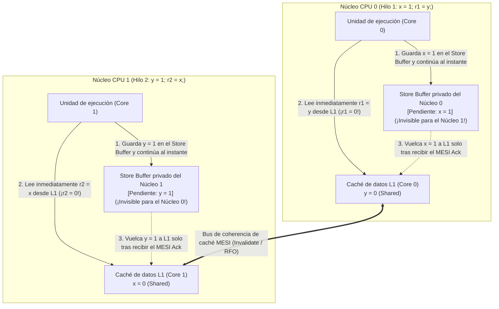
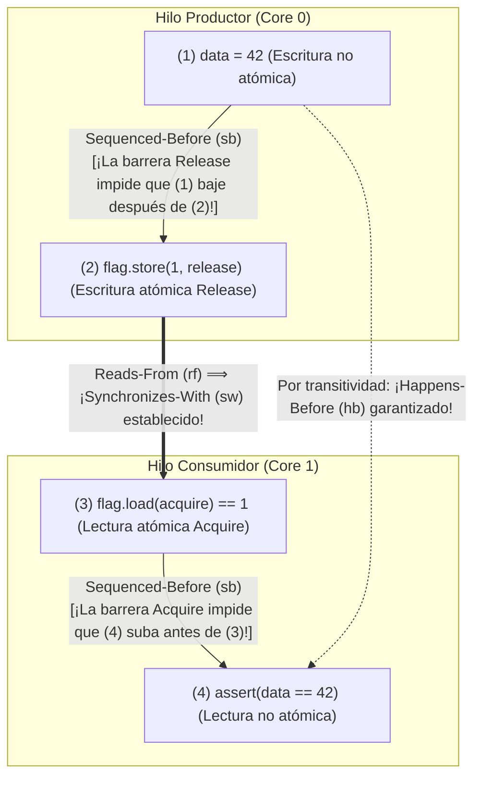

## Introducción: Cuatro líneas de código que desafían la intuición ── La prueba de fuego Store Buffering (`SB`)

Observa el siguiente programa concurrente en C de apenas cuatro instrucciones. Dos variables enteras compartidas `x` e `y` se inicializan en `0`. Dos hilos ejecutándose en dos núcleos de CPU distintos realizan cada uno una escritura (Store) seguida de una lectura (Load):

```c
// Initial state in shared memory:
int x = 0, y = 0;
int r1 = 0, r2 = 0;

// Thread 1 (Core 0)          // Thread 2 (Core 1)
void thread1(void) {          void thread2(void) {
    x = 1;      // (S1)           y = 1;      // (S2)
    r1 = y;     // (L1)           r2 = x;     // (L2)
}                             }
```

¿Qué valores finales de `(r1, r2)` son posibles cuando ambos hilos terminan?
Siguiendo el sentido común:
- Si el Hilo 1 termina antes que el Hilo 2, obtenemos `r1 = 0, r2 = 1`.
- Si el Hilo 2 termina antes que el Hilo 1, obtenemos `r1 = 1, r2 = 0`.
- Si ambos ejecutan su primera línea (`x = 1` e `y = 1`) antes de la segunda, obtenemos `r1 = 1, r2 = 1`.

En cualquier entrelazado imaginable, al menos una escritura de `1` debe ocurrir antes de la lectura del otro hilo; por tanto, <strong>el resultado `r1 == 0 && r2 == 0` parece matemáticamente imposible</strong>. Sin embargo, si compilas y ejecutas este código en un procesador moderno Intel/AMD x86-64, en un chip Apple Silicon (ARMv8) o con un compilador C/C++/Rust con optimización (`-O2`), <strong>¡el resultado «imposible» `r1 == 0 && r2 == 0` ocurre miles de veces por segundo!</strong> No es un fallo del hardware, sino la consecuencia directa del reordenamiento de instrucciones bajo la <strong>regla «As-If» de un solo hilo</strong>.

---

## Capítulo 1: La ilusión de la consistencia secuencial (Sequential Consistency)

En 1979, el ganador del Premio Turing <strong>Leslie Lamport</strong> formalizó el modelo mental intuitivo de los programadores como <strong>consistencia secuencial (Sequential Consistency, SC)</strong>: el resultado de cualquier ejecución es el mismo que si las operaciones de todos los procesadores se ejecutaran en un único orden total global ($\prec_m$), apareciendo las operaciones de cada procesador en el <strong>orden del programa (Program Order, $\prec_p$)</strong> especificado por su código fuente.

Bajo consistencia secuencial, podemos demostrar en tres líneas por qué `r1 == 0 && r2 == 0` es imposible:

$$\text{Program Order: } S_1 \prec_p L_1 \quad \land \quad S_2 \prec_p L_2$$

$$\text{Assume } r_1 = 0 \land r_2 = 0 \implies L_1 \prec_m S_2 \quad \land \quad L_2 \prec_m S_1$$

$$\implies S_1 \prec_p L_1 \prec_m S_2 \prec_p L_2 \prec_m S_1 \implies S_1 \prec S_1 \quad (\text{Contradiction!})$$

Para que $r_1 = 0$, la lectura $L_1$ debe preceder a la escritura $S_2$ ($L_1 \prec_m S_2$). Igualmente, $r_2 = 0$ exige que $L_2 \prec_m S_1$. Al encadenar esto con el orden del programa $S_1 \prec_p L_1$ y $S_2 \prec_p L_2$, surge un <strong>ciclo temporal contradictorio</strong> $S_1 \prec L_1 \prec S_2 \prec L_2 \prec S_1$. No obstante, como `x` e `y` son direcciones distintas sin dependencia de datos dentro de un hilo aislado, el hardware y el compilador rompen este orden global para ocultar la latencia de la memoria.

---

## Capítulo 2: Modelos de memoria en hardware ── Store Buffers, protocolo MESI y colas de invalidación

### 2.1 Coherencia de caché MESI y reordenamiento Store-Load mediante el Store Buffer

En una CPU moderna a 4 GHz, acceder a un registro toma $0.25\text{ ns}$ (1 ciclo) y acertar en la caché L1 toma $\sim 1\text{ ns}$, pero sincronizar cachés entre núcleos o acceder a la memoria DRAM tarda entre $50\text{ y }100\text{ ns}$ (hasta 300 ciclos). Los núcleos mantienen la coherencia mediante el <strong>protocolo MESI (Modified, Exclusive, Shared, Invalid)</strong>. Cuando el Núcleo 0 quiere modificar una línea de caché `x` que está en estado `Shared`, debe enviar un mensaje <strong>Invalidate (Read-For-Ownership, RFO)</strong> a los demás núcleos y esperar su confirmación (Ack).

Para no detener el núcleo decenas de ciclos en cada escritura, todos los procesadores modernos (¡incluidos x86-64!) colocan una cola FIFO privada llamada <strong>Store Buffer (búfer de escritura)</strong> entre la unidad de ejecución y la caché L1:



El Núcleo 0 deposita `x = 1` en su Store Buffer privado (invisible para el Núcleo 1) y lee de inmediato `r1 = y` (`0`) desde su caché L1. Al mismo tiempo, el Núcleo 1 deposita `y = 1` en su propio Store Buffer y lee `r2 = x` (`0`) desde su caché L1. Así, la lectura (Load) adelanta a la escritura previa (Store) en visibilidad global: ¡es el <strong>reordenamiento Store-Load</strong>! (Si el Núcleo 0 vuelve a leer su propia variable `x`, el <strong>Store Buffer Forwarding</strong> le entrega directamente `x = 1` desde su búfer local, preservando la regla As-If de un solo hilo).

### 2.2 Modelo fuerte x86-TSO vs. Arquitecturas débilmente ordenadas (ARMv8, RISC-V, PowerPC)

El modelo <strong>x86-TSO (Total Store Order)</strong> de Intel y AMD mantiene un Store Buffer FIFO estricto: nunca reordena `Load-Load`, `Load-Store` ni `Store-Store`, y <strong>solo permite el reordenamiento `Store -> Load`</strong>. En cambio, <strong>ARMv8-A (AArch64 / Apple Silicon), RISC-V (RVWMO) e IBM PowerPC</strong> emplean <strong>modelos de memoria débilmente ordenados (Weakly Ordered)</strong>: debido a la fusión de escrituras no FIFO, lecturas especulativas fuera de orden y <strong>colas de invalidación (Invalidate Queues)</strong>, <strong>las cuatro combinaciones (`Load-Load`, `Load-Store`, `Store-Store`, `Store-Load`) pueden reordenarse en hardware</strong>.

| Modelo de memoria en hardware | `Load -> Load` | `Load -> Store` | `Store -> Store` | `Store -> Load` | Atomicidad multicopia (MCA) |
| :--- | :---: | :---: | :---: | :---: | :--- |
| <strong>Consistencia Secuencial (SC)</strong> | No | No | No | No | MCA completa |
| <strong>x86 / x64 (TSO)</strong> | No | No | No | <strong>Sí (Store Buffer)</strong> | Other-MCA |
| <strong>ARMv8-A (AArch64)</strong> | <strong>Sí</strong> | <strong>Sí</strong> | <strong>Sí</strong> | <strong>Sí</strong> | Other-MCA |
| <strong>RISC-V (RVWMO)</strong> | <strong>Sí</strong> | <strong>Sí</strong> | <strong>Sí</strong> | <strong>Sí</strong> | Other-MCA |
| <strong>IBM PowerPC</strong> | <strong>Sí</strong> | <strong>Sí</strong> | <strong>Sí</strong> | <strong>Sí</strong> | <strong>No-MCA</strong> |

---

## Capítulo 3: Reordenamiento del compilador y el teorema DRF-SC ── Por qué las carreras de datos son comportamiento indefinido (UB)

Incluso en un procesador x86, el paso de mensajes sin sincronización `data = 42; ready = 1;` falla porque <strong>el compilador optimizador (`gcc`, `clang`, `rustc`) reordena libremente los cuatro tipos de accesos a memoria</strong>. Peor aún: mediante <strong>promoción a registros (Register Promotion) y movimiento de código invariante de bucle (LICM)</strong>, el compilador optimiza `while (!ready)` cargando `ready` en un registro una sola vez antes del bucle, ¡convirtiéndolo en un <strong>bucle infinito</strong>! Además, `volatile` en C/C++ solo sirve para registros MMIO y no emite barreras de memoria de CPU.

En 1990, <strong>Sarita Adve y Mark Hill</strong> demostraron el <strong>teorema DRF-SC (Data-Race-Free Sequential Consistency)</strong>:
- <strong>Carrera de datos (Data Race)</strong>: Dos hilos acceden concurrentemente a la misma dirección de memoria, al menos uno escribe, al menos uno es no atómico y no existe relación <strong>Happens-Before ($\xrightarrow{hb}$)</strong> entre ellos.
- <strong>El contrato DRF-SC</strong>: Si un programa está <strong>libre de carreras de datos (DRF)</strong>, el compilador y el hardware garantizan que toda ejecución se comportará exactamente con <strong>consistencia secuencial (SC)</strong>. Si existe una sola carrera de datos en C/C++ o Rust `unsafe`, todo el programa incurre en <strong>comportamiento indefinido (Undefined Behavior, UB)</strong>.

---

## Capítulo 4: La relación Happens-Before ($\xrightarrow{hb}$) y la sincronización Acquire-Release

En el modelo formal de C++11 / C11 / Rust, cuando el Hilo 1 realiza una escritura atómica <strong>Release</strong> $W_{\text{rel}}(x, v)$ y el Hilo 2 realiza una lectura atómica <strong>Acquire</strong> $R_{\text{acq}}(x, v)$ que observa ese valor ($W_{\text{rel}} \xrightarrow{rf} R_{\text{acq}}$), se establece un puente entre hilos llamado <strong>Synchronizes-With ($\xrightarrow{sw}$)</strong>. La clausura transitiva del orden interno del hilo (<strong>Sequenced-Before, $\xrightarrow{sb}$</strong>) y $\xrightarrow{sw}$ define la relación <strong>Happens-Before ($\xrightarrow{hb}$)</strong>:

$$W_{\text{rel}}(x, v) \xrightarrow{rf} R_{\text{acq}}(x, v) \implies W_{\text{rel}}(x, v) \xrightarrow{sw} R_{\text{acq}}(x, v)$$

$$\xrightarrow{hb} \;\; \triangleq \;\; \left( \xrightarrow{sb} \;\cup\; \xrightarrow{sw} \right)^+$$

Con `memory_order_release` y `memory_order_acquire`, el paso de mensajes queda matemáticamente garantizado:

```cpp
#include <atomic>
#include <cassert>

int data = 0;                        // Non-atomic payload
std::atomic<int> flag{0};            // Atomic synchronization variable

void producer_thread() {
    data = 42;                                           // (1) Sequenced-before (2)
    flag.store(1, std::memory_order_release);            // (2) Release store
}

void consumer_thread() {
    while (flag.load(std::memory_order_acquire) == 0) {  // (3) Acquire load
        // spin until flag == 1
    }
    assert(data == 42);                                  // (4) Guaranteed never to fail!
}
```



Demostración formal:

$$W(\text{data}=42) \xrightarrow{sb} W_{\text{rel}}(\text{flag}=1) \xrightarrow{sw} R_{\text{acq}}(\text{flag}=1) \xrightarrow{sb} R(\text{data})$$

$$\implies W(\text{data}=42) \xrightarrow{hb} R(\text{data}) \implies R(\text{data}) = 42$$

---

## Capítulo 5: Espectro de órdenes de memoria y mapeo a instrucciones de CPU (`MFENCE`, `DMB`, `LDAR`/`STLR`)

C++ y Rust ofrecen tres niveles principales de ordenamiento:
1. <strong>`Relaxed`</strong>: Garantiza solo atomicidad y orden de modificación ($\xrightarrow{mo}$) de una variable individual, sin sincronización $\xrightarrow{sw}$ (ideal para contadores simples).
2. <strong>`Acquire` / `Release` / `AcqRel`</strong>: Barreras unidireccionales (semántica *Roach Motel*) que crean enlaces $\xrightarrow{sw}$, pero <strong>NO impiden el reordenamiento `Store -> Load`</strong> cuando un `store(release)` precede a un `load(acquire)`.
3. <strong>`SeqCst` (por defecto)</strong>: Impone además un <strong>único orden total global $\xrightarrow{S}$</strong> sobre todas las operaciones `SeqCst` y prohíbe el reordenamiento `Store -> Load` (imprescindible para evitar `r1 == 0 && r2 == 0` en la prueba `SB`).

| Operación atómica (C++ / Rust) | Instrucciones x86-64 (TSO) | Instrucciones ARMv8-A (AArch64) | Instrucciones RISC-V (RVWMO) |
| :--- | :--- | :--- | :--- |
| <strong>`load(relaxed)`</strong> | `mov eax, [rdi]` | `ldr w0, [x0]` | `lw a0, 0(a0)` |
| <strong>`load(acquire)`</strong> | <strong>`mov eax, [rdi]`</strong> *(¡Costo cero en hardware!)* | <strong>`ldar w0, [x0]`</strong> *(Load-Acquire)* | `lw a0, 0(a0)` + `fence r, rw` |
| <strong>`store(release, v)`</strong> | <strong>`mov [rdi], esi`</strong> *(¡Costo cero en hardware!)* | <strong>`stlr w1, [x0]`</strong> *(Store-Release)* | `fence rw, w` + `sw a1, 0(a0)` |
| <strong>`store(seq_cst, v)`</strong> | <strong>`xchg [rdi], esi`</strong> *(o `mov` + `mfence`)* | <strong>`stlr w1, [x0]`</strong> *(ordenado con `ldar`)* | `fence rw, rw` + `sw` + `fence rw, rw` |
| <strong>Barrera `fence(seq_cst)`</strong> | <strong>`mfence`</strong> *(o `lock or [rsp], 0`)* | <strong>`dmb ish`</strong> *(Data Memory Barrier)* | <strong>`fence rw, rw`</strong> |

En x86-64, `Acquire` y `Release` se compilan en simples instrucciones `mov` sin costo de hardware, mientras que `store(seq_cst)` emite `xchg` (con prefijo `LOCK` implícito) o `mfence` para vaciar el Store Buffer. En ARMv8-A, las instrucciones dedicadas `LDAR` y `STLR` implementan Acquire-Release y SeqCst sin requerir una costosa barrera completa `DMB ISH`.
